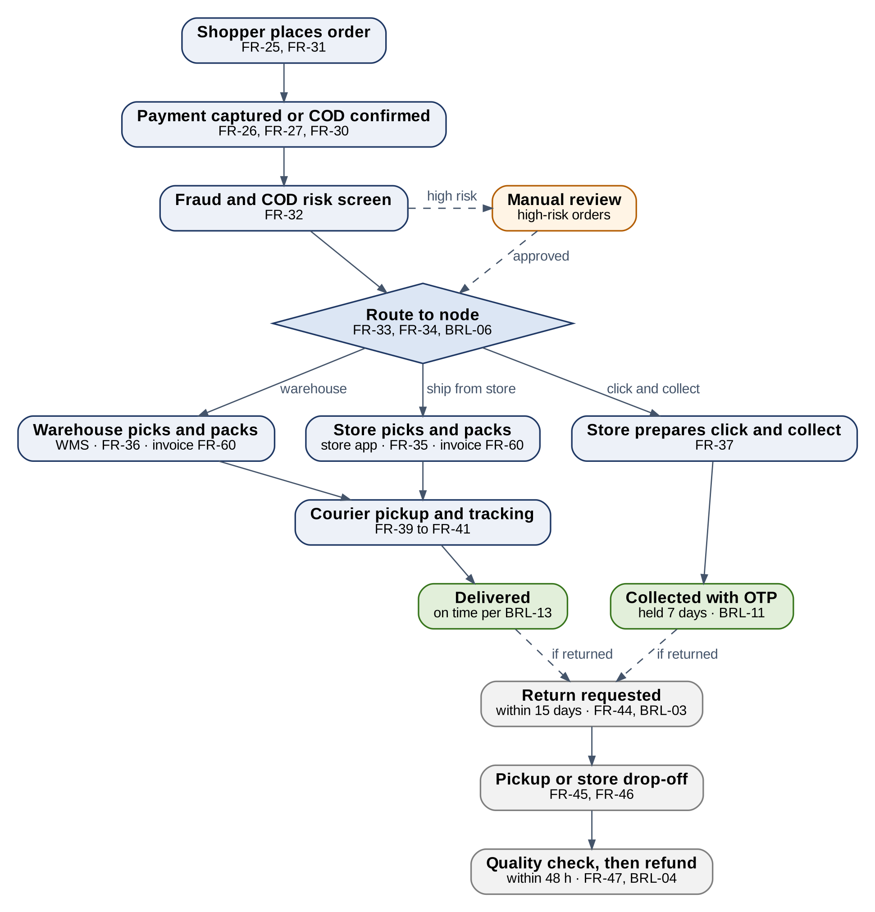

# Business Requirements Document (BRD)

**Tarang Direct: direct-to-consumer e-commerce portal**

Tarang Home & Kitchen Pvt. Ltd. · Version 1.0 · Approved 10 November 2026 · Prepared with the BABOK® Guide v3 template

**Contents**

- [About this example](#about-this-example)
- [Document control](#document-control)
- [1. Executive summary](#1-executive-summary)
- [2. Business need](#2-business-need)
- [3. Current state (as-is)](#3-current-state-as-is)
- [4. Scope](#4-scope)
- [5. Stakeholders](#5-stakeholders)
- [6. Business requirements](#6-business-requirements)
- [7. Stakeholder requirements](#7-stakeholder-requirements)
- [8. Functional requirements](#8-functional-requirements)
- [9. Non-functional requirements](#9-non-functional-requirements)
- [10. Transition requirements](#10-transition-requirements)
- [11. Future state (to-be) and business rules](#11-future-state-to-be-and-business-rules)
- [12. Assumptions, constraints and dependencies](#12-assumptions-constraints-and-dependencies)
- [13. Risks](#13-risks)
- [14. Requirements traceability matrix](#14-requirements-traceability-matrix)
- [15. Requirements quality checklist](#15-requirements-quality-checklist)
- [16. Glossary](#16-glossary)
- [17. Sign-off](#17-sign-off)
- [Appendix A: Decisions and open questions](#appendix-a-decisions-and-open-questions)
- [Appendix B: Regulatory compliance map](#appendix-b-regulatory-compliance-map)
- [Appendix C: References](#appendix-c-references)

# About this example

> *Note: Tarang Home & Kitchen Pvt. Ltd., its people, figures, systems and documents are fictional. Regulatory requirements reflect Indian law as of November 2026 and must be confirmed with legal counsel before use on a real project. Requirement IDs follow the template: BR, SR, FR, NFR and TR for the five BABOK requirement types, BRL for business rules.*

# Document control

| **Field** | **Value** |
|----|----|
| **Project name** | Tarang Direct: direct-to-consumer e-commerce portal |
| **Project ID** | DIG-2026-014 |
| **Organization** | Tarang Home & Kitchen Pvt. Ltd. |
| **Business sponsor** | Meera Iyer, Chief Executive Officer |
| **Product owner** | Rohan Mehta, Head of Digital Commerce |
| **Document owner (business analyst)** | Kavya Nair, Lead Business Analyst |
| **Current version** | 1.0 |
| **Document status** | Approved and baselined |
| **Last updated** | 2026-11-10 |
| **Related documents** | Business case BC-2026-07; solution architecture SA-DIG-014 (in progress); test strategy TS-DIG-014 (in progress) |

## Version history

| **Version** | **Date** | **Author** | **Summary of changes** |
|----|----|----|----|
| 0.1 | 2026-09-14 | Kavya Nair | Initial draft from discovery interviews and current-state analysis |
| 0.2 | 2026-10-05 | Kavya Nair | Stakeholder and functional requirements added after six elicitation workshops |
| 0.3 | 2026-10-23 | Kavya Nair | Compliance requirements revised after Legal review; non-functional requirements added with IT |
| 0.9 | 2026-11-04 | Kavya Nair | Review draft; all requirements checked against the quality checklist (section 15) |
| 1.0 | 2026-11-10 | Kavya Nair | Approved by the steering committee and baselined |

## Reviewers and approvers

| **Name** | **Role** | **Review or approve** | **Date reviewed** |
|----|----|----|----|
| Meera Iyer | CEO, business sponsor | Approve | 2026-11-10 |
| Sanjay Kulkarni | Chief Financial Officer | Approve | 2026-11-07 |
| Rohan Mehta | Head of Digital Commerce, product owner | Approve | 2026-11-06 |
| Farhan Sheikh | Head of Retail Operations | Approve | 2026-11-07 |
| Vikram Desai | Chief Information Officer | Approve | 2026-11-06 |
| Arjun Menon | Head of Legal and Compliance | Approve | 2026-11-08 |
| Lakshmi Prasad | Head of Supply Chain | Review | 2026-11-05 |
| Ananya Bose | Head of Marketing | Review | 2026-11-05 |
| Priya D'Souza | Head of Customer Service | Review | 2026-11-05 |
| Sneha Pillai | QA Lead | Review | 2026-11-04 |

# 1. Executive summary

Tarang sells home décor, kitchenware and furnishings through 38 stores in 11 cities. Online, it sells only through third-party marketplaces: ₹59 crore in FY2025-26, or 14% of revenue. Commissions, fees and marketplace advertising take 31% of that revenue, and Tarang owns none of the customer relationships.

Tarang Direct is a direct-to-consumer e-commerce portal (responsive website and progressive web app) selling Tarang's own inventory. It links stock in 2 warehouses and 12 pilot stores, so customers can order for home delivery or collect from a store, and it brings the 9.2-lakh-member Tarang Circle loyalty programme online.

In its first 12 months the portal targets ₹45 crore of net revenue, a channel cost of 18% or less, 4 lakh registered customers with marketing consent, and an online Net Promoter Score of 45. It must comply from launch with the Consumer Protection (E-Commerce) Rules 2020, the Dark Patterns Guidelines 2023, Legal Metrology rules, RBI card-data rules and the DPDP Act and Rules, whose core obligations apply from 13 May 2027.

Release 1 goes live on 15 April 2027 for ₹6.8 crore capital and ₹2.1 crore a year running cost (business case BC-2026-07). The biggest risk is inaccurate store stock, which would cause cancelled ship-from-store orders, so store fulfilment starts in 12 stores and expands only when each store reaches 97% stock accuracy. **Decision:** the steering committee approved these requirements on 10 November 2026; solution design starts on 16 November 2026.

# 2. Business need

## 2.1 Problem statement

|  |  |
|----|----|
| **The problem of** | selling online only through third-party marketplaces, with store and online stock managed separately |
| **affects** | Tarang's margins and customers, and its store, supply chain and marketing teams |
| **the impact of which is** | ₹18.3 crore (31% of online revenue) paid in channel costs in FY2025-26; no first-party data on online customers; 23% of SKUs shown "out of stock" online held in at least one store; 17% of stock value older than 180 days |
| **a successful solution would** | let customers buy directly from Tarang online, with one view of stock across warehouses and stores and one loyalty programme |

## 2.2 Strategic alignment

Tarang's 2030 strategy, "Every Room, Every Channel" (approved by the board in March 2026), targets 30% of revenue from digital channels by FY2029-30, at least half of it through Tarang-owned channels. Tarang Direct is the first initiative under the strategy's "Own the customer" pillar.

## 2.3 Cost of doing nothing

- Marketplace costs rose from 26% to 31% of online revenue between FY2023-24 and FY2025-26. At current growth they reach about ₹27 crore a year by FY2027-28.

- Tarang cannot contact its online buyers, so it pays for every repeat online sale again through marketplace advertising.

- Store stock that is not visible online keeps ageing and is cleared at an average markdown of 38%.

## 2.4 Business case

Business case BC-2026-07, approved on 2026-08-22: capital cost ₹6.8 crore, running cost ₹2.1 crore a year, payback in 28 months, and five-year net present value of ₹14.2 crore at a 12% discount rate.

# 3. Current state (as-is)

## 3.1 Process overview: online orders today

1.  Merchandisers keep product data in spreadsheets and upload listings separately to each marketplace's seller portal.

2.  The ERP sends warehouse stock to the marketplaces every 6 hours. Store stock is not shared online.

3.  Marketplace orders download to the warehouse management system (WMS) at the Bengaluru and Bhiwandi warehouses.

4.  Warehouse staff pick and pack orders and hand them to the marketplace's courier.

5.  Returns go back to the warehouses. The marketplace refunds the customer and deducts the amount from Tarang's settlement.

6.  Customer contact details, order history and reviews stay with the marketplace.

7.  In stores, the point-of-sale (POS) system records Tarang Circle points. Points cannot be earned or used online.

As-is process map: SharePoint › Tarang Direct › Discovery › AsIs_Online_Orders_v2.bpmn

## 3.2 Pain points

| **ID** | **Pain point** | **Who is affected** | **Evidence** |
|----|----|----|----|
| PP-01 | Channel costs take 31% of online revenue | Finance | FY2025-26 marketplace settlements: ₹18.3 crore on ₹59 crore |
| PP-02 | No direct relationship with online customers | Marketing | Marketplaces share no customer contact data |
| PP-03 | Products show as out of stock online while stores hold them | Customers, supply chain | 23% of SKUs shown out of stock online in Q1 FY2026-27 were in stock in at least one store |
| PP-04 | New products take 9 days to go live online | Merchandising | Average from ERP creation to live listing, sample of 120 SKUs |
| PP-05 | Loyalty members cannot earn or redeem points online | Loyalty members, customer service | 2,140 service contacts about online points in FY2025-26 |
| PP-06 | Aged stock builds up in stores | Retail operations | 17% of stock value older than 180 days (September 2026) |
| PP-07 | Brand presentation is limited to marketplace templates | Marketing | Room sets, buying guides and bundles cannot be shown |

## 3.3 Systems and data in use

| **System** | **Purpose** | **Owner** | **Change needed for Tarang Direct** |
|----|----|----|----|
| ERP | Product master, prices, purchasing, finance, GST | Finance IT | Send products, prices and stock; receive orders, invoices, returns and settlements |
| Store POS (38 stores) | Store sales, store stock, Tarang Circle points | Retail IT | Stock updates every 5 minutes and a loyalty balance service; upgrade to v8 (D-03) |
| WMS (2 warehouses) | Picking, packing, dispatch | Supply chain | Accept portal orders; print shipping labels |
| Marketplace seller portals | Listings, orders, settlements | Digital commerce | No change in Release 1 |
| Product spreadsheets | Product content | Merchandising | Retire after migration (TR-01) |
| Shared email inbox and phone line | Customer service | Customer service | Replace with a ticketing system (FR-52) |
| Catalogue website (tarang.example) | Brand pages and store locator; no selling | Marketing | Replace with the portal and redirect its URLs (TR-09) |

# 4. Scope

## 4.1 In scope (Release 1)

- Responsive website and progressive web app (PWA) in English, for customers in India

- Catalogue of about 6,500 SKUs across décor, kitchen, dining, bed and bath, and storage

- Search, browsing, filters (including country of origin) and product pages with all legally required declarations

- Customer accounts, guest checkout, and a consent and privacy centre

- Cart, pricing, promotions and coupons

- Checkout with UPI, cards (tokenised), net banking, wallets and cash on delivery

- Order management, with fulfilment from 2 warehouses and 12 pilot stores in Bengaluru, Pune and Hyderabad

- Home delivery through a logistics aggregator, next-day express in the 3 pilot cities, and click and collect at pilot stores

- Order tracking, cancellations, returns, exchanges and refunds

- Tarang Circle loyalty, with one points balance shared by stores and the portal

- Ratings and reviews from verified buyers

- Customer service ticketing and the grievance redressal mechanism

- Content management, consent-based marketing messages and analytics

- GST invoicing, payment reconciliation and ERP integration

## 4.2 Out of scope

| **Item** | **Reason** | **Planned for** |
|----|----|----|
| Native Android and iOS apps | The PWA meets launch needs; apps follow once usage data is available | Release 2 (Q4 2027) |
| Hindi and regional-language storefront | Prioritised after launch; consent notices are still offered in Hindi (FR-15) | Release 2 |
| Third-party sellers (marketplace model) | Tarang sells only its own inventory (DEC-01) | Not planned |
| International shipping | Low demand; customs and tax complexity | Not planned |
| Corporate and bulk orders | Handled by the existing B2B sales team | Review in 2028 |
| Changes to marketplace channels | Marketplace selling continues unchanged | — |
| Ship-from-store in the other 26 stores | Depends on pilot stock accuracy (RSK-01) | Release 1.1 onward |
| Augmented-reality room visualiser | Not needed to meet launch objectives | Backlog |

## 4.3 Affected areas

| **Area** | **Included** |
|----|----|
| **Business units** | Digital commerce, merchandising, marketing, retail operations (12 pilot stores), supply chain (2 warehouses), customer service, finance, legal |
| **Locations** | Delivery to serviceable pincodes across India; store fulfilment in Bengaluru (5 stores), Pune (4) and Hyderabad (3) |
| **Systems** | New: commerce platform, order management, ticketing, consent management. Changed: ERP, POS, WMS. Retired: product spreadsheets, catalogue website |
| **External parties** | Customers, payment aggregator, logistics aggregator, SMS, WhatsApp and email providers |

## 4.4 Release plan

| **Release** | **Target date** | **Scope** |
|----|----|----|
| Soft launch (invite only) | 2027-03-22 | All Release 1 features for employees and 2,000 invited loyalty members |
| Release 1 (public launch) | 2027-04-15 | Everything in 4.1 |
| Release 1.1 | 2027-07-15 | Ship-from-store in 10 more stores that meet TR-04 |
| Release 2 | 2027-10-31 | Native apps, Hindi storefront, delivery slots for bulky items |

# 5. Stakeholders

## 5.1 Stakeholder register

| **Stakeholder or group** | **BABOK role** | **Main interest** | **Influence** | **RACI** |
|----|----|----|----|----|
| Meera Iyer, CEO | Sponsor | Strategic growth, return on investment | High | A |
| Rohan Mehta, Head of Digital Commerce | Domain SME, product owner | Portal revenue, customer experience | High | R |
| Kavya Nair, Lead Business Analyst | Business analyst | Complete, testable requirements | Medium | R |
| Neha Kapoor, Programme Manager | Project manager | Scope, schedule, budget | Medium | C |
| Sanjay Kulkarni, CFO | Sponsor (finance) | Channel cost, reconciliation, controls | High | C |
| Farhan Sheikh, Head of Retail Operations | Domain SME | Store workload, stock accuracy | High | C |
| Lakshmi Prasad, Head of Supply Chain | Domain SME | Warehouse flow, logistics cost | Medium | C |
| Ananya Bose, Head of Marketing | Domain SME | Customer data, campaigns, brand | Medium | C |
| Priya D'Souza, Head of Customer Service | Operational support | Contact volumes, grievance timelines | Medium | C |
| Arjun Menon, Head of Legal and Compliance | Regulator (internal) | Legal compliance; acts as grievance officer | High | C |
| Vikram Desai, CIO | Implementation SME | Architecture, integration | High | C |
| Deepak Joshi, Chief Information Security Officer | Implementation SME | Security and privacy controls | Medium | C |
| Sneha Pillai, QA Lead | Tester | Testable acceptance criteria | Low | C |
| Store managers and staff, 12 pilot stores | End user | Fulfilment effort, incentives | Medium | C |
| Online shoppers | Customer | Range, price, delivery, easy returns | High | I |
| Payment and logistics aggregators | Supplier | Integration, volumes, service levels | Medium | I |
| Central Consumer Protection Authority; Data Protection Board of India | Regulator (external) | Compliance with consumer and data protection law | High | I |

## 5.2 Target customer segments

| **Segment** | **Description** | **Main needs** | **Share of year-1 revenue (plan)** |
|----|----|----|----|
| Home refreshers | Urban households aged 30–50 updating rooms each season | Ideas, room sets, fast delivery | 45% |
| First-home setters | Couples and young professionals aged 25–34 furnishing a new home | Value bundles, EMI, easy returns | 30% |
| Gift buyers | Buyers for weddings, housewarmings and festivals | Gift wrap, a delivery date they can rely on | 15% |
| Loyalty regulars | Tarang Circle members who mostly shop in store | One points balance, click and collect | 10% |

# 6. Business requirements

Each business requirement states an outcome Tarang needs from the portal, with a measure, a baseline and a target.

| **ID** | **Requirement** | **Measure: baseline → target** | **Source** | **Priority** | **Status** |
|----|----|----|----|----|----|
| BR-01 | Tarang shall earn net revenue through its own e-commerce portal. | Portal net revenue (BRL-12): ₹0 → ₹45 crore in the first 12 months after launch | CEO; business case BC-2026-07 | Must | Approved |
| BR-02 | Tarang shall reduce the cost of selling online. | Channel cost (payment fees, logistics, performance marketing) as % of portal net revenue: 31% on marketplaces → 18% or less by month 6 | CFO | Must | Approved |
| BR-03 | Tarang shall build a base of online customers it can contact directly. | Registered portal customers with marketing consent: 0 → 4 lakh within 12 months of launch | Head of Marketing | Must | Approved |
| BR-04 | Tarang shall reduce aged stock by selling store stock online. | Stock older than 180 days as % of stock value: 17% → 12% by 2028-03-31 | Head of Retail Operations | Should | Approved |
| BR-05 | Tarang shall use its stores to fulfil online orders. | Share of portal orders fulfilled by a store (ship-from-store or click and collect): 0% → 20% by month 12 | Head of Retail Operations | Should | Approved |
| BR-06 | Tarang shall give online customers an experience they recommend. | Online Net Promoter Score: no baseline → 45 or higher by month 6 | Head of Digital Commerce | Must | Approved |
| BR-07 | Tarang shall run the portal in compliance with Indian law from launch. | Open gaps in Legal's compliance audit (Appendix B): 0 at go-live, and no high-severity findings in any 6-monthly audit | Head of Legal and Compliance | Must | Approved |

Supporting measures on the launch dashboard (FR-59): conversion rate (plan 2.2%), average order value (plan ₹2,400), orders on time (target 95%, BRL-13), return rate (plan 9% or less) and payment success rate (target 90% or more).

# 7. Stakeholder requirements

Each stakeholder requirement states what one group needs from the portal and traces back to at least one business requirement.

| **ID** | **Stakeholder group** | **Requirement** | **Traces to** | **Priority** | **Status** |
|----|----|----|----|----|----|
| SR-01 | Shoppers | Shoppers need to find products quickly by room, category, price, material and colour. | BR-01, BR-06 | Must | Approved |
| SR-02 | Shoppers | Shoppers need to see the full price, including every charge, before they pay. | BR-06, BR-07 | Must | Approved |
| SR-03 | Shoppers | Shoppers need to check out quickly, as a guest or signed in, and pay by their preferred method, including UPI and cash on delivery. | BR-01 | Must | Approved |
| SR-04 | Shoppers | Shoppers need to know when an order will arrive before they buy, and to track it afterwards. | BR-06 | Must | Approved |
| SR-05 | Shoppers | Shoppers need to cancel, return or exchange items easily and get refunds quickly. | BR-06 | Must | Approved |
| SR-06 | Loyalty members | Loyalty members need to earn and redeem Tarang Circle points online and in store from one balance. | BR-03 | Must | Approved |
| SR-07 | Shoppers | Shoppers need to buy online and collect from, or return to, a nearby store. | BR-05 | Should | Approved |
| SR-08 | Shoppers | Shoppers need to control how their personal data is used and to withdraw consent easily. | BR-03, BR-07 | Must | Approved |
| SR-09 | Store staff | Store staff need to see, pick and pack online orders for their store without disrupting floor sales. | BR-04, BR-05 | Should | Approved |
| SR-10 | Warehouse team | The warehouse team needs portal orders to arrive in the WMS with packing instructions and shipping labels. | BR-01 | Must | Approved |
| SR-11 | Customer service agents | Agents need one view of a customer's orders, payments, returns and contacts so they can resolve issues on first contact. | BR-06 | Must | Approved |
| SR-12 | Merchandising team | Merchandisers need to publish products, prices and promotions online without IT help. | BR-01, BR-04 | Must | Approved |
| SR-13 | Marketing team | Marketers need to message and measure customers who have consented, by segment. | BR-02, BR-03 | Should | Approved |
| SR-14 | Finance team | Finance needs every payment, refund and COD remittance reconciled daily, and correct GST invoices. | BR-02, BR-07 | Must | Approved |
| SR-15 | Legal and compliance | Legal needs evidence that the portal meets consumer protection, legal metrology and data protection obligations. | BR-07 | Must | Approved |
| SR-16 | Information security | The security team needs customer and payment data protected and attacks detected quickly. | BR-07 | Must | Approved |
| SR-17 | Leadership team | The leadership team needs to track portal results against the business targets every week. | BR-01, BR-02, BR-03, BR-04, BR-05, BR-06 | Must | Approved |

# 8. Functional requirements

Functional requirements describe what the portal must do, grouped by capability. QA can test each acceptance criterion directly; detailed test cases will be in test strategy TS-DIG-014.

## 8.1 Catalogue and product content

| **ID** | **Requirement** | **Acceptance criteria** | **Traces to** | **Priority** | **Status** |
|----|----|----|----|----|----|
| FR-01 | The system shall import product master data (SKU, title, category, attributes, HSN code, GST rate, MRP, dimensions, weight, country of origin) from the ERP every 15 minutes. | A product created or changed in the ERP appears in portal admin within 15 minutes; records that fail validation appear in a daily error report to Merchandising. | SR-12 | Must | Approved |
| FR-02 | The system shall let merchandisers add descriptions, images, videos, care instructions and room tags to a product, and schedule when it goes live. | A merchandiser creates and schedules a product page with no IT help; the page goes live within 5 minutes of the scheduled time. | SR-12 | Must | Approved |
| FR-03 | The system shall show on every product page the declarations required by the Legal Metrology (Packaged Commodities) Rules, including manufacturer, packer or importer name and address, country of origin, generic name, net quantity, MRP inclusive of all taxes, and consumer care details. | A product cannot be published while any mandatory declaration is empty; Legal confirms the field list before user acceptance testing (Appendix B). | SR-15 | Must | Approved |
| FR-04 | The system shall show on every product page the return, exchange and refund terms, the warranty, and Tarang's legal name and address as seller. | Terms shown match the policy set for the product's category; the full policy is one click away. | SR-02, SR-15 | Must | Approved |
| FR-05 | The system shall support product variants (size, colour, finish), each with its own images, price and stock. | Choosing a variant updates image, price, stock and delivery date without reloading the page. | SR-01 | Must | Approved |
| FR-06 | The system shall support room-set bundles of up to 8 SKUs sold at a bundle price. | Bundle stock equals the lowest stock of its components; returning one item refunds that item's share of the bundle price shown at purchase. | SR-01, SR-12 | Should | Approved |
| FR-07 | The system shall reject any selling price above the product's MRP (BRL-09). | Saving or importing a price above MRP fails with an error, and the attempt is logged. | SR-15 | Must | Approved |

## 8.2 Search and navigation

| **ID** | **Requirement** | **Acceptance criteria** | **Traces to** | **Priority** | **Status** |
|----|----|----|----|----|----|
| FR-08 | The system shall provide search with suggestions as the shopper types, tolerance for spelling mistakes, and synonyms, including common Indian terms (for example "bedsheet", "bed sheet" and "chaddar"). | For the agreed list of 200 top search terms, a relevant product is in the top 5 results for at least 90% of terms; suggestions appear within 300 ms. | SR-01 | Must | Approved |
| FR-09 | The system shall let shoppers filter listings by category, room, price, colour, material, rating, discount, delivery to their pincode and country of origin, and sort by relevance, price, newest and rating. | Filter counts update without a page reload; a country-of-origin filter appears on every listing that contains imported products (Legal Metrology Rule 6(10A)). | SR-01, SR-15 | Must | Approved |
| FR-10 | The system shall show availability and the estimated delivery date for the shopper's pincode on listing and product pages. | With a pincode entered, each product shows "Delivery by \<date\>" or "Not deliverable to this pincode"; the pincode is remembered for the session. | SR-04 | Must | Approved |
| FR-11 | The system shall show stock at pilot stores within 10 km of the shopper's pincode. | Store stock shown equals POS stock less safety stock (BRL-05) and is no more than 5 minutes old. | SR-07 | Should | Approved |
| FR-12 | The system shall recommend related products ("Complete the look") on product and cart pages. | Recommendations never include out-of-stock items or items that cannot be delivered to the shopper's pincode. | SR-01 | Could | Approved |
| FR-13 | The system shall offer the storefront in Hindi. | Not applicable to Release 1. | SR-01 | Won't | Deferred to Release 2 |

## 8.3 Accounts, consent and privacy

| **ID** | **Requirement** | **Acceptance criteria** | **Traces to** | **Priority** | **Status** |
|----|----|----|----|----|----|
| FR-14 | The system shall let shoppers register and sign in with a mobile number and one-time password (OTP), or with email and password, and shall allow guest checkout. | A guest completes checkout without creating an account; an OTP expires after 5 minutes and locks after 3 failed attempts. | SR-03 | Must | Approved |
| FR-15 | The system shall ask for consent to marketing (email, SMS, WhatsApp) and to personalisation separately, each with the itemised notice the DPDP Rules require. | No consent box is pre-ticked; the notice lists the data collected, the purpose, and how to withdraw consent or complain to the Data Protection Board; it is available in English and Hindi; each consent record stores notice version, time and channel. | SR-08, SR-15 | Must | Approved |
| FR-16 | The system shall provide a privacy centre where customers can view and download their data, correct it, withdraw any consent, nominate a person to act for them, and ask for erasure. | Withdrawing a consent takes no more steps than giving it and takes effect in all messaging tools within 24 hours; erasure requests are completed, or refused with a reason, within 30 days. | SR-08 | Must | Approved |
| FR-17 | The system shall store several delivery addresses for each customer, with pincode validation. | An address with an invalid or unserviceable pincode cannot be chosen for delivery, and the shopper is told why. | SR-03 | Must | Approved |
| FR-18 | The system shall give each customer an account page showing orders, returns, invoices, loyalty balance and wishlist. | Every order from the last 3 years is listed with its status and a downloadable GST invoice. | SR-04, SR-05 | Must | Approved |

## 8.4 Cart, pricing and promotions

| **ID** | **Requirement** | **Acceptance criteria** | **Traces to** | **Priority** | **Status** |
|----|----|----|----|----|----|
| FR-19 | The system shall keep a signed-in shopper's cart for 30 days across devices, and a guest's cart for 7 days on the same device. | Items added on a phone appear in the cart on a laptop after sign-in, with current prices and stock. | SR-03 | Should | Approved |
| FR-20 | The system shall show selling price, MRP and discount on listings, and an itemised total (items, discounts, delivery, COD fee, gift wrap, taxes included) in the cart and at every checkout step. | The amount charged equals the cart total shown before checkout plus only charges the shopper chose; no fee first appears on the payment step. | SR-02, SR-15 | Must | Approved |
| FR-21 | The system shall support percentage and flat discounts, buy-X-get-Y offers, bundle prices, free-delivery thresholds, and coupon codes limited by dates, uses per customer, total uses, minimum cart value and excluded categories. | Merchandisers set up and schedule each promotion type without IT help; stacking follows BRL-08 in all 25 test scenarios. | SR-12, SR-13 | Must | Approved |
| FR-22 | The system shall show stock or urgency messages only when they reflect live data, and shall never use countdown timers that restart. | "Only N left" appears only when available stock is 5 or fewer and N equals that stock; Legal's dark-pattern review finds no false urgency. | SR-15 | Must | Approved |
| FR-23 | The system shall never add a product, service, donation or charge to the cart without the shopper's explicit action. | No checkbox or add-on is pre-selected anywhere in the purchase journey. | SR-15 | Must | Approved |
| FR-24 | The system shall offer gift wrap and a gift message, with prices left off the packing slip. | The gift wrap charge (₹99) is shown before payment; the packing slip shows no prices. | SR-03 | Could | Approved |

## 8.5 Checkout and payments

| **ID** | **Requirement** | **Acceptance criteria** | **Traces to** | **Priority** | **Status** |
|----|----|----|----|----|----|
| FR-25 | The system shall provide a checkout of no more than 4 steps (address, delivery option, payment, review) offering standard delivery, express delivery and click and collect where available. | A signed-in shopper with a saved address completes checkout in 4 steps or fewer; unavailable delivery options are shown as unavailable with a reason. | SR-03, SR-04 | Must | Approved |
| FR-26 | The system shall accept UPI (app, QR code and collect request), debit and credit cards, net banking and major wallets through an RBI-authorised payment aggregator. | Each method completes a test payment and a test refund in user acceptance testing; payment options load within 2 seconds. | SR-03 | Must | Approved |
| FR-27 | The system shall offer cash on delivery (COD) within the limits in BRL-02 and ask for OTP confirmation of COD orders over ₹5,000. | COD is hidden for ineligible orders, pincodes and customers; the COD fee is shown before the order is placed. | SR-03 | Must | Approved |
| FR-28 | The system shall let customers save cards only as card-network or bank tokens, with explicit consent, and shall never store the card number, expiry date or CVV. | A security review and database scan find no card numbers, expiry dates or CVVs in portal systems or logs; only the token reference and last 4 digits are stored. | SR-15, SR-16 | Must | Approved |
| FR-29 | The system shall offer EMI on eligible cards for orders of ₹3,000 or more. | EMI tenures and interest are shown before payment; whether no-cost EMI is offered depends on Q-01. | SR-03 | Could | Approved |
| FR-30 | The system shall resolve payments with an unknown status: confirm the order if payment succeeded, or start an automatic refund if it cannot be confirmed. | No payment stays unresolved for more than 30 minutes; the customer is told the outcome by SMS and email. | SR-03, SR-14 | Must | Approved |
| FR-31 | The system shall place an order only when the shopper selects an explicit "Place order" button, and shall then show and send an order confirmation. | The confirmation page, email and SMS show order number, items, amount paid, delivery date and payment method within 2 minutes. | SR-04, SR-15 | Must | Approved |
| FR-32 | The system shall screen orders for fraud and COD risk (repeat-attempt checks, address and device signals, previous refused deliveries) before releasing them to fulfilment. | High-risk orders go to a review queue; at least 98% of orders are released within 10 minutes. | SR-16 | Should | Approved |

## 8.6 Order management and fulfilment

| **ID** | **Requirement** | **Acceptance criteria** | **Traces to** | **Priority** | **Status** |
|----|----|----|----|----|----|
| FR-33 | The system shall calculate available-to-promise (ATP) stock for each SKU at each node (2 warehouses, 12 stores) as on-hand minus reserved minus safety stock, and reserve stock when an order is placed. | ATP reflects POS and WMS changes within 5 minutes; two shoppers cannot both buy the last unit. | SR-09, SR-10 | Must | Approved |
| FR-34 | The system shall route each order to a fulfilment node using BRL-06, and split it into separate shipments only when no single node can fulfil the whole order by the promised date. | In 40 routing test scenarios the chosen node matches BRL-06; a split shipment is shown to the shopper before payment. | SR-09, SR-10 | Must | Approved |
| FR-35 | The system shall give store staff a fulfilment app (tablet and handheld scanner) to accept, pick by barcode scan, pack and label orders. | A store picks and packs an order received before 4 pm within 4 business hours; scanning a wrong item blocks packing. | SR-09 | Should | Approved |
| FR-36 | The system shall send warehouse orders to the WMS with packing instructions, gift options and shipping label data. | Orders reach the WMS within 5 minutes of release; WMS status updates reach the portal within 5 minutes. | SR-10 | Must | Approved |
| FR-37 | The system shall support click and collect at pilot stores: notify the customer when the order is ready, hold it for 7 days, and hand it over only against an OTP. | "Ready for pickup" is sent within 4 hours of ordering for in-stock items; uncollected orders are cancelled and refunded on day 8 (BRL-11). | SR-07 | Should | Approved |
| FR-38 | The system shall let customers cancel all or part of an order free of charge until it is dispatched. | The cancel option disappears at dispatch; refunds follow BRL-04. | SR-05 | Must | Approved |

## 8.7 Delivery and tracking

| **ID** | **Requirement** | **Acceptance criteria** | **Traces to** | **Priority** | **Status** |
|----|----|----|----|----|----|
| FR-39 | The system shall integrate with the logistics aggregator for serviceability, rates, shipment creation, labels, pickup booking and tracking events. | Shipment creation succeeds for 99.5% of attempts; tracking events reach the portal within 15 minutes. | SR-04, SR-10 | Must | Approved |
| FR-40 | The system shall calculate the promised delivery date from node stock, cut-off time, processing time and courier transit time to the pincode. | In the first 3 months, at least 95% of orders are on time (BRL-13). | SR-04 | Must | Approved |
| FR-41 | The system shall provide a tracking page and send status messages at dispatch, out for delivery, delivery, and any delay. | A delay message with a new expected date is sent within 2 hours of the courier reporting a delay. | SR-04 | Must | Approved |
| FR-42 | The system shall offer next-day express delivery in Bengaluru, Pune and Hyderabad under BRL-14. | Express is offered only when BRL-14 conditions are met; at least 95% of express orders arrive the next day. | SR-04 | Should | Approved |
| FR-43 | The system shall let customers reschedule a delivery or correct the address after a failed attempt, through a link sent by SMS and WhatsApp. | The courier receives the customer's instruction within 1 hour; the shipment returns to the sender after 3 failed attempts. | SR-04 | Should | Approved |

## 8.8 Returns, exchanges and refunds

| **ID** | **Requirement** | **Acceptance criteria** | **Traces to** | **Priority** | **Status** |
|----|----|----|----|----|----|
| FR-44 | The system shall let customers request a return or exchange online within the return window (BRL-03), giving a reason and optional photos. | Ineligible items show why they cannot be returned; an eligible request takes no more than 3 steps. | SR-05 | Must | Approved |
| FR-45 | The system shall book a return pickup with the logistics aggregator. | A pickup is offered within 2 business days on every serviceable pincode. | SR-05 | Must | Approved |
| FR-46 | The system shall let customers return portal orders at any pilot store. | Store staff find the order by order number or mobile number; the refund starts the same way as for a pickup return. | SR-07 | Should | Approved |
| FR-47 | The system shall refund customers under BRL-04 and show refund status in their account. | Refunds start within 48 hours of a return passing quality check; COD customers choose UPI, bank transfer or store credit. | SR-05, SR-14 | Must | Approved |
| FR-48 | The system shall let customers report items damaged in transit within 48 hours of delivery, with photos. | A report creates a ticket with the photos attached and offers a replacement or a refund. | SR-05 | Should | Approved |

## 8.9 Loyalty

| **ID** | **Requirement** | **Acceptance criteria** | **Traces to** | **Priority** | **Status** |
|----|----|----|----|----|----|
| FR-49 | The system shall link a portal account to a Tarang Circle membership using the customer's mobile number and an OTP, giving one points balance across stores and the portal. | Points earned in a store appear online within 5 minutes, and points earned online appear in store within 5 minutes. | SR-06 | Must | Approved |
| FR-50 | The system shall apply the earn and redemption rules in BRL-07 at checkout and on the account page. | Points are credited only after the return window closes; redemption is capped at 20% of order value. | SR-06 | Must | Approved |

## 8.10 Ratings and reviews

| **ID** | **Requirement** | **Acceptance criteria** | **Traces to** | **Priority** | **Status** |
|----|----|----|----|----|----|
| FR-51 | The system shall collect ratings and reviews only from verified buyers (BRL-10) after delivery, and moderate and publish them under a published policy aligned to IS 19000:2022. | Reviews are published or rejected within 48 hours; negative reviews are not suppressed; the average rating includes all published reviews. | SR-01, SR-15 | Should | Approved |

## 8.11 Customer service and grievances

| **ID** | **Requirement** | **Acceptance criteria** | **Traces to** | **Priority** | **Status** |
|----|----|----|----|----|----|
| FR-52 | The system shall give agents a ticketing tool with a single customer view of orders, payments, returns, loyalty and past contacts. | An agent finds a customer by order number, mobile number or email in under 10 seconds. | SR-11 | Must | Approved |
| FR-53 | The system shall create a ticket for every phone, email, web chat and WhatsApp contact and give the customer a ticket number. | Every channel creates tickets automatically; the customer receives the ticket number within 5 minutes. | SR-11 | Must | Approved |
| FR-54 | The system shall support the grievance redressal mechanism: show the grievance officer's name, designation and contact details on the website, acknowledge each complaint within 48 hours, and resolve it within one month. | Timers escalate at 36 hours (acknowledgement) and on day 21 (resolution); the monthly report shows 100% of complaints acknowledged within 48 hours. | SR-11, SR-15 | Must | Approved |
| FR-55 | The system shall let agents cancel orders, start returns and give goodwill credit of up to ₹500 with a reason code. | Every agent action is logged with agent, time and reason; credit over ₹500 needs a supervisor's approval. | SR-11 | Should | Approved |

## 8.12 Content, marketing and analytics

| **ID** | **Requirement** | **Acceptance criteria** | **Traces to** | **Priority** | **Status** |
|----|----|----|----|----|----|
| FR-56 | The system shall provide a content management system (CMS) for pages, banners, store pages and policies, with draft, approval and scheduled publishing. | Policy pages (returns, privacy, terms, grievance) show a version and effective date; only Legal can approve policy changes. | SR-12, SR-15 | Must | Approved |
| FR-57 | The system shall send triggered messages (abandoned cart, back in stock, review request) only to customers who have given the matching consent. | Messages are suppressed for customers without consent in 100% of test cases; every message has a one-step opt-out. | SR-08, SR-13 | Should | Approved |
| FR-58 | The system shall let marketers build customer segments and export them to marketing tools, limited to customers with marketing consent. | Exports exclude customers who withdrew consent, including withdrawals in the last 24 hours. | SR-13 | Should | Approved |
| FR-59 | The system shall track shopping events and provide a dashboard of the measures for BR-01 to BR-06. | The dashboard refreshes daily and its revenue matches the ERP within 1%; non-essential tracking runs only for customers who consented. | SR-13, SR-17 | Must | Approved |

## 8.13 Finance and tax

| **ID** | **Requirement** | **Acceptance criteria** | **Traces to** | **Priority** | **Status** |
|----|----|----|----|----|----|
| FR-60 | The system shall issue a GST tax invoice for each shipment from the GSTIN of the shipping location, and a credit note for each return. | Invoices show GSTIN, HSN code, taxable value, tax by rate and place of supply; Finance passes 30 test scenarios covering Karnataka, Maharashtra and Telangana. | SR-14, SR-15 | Must | Approved |
| FR-61 | The system shall reconcile payment aggregator settlements, COD remittances and refunds against orders every day. | A daily exceptions report lists every unmatched item; at least 99.5% of items match automatically. | SR-14 | Must | Approved |
| FR-62 | The system shall post orders, invoices, credit notes, payments and refunds to the ERP at least every hour. | After the last hourly post, ERP sales for a day equal portal sales for that day. | SR-14 | Must | Approved |

# 9. Non-functional requirements

Non-functional requirements set the qualities and conditions the portal must meet. "Peak load" means the load in NFR-04.

| **ID** | **Category** | **Requirement** | **Traces to** | **Priority** | **Status** |
|----|----|----|----|----|----|
| NFR-01 | Performance | Pages shall meet Google's "good" Core Web Vitals at the 75th percentile on mobile: Largest Contentful Paint 2.5 s or less, Interaction to Next Paint 200 ms or less, Cumulative Layout Shift 0.1 or less. | SR-01 | Must | Approved |
| NFR-02 | Performance | Search results shall return within 1 second for 95% of queries at peak load. | SR-01 | Must | Approved |
| NFR-03 | Performance | Checkout and payment steps shall respond within 800 ms for 95% of requests at peak load. | SR-03 | Must | Approved |
| NFR-04 | Scalability | The portal shall support 8,000 concurrent sessions and 60 orders a minute for 2 hours without breaching NFR-01 to NFR-03. | SR-03 | Must | Approved |
| NFR-05 | Availability | Storefront and checkout shall be available 99.9% of each month (about 43 minutes of downtime), excluding announced maintenance between 02:00 and 05:00 IST. | SR-03 | Must | Approved |
| NFR-06 | Recovery | After a failure, no more than 15 minutes of data shall be lost (RPO) and service shall be restored within 2 hours (RTO), proven by a disaster-recovery drill before launch. | SR-03, SR-14 | Must | Approved |
| NFR-07 | Security | The portal shall meet OWASP ASVS Level 2, and an independent penetration test shall find no open critical or high issues at go-live. | SR-16 | Must | Approved |
| NFR-08 | Security | Staff access to admin and service tools shall use single sign-on with multi-factor authentication and role-based permissions, reviewed every quarter. | SR-16 | Must | Approved |
| NFR-09 | Security | All data shall be encrypted in transit (TLS 1.2 or higher), and personal data shall be encrypted at rest. | SR-16 | Must | Approved |
| NFR-10 | Payment security | Card details shall be entered only in the payment aggregator's PCI DSS-compliant hosted fields or SDK, so full card numbers never reach portal systems. | SR-16 | Must | Approved |
| NFR-11 | Security | The portal shall use a web application firewall, bot protection, and rate limits on sign-in, OTP and coupon requests. | SR-16 | Must | Approved |
| NFR-12 | Privacy | Access to personal data shall be logged and processing logs kept for at least 1 year, as the DPDP Rules require; a breach runbook shall cover notifying the Data Protection Board and affected customers within the Rules' timelines. | SR-08, SR-16 | Must | Approved |
| NFR-13 | Data residency | Customer personal data shall be stored in data centres in India (C-04). | SR-16 | Must | Approved |
| NFR-14 | Accessibility | The storefront shall conform to WCAG 2.2 Level AA, confirmed by an external audit before launch. | SR-01 | Must | Approved |
| NFR-15 | Usability | In a moderated test with 12 target customers, at least 90% shall find a product and complete a purchase without help. | SR-01, SR-03 | Must | Approved |
| NFR-16 | Compatibility | The storefront shall work on the latest two versions of Chrome, Safari, Edge, Firefox and Samsung Internet, on Android 10 and later and iOS 16 and later, on screens 360 px wide and up. | SR-01 | Must | Approved |
| NFR-17 | Performance | The home page shall be usable within 5 seconds on a throttled slow-4G connection. | SR-01 | Should | Approved |
| NFR-18 | Localisation | Prices shall use ₹ with Indian digit grouping (₹1,23,450), dates DD-MM-YYYY, times in IST, and Indian address formats with 6-digit pincodes. | SR-02 | Must | Approved |
| NFR-19 | Data retention | Order and invoice records shall be kept for the period GST law requires (currently 72 months from the due date of the annual return); accounts inactive for 3 years shall be erased after 48 hours' notice to the customer. | SR-08, SR-14 | Must | Approved |
| NFR-20 | Operability | Monitoring shall alert the on-call team within 5 minutes if payment success falls below 85% over 15 minutes or the error rate exceeds 2%. | SR-03, SR-14 | Must | Approved |
| NFR-21 | Configurability | Business users shall change promotions, content, delivery charges and COD limits without a software release. | SR-12 | Must | Approved |
| NFR-22 | Search engine optimisation | Listing and product pages shall be rendered on the server, with unique URLs, structured product data and an XML sitemap. | SR-01 | Should | Approved |

# 10. Transition requirements

Transition requirements cover what is needed only to move from today's process to the portal. They stop applying once Release 1 is stable.

| **ID** | **Category** | **Requirement** | **Traces to** | **Priority** | **Status** |
|----|----|----|----|----|----|
| TR-01 | Data migration | All 6,500 SKUs shall be migrated with mandatory declarations, HSN codes and country of origin 100% complete. | SR-12, SR-15 | Must | Approved |
| TR-02 | Content | Each of the top 2,000 SKUs shall have at least 5 images, and every other SKU at least 3, before soft launch (D-05). | SR-12 | Must | Approved |
| TR-03 | Data migration | Tarang Circle members (9.2 lakh) shall be able to link their accounts (FR-49); no member shall receive portal marketing until they have been shown a DPDP notice and given consent. | SR-06, SR-08 | Must | Approved |
| TR-04 | Store readiness | Each pilot store shall reach 97% stock-count accuracy in two consecutive weekly counts, and have 2 trained staff on every shift, before ship-from-store starts there. | SR-09 | Must | Approved |
| TR-05 | Training | 18 customer service agents shall complete training, and the knowledge base shall be published, 2 weeks before soft launch. | SR-11 | Must | Approved |
| TR-06 | Soft launch | A 3-week invite-only soft launch shall take at least 500 orders, and shall end only when payment success is 90% or more and no severity-1 defects are open. | SR-03, SR-04 | Must | Approved |
| TR-07 | Readiness testing | The load test (NFR-04) and the disaster-recovery drill (NFR-06) shall pass before public launch. | SR-03 | Must | Approved |
| TR-08 | Compliance | Legal shall sign off the pre-launch compliance audit, including a dark-pattern self-audit, before public launch (Appendix B). | SR-15 | Must | Approved |
| TR-09 | Search engine migration | The 1,200 URLs of the current catalogue website shall redirect permanently (HTTP 301) to the matching portal pages. | SR-01 | Should | Approved |
| TR-10 | Hypercare | A daily war room, with vendors on call, shall run for 6 weeks after public launch. | SR-03, SR-11 | Must | Approved |
| TR-11 | Channel transition | Marketplace sales shall be compared with portal sales every week for 3 months after launch, to measure how much portal revenue is new rather than moved from marketplaces. | BR-01 | Should | Approved |

# 11. Future state (to-be) and business rules

## 11.1 Future-state order process

The diagram shows how an order moves from checkout to delivery or collection, and on to a refund if the customer returns it. Requirement IDs show which requirements govern each step.

*Figure 1: Future-state order process for Tarang Direct*

1.  The shopper places an order with an explicit "Place order" action (FR-31).

2.  The payment is captured, or the COD order is confirmed (FR-26, FR-27, FR-30).

3.  The order is screened for fraud and COD risk; high-risk orders go to manual review (FR-32).

4.  The order is routed to a warehouse or store under BRL-06 (FR-33, FR-34).

5.  A warehouse packs it in the WMS (FR-36), or a store packs it in the store app (FR-35); a GST invoice is created per shipment (FR-60).

6.  The courier collects and delivers it, with tracking messages along the way (FR-39 to FR-41). Click-and-collect orders are instead held at the store and handed over against an OTP (FR-37).

7.  Within the return window, the customer can return the item by pickup or at a store (FR-44 to FR-46). After quality check, the refund starts within 48 hours (FR-47).

8.  Orders, invoices, payments and refunds post to the ERP every hour (FR-62).

To-be process map (BPMN 2.0): SharePoint › Tarang Direct › Design › ToBe_Order_to_Delivery_v3.bpmn

## 11.2 Order status model

| **Status** | **Meaning** | **Message to customer** |
|----|----|----|
| Placed | Order created; payment pending or COD awaiting confirmation | Order received |
| Confirmed | Payment captured or COD confirmed | Order confirmation (FR-31) |
| Allocated | Assigned to a node and stock reserved | None |
| Packed | Picked, packed and invoiced | None |
| Shipped | Handed to the courier | Shipped, with tracking link |
| Out for delivery | With the delivery agent | Out for delivery |
| Delivered | Delivery confirmed by the courier; return window starts | Delivered |
| Ready for pickup | Click-and-collect order waiting at the store | Ready, with collection OTP |
| Collected | Handed over at the store against the OTP | Collected |
| Cancelled | Cancelled by the customer or Tarang, or not collected within 7 days | Cancelled, with refund details |
| Return requested | Customer has asked to return one or more items | Return booked, with pickup date |
| Return received | Item received and passed quality check | Return accepted |
| Refunded | Refund sent to the customer | Refund sent, with amount and method |

## 11.3 Business rules

| **ID** | **Rule** | **Type** | **Source** | **Owner** |
|----|----|----|----|----|
| BRL-01 | Standard delivery is free for orders of ₹999 or more after discounts; otherwise it costs ₹79. | Behavioural | Pricing policy PRC-2026-03 | Head of Digital Commerce |
| BRL-02 | COD is available for orders from ₹299 to ₹10,000 to eligible pincodes, for a fee of ₹49; it is withdrawn for customers who refused 2 COD deliveries in the last 90 days. | Behavioural | DEC-02 | CFO |
| BRL-03 | Items can be returned within 15 days of delivery, except personalised items, items marked "final sale", and opened candles and fragrances. | Behavioural | Returns policy RP-2026-01 | Head of Customer Service |
| BRL-04 | Refunds start within 48 hours of a return passing quality check and go to the original payment method; COD refunds go by UPI or bank transfer, or as store credit if the customer chooses. | Behavioural | Returns policy RP-2026-01 | CFO |
| BRL-05 | A store's last 2 units of a SKU are not offered online; store managers may lower this to 0 for stock older than 180 days. | Behavioural | Retail operations procedure RO-14 | Head of Retail Operations |
| BRL-06 | Orders go first to a single node that can meet the promised date for the whole order, then to the node with the lowest delivery cost, then to the node with the oldest stock of the SKU. | Behavioural | DEC-03 | Head of Supply Chain |
| BRL-07 | Customers earn 1 Tarang Circle point per ₹100 of net spend, and 1 point is worth ₹1. Points are credited when the return window closes, can pay for up to 20% of an order, and expire 12 months after the member's last activity. | Behavioural | Loyalty terms LT-2026 | Head of Marketing |
| BRL-08 | Only one coupon applies per order; coupons do not apply to bundle prices or to items already discounted by more than 40%. | Behavioural | Pricing policy PRC-2026-03 | Head of Digital Commerce |
| BRL-09 | The selling price of a product can never be higher than its MRP. | Behavioural | Legal Metrology Act 2009 and Rules | Head of Legal and Compliance |
| BRL-10 | A "verified buyer" of a product is a customer with a delivered portal order that contains it. | Definitional | Reviews policy RV-2026 | Head of Marketing |
| BRL-11 | Click-and-collect orders are held for 7 days; uncollected orders are cancelled and fully refunded on day 8. | Behavioural | Retail operations procedure RO-14 | Head of Retail Operations |
| BRL-12 | "Net revenue" is order value after discounts and returns, excluding GST and delivery charges. | Definitional | Finance policy FP-09 | CFO |
| BRL-13 | An order is "on time" if it is delivered, or ready for pickup, on or before the date promised at checkout. | Definitional | Service levels SL-2026 | Head of Supply Chain |
| BRL-14 | Express delivery (₹149) is offered in Bengaluru, Pune and Hyderabad for orders placed by 2 pm that one node in the same city can fulfil completely. | Behavioural | DEC-03 | Head of Supply Chain |

# 12. Assumptions, constraints and dependencies

| **ID** | **Type** | **Description** | **Owner** | **Impact if wrong or unmet** |
|----|----|----|----|----|
| A-01 | Assumption | About 70% of visits and 60% of orders will come from mobile devices. | Head of Digital Commerce | Mobile journeys get less design and test effort than they need. |
| A-02 | Assumption | A 2.2% conversion rate and ₹2,400 average order value are achievable with a year-1 marketing budget of ₹9 crore. | Head of Marketing | BR-01 revenue target is missed. |
| A-03 | Assumption | The logistics aggregator serves at least 19,000 pincodes, covering 95% of the destinations of Tarang's marketplace orders. | Head of Supply Chain | More shoppers see "Not deliverable" (FR-10); lower revenue. |
| A-04 | Assumption | Pilot store POS can send stock changes every 5 minutes after the v8 upgrade. | CIO | Stale ATP (FR-33) and more cancelled orders. |
| A-05 | Assumption | About 9% of orders will be returned, as on marketplaces. | CFO | Higher reverse-logistics cost puts BR-02 at risk. |
| C-01 | Constraint | Public launch by 2027-04-15, before the DPDP Rules' core obligations apply on 2027-05-13. | Sponsor | — |
| C-02 | Constraint | Budget of ₹6.8 crore capital and ₹2.1 crore a year running cost. | CFO | — |
| C-03 | Constraint | Payments only through an RBI-authorised payment aggregator; no card data stored by Tarang. | CFO; Head of Legal and Compliance | — |
| C-04 | Constraint | Customer personal data is hosted in India (Tarang data policy DP-03). | CIO; Head of Legal and Compliance | — |
| C-05 | Constraint | The ERP remains the system of record for products, prices, stock valuation and finance. | CIO | — |
| C-06 | Constraint | Tarang sells only its own inventory, as an inventory e-commerce entity under the E-Commerce Rules (DEC-01). | Sponsor | — |
| D-01 | Dependency | Payment aggregator onboarding and KYC complete by 2027-02-15. | CFO | Checkout cannot be tested end to end; soft launch slips. |
| D-02 | Dependency | Logistics aggregator contract signed by 2027-01-31. | Head of Supply Chain | Delivery integration cannot be tested. |
| D-03 | Dependency | POS upgraded to v8 in the 12 pilot stores by 2027-01-31. | CIO | Ship-from-store and store stock display are delayed. |
| D-04 | Dependency | Grievance officer appointed and their details published before soft launch. | Head of Legal and Compliance | Portal breaches the E-Commerce Rules. |
| D-05 | Dependency | Product photography for all 6,500 SKUs complete by 2027-03-15. | Head of Marketing | Products cannot be published (TR-02). |

# 13. Risks

| **ID** | **Risk** | **Likelihood** | **Impact** | **Mitigation** | **Owner** |
|----|----|----|----|----|----|
| RSK-01 | Store stock accuracy below 97% causes cancelled ship-from-store orders. | High | High | Weekly cycle counts in pilot stores; safety stock (BRL-05); each store starts only after meeting TR-04. | Head of Retail Operations |
| RSK-02 | Launch or sale-day traffic slows or stops the portal. | Medium | High | Load test at 5 times the forecast peak (NFR-04); automatic scaling; sale-day war room. | CIO |
| RSK-03 | More than 20% of COD orders are refused at the door and returned, raising logistics costs. | Medium | High | COD limits and risk screening (BRL-02, FR-32); OTP confirmation over ₹5,000; offers for prepaid orders. | CFO |
| RSK-04 | Marketplace customers move to the portal, so sales shift rather than grow. | Medium | Medium | Weekly comparison (TR-11); ranges sold only on the portal. | Head of Digital Commerce |
| RSK-05 | Store staff give online orders low priority. | Medium | High | Stores get sales credit for the orders they fulfil; fulfilment times added to store scorecards. | Head of Retail Operations |
| RSK-06 | Privacy or consent gaps are found after launch. | Low | High | Privacy review in every sprint; external DPDP readiness review before launch (TR-08). | Head of Legal and Compliance |
| RSK-07 | Product content or declarations are incomplete at launch. | Medium | Medium | Publishing blocked until complete (FR-03); content team tracks weekly progress against D-05. | Head of Marketing |
| RSK-08 | Payment success below 85% loses sales. | Low | High | Alerts (NFR-20); contract allows a second payment aggregator to be added. | CFO |
| RSK-09 | A regulator finds a dark pattern on the portal. | Low | High | Legal reviews every journey; self-audit before launch and every 6 months. | Head of Legal and Compliance |
| RSK-10 | Scope grows (native apps, more stores) and threatens the launch date. | High | Medium | Changes go through the steering committee; deferred items go to the Release 2 backlog. | Programme Manager |

# 14. Requirements traceability matrix

Each row starts from a stakeholder requirement and shows the business requirement it serves, the solution and transition requirements that deliver it, and the test suites that verify them. Every business requirement traces to at least one stakeholder requirement, and every functional and non-functional requirement traces to at least one stakeholder requirement.

| **Stakeholder req.** | **Business req.** | **Functional req.** | **Non-functional req.** | **Transition req.** | **Test suites** |
|----|----|----|----|----|----|
| SR-01 | BR-01, BR-06 | FR-05, FR-06, FR-08, FR-09, FR-12, FR-13, FR-51 | NFR-01, NFR-02, NFR-14 to NFR-17, NFR-22 | TR-09 | TS-01, TS-06, TS-10, TS-12, TS-14 |
| SR-02 | BR-06, BR-07 | FR-04, FR-20 | NFR-18 | — | TS-01, TS-03, TS-12, TS-13 |
| SR-03 | BR-01 | FR-14, FR-17, FR-19, FR-24 to FR-27, FR-29, FR-30 | NFR-03 to NFR-06, NFR-15, NFR-20 | TR-06, TR-07, TR-10 | TS-02, TS-03, TS-10, TS-12, TS-14 |
| SR-04 | BR-06 | FR-10, FR-18, FR-25, FR-31, FR-39 to FR-43 | — | TR-06 | TS-01, TS-02, TS-03, TS-04, TS-14 |
| SR-05 | BR-06 | FR-18, FR-38, FR-44, FR-45, FR-47, FR-48 | — | — | TS-02, TS-04, TS-05 |
| SR-06 | BR-03 | FR-49, FR-50 | — | TR-03 | TS-06, TS-14 |
| SR-07 | BR-05 | FR-11, FR-37, FR-46 | — | — | TS-01, TS-04, TS-05 |
| SR-08 | BR-03, BR-07 | FR-15, FR-16, FR-57 | NFR-12, NFR-19 | TR-03 | TS-02, TS-08, TS-11, TS-13, TS-14 |
| SR-09 | BR-04, BR-05 | FR-33 to FR-35 | — | TR-04 | TS-04, TS-14 |
| SR-10 | BR-01 | FR-33, FR-34, FR-36, FR-39 | — | — | TS-04 |
| SR-11 | BR-06 | FR-52 to FR-55 | — | TR-05, TR-10 | TS-07, TS-14 |
| SR-12 | BR-01, BR-04 | FR-01, FR-02, FR-06, FR-21, FR-56 | NFR-21 | TR-01, TR-02 | TS-01, TS-03, TS-08, TS-12, TS-14 |
| SR-13 | BR-02, BR-03 | FR-21, FR-57 to FR-59 | — | — | TS-03, TS-08 |
| SR-14 | BR-02, BR-07 | FR-30, FR-47, FR-60 to FR-62 | NFR-06, NFR-19, NFR-20 | — | TS-03, TS-05, TS-09, TS-10, TS-11, TS-13 |
| SR-15 | BR-07 | FR-03, FR-04, FR-07, FR-09, FR-15, FR-20, FR-22, FR-23, FR-28, FR-31, FR-51, FR-54, FR-56, FR-60 | — | TR-01, TR-08 | TS-01, TS-02, TS-03, TS-06, TS-07, TS-08, TS-09, TS-13, TS-14 |
| SR-16 | BR-07 | FR-28, FR-32 | NFR-07 to NFR-13 | — | TS-03, TS-11, TS-13 |
| SR-17 | BR-01, BR-02, BR-03, BR-04, BR-05, BR-06 | FR-59 | — | — | TS-08 |
| — | BR-01 | — | — | TR-11 | TS-14 |

## Test suites

| **Suite** | **Covers** | **Requirements** |
|----|----|----|
| TS-01 | Catalogue and search | FR-01 to FR-13 |
| TS-02 | Accounts, consent and privacy | FR-14 to FR-18 |
| TS-03 | Cart, checkout and payments | FR-19 to FR-32 |
| TS-04 | Orders, fulfilment and delivery | FR-33 to FR-43 |
| TS-05 | Returns and refunds | FR-44 to FR-48 |
| TS-06 | Loyalty and reviews | FR-49 to FR-51 |
| TS-07 | Customer service and grievances | FR-52 to FR-55 |
| TS-08 | Content, marketing and analytics | FR-56 to FR-59 |
| TS-09 | Finance and tax | FR-60 to FR-62 |
| TS-10 | Performance and resilience | NFR-01 to NFR-06, NFR-17, NFR-20 |
| TS-11 | Security and privacy | NFR-07 to NFR-13, NFR-19 |
| TS-12 | Usability, accessibility and platform | NFR-14 to NFR-16, NFR-18, NFR-21, NFR-22 |
| TS-13 | Compliance audit (Appendix B) | Every requirement tracing to BR-07, audited against Appendix B |
| TS-14 | Migration and cutover | TR-01 to TR-11 (rehearsed in soft launch) |

# 15. Requirements quality checklist

All requirements were checked against BABOK's nine characteristics of quality requirements in the review on 2026-11-04 (Kavya Nair, Sneha Pillai, Rohan Mehta). Nine requirements were rewritten as a result: FR-20 and FR-54 were split because they were not atomic; FR-08, NFR-15 and NFR-17 were given measurable targets; BRL-06 and BRL-08 were reworded to remove ambiguity; and BR-06 and FR-40 were narrowed to one measure each.

☑ **Atomic:** each requirement states one thing.

☑ **Complete:** nothing a reader needs to act on it is missing.

☑ **Consistent:** no requirement conflicts with another.

☑ **Concise:** no extra words or explanation.

☑ **Feasible:** each can be met within the budget, timeline and technology in section 12.

☑ **Unambiguous:** two readers would interpret it the same way.

☑ **Testable:** each has a measure or acceptance criterion QA can test.

☑ **Prioritized:** each has a MoSCoW priority.

☑ **Understandable:** all terms are in plain language or the glossary.

Document-level checks:

☑ Every requirement has an ID, a source or trace, a priority and a status.

☑ Every business requirement traces forward in section 14.

☑ Every project-specific abbreviation and technical term is in the glossary.

☑ Open questions have an owner and a due date (Appendix A).

# 16. Glossary

| **Term** | **Definition** |
|----|----|
| **ATP (available to promise)** | Stock that can be sold online: on-hand stock minus reserved stock minus safety stock. |
| **BABOK** | A Guide to the Business Analysis Body of Knowledge, published by the International Institute of Business Analysis (IIBA). |
| **BPMN** | Business Process Model and Notation, the standard notation for process maps. |
| **Business requirement** | A goal, objective or outcome the organization needs; it states why the change is being made. |
| **Click and collect** | Buying online and picking up in store. |
| **CMS** | Content management system: the tool business users use to edit web pages. |
| **COD (cash on delivery)** | Payment made to the courier when the order is delivered. |
| **Core Web Vitals** | Google's page-experience measures: Largest Contentful Paint, Interaction to Next Paint and Cumulative Layout Shift. |
| **Crore / lakh** | 1 crore = 10 million (1,00,00,000); 1 lakh = 100,000 (1,00,000). |
| **CVV** | The 3-digit security code on a payment card. |
| **Dark pattern** | A design that misleads or tricks users into doing something they did not intend; the CCPA's 2023 Guidelines list 13 types. |
| **Data fiduciary / data principal** | Under the DPDP Act, the organization that decides how personal data is processed / the person the data is about. |
| **DPDP Act and Rules** | The Digital Personal Data Protection Act, 2023, and the Digital Personal Data Protection Rules, 2025. |
| **EMI** | Equated monthly instalments: paying for a purchase in fixed monthly amounts. |
| **ERP** | Enterprise resource planning system: Tarang's system of record for products, stock and finance. |
| **GST** | Goods and Services Tax. |
| **GSTIN** | Goods and Services Tax Identification Number. |
| **HSN code** | Harmonised System of Nomenclature code, used to classify goods for GST. |
| **Inventory e-commerce entity** | Under the E-Commerce Rules, an online business that sells goods it owns directly to consumers. |
| **IST** | Indian Standard Time (UTC+05:30). |
| **KYC** | Know your customer: identity checks a payment aggregator carries out before onboarding a merchant. |
| **MoSCoW** | Prioritization scheme: Must have, Should have, Could have, Won't have this release. |
| **MRP** | Maximum retail price, inclusive of all taxes, as defined in Legal Metrology law. |
| **Node** | A location that can fulfil orders: a warehouse or a store. |
| **NPS (Net Promoter Score)** | The percentage of customers who would recommend Tarang minus the percentage who would not, on a −100 to 100 scale. |
| **OTP** | One-time password sent by SMS or WhatsApp. |
| **OWASP ASVS** | Open Worldwide Application Security Project's Application Security Verification Standard. |
| **PCI DSS** | Payment Card Industry Data Security Standard. |
| **Pincode** | India's 6-digit postal code. |
| **POS** | Point-of-sale system used at store checkouts. |
| **PWA (progressive web app)** | A website that can be installed on a phone and used like an app. |
| **QA** | Quality assurance: the team that tests the portal against these requirements. |
| **RACI** | Responsible, Accountable, Consulted, Informed: each stakeholder's role for this BRD. |
| **RBI** | Reserve Bank of India. |
| **RPO / RTO** | Recovery point objective (most data that can be lost) / recovery time objective (longest time to restore service). |
| **Safety stock** | Units held back from online sale to protect store sales (BRL-05). |
| **SDK** | Software development kit: code a supplier provides for integration. |
| **SEO** | Search engine optimisation. |
| **SKU** | Stock-keeping unit: one distinct product variant. |
| **SME** | Subject matter expert. |
| **Solution requirement** | A capability (functional) or quality (non-functional) the solution must have. |
| **Stakeholder requirement** | A need of a stakeholder group, linking business and solution requirements. |
| **Tarang Circle** | Tarang's loyalty programme, with 9.2 lakh members. |
| **TLS** | Transport Layer Security, the encryption used for web traffic. |
| **Token (card)** | A substitute for a card number, issued by the card network or bank, that merchants may store instead of card details. |
| **Traceability** | Links from each requirement back to its source and forward to design and tests. |
| **Transition requirement** | A temporary need for moving from the current to the future state, such as data migration or training. |
| **UPI** | Unified Payments Interface, India's real-time bank-to-bank payment system. |
| **WCAG** | Web Content Accessibility Guidelines, published by the W3C. |
| **WMS** | Warehouse management system. |

# 17. Sign-off

By signing, approvers confirm that version 1.0 of this BRD states the business requirements accurately and authorize solution design and vendor selection. Changes after sign-off go through the change control process CC-DIG-014 and the steering committee.

| **Name** | **Role** | **Decision** | **Signature** | **Date** |
|----|----|----|----|----|
| Meera Iyer | CEO, business sponsor | Approved | Signed electronically | 2026-11-10 |
| Sanjay Kulkarni | Chief Financial Officer | Approved | Signed electronically | 2026-11-07 |
| Rohan Mehta | Head of Digital Commerce | Approved | Signed electronically | 2026-11-06 |
| Farhan Sheikh | Head of Retail Operations | Approved with conditions: ship-from-store expands beyond the 12 pilot stores only where TR-04 is met | Signed electronically | 2026-11-07 |
| Vikram Desai | Chief Information Officer | Approved | Signed electronically | 2026-11-06 |
| Arjun Menon | Head of Legal and Compliance | Approved | Signed electronically | 2026-11-08 |

# Appendix A: Decisions and open questions

## Decisions

| **ID** | **Date** | **Decision** | **Made by** |
|----|----|----|----|
| DEC-01 | 2026-09-28 | Sell only Tarang's own inventory; no third-party sellers. | Steering committee |
| DEC-02 | 2026-10-05 | Offer COD up to ₹10,000 with a ₹49 fee. | CFO |
| DEC-03 | 2026-10-12 | Limit ship-from-store, click and collect and express delivery to 12 stores in 3 cities for Release 1. | Steering committee |
| DEC-04 | 2026-10-19 | Allow guest checkout. | Head of Digital Commerce |
| DEC-05 | 2026-10-23 | Host customer personal data in India. | CIO; Head of Legal and Compliance |
| DEC-06 | 2026-11-03 | Credit loyalty points only after the return window closes. | Head of Marketing; CFO |

## Open questions

| **ID** | **Question** | **Owner** | **Due** |
|----|----|----|----|
| Q-01 | Should Tarang offer no-cost EMI and absorb the interest (FR-29)? | CFO | 2026-12-15 |
| Q-02 | Beyond English and Hindi, which languages must the DPDP consent notice offer at launch (FR-15)? | Head of Legal and Compliance | 2026-12-01 |
| Q-03 | Should express delivery be free for the top Tarang Circle tier (BRL-14)? | Head of Marketing | 2027-01-15 |

# Appendix B: Regulatory compliance map

Legal uses this map for the pre-launch audit (TR-08) and the 6-monthly audits (BR-07).

| **Law or standard** | **What it requires of the portal** | **Covered by** |
|----|----|----|
| Consumer Protection (E-Commerce) Rules, 2020 | Show Tarang's legal name, address, and customer care and grievance officer contacts; show return, refund, exchange, warranty, delivery and payment terms; acknowledge complaints within 48 hours and resolve them within one month; record purchase consent only through an explicit, affirmative action, never pre-ticked boxes; no cancellation charges unless Tarang bears similar charges when it cancels. | FR-04, FR-23, FR-31, FR-38, FR-54, FR-56, D-04 |
| Guidelines for Prevention and Regulation of Dark Patterns, 2023 (Central Consumer Protection Authority) | Use none of the 13 specified dark patterns, including false urgency, basket sneaking, confirm shaming, forced action, subscription traps, interface interference, bait and switch, drip pricing, disguised advertising, nagging and trick questions. | FR-16, FR-20, FR-22, FR-23, TR-08, RSK-09 |
| Legal Metrology Act, 2009 and Legal Metrology (Packaged Commodities) Rules, 2011 | Show mandatory declarations on product pages (Rule 6(10)); for imported products, a searchable and sortable country-of-origin filter (Rule 6(10A), in force from 1 July 2026); never sell above MRP. | FR-03, FR-07, FR-09, BRL-09, TR-01 |
| Digital Personal Data Protection Act, 2023 and DPDP Rules, 2025 | Give an itemised notice and get free, specific, informed consent; make withdrawal as easy as giving consent; support access, correction, erasure, nomination and grievances; apply reasonable security safeguards; report breaches; keep logs for at least 1 year. Core obligations apply from 13 May 2027. | FR-15, FR-16, FR-57, FR-58, NFR-09, NFR-12, NFR-19, TR-03 |
| RBI directions on card-on-file data and tokenisation | Merchants must not store card data; saved cards are allowed only as tokens, with the customer's consent. | FR-28, NFR-10, C-03 |
| GST law (Central Goods and Services Tax Act, 2017) | Issue a tax invoice for each supply and a credit note for each return; keep records for the required period. | FR-60, NFR-19 |
| IS 19000:2022, Online Consumer Reviews (voluntary standard, Bureau of Indian Standards) | Principles for collecting, moderating and publishing consumer reviews. | FR-51 |
| WCAG 2.2 (W3C; Tarang standard) | Accessible design and content at Level AA. | NFR-14 |

# Appendix C: References

- [A Guide to the Business Analysis Body of Knowledge (BABOK Guide) v3, IIBA](https://www.iiba.org/career-resources/a-business-analysis-professionals-foundation-for-success/babok/)

- [Consumer Protection (E-Commerce) Rules, 2020: summary by Lakshmikumaran & Sridharan](https://www.lkslaw.com/insights/news/e-commerce-consumer-protection-e-commerce-rules-2020-notified)

- [CCPA's Guidelines on Dark Patterns: an overview (Mondaq, September 2026)](https://www.mondaq.com/article/1844140/ccpas-guidelines-on-dark-patterns-an-overview)

- [Legal Metrology (Packaged Commodities) Amendment Rules, 2026 explained (SCC Online)](https://www.scconline.com/blog/post/2026/02/21/legal-metrology-packaged-commodities-amendment-rules-2026-explained/)

- [India's DPDP framework comes into effect (AZB & Partners, November 2025)](https://www.azbpartners.com/bank/update-indias-digital-personal-data-protection-framework-comes-into-effect/)

- [RBI: Restriction on storage of actual card data (Card-on-File)](https://www.rbi.org.in/Scripts/BS_ViewMasDirections.aspx?id=12211)

- [IS 19000:2022 Online Consumer Reviews framework (Mondaq)](https://www.mondaq.com/Article/1259220)
