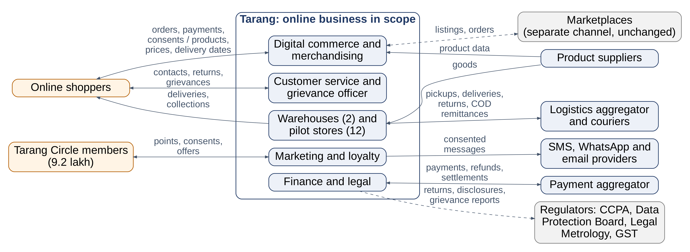
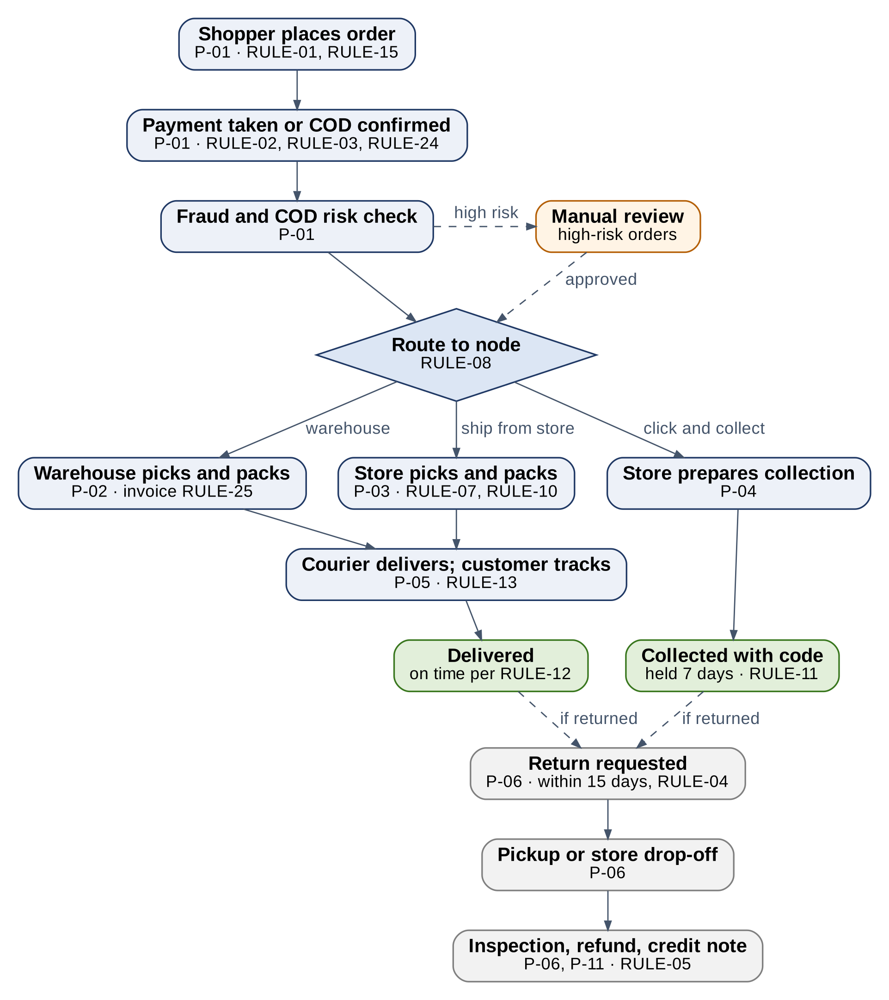
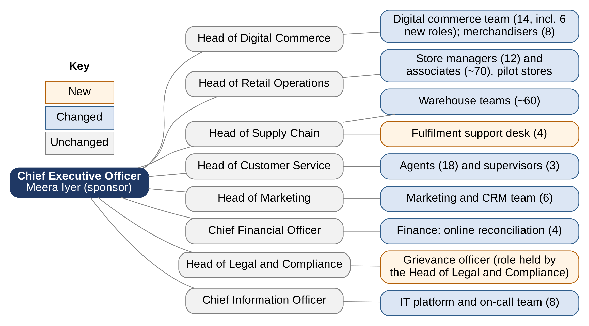
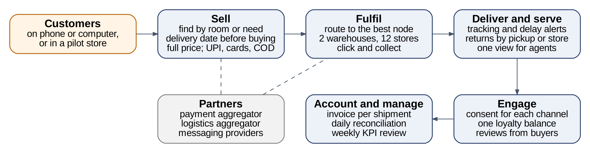

**BUSINESS REQUIREMENTS**

**SPECIFICATION**

Tarang Direct: direct-to-consumer e-commerce portal

Tarang Home & Kitchen Pvt. Ltd. · Digital Commerce

|                      |                                     |
|----------------------|-------------------------------------|
| **Document ID**      | BRS-DIG-014                         |
| **Version**          | 1.1                                 |
| **Status**           | Approved                            |
| **Date**             | 14-Dec-2026                         |
| **Document owner**   | Kavya Nair, Lead Business Analyst   |
| **Business sponsor** | Meera Iyer, Chief Executive Officer |
| **Classification**   | Internal                            |

*Structured according to the Business Requirements Specification (BRS) content items in ISO/IEC/IEEE 29148:2018, clause 9.3. Fictional example: Tarang Home & Kitchen Pvt. Ltd., its people, figures, systems and dates are invented. Regulatory content reflects Indian law as of November 2026 and must be confirmed with legal counsel before use.*

# About this example

This example fills in the ISO/IEC/IEEE 29148 BRS template for Tarang Direct, the e-commerce portal described in the example Business Requirements Document BRD-DIG-014. It states the same business need at the business level, without describing a solution.

**How the IDs relate to the BRD.** The BRD's business requirements (its BR-01 to BR-07) appear here as goals and objectives (section 7.2). The business requirements in Appendix A (BR-01 to BR-32) are this document's own, written to the template's pattern. Stakeholder requirements SR-01 to SR-17 in BRD section 7 serve as the stakeholder requirements specification (StRS), and the software requirements are those in the example SRS, FRD-DIG-014-S (Appendix C).

### Mapping to ISO/IEC/IEEE 29148:2018

Clause numbers refer to the 2018 (second) edition. A third edition is in development and may renumber clauses; check the edition your organization has adopted.

| **Template section** | **Content** | **29148:2018 clause** |
|----|----|----|
| Document control | Identification, version history, approvals | 9.2.1, 9.2.2 |
| 1.1 – 1.3 | Purpose, audience, related documents | 9.3.1 |
| 1.4 | Definitions | 9.2.3 |
| 1.5 | References | 9.2.4 |
| 1.6 | Acronyms and abbreviations | 9.2.5 |
| 2 | Business purpose | 9.3.2 |
| 3 | Business scope | 9.3.3 |
| 4 | Business overview | 9.3.4 |
| 5 | Major stakeholders | 9.3.5 |
| 6 | Business environment | 9.3.6 |
| 7 | Mission, goals and objectives | 9.3.7 |
| 8 | Business model | 9.3.8 |
| 9 | Information environment | 9.3.9 |
| 10 | Business processes | 9.3.10 |
| 11 | Business operational policies and rules | 9.3.11 |
| 12 | Business operational constraints | 9.3.12 |
| 13 | Business operational modes | 9.3.13 |
| 14 | Business operational quality | 9.3.14 |
| 15 | Business structure | 9.3.15 |
| 16 | High-level operational concept | 9.3.16 |
| 17 | High-level operational scenarios | 9.3.17 |
| Appendices A – D | Requirements register, quality checklist, traceability matrix, issues log | Practical additions; not part of the 9.3 outline |

# Document control

### Revision history

| **Version** | **Date** | **Author** | **Summary of changes** |
|----|----|----|----|
| 0.1 | 21-Sep-2026 | Kavya Nair | Initial draft from discovery interviews and current-state analysis |
| 0.2 | 09-Oct-2026 | Kavya Nair | Goals, processes and rules added after six business workshops |
| 0.3 | 26-Oct-2026 | Kavya Nair | Business environment, constraints and compliance rules revised after Legal review |
| 0.9 | 05-Nov-2026 | Kavya Nair | Review draft; Appendix B checklist completed |
| 1.0 | 12-Nov-2026 | Kavya Nair | Approved by the steering committee |
| 1.1 | 14-Dec-2026 | Kavya Nair | Appendix C updated with software requirement IDs from FRD-DIG-014-S v1.0; Appendix D updated. No change to requirements |

### Review and approval

By approving, reviewers confirm that this BRS correctly states the business need and may be used as the basis for deriving stakeholder requirements.

| **Name** | **Role** | **Decision** | **Signature** | **Date** |
|----|----|----|----|----|
| Meera Iyer | Business sponsor (Chief Executive Officer) | Approved | Signed electronically | 12-Nov-2026 |
| Rohan Mehta | Business owner: digital commerce | Approved | Signed electronically | 11-Nov-2026 |
| Farhan Sheikh | Business owner: retail operations | Approved with comments: store fulfilment extends beyond the 12 pilot stores only where RULE-09 is met | Signed electronically | 11-Nov-2026 |
| Lakshmi Prasad | Business owner: supply chain | Approved | Signed electronically | 11-Nov-2026 |
| Priya D'Souza | Business owner: customer service | Approved | Signed electronically | 11-Nov-2026 |
| Ananya Bose | Business owner: marketing and loyalty | Approved | Signed electronically | 11-Nov-2026 |
| Sanjay Kulkarni | Business owner: finance (Chief Financial Officer) | Approved | Signed electronically | 11-Nov-2026 |
| Kavya Nair | Lead business analyst | Approved | Signed electronically | 10-Nov-2026 |
| Vikram Desai | Enterprise architect (Chief Information Officer) | Approved | Signed electronically | 10-Nov-2026 |
| Arjun Menon | Compliance and legal (Head of Legal and Compliance) | Approved with comments: I-08 to be closed before the stakeholder requirements are approved | Signed electronically | 12-Nov-2026 |

### Distribution

| **Name / group**                  | **Role**             | **Purpose** |
|-----------------------------------|----------------------|-------------|
| Tarang Direct steering committee  | Governance           | Approval    |
| Programme team, DIG-2026-014      | Delivery             | Information |
| Store managers, 12 pilot stores   | Operations           | Information |
| Internal audit                    | Assurance            | Review      |
| Information security office       | Security and privacy | Review      |
| Board of directors (summary only) | Oversight            | Information |

# Contents

- [About this example](#about-this-example)
- [Document control](#document-control)
- [Contents](#contents)
- [1 Introduction](#1-introduction)
  - [1.1 Purpose of this document](#11-purpose-of-this-document)
  - [1.2 Intended audience](#12-intended-audience)
  - [1.3 Related documents](#13-related-documents)
  - [1.4 Definitions](#14-definitions)
  - [1.5 References](#15-references)
  - [1.6 Acronyms and abbreviations](#16-acronyms-and-abbreviations)
- [2 Business purpose](#2-business-purpose)
  - [2.1 Problem or opportunity statement](#21-problem-or-opportunity-statement)
  - [2.2 Business drivers](#22-business-drivers)
  - [2.3 Cost of inaction](#23-cost-of-inaction)
- [3 Business scope](#3-business-scope)
  - [3.1 In scope](#31-in-scope)
  - [3.2 Out of scope](#32-out-of-scope)
  - [3.3 Assumptions](#33-assumptions)
  - [3.4 Dependencies](#34-dependencies)
- [4 Business overview](#4-business-overview)
  - [4.1 Current state](#41-current-state)
  - [4.2 Key facts and figures](#42-key-facts-and-figures)
  - [4.3 Business context diagram](#43-business-context-diagram)
- [5 Major stakeholders](#5-major-stakeholders)
- [6 Business environment](#6-business-environment)
- [7 Mission, goals and objectives](#7-mission-goals-and-objectives)
  - [7.1 Mission and strategic alignment](#71-mission-and-strategic-alignment)
  - [7.2 Goals and objectives](#72-goals-and-objectives)
  - [7.3 Success criteria and benefits](#73-success-criteria-and-benefits)
- [8 Business model](#8-business-model)
- [9 Information environment](#9-information-environment)
  - [9.1 Information items](#91-information-items)
  - [9.2 Existing systems and data stores](#92-existing-systems-and-data-stores)
- [10 Business processes](#10-business-processes)
  - [10.1 Process inventory](#101-process-inventory)
  - [10.2 Process descriptions](#102-process-descriptions)
- [11 Business operational policies and rules](#11-business-operational-policies-and-rules)
- [12 Business operational constraints](#12-business-operational-constraints)
- [13 Business operational modes](#13-business-operational-modes)
- [14 Business operational quality](#14-business-operational-quality)
- [15 Business structure](#15-business-structure)
  - [15.1 Organizational units and roles](#151-organizational-units-and-roles)
  - [15.2 Organization chart](#152-organization-chart)
- [16 High-level operational concept](#16-high-level-operational-concept)
- [17 High-level operational scenarios](#17-high-level-operational-scenarios)
  - [17.1 Scenario summary](#171-scenario-summary)
  - [17.2 Scenario descriptions](#172-scenario-descriptions)
- [Appendix A — Business requirements register](#appendix-a--business-requirements-register)
- [Appendix B — Requirement quality checklist](#appendix-b--requirement-quality-checklist)
- [Appendix C — Traceability matrix](#appendix-c--traceability-matrix)
- [Appendix D — Open issues and decisions log](#appendix-d--open-issues-and-decisions-log)

# 1 Introduction

## 1.1 Purpose of this document

This Business Requirements Specification describes the business needs, goals, constraints and operating expectations for Tarang Direct, Tarang's own direct-to-consumer online channel. Once approved, it is the agreed basis for releasing the capital in business case BC-2026-07, selecting the payment, logistics and platform partners, and deriving the stakeholder and software requirements.

## 1.2 Intended audience

- The business sponsor and the Tarang Direct steering committee

- Owners and managers of the processes in scope: digital commerce, retail operations, supply chain, customer service, marketing, finance and legal

- Business analysts who derive the stakeholder and software requirements

- The enterprise and solution architects, the programme manager, internal audit and the information security office

## 1.3 Related documents

| **Document** | **ID / location** | **Relationship to this BRS** |
|----|----|----|
| Business case | BC-2026-07 v1.0 | Justifies the investment of ₹6.8 crore capital and ₹2.1 crore a year; this BRS details the business needs behind it |
| Business Requirements Document | BRD-DIG-014 v1.0 | States the same need in BABOK form; its section 7 stakeholder requirements serve as the StRS |
| Stakeholder Requirements Specification (StRS) | BRD-DIG-014, section 7 | Derived from this BRS (SR-01 to SR-17) |
| Software Requirements Specification (SRS) | FRD-DIG-014-S v1.0 | Derived from the stakeholder requirements; traced in Appendix C |
| Operational concept (OpsCon) | OC-DIG-014 v0.5 | Expands sections 16 and 17 of this BRS |
| Corporate strategy | "Every Room, Every Channel" 2026–2030 | Source of the mission and strategic objectives in section 7.1 |

## 1.4 Definitions

| **Term** | **Definition** |
|----|----|
| **Aged stock** | Stock that has been held for more than 180 days, measured as a share of total stock value. |
| **Available to promise** | Stock at a location that can be sold online: stock on hand, less stock already reserved and safety stock (RULE-07). |
| **Business requirement** | A statement of what Tarang needs to achieve or be able to do, expressed independently of any particular solution. |
| **Channel cost** | Payment fees, logistics costs and performance marketing for an online channel, as a share of that channel's net revenue. |
| **Click and collect** | Buying online and collecting the order from a pilot store. |
| **Cash on delivery (COD)** | Paying the courier in cash or by UPI when the order is delivered. |
| **Grievance officer** | The person Tarang appoints under the Consumer Protection (E-Commerce) Rules, 2020 to receive and resolve consumer grievances. |
| **Inventory e-commerce** | An online business that sells goods it owns, rather than providing a marketplace for other sellers. |
| **Marketing consent** | A customer's free, specific and recorded agreement to receive marketing on a named channel (email, SMS or WhatsApp). |
| **Net revenue** | Order value after discounts and returns, excluding GST and delivery charges (RULE-18). |
| **Node** | A location that fulfils online orders: one of the 2 warehouses or 12 pilot stores. |
| **On time** | Delivered, or ready for collection, on or before the date promised at the time of purchase (RULE-12). |
| **Pilot store** | One of the 12 stores in Bengaluru, Pune and Hyderabad that fulfil online orders in Release 1. |
| **Portal** | Tarang Direct: Tarang's own website and progressive web app for selling online. |
| **Ship from store** | Packing an online order in a store and sending it to the customer by courier. |
| **Tarang Circle** | Tarang's loyalty programme, with 9.2 lakh members. |
| **Verified buyer** | A customer with a delivered portal order that contains the product being reviewed (RULE-20). |

## 1.5 References

| **Ref.** | **Title** | **Version / date** | **Source / location** |
|----|----|----|----|
| \[R1\] | ISO/IEC/IEEE 29148:2018 Systems and software engineering — Life cycle processes — Requirements engineering | 2018 | ISO / IEC / IEEE |
| \[R2\] | Tarang corporate strategy "Every Room, Every Channel" 2026–2030 | Mar-2026 | Board papers |
| \[R3\] | Consumer Protection Act, 2019 and Consumer Protection (E-Commerce) Rules, 2020 | 2020, as amended | Department of Consumer Affairs |
| \[R4\] | Guidelines for Prevention and Regulation of Dark Patterns, 2023 | Nov-2023 | Central Consumer Protection Authority |
| \[R5\] | Legal Metrology Act, 2009 and Legal Metrology (Packaged Commodities) Rules, 2011, including Rule 6(10A) | Amended 2026 | Department of Consumer Affairs |
| \[R6\] | Digital Personal Data Protection Act, 2023 and Digital Personal Data Protection Rules, 2025 | 2023; 2025 | Ministry of Electronics and IT |
| \[R7\] | RBI directions on storage of card data and card-on-file tokenisation | Current | Reserve Bank of India |
| \[R8\] | Central Goods and Services Tax Act, 2017 and CGST Rules, 2017 | Current | CBIC |
| \[R9\] | IS 19000:2022 Online consumer reviews (voluntary) | 2022 | Bureau of Indian Standards |
| \[R10\] | Telecom Commercial Communications Customer Preference Regulations, 2018 (DLT registration of SMS) | 2018, as amended | TRAI |
| \[R11\] | Tarang policies: returns RP-2026-01, pricing PRC-2026-03, loyalty LT-2026, data DP-03, retail operations RO-14, reviews RV-2026 | Current | Policy library |

## 1.6 Acronyms and abbreviations

| **Acronym** | **Meaning** |
|----|----|
| BRS | Business Requirements Specification |
| StRS | Stakeholder Requirements Specification |
| SyRS | System Requirements Specification |
| SRS | Software Requirements Specification |
| OpsCon | Operational Concept |
| KPI | Key performance indicator |
| CCPA | Central Consumer Protection Authority |
| COD | Cash on delivery |
| DLT | Distributed Ledger Technology platform for registering SMS senders and templates |
| DPDP | Digital Personal Data Protection (Act, 2023; Rules, 2025) |
| ERP | Enterprise resource planning system |
| GST, GSTIN | Goods and Services Tax; GST identification number |
| MRP | Maximum retail price |
| NPS | Net Promoter Score |
| POS | Point-of-sale system |
| PWA | Progressive web app |
| RBI | Reserve Bank of India |
| SKU | Stock-keeping unit |
| UPI | Unified Payments Interface |
| WMS | Warehouse management system |

# 2 Business purpose

## 2.1 Problem or opportunity statement

|  |  |
|----|----|
| **The problem / opportunity of** | selling online only through third-party marketplaces, with store and online stock managed separately |
| **affects** | Tarang's margins and online customers, and its store, supply chain, marketing and finance teams |
| **the impact of which is** | ₹18.3 crore (31% of online revenue) paid in channel costs in FY2025-26; no first-party data on online customers; 23% of SKUs shown out of stock online held in at least one store; 17% of stock value older than 180 days |
| **a successful outcome would** | let customers buy directly from Tarang online, with one view of stock across warehouses and stores and one loyalty programme, at a channel cost of 18% or less |

## 2.2 Business drivers

- **Rising channel cost:** marketplace commissions, fees and advertising rose from 26% to 31% of online revenue between FY2023-24 and FY2025-26.

- **Strategy:** the board's 2030 strategy targets 30% of revenue from digital channels by FY2029-30, at least half of it through Tarang-owned channels.

- **Customer ownership:** marketplaces share no customer contact data, so Tarang pays again, through marketplace advertising, for every repeat online sale.

- **Stock visibility:** 23% of SKUs shown out of stock online are on a store shelf, and store stock keeps ageing.

- **Regulation:** the core obligations of the DPDP Rules apply from 13-May-2027; building consent and data rights into a new channel from the start costs less than adding them later.

## 2.3 Cost of inaction

If Tarang does nothing, marketplace costs will reach about ₹27 crore a year by FY2027-28 at current growth. Tarang will keep paying to reach customers who have already bought from it, aged store stock will keep being cleared at an average markdown of 38%, and the 2030 digital target will be missed. Business case BC-2026-07 estimates a five-year net present value of ₹14.2 crore from proceeding, with payback in 28 months; that value is lost if Tarang does not act.

# 3 Business scope

## 3.1 In scope

| **ID** | **Scope item** | **Notes** |
|----|----|----|
| S-01 | Selling Tarang's own range of about 6,500 SKUs online to consumers in India, in English | Décor, kitchen, dining, bed and bath, storage |
| S-02 | Publishing product information, including legally required declarations | All products sold online |
| S-03 | Customer accounts, guest purchases, and customers' control of their personal data | Includes consent and data-principal rights |
| S-04 | Online pricing, promotions and coupons | Within the pricing policy PRC-2026-03 |
| S-05 | Taking payment by UPI, cards, net banking, wallets and cash on delivery | Through an RBI-authorised payment aggregator |
| S-06 | Fulfilling online orders from 2 warehouses and 12 pilot stores | Bengaluru (5 stores), Pune (4), Hyderabad (3); warehouses at Bengaluru and Bhiwandi |
| S-07 | Home delivery, next-day express delivery and click and collect | Express and click and collect in the 3 pilot cities only |
| S-08 | Order tracking, cancellations, returns, exchanges and refunds | Returns by courier pickup or at pilot stores |
| S-09 | One Tarang Circle points balance across stores and online | All 9.2 lakh members |
| S-10 | Ratings and reviews from verified buyers | — |
| S-11 | Customer service and grievance redressal for online customers | 09:00 to 21:00 IST, 7 days a week |
| S-12 | Online content, consent-based marketing, and measuring results | Email, SMS and WhatsApp |
| S-13 | GST invoicing, daily reconciliation of payments, and accounting for online sales | Accounting stays in the ERP |
| S-14 | Organizational change: new and changed roles, training and store incentives | Section 15 |

Time period: from the soft launch on 22-Mar-2027 through the first 12 months after public launch on 15-Apr-2027.

## 3.2 Out of scope

| **ID** | **Excluded item** | **Reason / where it is handled** |
|----|----|----|
| X-01 | Native Android and iOS apps | Release 2 (Q4 2027); the progressive web app meets launch needs |
| X-02 | Hindi and regional-language storefront | Release 2; consent notices are still offered in Hindi (BR-22) |
| X-03 | Third-party sellers (marketplace model) | Not planned: Tarang sells only its own inventory (C-06) |
| X-04 | International shipping | Not planned: low demand, customs and tax complexity |
| X-05 | Corporate and bulk orders | Existing B2B sales team; review in 2028 |
| X-06 | Changes to marketplace selling | Continues unchanged (P-12) |
| X-07 | Store fulfilment in the other 26 stores | Release 1.1 onward, store by store, once RULE-09 is met |
| X-08 | Augmented-reality room visualiser | Backlog; not needed for the launch objectives |

## 3.3 Assumptions

| **ID** | **Assumption** | **Owner** | **Impact if false** |
|----|----|----|----|
| A-01 | About 70% of visits and 60% of orders will come from mobile devices. | Head of Digital Commerce | Mobile journeys get less design and test effort than they need |
| A-02 | A 2.2% conversion rate and ₹2,400 average order value are achievable with a year-1 marketing budget of ₹9 crore. | Head of Marketing | O-01 is missed |
| A-03 | The logistics partner serves at least 19,000 pincodes, covering 95% of past marketplace destinations. | Head of Supply Chain | More shoppers cannot order; lower revenue |
| A-04 | Pilot store POS can report stock changes every 5 minutes after the v8 upgrade. | Chief Information Officer | Stale store stock and more cancelled orders (Q-08) |
| A-05 | About 9% of orders will be returned, as on marketplaces. | Chief Financial Officer | Higher reverse-logistics cost puts O-03 at risk |

## 3.4 Dependencies

| **ID** | **Dependency** | **Depends on** | **Needed by** |
|----|----|----|----|
| D-01 | Payment aggregator onboarding and KYC complete | Payment aggregator; CFO | 15-Feb-2027 |
| D-02 | Logistics aggregator contract signed | Logistics aggregator; Head of Supply Chain | 31-Jan-2027 |
| D-03 | POS upgraded to v8 in the 12 pilot stores | Retail IT; POS vendor | 31-Jan-2027 |
| D-04 | Grievance officer appointed and details published | Head of Legal and Compliance | Before soft launch, 22-Mar-2027 |
| D-05 | Product photography for all 6,500 SKUs complete | Head of Marketing; photography agency | 15-Mar-2027 |
| D-06 | SMS sender ID and templates registered on the DLT platform | Head of Marketing; SMS provider | 28-Feb-2027 |

# 4 Business overview

## 4.1 Current state

Tarang Home & Kitchen sells home décor, kitchenware and furnishings through 38 stores in 11 cities and, online, only through third-party marketplaces. Online sales were ₹59 crore in FY2025-26, 14% of revenue.

Merchandisers keep product data in spreadsheets and upload listings separately to each marketplace. The ERP sends warehouse stock to the marketplaces every 6 hours; store stock is not shared online. Marketplace orders are picked and packed in the Bengaluru and Bhiwandi warehouses and handed to the marketplace's courier. Returns go back to the warehouses, and the marketplace refunds the customer and deducts the amount from Tarang's settlement.

Customer contact details, order history and reviews stay with the marketplaces. In stores, the POS records Tarang Circle points, which cannot be earned or used online. New products take an average of 9 days to go live online, and brand presentation is limited to each marketplace's templates.

## 4.2 Key facts and figures

| **Measure** | **Current value** | **Source** | **As of** |
|----|----|----|----|
| Stores | 38 in 11 cities | Store master | Sep-2026 |
| Annual revenue, all channels | About ₹420 crore | Audited accounts | Mar-2026 |
| Online (marketplace) revenue | ₹59 crore (14% of revenue) | Marketplace settlements | Mar-2026 |
| Online channel cost | ₹18.3 crore (31% of online revenue; 26% in FY2023-24) | Finance analysis | Mar-2026 |
| Marketplace orders | About 20,000 a month | Marketplace reports | Sep-2026 |
| Return rate, marketplace orders | About 9% | Marketplace reports | Sep-2026 |
| Product range | About 6,500 SKUs | ERP | Sep-2026 |
| Warehouses | 2 (Bengaluru, Bhiwandi) | Supply chain | Sep-2026 |
| Tarang Circle members | 9.2 lakh | POS loyalty data | Sep-2026 |
| Stock older than 180 days | 17% of stock value | Stock ageing report | Sep-2026 |
| SKUs shown out of stock online but held in a store | 23% | Stock analysis, Q1 FY2026-27 | Jun-2026 |
| Time from ERP creation to live online listing | 9 days on average (sample of 120 SKUs) | Process audit | Aug-2026 |
| Service contacts about online loyalty points | 2,140 a year | Contact log | Mar-2026 |

## 4.3 Business context diagram

Figure 1 shows Tarang's online business, the parties it deals with and the main flows between them. Marketplaces remain a separate channel; the dashed lines are regulatory and reporting relationships.

*Figure 1: Business context of Tarang's online selling in the future state*

# 5 Major stakeholders

Influence on the initiative and impact of the change on each group are rated High (H), Medium (M) or Low (L). Store staff (SH-07) are the group most likely to resist, so their incentives change (I-12).

| **ID** | **Stakeholder (group / role)** | **Interests and concerns** | **Influence (H/M/L)** | **Impact on them (H/M/L)** | **Representative** |
|----|----|----|----|----|----|
| SH-01 | Online shoppers (home refreshers, first-home setters, gift buyers) | Range, honest prices, reliable delivery dates, easy returns, protection of personal data | M | H | Head of Digital Commerce (customer panel of 40) |
| SH-02 | Tarang Circle members | One points balance; buying online and collecting or returning in store | M | H | Head of Marketing |
| SH-03 | Board and executive leadership | Growth, return on investment, the 2030 strategy | H | M | Meera Iyer, CEO (sponsor) |
| SH-04 | Digital commerce team | Revenue, conversion, a channel it controls | H | H | Rohan Mehta, Head of Digital Commerce |
| SH-05 | Merchandising team | Publishing products, prices and promotions without IT help | M | H | Merchandising manager |
| SH-06 | Marketing team | Customer data, consented campaigns, brand presentation | M | H | Ananya Bose, Head of Marketing |
| SH-07 | Store managers and staff (12 pilot stores) | Workload alongside floor sales, incentives, stock accuracy; some resistance expected | M | H | Farhan Sheikh, Head of Retail Operations |
| SH-08 | Warehouse teams (Bengaluru, Bhiwandi) | Order flow, packing standards, returns handling | M | M | Lakshmi Prasad, Head of Supply Chain |
| SH-09 | Customer service team | Contact volumes, one view of the customer, grievance timelines | M | H | Priya D'Souza, Head of Customer Service |
| SH-10 | Finance team | Channel cost, daily reconciliation, GST correctness, controls | H | M | Sanjay Kulkarni, CFO |
| SH-11 | Legal and compliance, including the grievance officer | Compliance from launch; audit evidence | H | M | Arjun Menon, Head of Legal and Compliance |
| SH-12 | IT and information security | Architecture, integration with ERP, POS and WMS; protection of data | H | M | Vikram Desai, CIO; Deepak Joshi, CISO |
| SH-13 | Payment aggregator | Transaction volumes, integration, fraud and refund handling | L | M | Relationship owner: CFO |
| SH-14 | Logistics aggregator and couriers | Volumes, pickups from stores, COD remittance, service levels | L | M | Relationship owner: Head of Supply Chain |
| SH-15 | Marketplaces (existing channel partners) | Tarang's continued selling and advertising on their platforms; price parity with the portal | M | M | Relationship owner: Head of Digital Commerce |
| SH-16 | Regulators: CCPA, Data Protection Board of India, Legal Metrology and GST authorities | Compliance with consumer, data protection, metrology and tax law | H | L | Head of Legal and Compliance (liaison) |

# 6 Business environment

Factors marked "expected to change" are reviewed each quarter by the programme manager and reported to the steering committee.

| **Category** | **Factor** | **Effect on the business need** | **Source** |
|----|----|----|----|
| Political | Government support for digital public infrastructure, such as UPI and the Open Network for Digital Commerce (ONDC) | UPI keeps payment costs low; ONDC is a possible future channel, not in scope (watch) | NPCI; DPIIT |
| Economic | Marketplace commissions, fees and advertising costs rising (26% to 31% of online revenue in two years) | The main reason for an own channel; sets the 18% channel-cost objective (O-03) | Finance analysis FY2025-26 |
| Economic | Home and kitchen spending concentrated in the festive season (October to November) and end-of-season sales | The business must operate at about 5 times normal demand on sale days (section 13) | Tarang sales history |
| Social | Mobile-first shoppers; cash on delivery still preferred outside metros; free returns and fast delivery expected | Mobile is the main channel; COD must be offered with controls (RULE-02, RULE-03) | Customer panel; marketplace data |
| Social | Growing public concern about personal data and manipulative design online | Consent, data rights and fair design are part of the brand promise (G-06) | Customer panel |
| Technological | UPI is the most used online payment method; card details may be saved only as tokens | Payment options and card handling (BR-06, BR-07) | NPCI; RBI |
| Technological | POS v8 can report store stock changes within minutes | Makes selling store stock online practical (G-04) | POS vendor; D-03 |
| Legal / regulatory | Consumer Protection (E-Commerce) Rules, 2020 and the CCPA Dark Patterns Guidelines, 2023 | Seller disclosures, explicit purchase consent, no cancellation fees, grievance officer, no dark patterns | \[R3\], \[R4\] |
| Legal / regulatory | Legal Metrology rules: product declarations, MRP, and a country-of-origin filter for imported goods (Rule 6(10A), from 1-Jul-2026) | Every product page must carry declarations; imported goods must be searchable by origin | \[R5\] |
| Legal / regulatory | DPDP Act, 2023 and Rules, 2025: core obligations apply from 13-May-2027 (expected to change: guidance still being issued) | Notice, consent, withdrawal, data rights, safeguards and breach reporting; sets the launch deadline (C-01) | \[R6\] |
| Legal / regulatory | RBI card-data rules; GST invoicing and record-keeping; TRAI DLT registration for SMS | No card data stored; invoice for every supply; registered SMS senders | \[R7\], \[R8\], \[R10\] |
| Environmental | Extended producer responsibility for plastic packaging under the Plastic Waste Management Rules, 2016, as amended | Online orders add packaging that Tarang must report and recover as a brand owner | Plastic Waste Management Rules |
| Market / competitive | Large marketplaces, other direct-to-consumer home brands, and quick-commerce apps adding home and kitchen products (expected to change) | Shoppers compare delivery speed and price; Tarang competes on range, room sets and its store network | Market review, Aug-2026 |
| Internal (strategy, culture, capability) | 2030 strategy "Every Room, Every Channel"; store teams measured only on store sales; limited in-house digital skills; a strong loyalty base | Store incentives must change (section 15); new digital roles are needed; loyalty members are the first audience | \[R2\]; HR |

# 7 Mission, goals and objectives

## 7.1 Mission and strategic alignment

Tarang's mission is to help Indian households make every room their own with well-designed, fairly priced home and kitchen products, wherever they choose to shop.

The 2030 strategy "Every Room, Every Channel", approved by the board in March 2026, targets 30% of revenue from digital channels by FY2029-30, at least half of it through Tarang-owned channels. Tarang Direct is the first initiative under the strategy's "Own the customer" pillar, and it supports the "One stock" pillar by making store stock available to online customers.

## 7.2 Goals and objectives

| **ID** | **Goal** | **Objective** | **KPI / measure** | **Baseline** | **Target** | **By** |
|----|----|----|----|----|----|----|
| G-01 / O-01 | Grow revenue through Tarang's own online channel | Earn net revenue through the portal (RULE-18) | Portal net revenue | ₹0 | ₹45 crore | 15-Apr-2028 |
| G-01 / O-02 | Grow revenue through Tarang's own online channel | Turn portal visits into orders | Conversion rate | No baseline | 2.2% | 15-Oct-2027 |
| G-02 / O-03 | Reduce the cost of selling online | Lower channel cost on the portal than on marketplaces | Channel cost as % of portal net revenue | 31% (marketplaces) | ≤ 18% | 15-Oct-2027 |
| G-03 / O-04 | Own the relationship with online customers | Build a base of customers Tarang can contact directly | Registered customers with marketing consent | 0 | 4 lakh | 15-Apr-2028 |
| G-03 / O-05 | Own the relationship with online customers | Bring loyalty members online | Tarang Circle members with linked portal accounts | 0 | 2 lakh | 15-Apr-2028 |
| G-04 / O-06 | Turn store stock into online sales | Reduce aged stock by selling store stock online | Stock older than 180 days as % of stock value | 17% | ≤ 12% | 31-Mar-2028 |
| G-04 / O-07 | Turn store stock into online sales | Use stores to fulfil online orders | Share of portal orders fulfilled by a store | 0% | 20% | 15-Apr-2028 |
| G-05 / O-08 | Give online customers an experience they recommend | Earn recommendations from online customers | Online Net Promoter Score | No baseline | ≥ 45 | 15-Oct-2027 |
| G-05 / O-09 | Give online customers an experience they recommend | Keep delivery promises | Orders on time (RULE-12) | No baseline | ≥ 95% each month | From 15-Apr-2027 |
| G-06 / O-10 | Operate lawfully from launch | Close every compliance gap before launch and keep it closed | Open gaps in Legal's compliance audit | Not applicable | 0 at go-live; no high-severity findings in any 6-monthly audit | 15-Apr-2027, then every 6 months |

## 7.3 Success criteria and benefits

The sponsor will judge Tarang Direct a success if, 12 months after public launch, it earns ₹45 crore of net revenue at a channel cost of 18% or less, with 4 lakh contactable customers and an online NPS of 45 or more, and with no high-severity compliance findings.

Benefits are measured weekly from launch in the KPI review (P-13) and formally reviewed by the steering committee at months 3, 6 and 12. Channel cost and NPS are expected to reach target by month 6; revenue, consented customers and store fulfilment by month 12; and aged stock by 31-Mar-2028. The business case assumes payback in 28 months and a five-year net present value of ₹14.2 crore at a 12% discount rate.

For three months after launch, weekly comparison of marketplace and portal sales (BR-30) will show how much portal revenue is new rather than moved from marketplaces; the revenue objective counts only portal net revenue.

# 8 Business model

| **Element** | **Current state** | **Future state** |
|----|----|----|
| Customer segments | Store shoppers; marketplace buyers, who are unknown to Tarang | Adds four online segments: home refreshers (45% of planned revenue), first-home setters (30%), gift buyers (15%) and loyalty regulars (10%) |
| Value proposition | Design-led home products in stores; online, Tarang products listed among many others | Full range online with room sets and buying guides; delivery date shown before purchase; buy online and collect or return in store; one loyalty balance |
| Channels | 38 stores; third-party marketplaces | Adds Tarang's own website and progressive web app, and order messages by email, SMS and WhatsApp; stores and marketplaces continue |
| Customer relationships | Loyalty in stores only; online customers belong to marketplaces | Direct relationship with consent; one loyalty balance; service by phone, email, chat and WhatsApp |
| Revenue streams | Store sales; marketplace sales of ₹59 crore | Adds portal sales (₹45 crore net revenue in year 1) and minor delivery and COD fees |
| Key activities | Store retail; marketplace listing; warehouse dispatch for marketplace orders | Adds online trading and content, store fulfilment, online customer service, consent-based marketing and daily reconciliation |
| Key resources | Stores, 2 warehouses, 6,500-SKU range, 9.2 lakh loyalty members, brand | Adds consented customer data, an online sales capability and store fulfilment skills |
| Key partners | Marketplaces; product suppliers; couriers chosen by the marketplaces | Adds a payment aggregator, a logistics aggregator, messaging providers and technology vendors |
| Cost structure | Store costs; marketplace commission, fees and advertising at 31% of online revenue | Portal channel cost of 18% or less; ₹6.8 crore capital and ₹2.1 crore a year running cost; new roles (section 15) |

# 9 Information environment

## 9.1 Information items

| **ID** | **Information item** | **Source** | **Owner** | **Used by** | **Sensitivity** | **Retention** |
|----|----|----|----|----|----|----|
| INF-01 | Product master and legal declarations | ERP; merchandisers | Head of Digital Commerce | Shoppers, merchandising, finance | Internal until published | Life of product, plus 72 months |
| INF-02 | Prices, promotions and coupons | Merchandisers | Head of Digital Commerce | Shoppers, finance, legal | Internal until published | 72 months (MRP and pricing evidence) |
| INF-03 | Stock available by location | POS; WMS | Head of Supply Chain | Shoppers, stores, service | Internal | 13 months |
| INF-04 | Customer profile and addresses | Customers | Head of Digital Commerce | Service, fulfilment, marketing (with consent) | Confidential (personal data) | Until erasure, or 3 years after last activity (RULE-19) |
| INF-05 | Consent and notice records | Customers | Head of Legal and Compliance | Marketing, legal, auditors | Confidential (personal data) | Life of account plus 3 years (DP-03) |
| INF-06 | Orders and order history | Customers | Head of Digital Commerce | All online teams | Confidential (personal data) | 72 months (GST) |
| INF-07 | Payment and refund records (no card data) | Payment aggregator | Chief Financial Officer | Finance, service | Confidential (financial) | 72 months |
| INF-08 | Shipments and tracking events | Logistics aggregator | Head of Supply Chain | Customers, service | Confidential | 13 months |
| INF-09 | Returns, inspection results and photos | Customers; inspection staff | Head of Customer Service | Supply chain, merchandising | Confidential | 72 months |
| INF-10 | Tax invoices and credit notes | Generated per shipment and return | Chief Financial Officer | Customers, finance, auditors | Confidential (financial) | 72 months from the due date of the annual return |
| INF-11 | Loyalty membership and points | POS loyalty records | Head of Marketing | Customers, service, finance | Confidential (personal data) | Life of membership plus 3 years |
| INF-12 | Ratings and reviews | Customers | Head of Marketing | Shoppers, merchandising | Public once published | Life of product |
| INF-13 | Customer contacts, complaints and grievances | Customers | Head of Customer Service | Service, legal | Confidential (personal data) | 3 years after closure |
| INF-14 | Shopping behaviour and segments (consented customers only) | Portal activity | Head of Marketing | Marketing, digital commerce | Confidential (personal data) | 13 months |
| INF-15 | Personal data processing logs | All systems handling personal data | Chief Information Security Officer | Security, legal | Confidential | At least 1 year (DPDP Rules) |
| INF-16 | Business performance measures | Derived from INF-02 to INF-10 | Head of Digital Commerce | Leadership, steering committee | Internal | 5 years |

## 9.2 Existing systems and data stores

| **System / data store** | **Purpose** | **Business owner** | **Information held** | **Expected change** |
|----|----|----|----|----|
| ERP | Product master, prices, purchasing, finance, GST | Chief Financial Officer | INF-01, INF-02, INF-10 (posted) | Modify |
| Store POS (38 stores) | Store sales, store stock, Tarang Circle points | Head of Retail Operations | INF-03, INF-11 | Modify |
| WMS (2 warehouses) | Picking, packing, dispatch | Head of Supply Chain | INF-03 | Modify |
| Marketplace seller portals | Marketplace listings, orders, settlements | Head of Digital Commerce | Marketplace orders | Retain |
| Product spreadsheets | Product content | Head of Digital Commerce | INF-01 | Retire |
| Shared email inbox and phone line | Customer service | Head of Customer Service | INF-13 | Replace |
| Catalogue website | Brand pages and store locator; no selling | Head of Marketing | Brand content | Replace |
| Settlement reconciliation spreadsheets | Marketplace settlement checks | Chief Financial Officer | Marketplace settlements | Retain |

Expected change: Retain / Modify / Replace / Retire. Capabilities with no existing system, such as online selling, order management across nodes, consent records and service ticketing, are for the solution to provide; this BRS does not choose them.

# 10 Business processes

## 10.1 Process inventory

| **ID** | **Process name** | **Process owner** | **Trigger** | **Outcome** | **Change** |
|----|----|----|----|----|----|
| P-01 | Sell online (browse to confirmed order) | Head of Digital Commerce | Shopper visits the portal | Order confirmed and paid, or COD confirmed | New |
| P-02 | Route and fulfil orders from warehouses | Head of Supply Chain | Order confirmed | Order packed, invoiced and handed to the courier | Changed |
| P-03 | Fulfil orders from stores (ship from store) | Head of Retail Operations | Order allocated to a pilot store | Order packed, invoiced and handed to the courier | New |
| P-04 | Click and collect | Head of Retail Operations | Shopper chooses collection at a pilot store | Order handed over in store, or cancelled and refunded on day 8 | New |
| P-05 | Deliver and track orders | Head of Supply Chain | Courier collects the parcel | Order delivered on time, or returned to Tarang after 3 failed attempts | Changed |
| P-06 | Cancel, return, exchange and refund | Head of Customer Service | Customer asks to cancel, return or exchange | Refund sent and credit note issued, or exchange delivered | Changed |
| P-07 | Publish products, prices and promotions online | Head of Digital Commerce | New product in the ERP, price change or planned promotion | Product, price or promotion live online with all declarations | Changed |
| P-08 | Manage customer consent and data rights | Head of Legal and Compliance | Customer gives or withdraws consent, or makes a data request | Consent recorded and honoured; request completed within 30 days | New |
| P-09 | Engage customers through loyalty, reviews and consented marketing | Head of Marketing | Purchase, campaign plan or customer event | Points credited; consented messages sent; reviews published | Changed |
| P-10 | Handle customer contacts and grievances | Head of Customer Service | Customer contacts Tarang by phone, email, chat or WhatsApp | Contact resolved; grievances closed within one month | Changed |
| P-11 | Invoice, reconcile and account for online sales | Chief Financial Officer | Shipment packed; daily settlement files received | Every rupee reconciled daily and posted to the ERP | Changed |
| P-12 | Sell through marketplaces | Head of Digital Commerce | Marketplace order received | Order fulfilled from a warehouse | Unchanged |
| P-13 | Review portal performance | Head of Digital Commerce | Weekly review meeting; monthly steering committee | Actions agreed against the objectives in section 7.2 | New |

Change: New / Changed / Unchanged / Retired.

## 10.2 Process descriptions

Figure 2 shows how the new and changed processes connect, from a confirmed order to delivery, collection or refund. Detailed BPMN models are in the operational concept OC-DIG-014.

*Figure 2: Future-state order process across P-01 to P-06 and P-11*

### P-01 Sell online (browse to confirmed order)

<table>
<colgroup>
<col style="width: 27%" />
<col style="width: 72%" />
</colgroup>
<tbody>
<tr>
<td><strong>Purpose</strong></td>
<td>Let shoppers find, choose and buy Tarang products online with a clear price and delivery date.</td>
</tr>
<tr>
<td><strong>Trigger</strong></td>
<td>A shopper visits the portal.</td>
</tr>
<tr>
<td><strong>Roles / actors</strong></td>
<td>Shopper (guest or registered); payment aggregator; digital commerce team (monitoring).</td>
</tr>
<tr>
<td><strong>Inputs</strong></td>
<td>Products, prices and promotions (INF-01, INF-02); available stock (INF-03); serviceable pincodes and transit times; customer details (INF-04).</td>
</tr>
<tr>
<td><strong>Main steps (future state)</strong></td>
<td>
1. Shopper finds products by searching or browsing by room, category, price, material or colour.

2. Shopper enters a pincode and sees whether, when and where each product can be had.

3. Shopper adds items to the cart and sees the full price, including every charge.

4. Shopper signs in or continues as a guest, chooses an address and a delivery option.

5. Shopper pays by UPI, card, net banking or wallet, or chooses cash on delivery where RULE-02 allows.

6. Shopper places the order with an explicit action; Tarang confirms it within 2 minutes with the promised date.
</td>
</tr>
<tr>
<td><strong>Outputs</strong></td>
<td>Confirmed order (INF-06); payment record (INF-07); confirmation message.</td>
</tr>
<tr>
<td><strong>Outcome / end state</strong></td>
<td>A confirmed, paid or COD-confirmed order with stock reserved and a promised date.</td>
</tr>
<tr>
<td><strong>Volumes and frequency</strong></td>
<td>About 520 orders a day in year 1; up to 60 orders a minute on sale days.</td>
</tr>
<tr>
<td><strong>Pain points today</strong></td>
<td>Not possible today: online buyers must use a marketplace, and Tarang does not see them.</td>
</tr>
<tr>
<td><strong>Changes from current state</strong></td>
<td>New process. Tarang sets prices, presentation and delivery promises itself and owns the customer relationship.</td>
</tr>
<tr>
<td><strong>Related rules / goals</strong></td>
<td>RULE-01, RULE-02, RULE-03, RULE-15, RULE-24, RULE-26; G-01, G-03, G-05.</td>
</tr>
<tr>
<td><strong>Process diagram</strong></td>
<td>Figure 2, first three steps.</td>
</tr>
</tbody>
</table>

### P-02 Route and fulfil orders from warehouses

<table>
<colgroup>
<col style="width: 27%" />
<col style="width: 72%" />
</colgroup>
<tbody>
<tr>
<td><strong>Purpose</strong></td>
<td>Send each order from the location that can meet its promised date at the lowest cost.</td>
</tr>
<tr>
<td><strong>Trigger</strong></td>
<td>An order is confirmed and passes risk screening.</td>
</tr>
<tr>
<td><strong>Roles / actors</strong></td>
<td>Warehouse teams (Bengaluru, Bhiwandi); fulfilment support desk; logistics aggregator.</td>
</tr>
<tr>
<td><strong>Inputs</strong></td>
<td>Confirmed order (INF-06); stock by location (INF-03); delivery cost by node.</td>
</tr>
<tr>
<td><strong>Main steps (future state)</strong></td>
<td>
1. The order is allocated to a node under RULE-08; high-risk orders are reviewed first.

2. If the node is a warehouse, the warehouse receives the order with packing and gift instructions.

3. Warehouse staff pick, pack and label the order and print the tax invoice.

4. The courier collects the parcel; the customer is told it has shipped.
</td>
</tr>
<tr>
<td><strong>Outputs</strong></td>
<td>Packed shipment; tax invoice (INF-10); shipment record (INF-08).</td>
</tr>
<tr>
<td><strong>Outcome / end state</strong></td>
<td>Order handed to the courier in time to meet the promised date.</td>
</tr>
<tr>
<td><strong>Volumes and frequency</strong></td>
<td>About 80% of portal orders (about 415 a day in year 1), alongside about 20,000 marketplace orders a month.</td>
</tr>
<tr>
<td><strong>Pain points today</strong></td>
<td>Warehouses handle only marketplace orders, each in the marketplace's own format.</td>
</tr>
<tr>
<td><strong>Changes from current state</strong></td>
<td>Changed. Portal orders are added, routed with store stock in view, and invoiced by Tarang.</td>
</tr>
<tr>
<td><strong>Related rules / goals</strong></td>
<td>RULE-08, RULE-12, RULE-25; G-05.</td>
</tr>
<tr>
<td><strong>Process diagram</strong></td>
<td>Figure 2, "Route to node" and "Warehouse picks and packs".</td>
</tr>
</tbody>
</table>

### P-03 Fulfil orders from stores (ship from store)

<table>
<colgroup>
<col style="width: 27%" />
<col style="width: 72%" />
</colgroup>
<tbody>
<tr>
<td><strong>Purpose</strong></td>
<td>Sell store stock to online customers, cutting aged stock and delivering faster to nearby customers.</td>
</tr>
<tr>
<td><strong>Trigger</strong></td>
<td>An order is allocated to a pilot store.</td>
</tr>
<tr>
<td><strong>Roles / actors</strong></td>
<td>Store associates; store manager; fulfilment support desk; logistics aggregator.</td>
</tr>
<tr>
<td><strong>Inputs</strong></td>
<td>Allocated order; store stock (INF-03); safety stock settings (RULE-07).</td>
</tr>
<tr>
<td><strong>Main steps (future state)</strong></td>
<td>
1. The store is alerted and an associate accepts the order within 30 minutes (RULE-10).

2. The associate picks each item, confirming it is the right product and in sellable condition.

3. The associate packs the order, prints the label and tax invoice, and books the courier pickup within 4 business hours.

4. If an item cannot be supplied, the order is moved to the next-best node and the customer told of any new date.
</td>
</tr>
<tr>
<td><strong>Outputs</strong></td>
<td>Packed shipment; tax invoice; updated store stock.</td>
</tr>
<tr>
<td><strong>Outcome / end state</strong></td>
<td>Order handed to the courier from the store, with store stock reduced.</td>
</tr>
<tr>
<td><strong>Volumes and frequency</strong></td>
<td>Up to 20% of portal orders by month 12 (about 100 a day across 12 stores); up to 60 a day at one store at peak.</td>
</tr>
<tr>
<td><strong>Pain points today</strong></td>
<td>Store stock is invisible online; 23% of SKUs shown out of stock online are on a store shelf.</td>
</tr>
<tr>
<td><strong>Changes from current state</strong></td>
<td>New. Stores take on online work alongside floor sales; managers set safety stock; stores get sales credit for orders they fulfil.</td>
</tr>
<tr>
<td><strong>Related rules / goals</strong></td>
<td>RULE-07 to RULE-10, RULE-25; G-04, G-05.</td>
</tr>
<tr>
<td><strong>Process diagram</strong></td>
<td>Figure 2, "Store picks and packs".</td>
</tr>
</tbody>
</table>

### P-04 Click and collect

<table>
<colgroup>
<col style="width: 27%" />
<col style="width: 72%" />
</colgroup>
<tbody>
<tr>
<td><strong>Purpose</strong></td>
<td>Let shoppers buy online and collect from a nearby pilot store at no charge.</td>
</tr>
<tr>
<td><strong>Trigger</strong></td>
<td>A shopper chooses collection from a pilot store at checkout.</td>
</tr>
<tr>
<td><strong>Roles / actors</strong></td>
<td>Shopper; store associates; store manager.</td>
</tr>
<tr>
<td><strong>Inputs</strong></td>
<td>Order with chosen store; store stock (INF-03).</td>
</tr>
<tr>
<td><strong>Main steps (future state)</strong></td>
<td>
1. The store prepares the order and the shopper is told it is ready, with a collection code.

2. The shopper collects within 7 days; staff hand over the order only against the code.

3. Orders not collected by the end of day 7 are cancelled and refunded in full on day 8 (RULE-11).
</td>
</tr>
<tr>
<td><strong>Outputs</strong></td>
<td>Collected order, or cancellation and refund.</td>
</tr>
<tr>
<td><strong>Outcome / end state</strong></td>
<td>Order in the customer's hands, with a visit to the store.</td>
</tr>
<tr>
<td><strong>Volumes and frequency</strong></td>
<td>About 5% of portal orders (about 25 a day across 12 stores) in year 1.</td>
</tr>
<tr>
<td><strong>Pain points today</strong></td>
<td>Not possible today.</td>
</tr>
<tr>
<td><strong>Changes from current state</strong></td>
<td>New. Stores keep a collection shelf and hand over online orders.</td>
</tr>
<tr>
<td><strong>Related rules / goals</strong></td>
<td>RULE-11, RULE-14; G-03, G-04.</td>
</tr>
<tr>
<td><strong>Process diagram</strong></td>
<td>Figure 2, "Store prepares click and collect".</td>
</tr>
</tbody>
</table>

### P-05 Deliver and track orders

<table>
<colgroup>
<col style="width: 27%" />
<col style="width: 72%" />
</colgroup>
<tbody>
<tr>
<td><strong>Purpose</strong></td>
<td>Deliver orders by the promised date and keep customers informed.</td>
</tr>
<tr>
<td><strong>Trigger</strong></td>
<td>The courier collects the parcel.</td>
</tr>
<tr>
<td><strong>Roles / actors</strong></td>
<td>Logistics aggregator and couriers; fulfilment support desk; customer.</td>
</tr>
<tr>
<td><strong>Inputs</strong></td>
<td>Shipment record (INF-08); customer contact details.</td>
</tr>
<tr>
<td><strong>Main steps (future state)</strong></td>
<td>
1. The customer receives messages at dispatch, out for delivery and delivery, and can track the order without signing in.

2. If the order will be late, the customer is told within 2 hours with a new date.

3. After a failed delivery attempt, the customer can reschedule or correct the address; after 3 failed attempts the parcel returns to Tarang and prepaid amounts are refunded.

4. The fulfilment support desk works each order at risk of missing its date.
</td>
</tr>
<tr>
<td><strong>Outputs</strong></td>
<td>Delivered order; on-time measure (RULE-12).</td>
</tr>
<tr>
<td><strong>Outcome / end state</strong></td>
<td>Order delivered on time, or the customer kept informed and refunded where delivery fails.</td>
</tr>
<tr>
<td><strong>Volumes and frequency</strong></td>
<td>About 495 deliveries a day in year 1, including next-day express in the 3 pilot cities.</td>
</tr>
<tr>
<td><strong>Pain points today</strong></td>
<td>Delivery promises and courier performance on marketplace orders are controlled by the marketplaces.</td>
</tr>
<tr>
<td><strong>Changes from current state</strong></td>
<td>Changed. Tarang makes and keeps its own delivery promises and handles delivery exceptions.</td>
</tr>
<tr>
<td><strong>Related rules / goals</strong></td>
<td>RULE-12, RULE-13; G-05.</td>
</tr>
<tr>
<td><strong>Process diagram</strong></td>
<td>Figure 2, "Courier pickup and tracking".</td>
</tr>
</tbody>
</table>

### P-06 Cancel, return, exchange and refund

<table>
<colgroup>
<col style="width: 27%" />
<col style="width: 72%" />
</colgroup>
<tbody>
<tr>
<td><strong>Purpose</strong></td>
<td>Let customers change their minds easily and get their money back quickly.</td>
</tr>
<tr>
<td><strong>Trigger</strong></td>
<td>A customer asks to cancel, return or exchange an item.</td>
</tr>
<tr>
<td><strong>Roles / actors</strong></td>
<td>Customer; customer service; warehouse and store staff; logistics aggregator; payment aggregator; finance.</td>
</tr>
<tr>
<td><strong>Inputs</strong></td>
<td>Order (INF-06); return reason and photos; payment record (INF-07).</td>
</tr>
<tr>
<td><strong>Main steps (future state)</strong></td>
<td>
1. Before dispatch, the customer cancels free of charge (RULE-06).

2. After delivery, the customer asks for a return or exchange within the return window (RULE-04) and chooses a courier pickup or a pilot store.

3. Staff inspect the returned item; if it passes, the refund starts within 48 hours to the original payment method (RULE-05).

4. A credit note is issued and loyalty points are adjusted; if the item fails inspection, the customer is told why and offered its return.
</td>
</tr>
<tr>
<td><strong>Outputs</strong></td>
<td>Refund (INF-07); credit note (INF-10); inspection result (INF-09).</td>
</tr>
<tr>
<td><strong>Outcome / end state</strong></td>
<td>Customer refunded or exchanged, and stock back in a sellable location.</td>
</tr>
<tr>
<td><strong>Volumes and frequency</strong></td>
<td>About 47 returns a day (9% of orders) and about 10 cancellations a day.</td>
</tr>
<tr>
<td><strong>Pain points today</strong></td>
<td>Marketplaces control returns and deduct refunds from Tarang's settlements, with little information on reasons.</td>
</tr>
<tr>
<td><strong>Changes from current state</strong></td>
<td>Changed. Tarang sets and runs its own returns policy, sees return reasons and can accept returns in stores.</td>
</tr>
<tr>
<td><strong>Related rules / goals</strong></td>
<td>RULE-04 to RULE-06, RULE-14, RULE-25; G-05.</td>
</tr>
<tr>
<td><strong>Process diagram</strong></td>
<td>Figure 2, last three steps.</td>
</tr>
</tbody>
</table>

### P-07 Publish products, prices and promotions online

<table>
<colgroup>
<col style="width: 27%" />
<col style="width: 72%" />
</colgroup>
<tbody>
<tr>
<td><strong>Purpose</strong></td>
<td>Get products, prices and offers live online quickly, correctly and lawfully.</td>
</tr>
<tr>
<td><strong>Trigger</strong></td>
<td>A new product is created in the ERP, a price changes, or a promotion is planned.</td>
</tr>
<tr>
<td><strong>Roles / actors</strong></td>
<td>Merchandisers; content team; Legal (policy pages); finance (tax data).</td>
</tr>
<tr>
<td><strong>Inputs</strong></td>
<td>Product master and declarations (INF-01); images; prices and promotions (INF-02).</td>
</tr>
<tr>
<td><strong>Main steps (future state)</strong></td>
<td>
1. Product master data, prices and tax data come from the ERP; incomplete records are held back and reported.

2. Merchandisers add descriptions, images and room tags, and schedule publication.

3. A product goes live only when every mandatory declaration is complete (RULE-17) and its price does not exceed its MRP (RULE-16).

4. Merchandisers set up promotions and coupons within the pricing policy, without IT help.
</td>
</tr>
<tr>
<td><strong>Outputs</strong></td>
<td>Live product pages, prices and promotions.</td>
</tr>
<tr>
<td><strong>Outcome / end state</strong></td>
<td>Product sellable online within 1 business day of being ready in the ERP.</td>
</tr>
<tr>
<td><strong>Volumes and frequency</strong></td>
<td>About 6,500 SKUs at launch; about 150 new SKUs and 25 promotions a month.</td>
</tr>
<tr>
<td><strong>Pain points today</strong></td>
<td>Product data lives in spreadsheets and is re-keyed for each marketplace; a new product takes 9 days to go live.</td>
</tr>
<tr>
<td><strong>Changes from current state</strong></td>
<td>Changed. One source of product data; merchandisers publish directly; compliance checks happen before publication.</td>
</tr>
<tr>
<td><strong>Related rules / goals</strong></td>
<td>RULE-15 to RULE-17; G-01.</td>
</tr>
<tr>
<td><strong>Process diagram</strong></td>
<td>Detailed model in OC-DIG-014.</td>
</tr>
</tbody>
</table>

### P-08 Manage customer consent and data rights

<table>
<colgroup>
<col style="width: 27%" />
<col style="width: 72%" />
</colgroup>
<tbody>
<tr>
<td><strong>Purpose</strong></td>
<td>Use customers' personal data only as they have agreed, and honour their rights under the DPDP Act.</td>
</tr>
<tr>
<td><strong>Trigger</strong></td>
<td>A customer gives or withdraws consent, or asks to access, correct or erase their data, or nominates someone.</td>
</tr>
<tr>
<td><strong>Roles / actors</strong></td>
<td>Customer; Legal and compliance; customer service; marketing; information security.</td>
</tr>
<tr>
<td><strong>Inputs</strong></td>
<td>Notice text in English and Hindi; consent records (INF-05); customer data (INF-04).</td>
</tr>
<tr>
<td><strong>Main steps (future state)</strong></td>
<td>
1. The customer sees an itemised notice and gives or refuses each purpose separately; nothing is pre-selected.

2. Each consent is recorded with purpose, notice version, language, time and channel.

3. A withdrawal takes effect across every channel and tool within 24 hours (RULE-21).

4. Requests to access, correct or erase data are verified and completed within 30 days, except records the law requires Tarang to keep.
</td>
</tr>
<tr>
<td><strong>Outputs</strong></td>
<td>Consent records; completed requests; erasure confirmations.</td>
</tr>
<tr>
<td><strong>Outcome / end state</strong></td>
<td>Every use of personal data is backed by a recorded consent or another lawful basis.</td>
</tr>
<tr>
<td><strong>Volumes and frequency</strong></td>
<td>About 15 lakh consent records in year 1; about 200 data-rights requests a month (estimate).</td>
</tr>
<tr>
<td><strong>Pain points today</strong></td>
<td>Not applicable: Tarang holds no online customer data today. Store loyalty consents are paper-based.</td>
</tr>
<tr>
<td><strong>Changes from current state</strong></td>
<td>New. Consent and data rights are managed centrally for the first time.</td>
</tr>
<tr>
<td><strong>Related rules / goals</strong></td>
<td>RULE-19, RULE-21, RULE-27; G-03, G-06.</td>
</tr>
<tr>
<td><strong>Process diagram</strong></td>
<td>Detailed model in OC-DIG-014.</td>
</tr>
</tbody>
</table>

### P-09 Engage customers through loyalty, reviews and consented marketing

<table>
<colgroup>
<col style="width: 27%" />
<col style="width: 72%" />
</colgroup>
<tbody>
<tr>
<td><strong>Purpose</strong></td>
<td>Build repeat business from customers who have chosen to hear from Tarang.</td>
</tr>
<tr>
<td><strong>Trigger</strong></td>
<td>A purchase, a campaign plan, or a customer event such as an abandoned cart or an item back in stock.</td>
</tr>
<tr>
<td><strong>Roles / actors</strong></td>
<td>Marketing and CRM team; Tarang Circle members; customers with marketing consent.</td>
</tr>
<tr>
<td><strong>Inputs</strong></td>
<td>Consent records (INF-05); orders (INF-06); loyalty data (INF-11); consented behaviour (INF-14).</td>
</tr>
<tr>
<td><strong>Main steps (future state)</strong></td>
<td>
1. Members link their portal account to Tarang Circle and see one balance across stores and online.

2. Points are credited when the return window closes, and can be redeemed online or in store (RULE-14).

3. Marketing sends messages only on consented channels, no more than 3 a week to each customer (RULE-21).

4. Verified buyers are invited to review; reviews are moderated fairly and published (RULE-20).
</td>
</tr>
<tr>
<td><strong>Outputs</strong></td>
<td>Points movements; campaign messages; published reviews; campaign results.</td>
</tr>
<tr>
<td><strong>Outcome / end state</strong></td>
<td>A growing base of consented, engaged customers.</td>
</tr>
<tr>
<td><strong>Volumes and frequency</strong></td>
<td>About 2 lakh linked members and 4 lakh consented customers by month 12; about 20,000 reviews a year.</td>
</tr>
<tr>
<td><strong>Pain points today</strong></td>
<td>Points cannot be used online (2,140 complaints a year); Tarang cannot contact online buyers.</td>
</tr>
<tr>
<td><strong>Changes from current state</strong></td>
<td>Changed. Loyalty extends online; Tarang markets directly to consented customers.</td>
</tr>
<tr>
<td><strong>Related rules / goals</strong></td>
<td>RULE-14, RULE-20, RULE-21, RULE-27; G-03.</td>
</tr>
<tr>
<td><strong>Process diagram</strong></td>
<td>Detailed model in OC-DIG-014.</td>
</tr>
</tbody>
</table>

### P-10 Handle customer contacts and grievances

<table>
<colgroup>
<col style="width: 27%" />
<col style="width: 72%" />
</colgroup>
<tbody>
<tr>
<td><strong>Purpose</strong></td>
<td>Resolve customers' questions and complaints quickly, and grievances within the legal time limits.</td>
</tr>
<tr>
<td><strong>Trigger</strong></td>
<td>A customer contacts Tarang by phone, email, web chat or WhatsApp.</td>
</tr>
<tr>
<td><strong>Roles / actors</strong></td>
<td>Customer service agents and supervisors; grievance officer; stores and warehouses as needed.</td>
</tr>
<tr>
<td><strong>Inputs</strong></td>
<td>Customer, order, payment, return and loyalty information (INF-04 to INF-11); contact history (INF-13).</td>
</tr>
<tr>
<td><strong>Main steps (future state)</strong></td>
<td>
1. Every contact is logged and linked to the customer and order, and the customer gets a reference.

2. The agent sees the customer's whole history in one place and resolves the issue, giving goodwill credit within RULE-23 if needed.

3. A complaint the customer escalates, or one about a legal right, is classed as a grievance: acknowledged within 48 hours and resolved within one month (RULE-22).

4. The grievance officer reviews the grievance register every month.
</td>
</tr>
<tr>
<td><strong>Outputs</strong></td>
<td>Resolved contacts; grievance register (INF-13).</td>
</tr>
<tr>
<td><strong>Outcome / end state</strong></td>
<td>Customer issue resolved, at first contact wherever possible.</td>
</tr>
<tr>
<td><strong>Volumes and frequency</strong></td>
<td>About 5,000 contacts a month in year 1; about 25 grievances a month (estimate).</td>
</tr>
<tr>
<td><strong>Pain points today</strong></td>
<td>A shared inbox and phone line with no record of history; agents cannot see marketplace orders.</td>
</tr>
<tr>
<td><strong>Changes from current state</strong></td>
<td>Changed. One view of the customer; new channels; a formal grievance process with a named officer.</td>
</tr>
<tr>
<td><strong>Related rules / goals</strong></td>
<td>RULE-22, RULE-23; G-05, G-06.</td>
</tr>
<tr>
<td><strong>Process diagram</strong></td>
<td>Detailed model in OC-DIG-014.</td>
</tr>
</tbody>
</table>

### P-11 Invoice, reconcile and account for online sales

<table>
<colgroup>
<col style="width: 27%" />
<col style="width: 72%" />
</colgroup>
<tbody>
<tr>
<td><strong>Purpose</strong></td>
<td>Make sure every online sale is correctly taxed, paid, reconciled and accounted for.</td>
</tr>
<tr>
<td><strong>Trigger</strong></td>
<td>A shipment is packed (invoice); daily settlement and COD remittance files arrive (reconciliation).</td>
</tr>
<tr>
<td><strong>Roles / actors</strong></td>
<td>Finance team; payment aggregator; logistics aggregator.</td>
</tr>
<tr>
<td><strong>Inputs</strong></td>
<td>Orders, payments, refunds and shipments (INF-06 to INF-08); settlement files.</td>
</tr>
<tr>
<td><strong>Main steps (future state)</strong></td>
<td>
1. A tax invoice is issued for each shipment from the GSTIN of the shipping location's state (RULE-25).

2. A credit note is issued for each return or cancellation after invoicing.

3. Every day, payments, refunds and COD remittances are matched to orders; exceptions are worked the same day.

4. Orders, invoices, payments, refunds and loyalty liability are posted to the ERP every hour.
</td>
</tr>
<tr>
<td><strong>Outputs</strong></td>
<td>Invoices and credit notes (INF-10); reconciliation report; ERP postings.</td>
</tr>
<tr>
<td><strong>Outcome / end state</strong></td>
<td>Daily sales in the ERP equal portal sales; every exception explained.</td>
</tr>
<tr>
<td><strong>Volumes and frequency</strong></td>
<td>About 650 payment and refund items a day; 1 settlement file and 1 COD remittance file a day.</td>
</tr>
<tr>
<td><strong>Pain points today</strong></td>
<td>Marketplace settlements are checked by hand in spreadsheets, weeks after the sale.</td>
</tr>
<tr>
<td><strong>Changes from current state</strong></td>
<td>Changed. Tarang invoices directly and reconciles daily instead of relying on marketplace statements.</td>
</tr>
<tr>
<td><strong>Related rules / goals</strong></td>
<td>RULE-05, RULE-18, RULE-25; G-02, G-06.</td>
</tr>
<tr>
<td><strong>Process diagram</strong></td>
<td>Figure 2 (invoice at packing; refund at the end).</td>
</tr>
</tbody>
</table>

### P-13 Review portal performance

<table>
<colgroup>
<col style="width: 27%" />
<col style="width: 72%" />
</colgroup>
<tbody>
<tr>
<td><strong>Purpose</strong></td>
<td>Track progress toward the objectives and act early when results fall short.</td>
</tr>
<tr>
<td><strong>Trigger</strong></td>
<td>Weekly business review; monthly steering committee.</td>
</tr>
<tr>
<td><strong>Roles / actors</strong></td>
<td>Head of Digital Commerce; leadership team; steering committee.</td>
</tr>
<tr>
<td><strong>Inputs</strong></td>
<td>Business performance measures (INF-16).</td>
</tr>
<tr>
<td><strong>Main steps (future state)</strong></td>
<td>
1. Each week, the team reviews net revenue, conversion, channel cost, consented customers, store fulfilment share, on-time delivery, returns and payment success.

2. For the first 3 months, marketplace and portal sales are compared to see how much revenue has moved channel.

3. Actions are agreed and tracked; the steering committee reviews results monthly and formally at months 3, 6 and 12.
</td>
</tr>
<tr>
<td><strong>Outputs</strong></td>
<td>Weekly performance pack; action log.</td>
</tr>
<tr>
<td><strong>Outcome / end state</strong></td>
<td>Leadership knows weekly where the portal stands against each objective.</td>
</tr>
<tr>
<td><strong>Volumes and frequency</strong></td>
<td>Weekly; monthly steering committee.</td>
</tr>
<tr>
<td><strong>Pain points today</strong></td>
<td>Online results are pieced together from marketplace reports, a month late.</td>
</tr>
<tr>
<td><strong>Changes from current state</strong></td>
<td>New.</td>
</tr>
<tr>
<td><strong>Related rules / goals</strong></td>
<td>RULE-12, RULE-18; G-01 to G-06.</td>
</tr>
<tr>
<td><strong>Process diagram</strong></td>
<td>Not applicable.</td>
</tr>
</tbody>
</table>

# 11 Business operational policies and rules

Each rule is one testable statement with its source, so it can be rechecked when the source changes. Rules that were only implied before this BRS (for example RULE-07 and RULE-27) are now written down.

| **ID** | **Rule statement** | **Type** | **Source** | **Applies to** | **Owner** |
|----|----|----|----|----|----|
| RULE-01 | Standard delivery shall be free for orders of ₹999 or more after discounts; otherwise it costs ₹79. | Policy | Pricing policy PRC-2026-03 | P-01 | Head of Digital Commerce |
| RULE-02 | Cash on delivery shall be offered only for orders of ₹299 to ₹10,000 to eligible pincodes, for a fee of ₹49, and shall be withdrawn for a customer who refused 2 COD deliveries in the last 90 days. | Decision | DEC-02 (05-Oct-2026) | P-01 | Chief Financial Officer |
| RULE-03 | A cash-on-delivery order over ₹5,000 shall be confirmed by the customer with a one-time code before it is dispatched. | Decision | CFO decision, 05-Oct-2026 (risk of refused COD deliveries) | P-01 | Chief Financial Officer |
| RULE-04 | Items may be returned within 15 days of delivery, except personalised items, items marked "final sale", and opened candles and fragrances. | Policy | Returns policy RP-2026-01 | P-06 | Head of Customer Service |
| RULE-05 | A refund shall start within 48 hours of a return passing inspection, to the original payment method; COD orders are refunded by UPI, bank transfer or store credit, at the customer's choice. | Policy | Returns policy RP-2026-01 | P-06, P-11 | Chief Financial Officer |
| RULE-06 | Customers may cancel free of charge until dispatch; Tarang shall charge no cancellation fee unless it bears a similar charge itself, and shall refund in full any order it cancels. | Rule | Consumer Protection (E-Commerce) Rules, 2020 | P-06 | Head of Legal and Compliance |
| RULE-07 | A store's last 2 units of a SKU shall not be offered online; the store manager may lower this to 0 for stock older than 180 days. | Rule | Retail operations procedure RO-14 | P-03 | Head of Retail Operations |
| RULE-08 | An order shall go first to a single node that can meet the promised date for the whole order, then to the node with the lowest delivery cost, then to the node with the oldest stock. | Decision | DEC-03 (12-Oct-2026) | P-02, P-03 | Head of Supply Chain |
| RULE-09 | A store shall fulfil online orders only after it reaches 97% stock-count accuracy in two consecutive weekly counts and has 2 trained staff on every shift. | Rule | Steering committee, 12-Oct-2026; RO-14 | P-03 | Head of Retail Operations |
| RULE-10 | A store shall accept an allocated order within 30 minutes and pack it within 4 business hours; an order not accepted within 60 minutes is moved to another node. | Rule | Retail operations procedure RO-14 | P-03 | Head of Retail Operations |
| RULE-11 | Click-and-collect orders shall be held for 7 days; uncollected orders are cancelled and fully refunded on day 8. | Rule | Retail operations procedure RO-14 | P-04 | Head of Retail Operations |
| RULE-12 | An order is on time if it is delivered, or ready for collection, on or before the date promised at purchase. | Calculation | Service levels SL-2026 | P-05, P-13 | Head of Supply Chain |
| RULE-13 | Next-day express delivery (₹149) shall be offered only in Bengaluru, Pune and Hyderabad, for orders placed by 14:00 that one node in the same city can fulfil completely. | Decision | DEC-03 (12-Oct-2026) | P-05 | Head of Supply Chain |
| RULE-14 | Members earn 1 Tarang Circle point per ₹100 of net spend, credited when the return window closes; 1 point is worth ₹1; points pay for up to 20% of an order and expire 12 months after the member's last activity. | Policy | Loyalty terms LT-2026; DEC-06 | P-04, P-09 | Head of Marketing |
| RULE-15 | Only one coupon shall apply to an order; coupons shall not apply to bundle prices or to items already discounted by more than 40%. | Policy | Pricing policy PRC-2026-03 | P-01, P-07 | Head of Digital Commerce |
| RULE-16 | No product shall be sold above its MRP. | Rule | Legal Metrology Act, 2009 and Rules | P-07 | Head of Legal and Compliance |
| RULE-17 | A product shall be offered online only when every declaration required by Rule 6(10) is complete; imported products must also be searchable by country of origin. | Rule | Legal Metrology (Packaged Commodities) Rules, 2011, Rules 6(10) and 6(10A) | P-07 | Head of Legal and Compliance |
| RULE-18 | Net revenue is order value after discounts and returns, excluding GST and delivery charges. | Calculation | Finance policy FP-09 | P-11, P-13 | Chief Financial Officer |
| RULE-19 | A customer account inactive for 3 years shall be erased after 48 hours' notice to the customer, keeping only records the law requires. | Policy | Tarang data policy DP-03 | P-08 | Head of Legal and Compliance |
| RULE-20 | Only verified buyers may review a product; reviews shall be rejected only for policy reasons (abuse, personal data, unrelated content), never because they are negative. | Policy | Reviews policy RV-2026; IS 19000:2022 | P-09 | Head of Marketing |
| RULE-21 | Marketing shall be sent only on channels a customer has consented to, no more than 3 messages a week; a withdrawal shall take effect everywhere within 24 hours. | Policy | Marketing policy MKT-05; DPDP Act, 2023 | P-08, P-09 | Head of Marketing |
| RULE-22 | A grievance shall be acknowledged within 48 hours and resolved within one month of receipt. | Rule | Consumer Protection (E-Commerce) Rules, 2020 | P-10 | Head of Legal and Compliance |
| RULE-23 | An agent may give goodwill credit of up to ₹500 on an order; more needs a supervisor's approval. | Policy | Customer service policy CS-04 | P-10 | Head of Customer Service |
| RULE-24 | Tarang shall not store card numbers, expiry dates or CVVs; cards may be saved only as tokens, with the customer's consent. | Rule | RBI directions on card-on-file data and tokenisation | P-01 | Chief Financial Officer |
| RULE-25 | A tax invoice shall be issued for each shipment from the GSTIN of the shipping location's state, numbered in a consecutive series for that GSTIN and financial year, and a credit note for each return. | Rule | CGST Act, 2017 and CGST Rules, 2017 | P-02, P-03, P-06, P-11 | Chief Financial Officer |
| RULE-26 | Shoppers may buy without creating an account. | Decision | DEC-04 (19-Oct-2026) | P-01 | Head of Digital Commerce |
| RULE-27 | Customer data obtained through marketplace orders shall not be used to market the portal. | Decision | I-11 (02-Nov-2026); marketplace seller agreements | P-08, P-09 | Head of Legal and Compliance |

Type: Policy / Rule / Decision / Calculation.

# 12 Business operational constraints

| **ID** | **Constraint** | **Category** | **Source** | **Consequence if breached** |
|----|----|----|----|----|
| C-01 | Public launch shall be no later than 15-Apr-2027, before the DPDP Rules' core obligations apply on 13-May-2027. | Schedule | Steering committee; DPDP Rules, 2025 | Launch with consent processes not yet tested in use; festive-season plan put at risk |
| C-02 | Capital spend shall not exceed ₹6.8 crore, and running cost ₹2.1 crore a year. | Budget | Business case BC-2026-07; board approval 22-Aug-2026 | Re-approval by the board |
| C-03 | Payments shall be taken only through an RBI-authorised payment aggregator, and Tarang shall hold no card data. | Regulatory | RBI directions; CFO | Regulatory action; loss of payment services |
| C-04 | Customer personal data shall be hosted in India. | Policy | Data policy DP-03; DEC-05 | Breach of Tarang policy; board-level escalation |
| C-05 | The ERP shall remain the system of record for products, prices, stock valuation and finance, and its core shall not be changed. | Technology | IT strategy; CIO | Loss of vendor support; audit findings |
| C-06 | Tarang shall sell only its own inventory online, as an inventory e-commerce entity; no third-party sellers. | Business model | DEC-01 (28-Sep-2026) | Different legal obligations as a marketplace; strategy breach |
| C-07 | In Release 1, store fulfilment, click and collect and express delivery are limited to 12 stores in Bengaluru, Pune and Hyderabad. | Location | DEC-03 (12-Oct-2026) | Stock-accuracy risk spreads to stores not yet ready |
| C-08 | No additional store headcount in FY2026-27; online work is done within existing rosters and store hours (10:00 to 21:00). | Staffing | Retail operations budget FY2026-27 | Store service levels fall; budget overrun |
| C-09 | Marketplace seller agreements remain in force; the portal shall not breach them, including their limits on using marketplace order data. | Contracts | Marketplace seller agreements | Contract breach; possible delisting |

# 13 Business operational modes

Tarang must be able to operate in each of the following modes. Entry into Peak, Degraded and Business continuity modes is announced in the operations channel, and each mode has a named lead (OC-DIG-014).

| **Mode** | **Description** | **Entry condition** | **Exit condition** | **Business expectations in this mode** |
|----|----|----|----|----|
| Normal | Everyday trading: about 520 orders a day; stores fulfil alongside floor sales. | Default | — | All services available; delivery promises met (Q-01); service desk 09:00–21:00. |
| Peak | Festive and end-of-season sales: up to 5 times normal traffic and 60 orders a minute. | Sale dates in the marketing calendar; or traffic above 3 times normal | Sale ends and order backlog cleared | Shoppers can still browse and buy without slowdown (Q-06); daily war room; extra courier pickups; no planned changes or maintenance. |
| Degraded | A partner or internal service is unavailable: payment aggregator, logistics partner, loyalty service or store stock feed. | Monitoring alert or partner incident notice | Service restored and backlog cleared | Browsing never stops; orders continue with the methods still available; affected stores stop taking online orders; customers told honestly what is unavailable; no customer charged without an order. |
| Business continuity | Loss of the primary hosting site or a major outage. | Major incident declared by the CIO | Primary site restored and data reconciled | Selling resumes within 2 hours with no more than 15 minutes of data lost (Q-17); customers told of any affected orders. |
| Transition / parallel run | Soft launch, store-by-store go-live and parallel running with marketplaces. | Soft launch on 22-Mar-2027 | End of hypercare, 6 weeks after public launch | Invite-only soft launch of at least 500 orders; each store starts only when RULE-09 is met; marketplaces continue unchanged; daily war room with partners on call. |
| Planned maintenance | Announced maintenance window. | Announced at least 48 hours ahead | Window ends (05:00 IST) | Only between 02:00 and 05:00 IST and never during a sale. |

# 14 Business operational quality

Each expectation has a measure and a target; Appendix C shows the stakeholder and software requirements that implement them.

| **ID** | **Quality attribute** | **Business expectation** | **Measure** | **Target** |
|----|----|----|----|----|
| Q-01 | Timeliness | Orders arrive, or are ready for collection, when promised | % of orders on time (RULE-12) | ≥ 95% each month |
| Q-02 | Timeliness | Click-and-collect orders for in-stock items are ready the same day | % ready within 4 hours of ordering in store hours | ≥ 90% |
| Q-03 | Timeliness | Refunds start promptly after a return passes inspection | % of refunds started within 48 hours | 100% |
| Q-04 | Availability | Customers can shop and order at any time | Monthly availability, excluding 02:00–05:00 maintenance | ≥ 99.9% |
| Q-05 | Responsiveness | Pages respond quickly on mobile phones | Time for the main content to appear, 75th percentile on mobile | ≤ 2.5 seconds |
| Q-06 | Capacity | Sale-day demand is served without slowdown | Concurrent shoppers; orders a minute for 2 hours | 8,000; 60 |
| Q-07 | Accuracy | Prices, discounts, taxes and totals are always right | Invoices with a calculation error | 0 |
| Q-08 | Accuracy | Stock shown online is really available | % of order lines cancelled for stock errors | ≤ 1% each month |
| Q-09 | Payment success | Customers who try to pay can do so | % of payment attempts that succeed | ≥ 90% each week |
| Q-10 | Security | Customer and payment data are protected | Critical or high findings open in an independent test at go-live | 0 |
| Q-11 | Privacy | Customers' choices about their data are honoured quickly | Hours for a withdrawal to take effect everywhere | ≤ 24 hours |
| Q-12 | Compliance | The portal stays compliant with Indian law | High-severity findings in 6-monthly compliance audits | 0 |
| Q-13 | Accessibility | Shoppers with disabilities can buy without help | External audit against WCAG 2.2 Level AA | Pass before launch |
| Q-14 | Ease of use | First-time shoppers can buy unaided | % of 12 target customers completing a purchase without help | ≥ 90% |
| Q-15 | Customer satisfaction | Online customers recommend Tarang | Online Net Promoter Score | ≥ 45 by month 6 |
| Q-16 | Service | Customers can reach Tarang quickly | % of calls answered in 60 seconds; % of written contacts answered in 4 business hours | ≥ 90%; ≥ 90% |
| Q-17 | Recoverability | A major failure costs little data and time | Data lost; time to restore selling | ≤ 15 minutes; ≤ 2 hours |

# 15 Business structure

## 15.1 Organizational units and roles

| **Unit / role** | **Responsibilities** | **Location(s)** | **People affected** | **Change** |
|----|----|----|----|----|
| Digital commerce team | Run the portal: trading, content, conversion, partner management | Bengaluru head office | 14 | Changed: 6 new roles (e-commerce operations manager, 2 trading executives, 3 content executives) |
| Merchandisers | Products, prices and promotions online | Bengaluru head office | 8 | Changed: publish directly online; no spreadsheets |
| Fulfilment support desk | Watch orders at risk, courier exceptions and partner incidents | Bengaluru head office | 4 | New unit, under the Head of Supply Chain |
| Store managers, 12 pilot stores | Store fulfilment, safety stock, staff rotas | Bengaluru (5), Pune (4), Hyderabad (3) | 12 | Changed: accountable for fulfilment times (RULE-10) |
| Store associates, 12 pilot stores | Pick, pack, hand over and accept returns alongside floor sales | Bengaluru, Pune, Hyderabad | About 70 | Changed: online tasks; sales credit for orders they fulfil |
| Warehouse teams | Pick and pack portal orders; inspect returns | Bengaluru, Bhiwandi | About 60 | Changed: portal orders added; returns inspected within 1 business day |
| Customer service agents (18) and supervisors (3) | Contacts by phone, email, chat and WhatsApp | Bengaluru head office | 21 | Changed: new channels; 09:00–21:00, 7 days; one view of the customer |
| Grievance officer (Head of Legal and Compliance) | Receive and resolve grievances under the E-Commerce Rules | Bengaluru head office | 1 | New appointment (D-04) |
| Marketing and CRM team | Consented campaigns, segments, loyalty online | Bengaluru head office | 6 | Changed: new CRM manager role |
| Finance | Daily reconciliation; GST for online sales | Bengaluru head office | 4 | Changed: daily rather than monthly reconciliation |
| Legal and compliance | Policy pages; pre-launch and 6-monthly compliance audits | Bengaluru head office | 2 | Changed: ongoing audit duty |
| IT | Platform operations, integrations, on-call support | Bengaluru head office; vendors | 8, plus vendors | Changed: 24 × 7 on-call rota |

## 15.2 Organization chart

Figure 3 shows the units involved in the future state and their reporting lines. Reporting lines do not change; the new units are the fulfilment support desk and the grievance officer role, and six roles are added to the digital commerce team.

*Figure 3: Future-state organization for Tarang Direct (new and changed units highlighted)*

# 16 High-level operational concept

Shoppers find Tarang products on their phones or computers, see a delivery date for their pincode before they decide, and choose home delivery, next-day express in the three pilot cities, or collection from a nearby pilot store. They pay the way they prefer, including UPI and cash on delivery, and see the full price before they pay. Tarang Circle members see one points balance wherever they shop.

Every confirmed order goes to the location that can meet its promise at the lowest cost: one of the two warehouses or one of the twelve pilot stores. Store staff pick and pack online orders between serving customers on the floor, and stores are credited with the sales they fulfil. A small fulfilment support desk watches every order at risk of being late and works with the logistics partner to recover it.

Customers track their orders without signing in, are told within two hours if anything changes, and can return items by courier pickup or at a pilot store. Refunds start within 48 hours of a return passing inspection. Customer service agents see each customer's whole history in one place, so most issues are resolved at first contact; grievances follow a formal process overseen by the grievance officer.

Customers decide what Tarang may do with their data: every marketing channel needs its own consent, and a withdrawal takes effect everywhere within a day. Merchandisers publish products and offers themselves, with legal declarations checked before anything goes live. Finance reconciles every payment, refund and COD remittance daily, and the leadership team reviews results against the objectives every week.

*Figure 4: High-level operational concept: how customers, Tarang's teams and partners work together*

The operational concept document OC-DIG-014 expands this narrative with detailed process models and a day-in-the-life view for each role.

# 17 High-level operational scenarios

## 17.1 Scenario summary

| **ID** | **Scenario** | **Operational mode** | **Related goals / processes** |
|----|----|----|----|
| SC-01 | A shopper buys online for home delivery and pays by UPI | Normal | G-01, G-05; P-01, P-02, P-05 |
| SC-02 | A loyalty member orders online, collects in store and redeems points | Normal | G-03, G-04; P-01, P-04, P-09 |
| SC-03 | Diwali sale brings five times normal traffic | Peak | G-01, G-05; P-01, P-02; Q-06 |
| SC-04 | The payment aggregator fails during an evening sale | Degraded | G-01; P-01; Q-04, Q-09 |
| SC-05 | The primary hosting site is lost | Business continuity | G-01; Q-04, Q-17 |
| SC-06 | A store cannot fulfil an allocated order | Normal (exception) | G-04, G-05; P-02, P-03 |
| SC-07 | A COD customer returns an item and is refunded by UPI | Normal | G-05; P-06, P-11 |
| SC-08 | A customer withdraws WhatsApp consent and later asks for erasure | Normal | G-03, G-06; P-08 |
| SC-09 | A customer raises a grievance about a late refund | Normal (exception) | G-05, G-06; P-10 |
| SC-10 | Soft launch and store-by-store go-live | Transition / parallel run | G-04, G-06; P-03, P-13 |

## 17.2 Scenario descriptions

Each scenario follows a named, fictional customer or team through the future state. They are reused to derive acceptance tests.

### SC-01 A shopper buys online for home delivery and pays by UPI

<table>
<colgroup>
<col style="width: 27%" />
<col style="width: 72%" />
</colgroup>
<tbody>
<tr>
<td><strong>Related goals / objectives</strong></td>
<td>G-01 / O-01, O-02; G-05 / O-08, O-09</td>
</tr>
<tr>
<td><strong>Actors</strong></td>
<td>Asha, a first-home setter in Pune; payment aggregator; Bengaluru warehouse; logistics partner.</td>
</tr>
<tr>
<td><strong>Operational mode</strong></td>
<td>Normal</td>
</tr>
<tr>
<td><strong>Preconditions</strong></td>
<td>Asha's pincode (411014) is serviceable; the dinner set she wants is in stock.</td>
</tr>
<tr>
<td><strong>Trigger</strong></td>
<td>Asha searches for "dinner set 6 person" on her phone at 11:30.</td>
</tr>
<tr>
<td><strong>Main sequence</strong></td>
<td>
1. Asha filters by material and price, enters her pincode and sees "Delivery by Friday".

2. She adds the set to her cart; the cart shows ₹3,299 with free delivery and GST included.

3. She checks out as a guest and pays by UPI on her phone.

4. Tarang confirms the order within 2 minutes; it is routed to the Bengaluru warehouse, which can meet the date at the lowest cost.

5. The warehouse packs and invoices the order the same day; Asha receives shipping and out-for-delivery messages.

6. The set arrives on Thursday, a day early; Asha is offered one-tap account creation and chooses to receive offers by email.
</td>
</tr>
<tr>
<td><strong>Alternative and exception paths</strong></td>
<td>If the UPI payment fails, Asha's cart is kept and she can retry with any method; she is never charged without an order.</td>
</tr>
<tr>
<td><strong>Outcome</strong></td>
<td>An on-time order, a new registered customer with email consent (O-04), and no marketplace commission paid.</td>
</tr>
</tbody>
</table>

### SC-02 A loyalty member orders online, collects in store and redeems points

<table>
<colgroup>
<col style="width: 27%" />
<col style="width: 72%" />
</colgroup>
<tbody>
<tr>
<td><strong>Related goals / objectives</strong></td>
<td>G-03 / O-05; G-04 / O-06, O-07</td>
</tr>
<tr>
<td><strong>Actors</strong></td>
<td>Ravi, a Tarang Circle member in Bengaluru; Koramangala pilot store staff.</td>
</tr>
<tr>
<td><strong>Operational mode</strong></td>
<td>Normal</td>
</tr>
<tr>
<td><strong>Preconditions</strong></td>
<td>Ravi has 640 points earned in stores and a portal account linked to his membership.</td>
</tr>
<tr>
<td><strong>Trigger</strong></td>
<td>Ravi orders cushion covers worth ₹2,450 at 10:15 and chooses collection from the Koramangala store.</td>
</tr>
<tr>
<td><strong>Main sequence</strong></td>
<td>
1. Ravi redeems 490 points (20% of the order, RULE-14) and pays the rest by card.

2. The store accepts the order within 30 minutes and puts it on the collection shelf.

3. Ravi is told the order is ready at 13:00, with a collection code.

4. He collects it that evening; staff check the code and hand it over.

5. When the return window closes, Ravi's points for the order are credited and show the same in store and online.
</td>
</tr>
<tr>
<td><strong>Alternative and exception paths</strong></td>
<td>If Ravi does not collect within 7 days, the order is cancelled on day 8, the points are restored and the payment refunded (RULE-11).</td>
</tr>
<tr>
<td><strong>Outcome</strong></td>
<td>Store stock sold online, a store visit generated, and one points balance across channels.</td>
</tr>
</tbody>
</table>

### SC-03 Diwali sale brings five times normal traffic

<table>
<colgroup>
<col style="width: 27%" />
<col style="width: 72%" />
</colgroup>
<tbody>
<tr>
<td><strong>Related goals / objectives</strong></td>
<td>G-01 / O-01; G-05 / O-09</td>
</tr>
<tr>
<td><strong>Actors</strong></td>
<td>Shoppers; digital commerce team; war room; logistics partner; stores.</td>
</tr>
<tr>
<td><strong>Operational mode</strong></td>
<td>Peak</td>
</tr>
<tr>
<td><strong>Preconditions</strong></td>
<td>Sale dates in the marketing calendar; extra courier pickups booked; no changes scheduled during the sale.</td>
</tr>
<tr>
<td><strong>Trigger</strong></td>
<td>The sale opens at 00:00 and traffic reaches 5 times normal within an hour.</td>
</tr>
<tr>
<td><strong>Main sequence</strong></td>
<td>
1. Shoppers browse and buy without slowdown (Q-05, Q-06); orders reach 60 a minute at the peak.

2. Stock shown online reflects what is really available, so few orders are cancelled (Q-08).

3. The daily war room watches payment success, orders at risk and store backlogs.

4. Warehouses and stores work extended packing shifts agreed before the sale; couriers make extra pickups.
</td>
</tr>
<tr>
<td><strong>Alternative and exception paths</strong></td>
<td>If a store's backlog passes 4 business hours, new orders go to other nodes until it clears.</td>
</tr>
<tr>
<td><strong>Outcome</strong></td>
<td>Sale-day demand is served, with on-time delivery at 95% or more.</td>
</tr>
</tbody>
</table>

### SC-04 The payment aggregator fails during an evening sale

<table>
<colgroup>
<col style="width: 27%" />
<col style="width: 72%" />
</colgroup>
<tbody>
<tr>
<td><strong>Related goals / objectives</strong></td>
<td>G-01 / O-01; G-05 / O-08</td>
</tr>
<tr>
<td><strong>Actors</strong></td>
<td>Shoppers; payment aggregator; on-call team; digital commerce team.</td>
</tr>
<tr>
<td><strong>Operational mode</strong></td>
<td>Degraded</td>
</tr>
<tr>
<td><strong>Preconditions</strong></td>
<td>Evening sale running; the payment aggregator's card and UPI services stop responding at 20:40.</td>
</tr>
<tr>
<td><strong>Trigger</strong></td>
<td>Payment success falls below 85% over 15 minutes; the on-call team is alerted within 5 minutes.</td>
</tr>
<tr>
<td><strong>Main sequence</strong></td>
<td>
1. Shoppers can still browse and add to cart; checkout explains that online payments are briefly unavailable.

2. Cash on delivery stays available for eligible orders (RULE-02).

3. Payments whose result is unclear are checked for up to 30 minutes, then confirmed or cancelled with an automatic refund.

4. Service resumes at 21:25; shoppers with abandoned carts and marketing consent receive one reminder the next day.
</td>
</tr>
<tr>
<td><strong>Alternative and exception paths</strong></td>
<td>If the outage lasts more than 2 hours, the sale is extended by a day.</td>
</tr>
<tr>
<td><strong>Outcome</strong></td>
<td>No customer is charged without an order, and lost sales are limited.</td>
</tr>
</tbody>
</table>

### SC-05 The primary hosting site is lost

<table>
<colgroup>
<col style="width: 27%" />
<col style="width: 72%" />
</colgroup>
<tbody>
<tr>
<td><strong>Related goals / objectives</strong></td>
<td>G-01 / O-01; G-06 / O-10</td>
</tr>
<tr>
<td><strong>Actors</strong></td>
<td>CIO; on-call team; vendors; customer service; finance.</td>
</tr>
<tr>
<td><strong>Operational mode</strong></td>
<td>Business continuity</td>
</tr>
<tr>
<td><strong>Preconditions</strong></td>
<td>A disaster-recovery drill passed before launch.</td>
</tr>
<tr>
<td><strong>Trigger</strong></td>
<td>The primary hosting site in India becomes unavailable at 14:10 on a weekday.</td>
</tr>
<tr>
<td><strong>Main sequence</strong></td>
<td>
1. The CIO declares a major incident and invokes recovery to the secondary site in India.

2. Selling resumes by 16:00, with no more than 15 minutes of orders to re-check (Q-17).

3. Finance and customer service contact customers whose orders were affected.

4. After restoration, all orders, payments and stock are reconciled before the incident is closed.
</td>
</tr>
<tr>
<td><strong>Alternative and exception paths</strong></td>
<td>If recovery takes longer than 2 hours, stores and warehouses continue packing orders already received.</td>
</tr>
<tr>
<td><strong>Outcome</strong></td>
<td>Selling restored within 2 hours, with customer data still hosted in India (C-04).</td>
</tr>
</tbody>
</table>

### SC-06 A store cannot fulfil an allocated order

<table>
<colgroup>
<col style="width: 27%" />
<col style="width: 72%" />
</colgroup>
<tbody>
<tr>
<td><strong>Related goals / objectives</strong></td>
<td>G-04 / O-07; G-05 / O-09</td>
</tr>
<tr>
<td><strong>Actors</strong></td>
<td>Store associate and store manager at the Kothrud store, Pune; Bhiwandi warehouse; customer.</td>
</tr>
<tr>
<td><strong>Operational mode</strong></td>
<td>Normal (exception)</td>
</tr>
<tr>
<td><strong>Preconditions</strong></td>
<td>An order for a lamp is allocated to the Kothrud store.</td>
</tr>
<tr>
<td><strong>Trigger</strong></td>
<td>The associate finds the last lamp damaged.</td>
</tr>
<tr>
<td><strong>Main sequence</strong></td>
<td>
1. The associate marks the line as unable to be supplied.

2. The order moves to the next-best node, the Bhiwandi warehouse, within minutes.

3. The new delivery date is a day later, so the customer is told within 2 hours and can cancel free of charge.

4. The store manager corrects the store's stock so the item is no longer offered online.
</td>
</tr>
<tr>
<td><strong>Alternative and exception paths</strong></td>
<td>If no node has stock, the order is cancelled and refunded in full with an apology (RULE-06).</td>
</tr>
<tr>
<td><strong>Outcome</strong></td>
<td>The customer is kept informed; the cancellation counts toward Q-08.</td>
</tr>
</tbody>
</table>

### SC-07 A COD customer returns an item and is refunded by UPI

<table>
<colgroup>
<col style="width: 27%" />
<col style="width: 72%" />
</colgroup>
<tbody>
<tr>
<td><strong>Related goals / objectives</strong></td>
<td>G-05 / O-08</td>
</tr>
<tr>
<td><strong>Actors</strong></td>
<td>Meena, a customer in Hyderabad; logistics partner; Hyderabad pilot store; finance.</td>
</tr>
<tr>
<td><strong>Operational mode</strong></td>
<td>Normal</td>
</tr>
<tr>
<td><strong>Preconditions</strong></td>
<td>Meena paid ₹1,899 cash on delivery for a rug delivered 6 days ago.</td>
</tr>
<tr>
<td><strong>Trigger</strong></td>
<td>Meena asks to return the rug because the colour does not suit her room.</td>
</tr>
<tr>
<td><strong>Main sequence</strong></td>
<td>
1. Meena chooses a reason and a pickup, and gives a UPI ID for the refund (RULE-05).

2. The courier collects the rug within 2 business days and takes it to the nearest pilot store.

3. Staff inspect the rug; it passes.

4. The refund starts within 48 hours to Meena's UPI ID, a credit note is issued, and finance matches the refund the next day.
</td>
</tr>
<tr>
<td><strong>Alternative and exception paths</strong></td>
<td>If the rug fails inspection, Meena is told why with photos and offered its return at no charge.</td>
</tr>
<tr>
<td><strong>Outcome</strong></td>
<td>Meena is refunded promptly; the return reason feeds merchandising reviews.</td>
</tr>
</tbody>
</table>

### SC-08 A customer withdraws WhatsApp consent and later asks for erasure

<table>
<colgroup>
<col style="width: 27%" />
<col style="width: 72%" />
</colgroup>
<tbody>
<tr>
<td><strong>Related goals / objectives</strong></td>
<td>G-03 / O-04; G-06 / O-10</td>
</tr>
<tr>
<td><strong>Actors</strong></td>
<td>Customer; Legal and compliance; marketing; customer service.</td>
</tr>
<tr>
<td><strong>Operational mode</strong></td>
<td>Normal</td>
</tr>
<tr>
<td><strong>Preconditions</strong></td>
<td>The customer consented to WhatsApp and email offers 2 months ago.</td>
</tr>
<tr>
<td><strong>Trigger</strong></td>
<td>The customer turns off WhatsApp offers in their privacy settings.</td>
</tr>
<tr>
<td><strong>Main sequence</strong></td>
<td>
1. The withdrawal is recorded and takes effect in every marketing tool within 24 hours; email offers continue.

2. A month later, the customer asks for their account to be erased.

3. Tarang verifies their identity and erases or anonymises their personal data within 30 days, keeping invoices that GST law requires.

4. The customer receives confirmation of the erasure.
</td>
</tr>
<tr>
<td><strong>Alternative and exception paths</strong></td>
<td>If an order is still open, erasure waits until it is complete, and the customer is told why.</td>
</tr>
<tr>
<td><strong>Outcome</strong></td>
<td>The customer's choices are honoured, with evidence for the Data Protection Board if asked.</td>
</tr>
</tbody>
</table>

### SC-09 A customer raises a grievance about a late refund

<table>
<colgroup>
<col style="width: 27%" />
<col style="width: 72%" />
</colgroup>
<tbody>
<tr>
<td><strong>Related goals / objectives</strong></td>
<td>G-05 / O-08; G-06 / O-10</td>
</tr>
<tr>
<td><strong>Actors</strong></td>
<td>Customer; customer service agent and supervisor; grievance officer; finance.</td>
</tr>
<tr>
<td><strong>Operational mode</strong></td>
<td>Normal (exception)</td>
</tr>
<tr>
<td><strong>Preconditions</strong></td>
<td>A refund was due 3 days ago but has not reached the customer.</td>
</tr>
<tr>
<td><strong>Trigger</strong></td>
<td>The customer emails the grievance officer's published address.</td>
</tr>
<tr>
<td><strong>Main sequence</strong></td>
<td>
1. The contact is logged as a grievance and acknowledged within 48 hours (RULE-22).

2. The agent sees that the bank rejected the refund and asks the customer for another UPI ID.

3. Finance re-sends the refund; the agent confirms receipt and closes the grievance in 6 days.

4. The case appears in the monthly grievance register reviewed by the grievance officer.
</td>
</tr>
<tr>
<td><strong>Alternative and exception paths</strong></td>
<td>If not resolved by day 21, the case escalates to the grievance officer.</td>
</tr>
<tr>
<td><strong>Outcome</strong></td>
<td>Grievance resolved well within one month, with evidence for the register.</td>
</tr>
</tbody>
</table>

### SC-10 Soft launch and store-by-store go-live

<table>
<colgroup>
<col style="width: 27%" />
<col style="width: 72%" />
</colgroup>
<tbody>
<tr>
<td><strong>Related goals / objectives</strong></td>
<td>G-04 / O-07; G-06 / O-10</td>
</tr>
<tr>
<td><strong>Actors</strong></td>
<td>Steering committee; 2,000 invited loyalty members; employees; pilot stores; partners.</td>
</tr>
<tr>
<td><strong>Operational mode</strong></td>
<td>Transition / parallel run</td>
</tr>
<tr>
<td><strong>Preconditions</strong></td>
<td>Compliance audit passed; agents trained; product content complete.</td>
</tr>
<tr>
<td><strong>Trigger</strong></td>
<td>Soft launch opens to invited customers on 22-Mar-2027.</td>
</tr>
<tr>
<td><strong>Main sequence</strong></td>
<td>
1. Invited customers place at least 500 orders over 3 weeks; marketplaces continue unchanged.

2. Each pilot store starts store fulfilment only when it meets RULE-09; the first 4 stores go live in week 1.

3. The soft launch ends when payment success is 90% or more and no severity-1 defects are open.

4. Public launch on 15-Apr-2027 is followed by 6 weeks of daily war rooms and weekly marketplace-versus-portal comparisons.
</td>
</tr>
<tr>
<td><strong>Alternative and exception paths</strong></td>
<td>If exit criteria are not met by 12-Apr-2027, the steering committee decides whether to delay public launch, within C-01.</td>
</tr>
<tr>
<td><strong>Outcome</strong></td>
<td>Tarang Direct opens to all customers with proven processes, and stores join only when ready.</td>
</tr>
</tbody>
</table>

# Appendix A — Business requirements register

| **ID** | **Business requirement** | **Rationale** | **Priority** | **Source** | **Goal / objective** | **Acceptance criterion** | **Status** |
|----|----|----|----|----|----|----|----|
| BR-01 | Tarang shall be able to sell its own range online to consumers at every pincode its delivery partner serves in India. | An own channel is the basis of every goal; reach must at least match marketplaces. | Must | SH-03; strategy \[R2\]; DEC-01 | G-01 / O-01 | At launch, orders can be placed for at least 95% of the pincodes Tarang's marketplace orders went to in FY2025-26. | Agreed |
| BR-02 | Tarang shall be able to help shoppers find products by room, category, price, material and colour. | Shoppers buy for a room; marketplace templates cannot show room sets (section 4.1). | Must | SH-01; customer panel, Sep-2026 | G-01 / O-02 | In a moderated test, at least 90% of 12 target customers find a named product without help. | Agreed |
| BR-03 | Tarang shall be able to take orders at any time of day, every day. | Most online orders are placed in the evening and at weekends. | Must | SH-04; marketplace order data | G-01 / O-01 | Availability of 99.9% or more in each of the first 3 months, excluding announced maintenance between 02:00 and 05:00. | Agreed |
| BR-04 | Tarang shall be able to show shoppers the full price of an order, including every charge, before they pay. | Drip pricing is a prohibited dark pattern, and hidden charges drive cart abandonment. | Must | SH-01; SH-11; \[R4\] | G-05 / O-08; G-06 / O-10 | An audit of 100 test orders finds the final total shown before payment in every case. | Agreed |
| BR-05 | Tarang shall be able to tell shoppers, before they buy, when an order will arrive or be ready to collect, and meet that date for at least 95% of orders. | Delivery date is the main reason shoppers give for choosing where to buy. | Must | SH-01; customer panel | G-05 / O-09 | On-time rate (RULE-12) of 95% or more in each month from launch. | Agreed |
| BR-06 | Tarang shall be able to sell to guests and to registered customers, taking payment by UPI, cards, net banking, wallets or cash on delivery. | Forcing sign-up and limiting payment methods both lose sales. | Must | SH-01; DEC-04 | G-01 / O-02 | Each payment method completes a test purchase and refund before launch; guest purchase works end to end. | Agreed |
| BR-07 | Tarang shall be able to accept card payments without storing card data, saving cards only as tokens with the customer's consent. | RBI rules forbid merchants to store card data (C-03). | Must | RULE-24; \[R7\] | G-06 / O-10 | An audit of all data stores before launch finds no card number, expiry date or CVV. | Agreed |
| BR-08 | Tarang shall be able to limit losses from refused cash-on-delivery orders and fraud. | Refused COD orders double logistics cost (BRD RSK-03). | Should | SH-10; DEC-02 | G-02 / O-03 | No more than 20% of COD orders refused at the door in any month after month 1. | Agreed |
| BR-09 | Tarang shall be able to serve shoppers with disabilities online without their needing help. | Accessible design widens the market and is Tarang's standard. | Must | SH-01; Tarang accessibility standard | G-05 / O-08 | An external audit before launch confirms conformance with WCAG 2.2 Level AA. | Agreed |
| BR-10 | Tarang shall be able to sell online in Hindi. | Would widen reach outside metros; not needed for Release 1 objectives. | Won't (this time) | SH-06 | G-01 | Not applicable to Release 1; planned for Release 2. | Deferred |
| BR-11 | Tarang shall be able to fulfil each online order from the warehouse or pilot store that can meet its promised date at the lowest cost (RULE-08). | Using all stock lowers cost and cancellations. | Must | SH-08; DEC-03 | G-02 / O-03; G-05 / O-09 | In 40 routing scenarios agreed with supply chain, every order goes to the node RULE-08 requires. | Agreed |
| BR-12 | Tarang shall be able to fulfil online orders from its pilot stores, so that at least 20% of portal orders are fulfilled by a store by month 12. | Sells store stock before it ages; 23% of SKUs shown out of stock online are in a store (section 4.2). | Should | SH-07; strategy "One stock" pillar | G-04 / O-06, O-07 | Store-fulfilled share of portal orders is 20% or more in month 12. | Agreed |
| BR-13 | Tarang shall be able to let shoppers buy online and collect from a pilot store, with in-stock orders ready the same day. | Brings online customers into stores; free for the customer. | Should | SH-02; SH-07 | G-03 / O-05; G-04 / O-07 | At least 90% of click-and-collect orders for in-stock items ready within 4 hours of ordering in store hours (Q-02). | Agreed |
| BR-14 | Tarang shall be able to offer next-day delivery in Bengaluru, Pune and Hyderabad. | Fast delivery is expected in metros and competes with quick commerce. | Should | SH-01; DEC-03 | G-05 / O-08 | At least 95% of express orders delivered the next day in the first 3 months. | Agreed |
| BR-15 | Tarang shall be able to keep customers informed of their order's progress, and tell them within 2 hours of any delay. | Uncertainty about delivery drives service contacts and lowers NPS. | Must | SH-01; SH-09 | G-05 / O-08 | Every shipment in a 3-month sample has dispatch, out-for-delivery and delivery messages; every delay notice is sent within 2 hours. | Agreed |
| BR-16 | Tarang shall be able to let customers cancel before dispatch free of charge, return items within 15 days, and receive refunds within 48 hours of a return passing inspection. | Easy returns build trust; the E-Commerce Rules forbid unfair cancellation charges. | Must | SH-01; RULE-04 to RULE-06 | G-05 / O-08; G-06 / O-10 | 100% of refunds in a 3-month sample started within 48 hours of inspection (Q-03). | Agreed |
| BR-17 | Tarang shall be able to accept returns of online orders at its pilot stores. | Convenient for customers; brings them into stores. | Should | SH-02; SH-07 | G-04 / O-07; G-05 / O-08 | Returns are accepted in every pilot store from its go-live, and refunded under RULE-05. | Agreed |
| BR-18 | Tarang shall be able to resolve at least 75% of customer contacts at first contact. | Agents today lack the customer's history; repeat contacts cost money and goodwill. | Must | SH-09 | G-05 / O-08 | First-contact resolution of 75% or more each month from month 2, from the contact log. | Agreed |
| BR-19 | Tarang shall be able to receive and resolve consumer grievances through a named grievance officer within the legal time limits (RULE-22). | Required by the Consumer Protection (E-Commerce) Rules, 2020. | Must | RULE-22; \[R3\] | G-06 / O-10 | The monthly grievance register shows 100% acknowledged within 48 hours and resolved within one month. | Agreed |
| BR-20 | Tarang shall be able to give Tarang Circle members one points balance that they can earn and spend in stores and online. | 2,140 complaints a year about online points; members are the first online audience. | Must | SH-02; DEC-06 | G-03 / O-05 | Points earned in either channel show in the other within 5 minutes, in a test across 3 stores. | Agreed |
| BR-21 | Tarang shall be able to send targeted marketing to customers who have consented, and measure the results of each campaign. | Repeat sales without paying marketplaces to reach the same customers again. | Should | SH-06 | G-03 / O-04; G-02 / O-03 | For every campaign in months 2 to 6, the campaign report shows reach, orders and net revenue, using consented customers only. | Agreed |
| BR-22 | Tarang shall be able to collect and record specific consent, in English or Hindi, for each use of personal data that needs it, honour a withdrawal within 24 hours, and complete data-rights requests within 30 days. | Required by the DPDP Act and Rules from 13-May-2027; customers expect control. | Must | RULE-21; \[R6\] | G-03 / O-04; G-06 / O-10 | Test of every consent purpose and data right; withdrawal reaches all tools within 24 hours in 100% of tests. | Agreed |
| BR-23 | Tarang shall be able to let verified buyers rate and review products, and publish reviews fairly. | Reviews drive conversion; IS 19000 sets good practice. | Should | SH-01; SH-06; RULE-20 | G-01 / O-02 | A moderation audit of 100 rejected reviews finds a policy reason for every rejection. | Agreed |
| BR-24 | Tarang shall be able to publish products, prices and promotions online without IT help, within 1 business day of a product being ready in the ERP. | New products take 9 days to go live today (section 4.2). | Must | SH-05; process audit, Aug-2026 | G-01 / O-01 | Average time from ERP creation to live product of 1 business day or less over 100 products in months 1 to 3. | Agreed |
| BR-25 | Tarang shall be able to show every legally required product declaration, sell nothing above its MRP, and let shoppers search imported products by country of origin. | Required by the Legal Metrology rules, including Rule 6(10A) from 1-Jul-2026. | Must | RULE-16, RULE-17; \[R5\] | G-06 / O-10 | Legal's pre-launch audit of 200 product pages finds no missing declaration and no price above MRP. | Agreed |
| BR-26 | Tarang shall be able to sell online without using any of the dark patterns in the CCPA Guidelines, and with every disclosure the E-Commerce Rules require. | Legal obligation and brand promise (G-06). | Must | SH-11; \[R3\], \[R4\] | G-06 / O-10 | Legal's dark-pattern and disclosure audit before launch, and every 6 months, finds no high-severity issue. | Agreed |
| BR-27 | Tarang shall be able to protect customer and payment data against unauthorized access, and detect and report breaches as the law requires. | A breach would harm customers, the brand and compliance. | Must | SH-12; \[R6\], \[R7\] | G-06 / O-10 | An independent penetration test before launch finds no open critical or high issue; breach response tested in a tabletop exercise. | Agreed |
| BR-28 | Tarang shall be able to issue a correct GST tax invoice for every shipment and a credit note for every return. | Required by GST law; errors create tax exposure. | Must | SH-10; RULE-25; \[R8\] | G-06 / O-10 | Finance review of 30 scenarios across Karnataka, Maharashtra and Telangana, including inter-state supplies, finds no error. | Agreed |
| BR-29 | Tarang shall be able to reconcile every online payment, refund and COD remittance every day, with at least 99.5% matched automatically. | Marketplace settlements are checked by hand weeks after the sale. | Must | SH-10 | G-02 / O-03 | Daily reconciliation report for the first 3 months shows 99.5% or more matched automatically, with every exception closed within 2 business days. | Agreed |
| BR-30 | Tarang shall be able to measure each week its progress toward every objective in section 7.2, including channel cost and how much portal revenue is new rather than moved from marketplaces. | The steering committee must see benefits early and act on shortfalls. | Must | SH-03 | G-01 to G-06 | The weekly performance pack covers every objective from week 1 after launch; revenue matches the ERP within 1%. | Agreed |
| BR-31 | Tarang shall be able to serve sale-day demand of up to 5 times normal without losing sales to slowdowns. | Festive sales concentrate demand (section 6). | Must | SH-04; marketing calendar | G-01 / O-01 | A test at 8,000 concurrent shoppers and 60 orders a minute for 2 hours keeps response times within Q-05. | Agreed |
| BR-32 | Tarang shall be able to keep selling when a supporting service fails, and to resume selling within 2 hours of a major failure, losing no more than 15 minutes of data. | Every hour offline loses sales and trust. | Must | SH-12; SH-04 | G-01 / O-01 | Failure tests of each partner service and a disaster-recovery drill pass before public launch. | Agreed |

Priority uses MoSCoW: Must / Should / Could / Won't (this time). Status: Proposed / Agreed / Deferred / Rejected / Withdrawn.

# Appendix B — Requirement quality checklist

Checklist completed by Kavya Nair and Sneha Pillai (QA Lead) on 05-Nov-2026 and rechecked for version 1.1.

### B.1 Each individual requirement

| **Characteristic** | **What to check** | **Pass** | **Notes / IDs failing** |
|----|----|----|----|
| Necessary | Removing it would leave a business need unmet or a goal unsupported. | ☑ | All 32 trace to a goal (Appendix C). BR-10 kept as Won't (this time) to record the decision. |
| Appropriate | It is stated at the business level and does not prescribe a solution or design. | ☑ | Checked 05-Nov-2026: three requirements naming systems were reworded to state the business need. |
| Unambiguous | It can be read only one way; no vague terms such as "fast", "user-friendly", "and/or" or "etc." | ☑ | "Quickly" and "easily" replaced by measures in BR-05, BR-13 and BR-16. |
| Complete | It can be understood without further information; conditions and measures are stated. | ☑ | Every requirement states its condition and measure. |
| Singular | It expresses one need, not several bundled together. | ☑ | BR-06 and BR-07 split, so card-data handling is a separate need. |
| Feasible | It can be achieved within known constraints of cost, time, technology and regulation. | ☑ | Confirmed by the enterprise architect and finance against C-01 and C-02 on 07-Nov-2026. |
| Verifiable | There is an objective way to show it has been met (an acceptance criterion is defined). | ☑ | Every requirement has an acceptance criterion and a verification method (Appendix C). |
| Correct | It accurately reflects the business or stakeholder need it came from. | ☑ | Each business owner confirmed the requirements for their area on 10 and 11-Nov-2026. |
| Conforming | It follows the agreed template, language conventions and ID scheme. | ☑ | All follow the pattern "Tarang shall be able to …" and the ID scheme. |

### B.2 The set of requirements as a whole

| **Characteristic** | **What to check** | **Pass** | **Notes** |
|----|----|----|----|
| Complete | Together, the requirements cover every goal, objective and in-scope item. | ☑ | Every goal, objective and in-scope item (S-01 to S-14) is covered by at least one requirement. |
| Consistent | No requirements conflict with or duplicate one another; terms are used consistently. | ☑ | No conflicts found; terms follow section 1.4. |
| Feasible | The set as a whole can be achieved within the constraints in section 12. | ☑ | The set fits C-01 (launch date) and C-02 (budget), with BR-10 deferred. |
| Comprehensible | The intended readers can understand what the business needs and why. | ☑ | All approvers confirmed they understood every requirement; specialist terms are defined in section 1.4. |
| Able to be validated | It can be shown that meeting the set will achieve the business goals in section 7. | ☑ | Meeting the set delivers objectives O-01 to O-10, measured weekly (BR-30). |

# Appendix C — Traceability matrix

Stakeholder requirements are SR-01 to SR-17 in BRD-DIG-014, section 7. Software requirements are from FRD-DIG-014-S v1.0 (ISO/IEC/IEEE 29148 SRS structure), found by tracing each business requirement through the BRD requirements it led to. Status: Traced = downstream requirements exist; verification follows launch.

| **BR ID** | **Goal / objective** | **Stakeholders** | **Process / scenario** | **StRS requirement IDs** | **SyRS / SRS requirement IDs** | **Verification method** | **Status** |
|----|----|----|----|----|----|----|----|
| BR-01 | G-01 / O-01 | SH-01, SH-03, SH-04 | P-01; SC-01 | SR-01, SR-03, SR-04 | FUN-CAT-01 to FUN-CAT-03, FUN-SRC-06, FUN-STR-04, FUN-DLV-01 to FUN-DLV-03, FUN-RPT-01, PRF-10, DBR-06 | Analysis | Traced |
| BR-02 | G-01 / O-02 | SH-01, SH-05 | P-01; SC-01 | SR-01 | FUN-CAT-06, FUN-CAT-07, FUN-SRC-01 to FUN-SRC-05, FUN-SRC-08, FUN-RPT-02, PRF-06, PRF-07, DBR-08, DSC-05 | Test | Traced |
| BR-03 | G-01 / O-01 | SH-01, SH-04 | P-01; SC-04 | SR-03 | REL-02, REL-03, AVL-01, AVL-03 | Analysis | Traced |
| BR-04 | G-05 / O-08; G-06 / O-10 | SH-01, SH-11 | P-01; SC-01 | SR-02 | FUN-CAT-05, FUN-CRT-02 to FUN-CRT-04 | Inspection | Traced |
| BR-05 | G-05 / O-09 | SH-01, SH-08, SH-14 | P-01, P-05; SC-01 | SR-04 | FUN-SRC-06, FUN-DLV-01, FUN-DLV-04, FUN-RPT-04, PRF-10 | Analysis | Traced |
| BR-06 | G-01 / O-02 | SH-01, SH-13 | P-01; SC-01 | SR-03 | FUN-ACC-01 to FUN-ACC-03, FUN-CHK-01, FUN-CHK-02, FUN-PAY-01, FUN-PAY-02, FUN-PAY-05 to FUN-PAY-07, FUN-PAY-09, COM-02, DBR-03, REL-03, SEC-10 | Test | Traced |
| BR-07 | G-06 / O-10 | SH-10, SH-12, SH-13 | P-01 | SR-16 | FUN-PAY-01, FUN-PAY-03, FUN-PAY-04, DBR-09, DSC-03, STD-10 | Inspection | Traced |
| BR-08 | G-02 / O-03 | SH-10, SH-14 | P-01; SC-01 | SR-03, SR-14 | FUN-PAY-02, FUN-PAY-08 | Analysis | Traced |
| BR-09 | G-05 / O-08 | SH-01 | P-01 | SR-01 | USB-03 | Inspection | Traced |
| BR-10 | G-01 | SH-01, SH-06 | P-01 | SR-01 | — (deferred) | — | Deferred |
| BR-11 | G-02 / O-03; G-05 / O-09 | SH-07, SH-08 | P-02, P-03; SC-01, SC-06 | SR-09, SR-10 | FUN-CHK-03, FUN-CHK-06, FUN-OMS-01 to FUN-OMS-05 | Test | Traced |
| BR-12 | G-04 / O-06, O-07 | SH-07 | P-03; SC-06, SC-10 | SR-09 | FUN-OMS-04, FUN-STR-01 to FUN-STR-04, FUN-RPT-03, USB-02, AVL-04, PRT-03 | Analysis | Traced |
| BR-13 | G-03 / O-05; G-04 / O-07 | SH-02, SH-07 | P-04; SC-02 | SR-07 | FUN-SRC-07, FUN-STR-05 to FUN-STR-07 | Analysis | Traced |
| BR-14 | G-05 / O-08 | SH-01, SH-14 | P-05 | SR-04 | FUN-CHK-02, FUN-DLV-07 | Analysis | Traced |
| BR-15 | G-05 / O-08 | SH-01, SH-09 | P-05; SC-01, SC-06 | SR-04 | FUN-CHK-04, FUN-CHK-05, FUN-OMS-06, FUN-DLV-05, FUN-DLV-06, FUN-DLV-08, COM-02 to COM-04, DBR-01, DBR-02 | Analysis | Traced |
| BR-16 | G-05 / O-08; G-06 / O-10 | SH-01, SH-08, SH-10 | P-06; SC-07 | SR-05 | FUN-PAY-09, FUN-OMS-07, FUN-OMS-08, FUN-RET-01 to FUN-RET-08, FUN-RPT-09, DBR-11, DBR-13 | Analysis | Traced |
| BR-17 | G-04 / O-07; G-05 / O-08 | SH-01, SH-07 | P-06; SC-07 | SR-07 | FUN-STR-08, FUN-RET-04 | Demonstration | Traced |
| BR-18 | G-05 / O-08 | SH-09 | P-10; SC-09 | SR-11 | FUN-CSR-01, FUN-CSR-02, FUN-CSR-05, FUN-CSR-06 | Analysis | Traced |
| BR-19 | G-06 / O-10 | SH-09, SH-11, SH-16 | P-10; SC-09 | SR-15 | FUN-CSR-03, FUN-CSR-04, FUN-RPT-06, STD-02 | Inspection | Traced |
| BR-20 | G-03 / O-05 | SH-02, SH-06 | P-09; SC-02 | SR-06 | FUN-LOY-01 to FUN-LOY-05 | Test | Traced |
| BR-21 | G-03 / O-04; G-02 / O-03 | SH-06 | P-09 | SR-13 | FUN-ACC-07, FUN-CRT-05, FUN-CRT-06, FUN-REV-01, FUN-MKT-03, FUN-MKT-04, COM-03 | Demonstration | Traced |
| BR-22 | G-03 / O-04; G-06 / O-10 | SH-01, SH-11, SH-16 | P-08; SC-08 | SR-08 | FUN-ACC-04 to FUN-ACC-08, FUN-RPT-07, DBR-05, STD-08, STD-13, SEC-06, SEC-07 | Test | Traced |
| BR-23 | G-01 / O-02 | SH-01, SH-06 | P-09 | SR-01, SR-15 | FUN-REV-01 to FUN-REV-04, DBR-12, STD-12 | Inspection | Traced |
| BR-24 | G-01 / O-01 | SH-05 | P-07 | SR-12 | FUN-CAT-01 to FUN-CAT-03, FUN-CRT-05, FUN-CRT-06, FUN-MKT-01, FUN-MKT-02, FUN-RPT-01, DBR-06, MNT-01 | Analysis | Traced |
| BR-25 | G-06 / O-10 | SH-05, SH-11, SH-16 | P-07 | SR-15 | FUN-CAT-02, FUN-CAT-04, FUN-CAT-05, FUN-CAT-08, FUN-SRC-04, FUN-SRC-05, DBR-07, DBR-08, STD-06, STD-07 | Inspection | Traced |
| BR-26 | G-06 / O-10 | SH-11, SH-16 | P-01, P-06, P-07; SC-10 | SR-02, SR-15 | FUN-CRT-07, FUN-CRT-08, FUN-CHK-04, FUN-OMS-07, FUN-OMS-08, FUN-MKT-01, FUN-MKT-02, STD-01, STD-03 to STD-05 | Inspection | Traced |
| BR-27 | G-06 / O-10 | SH-01, SH-12 | P-01, P-08 | SR-16 | FUN-ACC-02, FUN-CSR-06, COM-01, COM-05, DSC-01, DSC-04, STD-09, SEC-01 to SEC-10 | Test | Traced |
| BR-28 | G-06 / O-10 | SH-10 | P-11; SC-07 | SR-14, SR-15 | FUN-STR-04, FUN-FIN-01, FUN-FIN-02, DBR-06, DBR-10, STD-11 | Test | Traced |
| BR-29 | G-02 / O-03 | SH-10, SH-13, SH-14 | P-11; SC-07 | SR-14 | FUN-PAY-06, FUN-PAY-09, FUN-FIN-03 to FUN-FIN-05, FUN-RPT-05, DBR-11, REL-03, REL-04, SEC-10 | Analysis | Traced |
| BR-30 | G-01 to G-06 | SH-03, SH-04, SH-10 | P-13; SC-10 | SR-17 | FUN-MKT-05, FUN-MKT-06, FUN-FIN-05, FUN-RPT-08 | Demonstration | Traced |
| BR-31 | G-01 / O-01 | SH-04, SH-12 | P-01; SC-03 | SR-01, SR-03 | PRF-01, PRF-02, PRF-04 to PRF-06, PRF-08, PRF-09 | Test | Traced |
| BR-32 | G-01 / O-01 | SH-04, SH-12 | P-01; SC-04, SC-05 | SR-03, SR-14 | REL-01 to REL-03, AVL-01 to AVL-03, MNT-02, MNT-04 | Test | Traced |

Verification method: Inspection / Analysis / Demonstration / Test.

# Appendix D — Open issues and decisions log

| **ID** | **Issue / decision** | **Raised by** | **Date raised** | **Owner** | **Due** | **Resolution / decision** | **Status** |
|----|----|----|----|----|----|----|----|
| I-01 | Decision: sell only Tarang's own inventory; no third-party sellers. | Rohan Mehta | 14-Sep-2026 | Steering committee | 28-Sep-2026 | Decided 28-Sep-2026 (DEC-01): avoids marketplace obligations; see C-06. | Closed |
| I-02 | Decision: offer cash on delivery, and if so up to what value and fee? | Sanjay Kulkarni | 21-Sep-2026 | CFO | 05-Oct-2026 | Decided 05-Oct-2026 (DEC-02): ₹299 to ₹10,000, ₹49 fee (RULE-02); code confirmation over ₹5,000 (RULE-03). | Closed |
| I-03 | Decision: how many stores fulfil online orders in Release 1? | Farhan Sheikh | 28-Sep-2026 | Steering committee | 12-Oct-2026 | Decided 12-Oct-2026 (DEC-03): 12 stores in 3 cities; others when RULE-09 is met. | Closed |
| I-04 | Decision: allow guest purchases? | Kavya Nair | 05-Oct-2026 | Head of Digital Commerce | 19-Oct-2026 | Decided 19-Oct-2026 (DEC-04): yes, with one-tap account creation afterwards (RULE-26). | Closed |
| I-05 | Decision: where may customer personal data be hosted? | Deepak Joshi | 09-Oct-2026 | CIO; Head of Legal and Compliance | 23-Oct-2026 | Decided 23-Oct-2026 (DEC-05): in India only (C-04). | Closed |
| I-06 | Decision: when are loyalty points credited for online orders? | Ananya Bose | 16-Oct-2026 | Head of Marketing; CFO | 03-Nov-2026 | Decided 03-Nov-2026 (DEC-06): when the return window closes (RULE-14). | Closed |
| I-07 | Should Tarang offer no-cost EMI and absorb the interest? | Rohan Mehta | 23-Oct-2026 | CFO | 15-Dec-2026 | Open: cost model with the payment aggregator in progress. | Open |
| I-08 | Beyond English and Hindi, which languages must the consent notice offer at launch? | Arjun Menon | 26-Oct-2026 | Head of Legal and Compliance | 18-Dec-2026 (was 01-Dec-2026) | Open: external counsel's view expected 16-Dec-2026. | Open |
| I-09 | Should express delivery be free for the top Tarang Circle tier? | Ananya Bose | 30-Oct-2026 | Head of Marketing | 15-Jan-2027 | Open: depends on soft-launch express volumes. | Open |
| I-10 | Should the Hindi storefront be in Release 1? | Ananya Bose | 02-Oct-2026 | Steering committee | 12-Oct-2026 | Decided 12-Oct-2026: no; Release 2 (BR-10 deferred). Consent notices still offered in Hindi. | Closed |
| I-11 | May customer data from marketplace orders be used to market the portal? | Ananya Bose | 20-Oct-2026 | Head of Legal and Compliance | 02-Nov-2026 | Decided 02-Nov-2026: no; marketplace agreements and DPDP purpose limits (RULE-27, C-09). | Closed |
| I-12 | How are store staff rewarded for online orders they fulfil? | Farhan Sheikh | 12-Oct-2026 | Head of Retail Operations; HR | 06-Nov-2026 | Decided 06-Nov-2026: fulfilling store gets the sales credit; fulfilment times added to store scorecards. | Closed |
| I-13 | Conflict: marketing wants daily messages in sale weeks; Legal advises against nagging. | Arjun Menon | 28-Oct-2026 | Business sponsor | 07-Nov-2026 | Decided 07-Nov-2026: limit stays at 3 a week in all weeks (RULE-21). | Closed |

— End of document —
