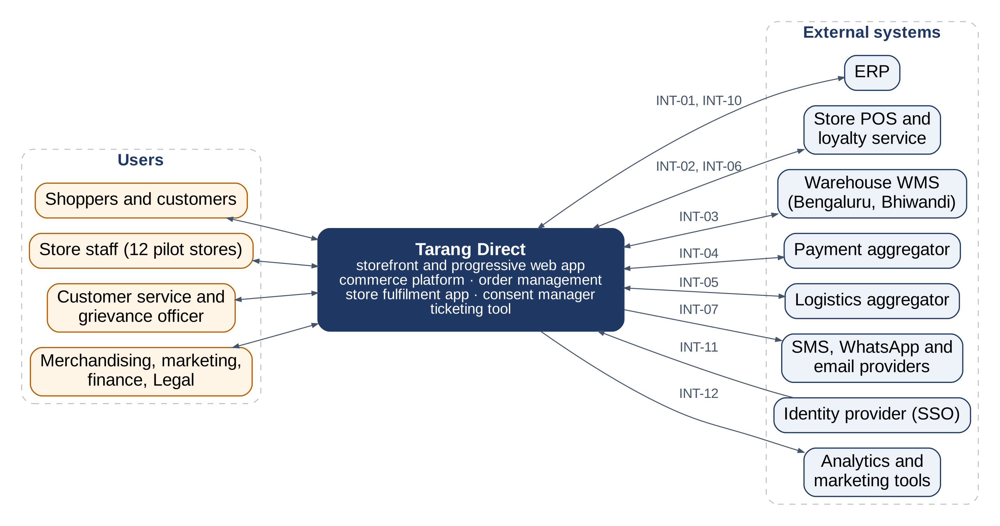
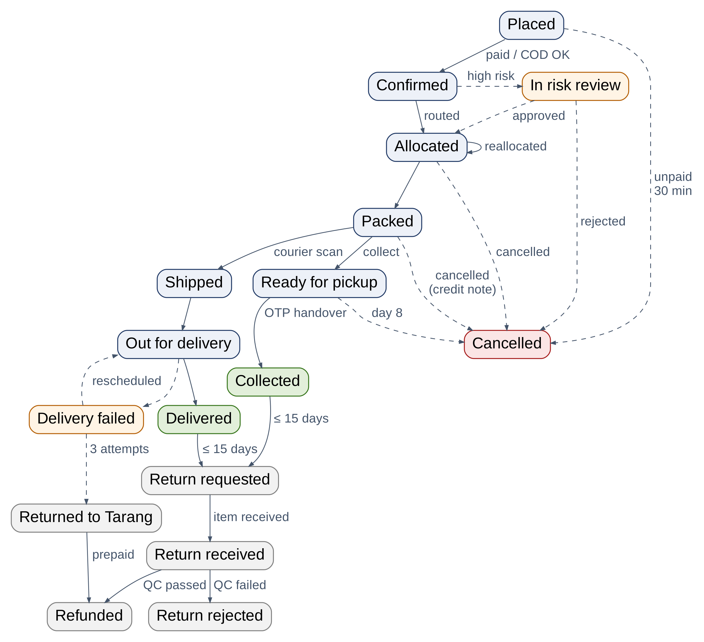

# Functional Requirements Document (FRD)

**Tarang Direct: direct-to-consumer e-commerce portal · Release 1**

Software requirements specification structure of ISO/IEC/IEEE 29148:2018 (successor to IEEE 830) · FRD-DIG-014-S · Version 1.0 · Approved 11 December 2026 · Derived from BRD-DIG-014 v1.0

**Contents**

- [About this example](#about-this-example)
- [Document control](#document-control)
- [1. Introduction](#1-introduction)
- [2. References](#2-references)
- [3. Specific requirements](#3-specific-requirements)
- [4. Verification](#4-verification)
- [5. Appendices](#5-appendices)

# About this example

> *Note: This example presents the requirements for Tarang Direct in the ISO/IEC/IEEE 29148:2018 software requirements specification structure (the successor to IEEE 830). It is derived from the example BRD "Tarang Direct: direct-to-consumer e-commerce portal" (BRD-DIG-014, version 1.0); a companion example presents the same system in the BABOK-aligned FRD template. Tarang Home & Kitchen Pvt. Ltd., its people, figures, systems and dates are fictional. Regulatory requirements reflect Indian law as of November 2026 and must be confirmed with legal counsel before use on a real project. In "Source (BRD)" columns, IDs such as FR-01, NFR-04, SR-12, BR-05, TR-04 and C-04 refer to the BRD.*

# Document control

| **Field** | **Value** |
|----|----|
| **Document title** | Functional Requirements Document (Software Requirements Specification) for Tarang Direct |
| **Document ID** | FRD-DIG-014-S |
| **Project** | Tarang Direct: direct-to-consumer e-commerce portal |
| **Release** | Release 1 (public launch 2027-04-15) |
| **Related documents** | BRD-DIG-014 v1.0 (approved 2026-11-10); solution architecture SA-DIG-014 v0.6 |
| **Author** | Kavya Nair, Lead Business Analyst |
| **Current version** | 1.0 |
| **Status** | Approved and baselined |
| **Date** | 2026-12-11 |

## Change history

| **Version** | **Date** | **Author** | **Summary of changes** |
|----|----|----|----|
| 0.1 | 2026-11-20 | Kavya Nair | Initial draft derived from BRD v1.0 |
| 0.2 | 2026-11-27 | Kavya Nair | Functions refined in four workshops with store, supply chain, service and finance teams |
| 0.3 | 2026-12-04 | Kavya Nair, Imran Qureshi | Interfaces, database requirements and software system attributes added with the solution architect |
| 0.9 | 2026-12-08 | Kavya Nair, Sneha Pillai | Review draft; verification matrix (section 4) completed; requirements checked against the 29148 characteristics |
| 1.0 | 2026-12-11 | Kavya Nair | Approved and baselined |

## Approvals

| **Name** | **Role** | **Decision** | **Signature** | **Date** |
|----|----|----|----|----|
| Rohan Mehta | Head of Digital Commerce, product owner | Approved | Signed electronically | 2026-12-10 |
| Imran Qureshi | Solution Architect | Approved | Signed electronically | 2026-12-09 |
| Vikram Desai | Chief Information Officer | Approved | Signed electronically | 2026-12-10 |
| Farhan Sheikh | Head of Retail Operations | Approved with conditions: BRL-18 times reviewed after 4 weeks of soft launch | Signed electronically | 2026-12-09 |
| Lakshmi Prasad | Head of Supply Chain | Approved | Signed electronically | 2026-12-09 |
| Sanjay Kulkarni | Chief Financial Officer | Approved | Signed electronically | 2026-12-10 |
| Arjun Menon | Head of Legal and Compliance | Approved with conditions: ISS-02 and ISS-06 closed before UAT | Signed electronically | 2026-12-11 |
| Sneha Pillai | QA Lead | Approved | Signed electronically | 2026-12-09 |

# 1. Introduction

## 1.1 Purpose

This document specifies the software requirements for Release 1 of Tarang Direct: the customer storefront, order management, store fulfilment app, and their integrations. It turns the business and stakeholder requirements in BRD-DIG-014 into requirements that developers can build and testers can verify, and states how each will be verified. It is written for the delivery team, testers, the solution architect, and the business, legal and security owners who approve it.

## 1.2 Scope

- **Software product:** Tarang Direct, Release 1: a responsive website and progressive web app, a commerce platform, an order management system (OMS), a store fulfilment app, and supporting consent, ticketing and analytics tools.

- **What it will do:** sell Tarang's own inventory online across India; show delivery dates by pincode; take payment by UPI, cards, net banking, wallets, EMI and cash on delivery; fulfil orders from 2 warehouses and 12 pilot stores, including click and collect; handle tracking, returns and refunds; run Tarang Circle loyalty online; handle customer service and grievances; issue GST invoices; and reconcile and post to the ERP.

- **What it will not do:** see section 1.3.5. Accounting, purchasing and supplier payments stay in the ERP.

- **Objectives supported:** BRD business requirements BR-01 to BR-07: ₹45 crore net revenue in year 1, channel cost of 18% or less, 4 lakh consented customers, aged stock down to 12%, 20% of orders fulfilled by stores, online NPS of 45, and full legal compliance at launch.

## 1.3 Product overview

### 1.3.1 Product perspective

Tarang Direct is a new product. It does not replace the marketplace channels, which continue unchanged. The ERP remains the system of record for products, prices, stock valuation and finance.

*Figure 1: System context for Tarang Direct Release 1*

| **Aspect** | **Description** |
|----|----|
| System interfaces | ERP, store POS and loyalty service, warehouse WMS, payment aggregator, logistics aggregator, messaging providers, consent manager, ticketing tool, identity provider, analytics and marketing tools (section 3.4.3) |
| User interfaces | Responsive storefront and installable web app for customers; store app on tablets; browser-based tools for service, merchandising, marketing and finance staff (section 3.4.1) |
| Hardware interfaces | Store tablets, barcode scanners, label printers and A4 printers in the 12 pilot stores (section 3.4.2) |
| Software interfaces | REST APIs, events, signed webhooks and daily files (section 3.4.3) |
| Communications interfaces | HTTPS, SMS, WhatsApp, email and webhooks (section 3.4.4) |
| Memory constraints | None beyond the hosting platform's limits |
| Operations | Storefront 24 × 7; store fulfilment 10:00–21:00 IST; customer service 09:00–21:00 IST, 7 days; nightly reconciliation (FUN-FIN-03); hourly ERP posting (FUN-FIN-04); planned maintenance 02:00–05:00 IST (AVL-03) |
| Site adaptation requirements | Each pilot store configured with its GSTIN, address, hours, safety stock and printers; delivery charges, COD limits and routing weights configured by the business (MNT-01) |

### 1.3.2 Product functions

| **Code** | **Function** | **Summary** | **Section** |
|----|----|----|----|
| CAT | Catalogue and product content | Import, enrich and publish products with legal declarations | 3.1.1 |
| SRC | Search and navigation | Search, filters, delivery dates by pincode, store stock | 3.1.2 |
| ACC | Accounts, consent and privacy | Sign-in, guest checkout, consent, privacy rights, addresses | 3.1.3 |
| CRT | Cart, pricing and promotions | Cart, transparent prices, promotions, gift options | 3.1.4 |
| CHK | Checkout | Four-step checkout, delivery options, placing the order | 3.1.5 |
| PAY | Payments | Payment methods, COD, card tokens, EMI, recovery, risk | 3.1.6 |
| OMS | Order management | Stock availability, reservation, routing, cancellations | 3.1.7 |
| STR | Store fulfilment app | Picking, packing, click and collect, store returns | 3.1.8 |
| DLV | Delivery and tracking | Shipments, promised dates, tracking, failed deliveries | 3.1.9 |
| RET | Returns, exchanges and refunds | Returns, exchanges, quality checks, refunds | 3.1.10 |
| LOY | Loyalty | One Tarang Circle balance across channels | 3.1.11 |
| REV | Ratings and reviews | Verified-buyer reviews and moderation | 3.1.12 |
| CSR | Customer service and grievances | Customer view, tickets, grievances, agent actions | 3.1.13 |
| MKT | Content, marketing and analytics | CMS, consent-based marketing, KPI dashboard | 3.1.14 |
| FIN | Finance and tax | GST invoices, reconciliation, ERP posting | 3.1.15 |
| RPT | Operational reports | Exception and compliance reports | 3.1.16 |

### 1.3.3 User characteristics

| **User group** | **Number (year 1)** | **Frequency of use** | **Characteristics** |
|----|----|----|----|
| Guest shoppers | About 60% of visitors | Occasional | Mostly on phones; varied digital skills; some on slow mobile data |
| Registered customers | 4–6 lakh | Monthly | Expect saved details and order history; many are Tarang Circle members |
| Store associates | About 70 in 12 stores | Daily, alongside floor sales | Trained in POS; new to online fulfilment |
| Store managers | 12 | Daily | Accountable for fulfilment times and safety stock |
| Customer service agents | 18 | Daily, full time | Trained; use the ticketing tool all day |
| Service supervisors and grievance officer | 3 | Daily | Senior; accountable for legal timelines |
| Merchandisers | 8 | Daily | Experts in product data; not technical |
| Marketing users | 6 | Daily | Use the CMS and marketing tool |
| Finance users | 4 | Daily | Experts in the ERP and GST |
| System administrators | 3 | As needed | IT staff |

### 1.3.4 Limitations

| **ID** | **Limitation** | **Source** |
|----|----|----|
| LIM-01 | Public launch by 2027-04-15, before the DPDP Rules' core obligations apply on 2027-05-13. | BRD C-01 |
| LIM-02 | Budget of ₹6.8 crore capital and ₹2.1 crore a year running cost. | BRD C-02 |
| LIM-03 | Payments only through an RBI-authorised payment aggregator; no card data stored by Tarang. | BRD C-03 |
| LIM-04 | Customer personal data hosted in India. | BRD C-04 |
| LIM-05 | The ERP stays the system of record; its core code is not changed. | BRD C-05 |
| LIM-06 | Tarang sells only its own inventory, as an inventory e-commerce entity under the E-Commerce Rules. | BRD C-06 |
| LIM-07 | Store POS v8 provides stock and loyalty services; no other POS changes in Release 1. | SA-DIG-014 |
| LIM-08 | The software must comply at launch with the laws and standards in section 3.6.1. | BRD BR-07 |

### 1.3.5 Apportioning of requirements

| **Requirement** | **Deferred or allocated to** | **Reason** |
|----|----|----|
| Hindi storefront (BRD FR-13) | Release 2 (October 2027) | Prioritised after launch; consent notices are offered in Hindi from launch (FUN-ACC-05) |
| Native Android and iOS apps | Release 2 | The installable web app (PRT-02) meets launch needs |
| Ship-from-store in the other 26 stores | Release 1.1 onward | Each store must first meet BRD TR-04 (MNT-03 allows it by configuration) |
| Delivery slots for bulky items | Release 2 | Not needed for the launch range |
| No-cost EMI | Decision pending (ISS-01) | Cost to be agreed by the CFO |
| Payment execution, accounting, purchasing | ERP | ERP is the system of record (LIM-05) |
| Corporate and bulk orders | Existing B2B sales team | Outside the portal's scope (BRD section 4.2) |

## 1.4 Definitions

| **Term** | **Definition** |
|----|----|
| **Available to promise (ATP)** | Stock that can be sold online at a node: on-hand minus reserved minus safety stock |
| **Click and collect** | Buying online and collecting from a pilot store |
| **Node** | A location that fulfils orders: one of 2 warehouses or 12 pilot stores |
| **Promised date** | The delivery or collection date shown at checkout (FUN-DLV-04) |
| **Safety stock** | Units held back from online sale to protect store sales (BRL-05) |
| **Verified buyer** | A customer with a delivered portal order containing the product (BRL-10) |
| **Transactional message** | A message sent because of an order or request, which needs no marketing consent (section 3.8.5) |

Acronyms are in section 5.2. Terms in the BRD glossary (BRD section 16) are not repeated.

# 2. References

| **ID** | **Document** | **Version** | **Date** | **Location** |
|----|----|----|----|----|
| REF-01 | Business Requirements Document, BRD-DIG-014 | 1.0 | 2026-11-10 | SharePoint › Tarang Direct › Requirements |
| REF-02 | Business case BC-2026-07 | 1.0 | 2026-08-22 | SharePoint › Tarang Direct › Business case |
| REF-03 | Solution architecture SA-DIG-014 | 0.6 | 2026-12-04 | SharePoint › Tarang Direct › Design |
| REF-04 | Tarang Digital UI style guide | 2.1 | 2026-06-30 | Figma › Tarang Design System |
| REF-05 | Wireframes, Release 1 | 0.8 | 2026-12-03 | Figma › Tarang Direct › R1 |
| REF-06 | Returns policy RP-2026-01; pricing policy PRC-2026-03; loyalty terms LT-2026 | Current | 2026 | Policy library |
| REF-07 | Use case catalogue | 0.9 | 2026-12-08 | SharePoint › Tarang Direct › Requirements |
| REF-08 | Test strategy TS-DIG-014 | 0.4 | 2026-12-08 | SharePoint › Tarang Direct › Test |
| REF-09 | ISO/IEC/IEEE 29148:2018, Requirements engineering | 2018 | 2018-11 | Standards library |

# 3. Specific requirements

Every requirement has an ID, a statement, a rationale, its source in the BRD, a priority (Essential, Conditional or Optional) and a verification method. Section 4 gives the pass criteria for each. Functions in section 3.1 are organized by feature.

## 3.1 Functions

Each feature covers input validation, the normal sequence, and responses to abnormal situations (stated as "If … then" requirements).

### 3.1.1 CAT: Catalogue and product content

**Description:** imports products from the ERP, lets merchandisers enrich and publish them, and enforces legal declarations and price limits. **Priority:** Essential. **Source (BRD):** BR-01, BR-07; SR-12, SR-15.

| **ID** | **Requirement** | **Rationale** | **Source (BRD)** | **Priority** | **Verification** |
|----|----|----|----|----|----|
| FUN-CAT-01 | When the ERP publishes a new or changed product, the system shall import its master data (SKU, title, category, attributes, HSN code, GST rate, MRP, dimensions, weight, country of origin, and manufacturer, packer or importer details) within 15 minutes. | ERP is the product master; avoids double keying | FR-01 (SR-12) | Essential | Test |
| FUN-CAT-02 | If an imported record fails validation (for example, a missing HSN code, MRP of zero, or no country of origin), then the system shall keep the last valid version live and add the record to the daily import error report. | Bad data must never reach a live page | FR-01, FR-03 (SR-12, SR-15) | Essential | Test |
| FUN-CAT-03 | The system shall let merchandisers add a description of up to 2,000 characters, 3 to 12 images, up to 2 videos, care instructions, room tags and search-engine title and description to each product, and schedule its publication. | Cuts time to go live from 9 days | FR-02 (SR-12) | Essential | Demonstration |
| FUN-CAT-04 | If any Legal Metrology declaration field is empty, then the system shall block publication and list the missing fields. | Legal Metrology declarations are mandatory | FR-03 (SR-15) | Essential | Test |
| FUN-CAT-05 | The system shall show on every product page the Legal Metrology declarations, the return, exchange and refund terms for its category, the warranty, and Tarang's legal name and address as seller. | E-Commerce Rules and Legal Metrology disclosures | FR-03, FR-04 (SR-02, SR-15) | Essential | Inspection |
| FUN-CAT-06 | The system shall support variants by size, colour and finish, each with its own SKU, images, price, stock and delivery date. | Most home products come in variants | FR-05 (SR-01) | Essential | Test |
| FUN-CAT-07 | The system shall support room-set bundles of 2 to 8 SKUs at a bundle price, with bundle stock equal to the lowest available stock of its components and a refund value for each item stored at purchase. | Room sets raise order value | FR-06 (SR-01, SR-12) | Conditional | Test |
| FUN-CAT-08 | If a price change would make a selling price higher than the MRP, then the system shall reject the change, keep the current price, and log the attempt with user and source. | Selling above MRP is unlawful | FR-07 (SR-15) | Essential | Test |

### 3.1.2 SRC: Search and navigation

**Description:** helps shoppers find products and see whether, when and where they can get them. **Priority:** Essential. **Source (BRD):** BR-01, BR-05, BR-06; SR-01, SR-04, SR-07.

| **ID** | **Requirement** | **Rationale** | **Source (BRD)** | **Priority** | **Verification** |
|----|----|----|----|----|----|
| FUN-SRC-01 | The system shall rank search results by relevance, tolerate up to 2 wrong characters in words of 5 or more characters, and apply synonyms maintained by merchandisers (for example "bedsheet", "bed sheet" and "chaddar"). | Search is the main route to products | FR-08 (SR-01) | Essential | Test |
| FUN-SRC-02 | When a shopper has typed 3 or more characters, the system shall show up to 8 product and category suggestions. | Speeds up finding products on phones | FR-08 (SR-01) | Essential | Test |
| FUN-SRC-03 | If a search returns no results, then the system shall show spelling suggestions and popular categories, and log the term for merchandiser review. | Turns failed searches into fixes | FR-08 (SR-01) | Conditional | Test |
| FUN-SRC-04 | The system shall let shoppers filter listings by category, room, price range, colour, material, rating, discount band, delivery to their pincode and country of origin, and sort by relevance, price (both directions), newest and rating. | Large range needs fast narrowing | FR-09 (SR-01, SR-15) | Essential | Test |
| FUN-SRC-05 | Where a listing contains imported products, the system shall let shoppers search, filter and sort by country of origin. | Required by Legal Metrology Rule 6(10A) | FR-09 (SR-01, SR-15) | Essential | Test |
| FUN-SRC-06 | When a shopper enters a pincode, the system shall show "Delivery by \<date\>" or "Not deliverable to this pincode" on every listing tile and product page, and remember the pincode for the session and, for signed-in customers, as their default. | Delivery date drives the buying decision | FR-10 (SR-04) | Essential | Test |
| FUN-SRC-07 | The system shall show stock at pilot stores within 10 km of the shopper's pincode as "In stock", "Few left" (3 or fewer) or "Out of stock", based on store stock available to promise. | Supports click and collect | FR-11 (SR-07) | Conditional | Test |
| FUN-SRC-08 | The system shall show up to 8 "Complete the look" recommendations on product and cart pages. | Raises order value | FR-12 (SR-01) | Optional | Test |

### 3.1.3 ACC: Accounts, consent and privacy

**Description:** sign-in, guest checkout, consent collection and the customer's privacy rights. **Priority:** Essential. **Source (BRD):** BR-03, BR-07; SR-03, SR-04, SR-05, SR-08.

| **ID** | **Requirement** | **Rationale** | **Source (BRD)** | **Priority** | **Verification** |
|----|----|----|----|----|----|
| FUN-ACC-01 | The system shall let shoppers register and sign in with a mobile number and OTP, or with an email address and a password of at least 8 characters including a letter and a number. | Mobile OTP suits Indian shoppers | FR-14 (SR-03) | Essential | Test |
| FUN-ACC-02 | If an OTP is entered wrongly 3 times, or is not used within 5 minutes, then the system shall invalidate it and allow a new OTP after 30 seconds, up to 5 OTPs an hour for each mobile number (BRL-16). | Limits OTP abuse and cost | FR-14, NFR-11 (SR-03, SR-16) | Essential | Test |
| FUN-ACC-03 | The system shall let shoppers check out as guests with a mobile number and email, and offer one-tap account creation after the order without re-entering details. | Forced sign-up loses sales | FR-14 (SR-03) | Essential | Test |
| FUN-ACC-04 | When the system asks for consent to an optional purpose, it shall show an itemised notice (data collected, purpose, how to withdraw, how to complain to the Data Protection Board) with separate, unticked choices for email, SMS and WhatsApp marketing and for personalisation. | DPDP notice and consent requirements | FR-15 (SR-08, SR-15) | Essential | Test |
| FUN-ACC-05 | The system shall show the notice in English or Hindi at the customer's choice, and record for each consent the purpose, notice version, language, time, channel and device. | Proves what each customer agreed to | FR-15 (SR-08, SR-15) | Essential | Test |
| FUN-ACC-06 | The system shall provide a privacy centre where customers can download their data, correct their profile, withdraw any consent, nominate a person to act for them, and ask for their account to be erased. | DPDP rights of the data principal | FR-16 (SR-08) | Essential | Test |
| FUN-ACC-07 | When a customer withdraws a consent, the system shall stop the related processing and send the withdrawal to the messaging, marketing and analytics tools within 24 hours. | Withdrawal must be effective everywhere | FR-16, FR-57 (SR-08, SR-13) | Essential | Test |
| FUN-ACC-08 | When a customer asks for erasure, the system shall confirm identity by OTP, erase or anonymise their personal data within 30 days except records the law requires Tarang to keep (STD-11), and confirm by email. | DPDP erasure, within legal retention | FR-16, NFR-19 (SR-08, SR-14) | Essential | Test |
| FUN-ACC-09 | The system shall store up to 10 delivery addresses for each customer, validate the 6-digit pincode against the serviceable list, and fill in city and state from the pincode. | Prevents undeliverable orders | FR-17 (SR-03) | Essential | Test |
| FUN-ACC-10 | The system shall provide an account page showing orders from the last 3 years, returns, downloadable GST invoices, loyalty balance, saved cards (issuer and last 4 digits), wishlist and a link to the privacy centre. | Self-service reduces service contacts | FR-18 (SR-04, SR-05) | Essential | Test |

### 3.1.4 CRT: Cart, pricing and promotions

**Description:** the cart, transparent pricing, promotions and honest urgency messages. **Priority:** Essential. **Source (BRD):** BR-01, BR-04, BR-06, BR-07; SR-02, SR-03, SR-12, SR-13, SR-15.

| **ID** | **Requirement** | **Rationale** | **Source (BRD)** | **Priority** | **Verification** |
|----|----|----|----|----|----|
| FUN-CRT-01 | The system shall keep a signed-in customer's cart for 30 days across devices, and a guest's cart for 7 days on the same device, and merge the guest cart into the account cart at sign-in. | Shoppers switch between devices | FR-19 (SR-03) | Conditional | Test |
| FUN-CRT-02 | When a cart is opened, the system shall recheck the price, stock and deliverability of every line and show what changed. | No surprises at checkout | FR-19, FR-20 (SR-02, SR-03, SR-15) | Essential | Test |
| FUN-CRT-03 | The system shall show on listings and product pages the selling price, the MRP struck through when it is higher, and the discount percentage rounded down to a whole number. | Transparent discounts | FR-20 (SR-02, SR-15) | Essential | Test |
| FUN-CRT-04 | The system shall show an itemised summary (items, discounts, coupon, loyalty points, delivery charge, COD fee, gift wrap, and total including GST) on the cart page and at every checkout step. | Prevents drip pricing | FR-20 (SR-02, SR-15) | Essential | Test |
| FUN-CRT-05 | The system shall support percentage and flat discounts, buy-X-get-Y offers, bundle prices, free-delivery thresholds, and coupons limited by dates, uses per customer, total uses, minimum cart value and eligible or excluded categories. | Merchandisers run promotions themselves | FR-21 (SR-12, SR-13) | Essential | Demonstration |
| FUN-CRT-06 | If a shopper applies a second coupon, or a coupon to ineligible items (BRL-08), then the system shall reject it and give the specific reason. | Clear reasons reduce abandonment | FR-21 (SR-12, SR-13) | Essential | Test |
| FUN-CRT-07 | The system shall show "Only N left" only when stock available to the shopper's delivery node is 5 or fewer, and shall show a countdown only for an offer with a fixed end time that never resets. | Prevents false urgency | FR-22 (SR-15) | Essential | Test |
| FUN-CRT-08 | The system shall never add an item, warranty, donation, insurance or charge to the cart without an explicit action by the shopper, and shall not pre-select any optional add-on. | Prevents basket sneaking | FR-23 (SR-15) | Essential | Inspection |
| FUN-CRT-09 | The system shall offer gift wrap (₹99 a shipment) and a gift message of up to 200 characters, and leave prices off the packing slip of gift orders. | 15% of revenue is gifting | FR-24 (SR-03) | Optional | Test |

### 3.1.5 CHK: Checkout

**Description:** a short checkout with clear delivery choices and an explicit order action. **Priority:** Essential. **Source (BRD):** BR-01, BR-06, BR-07; SR-03, SR-04, SR-15.

| **ID** | **Requirement** | **Rationale** | **Source (BRD)** | **Priority** | **Verification** |
|----|----|----|----|----|----|
| FUN-CHK-01 | The system shall provide a checkout of no more than 4 steps (address, delivery option, payment, review and place order); signed-in customers with a default address start at the delivery step. | Short checkout converts better | FR-25 (SR-03, SR-04) | Essential | Test |
| FUN-CHK-02 | The system shall show each available delivery option with its charge and promised date (standard under BRL-01, express under BRL-14, click and collect at eligible stores), and show unavailable options with the reason. | Shoppers choose speed against cost | FR-25, FR-42 (SR-03, SR-04) | Essential | Test |
| FUN-CHK-03 | Where an order will ship in more than one shipment, the system shall show each shipment's items and promised date before payment. | Sets honest expectations | FR-34 (SR-09, SR-10) | Essential | Test |
| FUN-CHK-04 | The system shall place an order only when the shopper selects "Place order" on the review step, shown next to links to the terms of sale and the returns policy, with no pre-ticked consent. | E-Commerce Rules require explicit consent | FR-31, FR-23 (SR-04, SR-15) | Essential | Test |
| FUN-CHK-05 | When an order is confirmed, the system shall show a confirmation page and send email and SMS within 2 minutes with the order number, items, amount paid, payment method and promised dates. | Customers need proof of order | FR-31 (SR-04, SR-15) | Essential | Test |
| FUN-CHK-06 | If any line becomes unavailable between the review step and payment, then the system shall stop before payment, show the affected lines, and offer to remove them or change the delivery option. | Never charge for unavailable stock | FR-33 (SR-09, SR-10) | Essential | Test |

### 3.1.6 PAY: Payments

**Description:** payment methods, cash on delivery, saved cards, payment recovery and risk screening. **Priority:** Essential. **Source (BRD):** BR-01, BR-02, BR-07; SR-03, SR-14, SR-15, SR-16.

| **ID** | **Requirement** | **Rationale** | **Source (BRD)** | **Priority** | **Verification** |
|----|----|----|----|----|----|
| FUN-PAY-01 | The system shall offer UPI (app intent on phones, QR code on desktops, and UPI ID collect requests), cards, net banking and wallets through the payment aggregator's hosted payment page or SDK. | Covers the methods Indian shoppers use | FR-26, NFR-10 (SR-03, SR-16) | Essential | Test |
| FUN-PAY-02 | The system shall offer cash on delivery only when BRL-02 conditions are met, show the ₹49 COD fee before the order is placed, and require OTP confirmation for COD orders over ₹5,000. | COD widens reach; OTP limits refusals | FR-27 (SR-03) | Essential | Test |
| FUN-PAY-03 | Where the customer consents, the system shall save a card as a card-network or bank token through the payment aggregator, storing only the token reference, card issuer name and last 4 digits. | Faster repeat checkout within RBI rules | FR-28 (SR-15, SR-16) | Essential | Inspection |
| FUN-PAY-04 | The system shall never receive, store or log a full card number, expiry date or CVV. | RBI rules; limits breach impact | FR-28, NFR-10 (SR-15, SR-16) | Essential | Inspection |
| FUN-PAY-05 | The system shall offer EMI on eligible cards for orders of ₹3,000 or more, showing tenure, interest and total payable before payment. | Helps first-home setters afford more | FR-29 (SR-03) | Optional | Test |
| FUN-PAY-06 | If a payment's status is pending or unknown when the customer returns from the payment step, then the system shall check with the aggregator every 2 minutes for up to 30 minutes, then confirm the order or cancel it and start an automatic refund. | Customer is never charged without an order | FR-30 (SR-03, SR-14) | Essential | Test |
| FUN-PAY-07 | If a payment fails, then the system shall keep the cart and checkout details, explain the failure in plain language, and let the customer retry with any method. | Recovers failed payments | FR-26 (SR-03) | Essential | Test |
| FUN-PAY-08 | The system shall score every order for fraud and COD risk (order frequency, address and device signals, refused COD deliveries) and send orders above the risk threshold to a review queue. | Limits fraud and COD refusals | FR-32 (SR-16) | Conditional | Analysis |
| FUN-PAY-09 | When a refund is triggered, the system shall create it through the payment aggregator to the original payment method and record the aggregator's refund ID. | Refunds traceable for reconciliation | FR-30, FR-47 (SR-03, SR-05, SR-14) | Essential | Test |

### 3.1.7 OMS: Order management

**Description:** stock available to promise, reservation, routing, warehouse orders, order status and cancellations. **Priority:** Essential. **Source (BRD):** BR-01, BR-04, BR-05, BR-06; SR-05, SR-09, SR-10.

| **ID** | **Requirement** | **Rationale** | **Source (BRD)** | **Priority** | **Verification** |
|----|----|----|----|----|----|
| FUN-OMS-01 | The system shall calculate stock available to promise (ATP) for each SKU at each node as on-hand minus reserved minus safety stock (BRL-05), updated from POS and WMS events within 5 minutes. | One stock view across 14 nodes | FR-33 (SR-09, SR-10) | Essential | Test |
| FUN-OMS-02 | When an order is placed, the system shall reserve stock at the planned node, and release it if payment is not confirmed within 30 minutes (BRL-17). | Prevents overselling | FR-33 (SR-09, SR-10) | Essential | Test |
| FUN-OMS-03 | When an order is confirmed and passes risk screening, the system shall allocate each line to a node under BRL-06 within 2 minutes. | Meets promise at lowest cost | FR-34 (SR-09, SR-10) | Essential | Test |
| FUN-OMS-04 | If a store does not accept an allocated order within 60 minutes or marks a line "Cannot fulfil" (BRL-18), then the system shall reallocate it to the next-best node and tell the customer if the promised date changes. | Keeps orders moving if a store cannot | FR-34, FR-35 (SR-09, SR-10) | Essential | Test |
| FUN-OMS-05 | When a line is allocated to a warehouse, the system shall send it to the WMS with packing instructions, gift options and label data within 5 minutes, and receive pick, pack and dispatch updates within 5 minutes of each event. | Warehouses keep using their WMS | FR-36 (SR-10) | Essential | Test |
| FUN-OMS-06 | The system shall maintain order and line statuses as shown in Figure 2 and share every status change with the customer's account, the service tool and analytics. | One status everywhere | FR-31, FR-41 (SR-04, SR-15) | Essential | Test |
| FUN-OMS-07 | The system shall let customers cancel a whole order or single lines free of charge until the line is dispatched. | E-Commerce Rules on cancellation | FR-38 (SR-05) | Essential | Test |
| FUN-OMS-08 | If Tarang cancels a line (stock error or failed risk check), then the system shall refund it in full, tell the customer the reason, and charge no fee. | Fair treatment when Tarang cancels | FR-38 (SR-05) | Essential | Test |

### 3.1.8 STR: Store fulfilment app

**Description:** the app store staff use to fulfil ship-from-store and click-and-collect orders and accept returns. **Priority:** Conditional. **Source (BRD):** BR-04, BR-05; SR-07, SR-09.

| **ID** | **Requirement** | **Rationale** | **Source (BRD)** | **Priority** | **Verification** |
|----|----|----|----|----|----|
| FUN-STR-01 | The system shall give store staff an app on store tablets and handheld scanners listing orders allocated to their store, sorted by pick-by time. | Stores fulfil without disrupting the floor | FR-35 (SR-09) | Conditional | Test |
| FUN-STR-02 | When an order is allocated to a store, the system shall alert the store app within 1 minute and require an associate to accept it within 30 minutes during store hours. | Keeps fulfilment times predictable | FR-35 (SR-09) | Conditional | Test |
| FUN-STR-03 | The system shall guide picking with each item's location and image and require a barcode scan for every unit; if a scanned barcode does not match, then the app shall block packing and show the expected item. | Prevents wrong items being sent | FR-35 (SR-09) | Conditional | Test |
| FUN-STR-04 | When packing is complete, the system shall print the shipping label and GST invoice at the store and book courier pickup. | Stores ship like warehouses | FR-35, FR-39, FR-60 (SR-04, SR-09, SR-10, SR-14, SR-15) | Conditional | Test |
| FUN-STR-05 | When a click-and-collect order is packed, the system shall mark it "Ready for pickup" and send the customer a collection OTP, the store address and opening hours. | Customer knows when to collect | FR-37 (SR-07) | Conditional | Test |
| FUN-STR-06 | The system shall release a click-and-collect order only when staff enter the customer's valid OTP, and record the staff member and time. | Hands orders only to the right person | FR-37 (SR-07) | Conditional | Test |
| FUN-STR-07 | If a click-and-collect order is not collected by the end of day 7, then the system shall cancel it on day 8, return the stock to store ATP and refund in full (BRL-11). | Releases stock and refunds fairly | FR-37 (SR-07) | Conditional | Test |
| FUN-STR-08 | The system shall let store staff accept a return of a portal order found by order number or mobile number, record its condition and reason, and print a return receipt. | Omnichannel returns | FR-46 (SR-07) | Conditional | Test |

### 3.1.9 DLV: Delivery and tracking

**Description:** serviceability, shipments, promised dates, tracking and failed deliveries. **Priority:** Essential. **Source (BRD):** BR-01, BR-06; SR-04, SR-10.

| **ID** | **Requirement** | **Rationale** | **Source (BRD)** | **Priority** | **Verification** |
|----|----|----|----|----|----|
| FUN-DLV-01 | The system shall get serviceability, charges and transit times by pincode from the logistics aggregator, keeping them for up to 24 hours. | Fast, consistent delivery promises | FR-39, FR-10 (SR-04, SR-10) | Essential | Test |
| FUN-DLV-02 | When a shipment is packed, the system shall create it with the logistics aggregator, receive the air waybill (AWB) number and label, and book pickup. | Automates dispatch | FR-39 (SR-04, SR-10) | Essential | Analysis |
| FUN-DLV-03 | If shipment creation fails, then the system shall retry 3 times at 5-minute intervals, then alert the fulfilment support queue. | Outages must not strand parcels | FR-39 (SR-04, SR-10) | Essential | Test |
| FUN-DLV-04 | The system shall calculate the promised delivery date from the node's stock, the 14:00 processing cut-off, node processing time, courier transit days to the pincode and a buffer set for each pincode zone. | On-time delivery drives NPS | FR-40 (SR-04) | Essential | Analysis |
| FUN-DLV-05 | The system shall provide a tracking page, reachable by a link without signing in, showing status history and expected date, and send messages at dispatch, out for delivery and delivery. | Fewer 'where is my order' contacts | FR-41 (SR-04) | Essential | Test |
| FUN-DLV-06 | When the courier reports a delay, or the promised date passes without delivery, the system shall tell the customer within 2 hours and give a new expected date. | Customers hear of delays first | FR-41 (SR-04) | Essential | Test |
| FUN-DLV-07 | The system shall offer next-day express delivery only when BRL-14 conditions are met. | Express only when it can be kept | FR-42 (SR-04) | Conditional | Test |
| FUN-DLV-08 | When the courier reports a failed delivery attempt, the system shall send the customer a link to reschedule within 3 days or correct the address, and pass the instruction to the courier within 1 hour; after 3 failed attempts the shipment returns to Tarang and any prepaid amount is refunded. | Saves failed deliveries | FR-43 (SR-04) | Conditional | Test |

### 3.1.10 RET: Returns, exchanges and refunds

**Description:** self-service returns and exchanges, quality checks and refunds. **Priority:** Essential. **Source (BRD):** BR-06; SR-05, SR-14.

| **ID** | **Requirement** | **Rationale** | **Source (BRD)** | **Priority** | **Verification** |
|----|----|----|----|----|----|
| FUN-RET-01 | The system shall let customers start a return or exchange from the order page within the return window (BRL-03), choosing item, quantity and reason, with up to 5 optional photos. | Easy returns build trust | FR-44 (SR-05) | Essential | Test |
| FUN-RET-02 | If an item is not eligible for return, then the system shall show the reason and offer no return. | Applies the returns policy consistently | FR-44 (SR-05) | Essential | Test |
| FUN-RET-03 | When a customer asks for an exchange, the system shall reserve the replacement variant if in stock, and otherwise offer a return. | Keeps the sale | FR-44 (SR-05) | Conditional | Test |
| FUN-RET-04 | When a return is requested, the system shall book a reverse pickup with the logistics aggregator within 2 business days on serviceable pincodes, or offer drop-off at a pilot store. | Collects returns quickly | FR-45, FR-46 (SR-05, SR-07) | Essential | Test |
| FUN-RET-05 | When a returned item passes quality check at a warehouse or store, the system shall start the refund within 48 hours under BRL-04 and issue a credit note (FUN-FIN-02). | Fast refunds; GST credit note | FR-47 (SR-05, SR-14) | Essential | Test |
| FUN-RET-06 | If a returned item fails quality check, then the system shall tell the customer why, with photos, and offer to send the item back at no charge. | Fair outcome for failed checks | FR-47 (SR-05, SR-14) | Conditional | Test |
| FUN-RET-07 | For COD orders, the system shall ask the customer before pickup to choose a refund to a UPI ID, to a bank account validated through the payment aggregator, or to store credit. | COD orders have no card to refund | FR-47 (SR-05, SR-14) | Essential | Test |
| FUN-RET-08 | The system shall let customers report damage in transit within 48 hours of delivery with up to 5 photos, creating a ticket and offering a replacement or refund. | Transit damage handled promptly | FR-48 (SR-05) | Conditional | Test |

### 3.1.11 LOY: Loyalty

**Description:** one Tarang Circle points balance across stores and the portal. **Priority:** Essential. **Source (BRD):** BR-03; SR-06.

| **ID** | **Requirement** | **Rationale** | **Source (BRD)** | **Priority** | **Verification** |
|----|----|----|----|----|----|
| FUN-LOY-01 | The system shall link a portal account to a Tarang Circle membership when the mobile numbers match and the customer confirms with an OTP. | Brings 9.2 lakh members online | FR-49 (SR-06) | Essential | Test |
| FUN-LOY-02 | The system shall read and update the points balance in the POS loyalty service, so the same balance shows in stores and online within 5 minutes of any change. | One balance across channels | FR-49 (SR-06) | Essential | Test |
| FUN-LOY-03 | When an order's return window closes, the system shall credit 1 point for each ₹100 of net spend on unreturned items (BRL-07). | Points only on kept purchases | FR-50 (SR-06) | Essential | Test |
| FUN-LOY-04 | The system shall let members redeem points at checkout at ₹1 a point, up to 20% of the order value, and reverse redeemed points in proportion when items are returned. | Rewards members; limits cost | FR-50 (SR-06) | Essential | Test |
| FUN-LOY-05 | If the loyalty service is unavailable at checkout, then the system shall hide redemption, let checkout continue, and queue point credits for later. | Loyalty outage must not stop sales | FR-49 (SR-06) | Essential | Test |

### 3.1.12 REV: Ratings and reviews

**Description:** reviews from verified buyers, moderated under a published policy. **Priority:** Conditional. **Source (BRD):** BR-06, BR-07; SR-01, SR-15.

| **ID** | **Requirement** | **Rationale** | **Source (BRD)** | **Priority** | **Verification** |
|----|----|----|----|----|----|
| FUN-REV-01 | The system shall accept reviews only from verified buyers (BRL-10), and send review requests only to customers with marketing consent. | Only genuine buyers review | FR-51, FR-57 (SR-01, SR-08, SR-13, SR-15) | Conditional | Test |
| FUN-REV-02 | The system shall let verified buyers give a 1 to 5 star rating with an optional title, text of up to 2,000 characters and up to 5 photos. | Rich reviews help buyers decide | FR-51 (SR-01, SR-15) | Conditional | Test |
| FUN-REV-03 | The system shall moderate each review within 48 hours against the published reviews policy, and reject reviews only for policy reasons (abuse, personal data, unrelated content), never because they are negative. | IS 19000; no suppression of criticism | FR-51 (SR-01, SR-15) | Conditional | Inspection |
| FUN-REV-04 | The system shall show the average rating of all published reviews with their count, and label each review "Verified purchase". | Honest, verifiable ratings | FR-51 (SR-01, SR-15) | Conditional | Test |

### 3.1.13 CSR: Customer service and grievances

**Description:** the agent's view of the customer, tickets, the grievance process and agent actions. **Priority:** Essential. **Source (BRD):** BR-06, BR-07; SR-11, SR-15, SR-16.

| **ID** | **Requirement** | **Rationale** | **Source (BRD)** | **Priority** | **Verification** |
|----|----|----|----|----|----|
| FUN-CSR-01 | The system shall give agents one view of a customer's profile, consents, orders, payments, refunds, returns, shipments, loyalty, reviews and past tickets, found by order number, mobile number or email. | Resolve on first contact | FR-52 (SR-11) | Essential | Test |
| FUN-CSR-02 | The system shall create a ticket for every phone, email, web chat and WhatsApp contact, link it to the customer and order, and send the customer the ticket number within 5 minutes. | Every contact is tracked | FR-53 (SR-11) | Essential | Test |
| FUN-CSR-03 | The system shall show the grievance officer's name, designation, phone number and email address on the Contact and Grievance pages and in the site footer. | Required by the E-Commerce Rules | FR-54 (SR-11, SR-15) | Essential | Inspection |
| FUN-CSR-04 | When a contact is classed as a grievance, the system shall acknowledge it within 48 hours, track resolution within one month, escalate at 36 hours and on day 21, and record the outcome. | Legal grievance timelines | FR-54 (SR-11, SR-15) | Essential | Test |
| FUN-CSR-05 | The system shall let agents cancel orders or lines, start returns, resend invoices and give goodwill credit of up to ₹500 with a reason code; credit above ₹500 needs supervisor approval (BRL-21). | Agents fix problems without hand-offs | FR-55 (SR-11) | Conditional | Test |
| FUN-CSR-06 | The system shall mask customers' contact details and payment references in the agent view (partial email, last 4 digits of mobile) unless the user has the supervisor role. | Least privilege for personal data | FR-52, NFR-08 (SR-11, SR-16) | Essential | Test |

### 3.1.14 MKT: Content, marketing and analytics

**Description:** content management, consent-based marketing, event tracking and the KPI dashboard. **Priority:** Essential. **Source (BRD):** BR-01 to BR-06; SR-08, SR-12, SR-13, SR-15, SR-17.

| **ID** | **Requirement** | **Rationale** | **Source (BRD)** | **Priority** | **Verification** |
|----|----|----|----|----|----|
| FUN-MKT-01 | The system shall provide a CMS for home, category, campaign, store and policy pages, with draft, review, approval, scheduled publishing and version history. | Marketing publishes without IT | FR-56 (SR-12, SR-15) | Essential | Demonstration |
| FUN-MKT-02 | The system shall let only the Legal role approve changes to policy pages (terms, privacy, returns, shipping, grievance), and show the version and effective date on each. | Policy text is a legal commitment | FR-56 (SR-12, SR-15) | Essential | Test |
| FUN-MKT-03 | The system shall send triggered marketing messages (abandoned cart after 1 hour, back in stock, review request, wishlist price drop) only on channels the customer has consented to, no more than 3 a week for each customer (BRL-20), each with a one-step opt-out. | Consent-based, non-nagging marketing | FR-57 (SR-08, SR-13) | Conditional | Test |
| FUN-MKT-04 | The system shall let marketers build segments by purchase history, category, city, loyalty tier and recency, and export only consented customers, refreshing suppression lists every 24 hours. | Targeted campaigns within consent | FR-58 (SR-13) | Conditional | Test |
| FUN-MKT-05 | The system shall capture shopping events (view, search, add to cart, checkout step, purchase, return), sending non-essential events to analytics only for customers who consented. | Measures the funnel lawfully | FR-59 (SR-13, SR-17) | Essential | Test |
| FUN-MKT-06 | The system shall provide a daily KPI dashboard for BR-01 to BR-06 (net revenue, channel cost, consented registrations, aged stock, store-fulfilled share, NPS) plus conversion, average order value, on-time delivery, return rate and payment success rate. | Tracks the BRD objectives | FR-59 (SR-13, SR-17) | Essential | Test |

### 3.1.15 FIN: Finance and tax

**Description:** GST invoices and credit notes, daily reconciliation and ERP posting. **Priority:** Essential. **Source (BRD):** BR-02, BR-07; SR-14, SR-15.

| **ID** | **Requirement** | **Rationale** | **Source (BRD)** | **Priority** | **Verification** |
|----|----|----|----|----|----|
| FUN-FIN-01 | When a shipment is packed, the system shall issue a GST tax invoice from the GSTIN of the shipping node's state, numbered in that GSTIN's series (BRL-19), showing HSN codes, taxable value, CGST and SGST or IGST by place of supply, and attach it to the order. | GST invoice for each supply | FR-60 (SR-14, SR-15) | Essential | Test |
| FUN-FIN-02 | When a return passes quality check, or a line is cancelled after invoicing, the system shall issue a credit note that references the original invoice. | GST credit note for each return | FR-60 (SR-14, SR-15) | Essential | Test |
| FUN-FIN-03 | The system shall reconcile every day the payment aggregator's settlements against captured payments and refunds, and the logistics aggregator's COD remittances against delivered COD orders, and list every exception. | Finds money mismatches daily | FR-61 (SR-14) | Essential | Test |
| FUN-FIN-04 | The system shall post orders, invoices, credit notes, payments, refunds, COD remittances and loyalty liability to the ERP every hour; if a post fails, then it shall retry and alert Finance IT after 3 failures. | Keeps the ERP books complete | FR-62 (SR-14) | Essential | Test |
| FUN-FIN-05 | The system shall calculate channel cost for each order (payment fee, logistics cost and allocated marketing cost) for BR-02 reporting. | Measures BR-02 channel cost | FR-59, FR-61 (SR-13, SR-14, SR-17) | Conditional | Analysis |

### 3.1.16 RPT: Operational reports

**Description:** reports that let each team act on exceptions and evidence compliance. The KPI dashboard is FUN-MKT-06. **Priority:** Essential. **Source (BRD):** BR-07, SR-15, SR-17 and the sources below

| **ID** | **Requirement** | **Rationale** | **Source (BRD)** | **Priority** | **Verification** |
|----|----|----|----|----|----|
| FUN-RPT-01 | The system shall produce a daily report of ERP product records rejected by import validation, giving SKU, field and reason. | Merchandisers fix data quickly | FR-01 (SR-12) | Essential | Test |
| FUN-RPT-02 | The system shall produce a weekly report of searches that returned no results, with each term and its number of searches. | Improves search coverage | FR-08 (SR-01) | Conditional | Test |
| FUN-RPT-03 | The system shall produce a daily report of acceptance and packing times by store, against BRL-18. | Manages store fulfilment times | FR-35 (SR-09) | Conditional | Test |
| FUN-RPT-04 | The system shall produce an hourly report of shipments likely to miss their promised date. | Act before a promise is missed | FR-40 (SR-04) | Essential | Test |
| FUN-RPT-05 | The system shall produce a daily report of unmatched payments, refunds and COD remittances. | Finance works only the exceptions | FR-61 (SR-14) | Essential | Test |
| FUN-RPT-06 | The system shall produce a monthly grievance register showing each grievance with its acknowledgement and resolution times. | Evidence for grievance compliance | FR-54 (SR-11, SR-15) | Essential | Test |
| FUN-RPT-07 | The system shall produce a weekly report of consents given and withdrawn by purpose, and the time each withdrawal took to reach every tool. | Evidence for DPDP compliance | FR-16 (SR-08) | Essential | Test |
| FUN-RPT-08 | The system shall produce a weekly comparison of marketplace and portal sales by category. | Measures cannibalisation (BRD TR-11) | FR-59 (SR-13, SR-17) | Conditional | Test |
| FUN-RPT-09 | The system shall produce a weekly report of returns by reason, category and SKU. | Finds product and packing problems | FR-44 (SR-05) | Conditional | Test |

## 3.2 Performance requirements

Static requirements state capacity; dynamic requirements state throughput and response times. "Peak load" means the load in PRF-01 and PRF-04.

**Static requirements**

| **ID** | **Requirement** | **Rationale** | **Source (BRD)** | **Priority** | **Verification** |
|----|----|----|----|----|----|
| PRF-01 | The system shall support 8,000 concurrent sessions. | Forecast festive-sale peak | NFR-04 (SR-03) | Essential | Test |
| PRF-02 | The system shall hold up to 20,000 SKUs at 14 nodes without breaching PRF-06 to PRF-08. | Room to grow the range | NFR-04, BR-05 (SR-03) | Essential | Test |
| PRF-03 | The system shall store at least 10 lakh customer accounts and 5 lakh orders a year. | Twice the year-1 plan | BR-01, BR-03 | Essential | Analysis |

**Dynamic requirements**

| **ID** | **Requirement** | **Rationale** | **Source (BRD)** | **Priority** | **Verification** |
|----|----|----|----|----|----|
| PRF-04 | The system shall accept 60 orders a minute for 2 hours. | Peak order rate | NFR-04 (SR-03) | Essential | Test |
| PRF-05 | Pages shall meet 'good' Core Web Vitals at the 75th percentile on mobile: LCP 2.5 s or less, INP 200 ms or less, CLS 0.1 or less. | Speed drives conversion | NFR-01 (SR-01) | Essential | Analysis |
| PRF-06 | 95% of searches shall return results within 1 second at the load in PRF-01 and PRF-04. | Fast search | NFR-02 (SR-01) | Essential | Test |
| PRF-07 | 95% of search suggestions shall appear within 300 ms of a keystroke at the same load. | Suggestions must keep up with typing | FR-08 (SR-01) | Essential | Test |
| PRF-08 | 95% of checkout and payment-step requests shall complete within 800 ms at the same load. | Slow checkout loses orders | NFR-03 (SR-03) | Essential | Test |
| PRF-09 | The home page shall be usable within 5 seconds on a throttled slow-4G connection. | Many shoppers have slow mobile data | NFR-17 (SR-01) | Conditional | Test |
| PRF-10 | 95% of pincode delivery checks shall return within 300 ms. | Shown on every listing tile | FR-10 (SR-04) | Essential | Test |

## 3.3 Usability requirements

| **ID** | **Requirement** | **Rationale** | **Source (BRD)** | **Priority** | **Verification** |
|----|----|----|----|----|----|
| USB-01 | At least 90% of 12 target customers shall find a product and complete a purchase without help. | Measures overall ease of buying | NFR-15 (SR-01, SR-03) | Essential | Test |
| USB-02 | A store associate shall pick and pack a 3-item order in the store app in under 10 minutes after 30 minutes of training. | Store staff are new to fulfilment | FR-35, TR-04 (SR-09) | Conditional | Test |
| USB-03 | The storefront shall conform to WCAG 2.2 Level AA. | Accessible to all customers | NFR-14 (SR-01) | Essential | Inspection |
| USB-04 | Every validation error shall appear next to its field and say what is wrong and how to fix it. | Helps users recover | NFR-15 (SR-01, SR-03) | Conditional | Inspection |
| USB-05 | Prices shall use ₹ with Indian digit grouping (₹1,23,450), dates DD-MM-YYYY, times in IST, and Indian address formats with 6-digit pincodes. | Familiar formats for Indian customers | NFR-18 (SR-02) | Essential | Inspection |

## 3.4 Interface requirements

### 3.4.1 User interfaces

All screens follow the Tarang UI style guide (REF-04), the wireframes (REF-05), and USB-03 to USB-05. The table lists each screen and the requirements it must satisfy.

| **ID** | **Screen** | **Purpose** | **Users** | **Must satisfy** | **Verification** |
|----|----|----|----|----|----|
| UIF-01 | Home | Inspiration, campaigns, entry to categories | Shoppers | CMS-managed content (FUN-MKT-01); pincode entry | Demonstration |
| UIF-02 | Category listing | Browse, filter, sort | Shoppers | FUN-SRC-04 to FUN-SRC-06, FUN-CRT-03 | Demonstration |
| UIF-03 | Search results | Find products by keyword | Shoppers | FUN-SRC-01 to FUN-SRC-03 | Demonstration |
| UIF-04 | Product page | Details, declarations, delivery date, store stock, reviews | Shoppers | FUN-CAT-05 to FUN-CAT-07, FUN-SRC-06, FUN-SRC-07, FUN-REV-04 | Demonstration |
| UIF-05 | Cart | Items, coupons, points, summary | Shoppers | FUN-CRT-01 to FUN-CRT-09, FUN-LOY-04 | Demonstration |
| UIF-06 | Checkout: address | Choose or add an address | Shoppers | FUN-CHK-01, FUN-ACC-09 | Demonstration |
| UIF-07 | Checkout: delivery | Choose a delivery option | Shoppers | FUN-CHK-02, FUN-CHK-03 | Demonstration |
| UIF-08 | Checkout: payment | Choose and make a payment | Shoppers | FUN-PAY-01 to FUN-PAY-05 | Demonstration |
| UIF-09 | Checkout: review | Check and place the order | Shoppers | FUN-CHK-04, FUN-CHK-06 | Demonstration |
| UIF-10 | Order confirmation | Confirm the order | Shoppers | FUN-CHK-05 | Demonstration |
| UIF-11 | Order tracking | Track a shipment without signing in | Shoppers | FUN-DLV-05, FUN-DLV-08 | Demonstration |
| UIF-12 | Account | Orders, invoices, loyalty, saved cards | Customers | FUN-ACC-10, FUN-LOY-01 | Demonstration |
| UIF-13 | Privacy centre | Consents and privacy rights | Customers | FUN-ACC-04 to FUN-ACC-08 | Demonstration |
| UIF-14 | Return or exchange | Start a return or exchange | Customers | FUN-RET-01 to FUN-RET-04, FUN-RET-07 | Demonstration |
| UIF-15 | Store app: order list | See and accept store orders | Store staff | FUN-STR-01, FUN-STR-02 | Demonstration |
| UIF-16 | Store app: pick and pack | Pick, scan, pack, print | Store staff | FUN-STR-03, FUN-STR-04 | Demonstration |
| UIF-17 | Store app: handover and returns | Collection handover; store returns | Store staff | FUN-STR-05 to FUN-STR-08 | Demonstration |
| UIF-18 | Service: customer view | Single customer view and actions | CS agents | FUN-CSR-01, FUN-CSR-05, FUN-CSR-06 | Demonstration |
| UIF-19 | Product editor | Enrich and publish products | Merchandisers | FUN-CAT-03, FUN-CAT-04 | Demonstration |
| UIF-20 | Promotions | Set up promotions and coupons | Merchandisers, marketing | FUN-CRT-05 | Demonstration |
| UIF-21 | KPI dashboard and reports | Business measures and exceptions | Leadership, operations | FUN-MKT-06, FUN-RPT-01 to FUN-RPT-09 | Demonstration |

### 3.4.2 Hardware interfaces

| **ID** | **Device** | **Use** | **Interface requirements** | **Verification** |
|----|----|----|----|----|
| HWI-01 | 10-inch Android tablet (2 per pilot store) | Store app | Android 10 or later; store Wi-Fi with mobile-data fallback | Test |
| HWI-02 | Handheld 1D/2D barcode scanner (2 per store) | Picking and returns | Reads EAN-13, Code 128 and QR codes; acts as a keyboard device to the store app | Test |
| HWI-03 | 4 × 6 inch thermal label printer (1 per store) | Shipping labels | Prints the logistics aggregator's label format within 30 seconds of packing | Test |
| HWI-04 | A4 printer (1 per store) | GST invoices and return receipts | Prints PDF invoices from the store app (open issue ISS-05) | Test |

### 3.4.3 Software interfaces

Each interface is verified by test in the integration test stage, including its behaviour when the other system is unavailable.

| **ID** | **Interface** | **Data** | **Direction** | **Format and protocol** | **Timing** | **If unavailable** |
|----|----|----|----|----|----|----|
| SWI-01 | ERP: products and prices | Products, prices, tax master | In | REST API, JSON | Every 15 minutes | Last valid data stays live; alert after 2 missed runs |
| SWI-02 | POS: store stock | Stock changes by store and SKU | In | Events | Within 5 minutes | Store ATP frozen; a store with data over 30 minutes old stops taking orders |
| SWI-03 | WMS: warehouse orders and stock | Stock in; orders out; pick, pack, dispatch statuses in | Both | REST API and events | Within 5 minutes | Queue and retry every 5 minutes; alert after 3 failures |
| SWI-04 | Payment aggregator | Payments, tokens, EMI, refunds; settlement file | Both | Hosted page or SDK, REST API, daily file | Real time; daily file | Checkout shows 'Payments unavailable'; refunds queue |
| SWI-05 | Logistics aggregator | Serviceability, shipments, labels, pickups, tracking, COD remittance file | Both | REST API, signed webhooks, daily file | Real time; daily file | Stored serviceability used; shipment creation retries (FUN-DLV-03) |
| SWI-06 | POS loyalty service | Membership link, balance, earn, redeem | Both | REST API | Real time | Redemption hidden; credits queued (FUN-LOY-05) |
| SWI-07 | Messaging providers | SMS, WhatsApp and email messages | Out | REST API | On event | Retry for 1 hour; WhatsApp falls back to SMS |
| SWI-08 | Consent manager | Notices, consents, withdrawals | Both | REST API | Real time | Optional consents cannot be collected; checkout continues |
| SWI-09 | Ticketing tool | Customer, order and return data; tickets | Both | REST API | Real time | Agents use read-only order lookup; tickets queue |
| SWI-10 | ERP: financial postings | Orders, invoices, credit notes, payments, refunds, COD remittances, loyalty liability | Out | REST API | Hourly | Queue and retry; alert Finance IT after 3 failures |
| SWI-11 | Identity provider | Staff sign-in and roles | In | SAML 2.0 or OpenID Connect | On sign-in | Staff cannot sign in; customer site unaffected |
| SWI-12 | Analytics and marketing tools | Consented events and segments; suppression lists | Out | REST API | Hourly; suppression lists daily | Data queues for 72 hours |

### 3.4.4 Communications interfaces

| **ID** | **Interface** | **Requirement** | **Source (BRD)** | **Verification** |
|----|----|----|----|----|
| COM-01 | Web traffic | HTTPS with TLS 1.2 or higher only; HTTP redirects to HTTPS. | NFR-09 (SR-16) | Test |
| COM-02 | SMS | Sender ID and every template registered on the DLT platform before use (D-06). | FR-31, FR-14 (SR-03, SR-04, SR-15) | Inspection |
| COM-03 | WhatsApp | Approved business templates only; messages only to customers who opted in to WhatsApp (D-07). | FR-41, FR-57 (SR-04, SR-08, SR-13) | Inspection |
| COM-04 | Email | Sending domain authenticated with SPF, DKIM and DMARC. | FR-31 (SR-04, SR-15) | Inspection |
| COM-05 | Webhooks | Incoming webhooks accepted only with a valid signature from the sender (SEC-10). | NFR-07 (SR-16) | Test |

## 3.5 Logical database requirements

| **Entity** | **Description** | **Key attributes** | **Frequency of use** | **Retention** |
|----|----|----|----|----|
| Customer | A registered customer | Customer ID, mobile, email, name, loyalty ID | 4–6 lakh records; read on every visit | Until erasure (FUN-ACC-08, STD-13) |
| Address | A delivery address | Address ID, customer ID, pincode, city, state | About 1.5 per customer | As customer |
| Consent record | One consent given or withdrawn | Purpose, status, notice version, language, time, channel, device | About 15 lakh records | Life of the account plus 1 year |
| Product and SKU | A product and its variants | SKU, HSN, GST rate, MRP, country of origin, declarations | 6,500 SKUs; read constantly | While sold, then archived |
| Node stock | Stock available to promise by SKU and node | SKU, node, on hand, reserved, safety stock, ATP | 91,000 rows; updated every 5 minutes | Current values only |
| Order and order line | A customer order and its lines | Order number, lines, prices, discounts, delivery option, status | About 1.9 lakh orders a year | GST period (STD-11) |
| Shipment | A parcel sent to a customer | Shipment ID, AWB, node, courier, promised date, status | About 2.1 lakh a year | GST period |
| Payment and refund | Money in and out | Aggregator IDs, method, amount, status, token reference | About 2.3 lakh a year | GST period |
| Return | A return or exchange | Return ID, line, reason, photos, QC result | About 17,000 a year | GST period |
| Invoice and credit note | GST documents | Number, GSTIN, HSN, taxable value, taxes, place of supply | About 2.3 lakh a year | GST period |
| Review | A rating and review | Review ID, SKU, customer, rating, text, status | About 20,000 a year | While the product is listed |
| Ticket | A customer contact | Ticket ID, channel, type, order, SLA timers, outcome | About 60,000 a year | 3 years |

Order line statuses and their allowed transitions:

*Figure 2: Order line status model*

An order's status shown to the customer is the least advanced status of its lines. Access to every entity follows the access-control matrix in section 3.7.3.

| **ID** | **Integrity rule** | **Rationale** | **Source (BRD)** | **Priority** | **Verification** |
|----|----|----|----|----|----|
| DBR-01 | Each order number shall be 'TD' followed by 10 digits, unique and never reused (BRL-15). | Unambiguous reference | FR-31 (SR-04, SR-15) | Essential | Test |
| DBR-02 | A line status shall change only along the transitions in Figure 2. | Status integrity | FR-31, FR-41 (SR-04, SR-15) | Essential | Test |
| DBR-03 | A mobile number shall have 10 digits starting with 6, 7, 8 or 9. | Valid Indian mobile numbers | FR-14 (SR-03) | Essential | Test |
| DBR-04 | A delivery address shall have a 6-digit pincode in the serviceable list. | Deliverable addresses only | FR-17 (SR-03) | Essential | Test |
| DBR-05 | Each consent record shall hold purpose, status, notice version, language, time, channel and device. | Proof of consent | FR-15 (SR-08, SR-15) | Essential | Test |
| DBR-06 | Each SKU shall be unique, with an HSN code of 4 to 8 digits and a GST rate that exist in the ERP tax master. | Correct tax | FR-01, FR-60 (SR-12, SR-14, SR-15) | Essential | Test |
| DBR-07 | Each selling price shall be greater than zero and not above the MRP (BRL-09). | Legal Metrology | FR-07 (SR-15) | Essential | Test |
| DBR-08 | Each product shall have a country of origin from the ISO country list. | Legal Metrology | FR-03, FR-09 (SR-01, SR-15) | Essential | Test |
| DBR-09 | A saved-card record shall hold only the token reference, card issuer name and last 4 digits. | RBI card-data rules | FR-28 (SR-15, SR-16) | Essential | Inspection |
| DBR-10 | Invoice numbers shall form a consecutive series for each GSTIN and financial year, of no more than 16 characters (BRL-19). | GST rules | FR-60 (SR-14, SR-15) | Essential | Test |
| DBR-11 | Each refund shall reference one payment and an aggregator refund ID, and total refunds on a payment shall never exceed the amount captured. | No over-refunds | FR-47, FR-61 (SR-05, SR-14) | Essential | Test |
| DBR-12 | Each review shall have a whole-number rating from 1 to 5 and link to a delivered order line for that product (BRL-10). | Verified reviews | FR-51 (SR-01, SR-15) | Conditional | Test |
| DBR-13 | A return reason of 'Other' shall have at least 10 characters of text. | Useful return data | FR-44 (SR-05) | Conditional | Test |

Entity-relationship diagram: SharePoint › Tarang Direct › Design › ERD_R1_v2

## 3.6 Design constraints

| **ID** | **Requirement** | **Rationale** | **Source (BRD)** | **Priority** | **Verification** |
|----|----|----|----|----|----|
| DSC-01 | Customer personal data shall be stored only in data centres in India. | Tarang data policy | NFR-13, C-04 (SR-16) | Essential | Inspection |
| DSC-02 | The software shall exchange data with the ERP, POS and WMS only through their standard APIs and events, without changes to their core code. | ERP stays the system of record | C-05 | Essential | Inspection |
| DSC-03 | Card details shall be entered only in the payment aggregator's PCI DSS-compliant hosted fields or SDK. | Keeps card data out of scope | NFR-10, C-03 (SR-16) | Essential | Inspection |
| DSC-04 | Staff tools shall be browser-based and use corporate single sign-on. | One identity for staff | NFR-08 (SR-16) | Essential | Inspection |
| DSC-05 | Listing and product pages shall be rendered on the server, with unique URLs, structured product data, an XML sitemap and permanent redirects from the old catalogue site. | Search-engine visibility | NFR-22, TR-09 (SR-01) | Conditional | Inspection |

### 3.6.1 Standards compliance

Legal audits these requirements before launch (BRD TR-08) and every 6 months (BRD BR-07).

| **ID** | **Requirement** | **Standard or regulation** | **Implemented by** | **Verification** |
|----|----|----|----|----|
| STD-01 | Show Tarang's legal name, address, customer care contacts and grievance officer details. | Consumer Protection (E-Commerce) Rules, 2020 | FUN-CAT-05, FUN-CSR-03, FUN-MKT-02 | Inspection |
| STD-02 | Acknowledge grievances within 48 hours and resolve them within one month. | Consumer Protection (E-Commerce) Rules, 2020 | FUN-CSR-04, FUN-RPT-06 | Test |
| STD-03 | Record consent to a purchase only through an explicit, affirmative action; no pre-ticked boxes. | Consumer Protection (E-Commerce) Rules, 2020 | FUN-CHK-04, FUN-CRT-08 | Inspection |
| STD-04 | Charge no cancellation fee unless Tarang bears a similar charge when it cancels. | Consumer Protection (E-Commerce) Rules, 2020 | FUN-OMS-07, FUN-OMS-08 | Test |
| STD-05 | Use none of the 13 dark patterns in the CCPA Guidelines, including false urgency, basket sneaking, drip pricing and nagging. | Guidelines for Prevention and Regulation of Dark Patterns, 2023 | FUN-CRT-04, FUN-CRT-07, FUN-CRT-08, FUN-ACC-07, FUN-MKT-03 | Inspection |
| STD-06 | Show mandatory declarations on product pages and never sell above MRP. | Legal Metrology (Packaged Commodities) Rules, 2011, Rule 6(10) | FUN-CAT-04, FUN-CAT-05, FUN-CAT-08 | Inspection |
| STD-07 | Let shoppers search, filter and sort imported products by country of origin. | Legal Metrology Rules, Rule 6(10A), in force from 1 July 2026 | FUN-SRC-05 | Test |
| STD-08 | Give itemised notices; collect free, specific consent; make withdrawal as easy as consent; support access, correction, erasure, nomination and grievances. | Digital Personal Data Protection Act, 2023 and Rules, 2025 | FUN-ACC-04 to FUN-ACC-08 | Test |
| STD-09 | Apply reasonable security safeguards, keep processing logs for at least 1 year, and report breaches. | Digital Personal Data Protection Act, 2023 and Rules, 2025 | SEC-04, SEC-06, SEC-07 | Inspection |
| STD-10 | Store no card data; save cards only as tokens, with consent. | RBI directions on card-on-file data and tokenisation | FUN-PAY-03, FUN-PAY-04, DSC-03, DBR-09 | Inspection |
| STD-11 | Issue a tax invoice for each supply and a credit note for each return; keep records for the period GST law requires (currently 72 months from the due date of the annual return). | Central Goods and Services Tax Act, 2017 | FUN-FIN-01, FUN-FIN-02, FUN-ACC-08 | Test |
| STD-12 | Collect, moderate and publish reviews fairly and transparently. | IS 19000:2022 (voluntary) | FUN-REV-01 to FUN-REV-04 | Inspection |
| STD-13 | Erase accounts inactive for 3 years after 48 hours' notice to the customer. | Tarang data policy DP-03 | FUN-ACC-08 | Test |

## 3.7 Software system attributes

### 3.7.1 Reliability

| **ID** | **Requirement** | **Rationale** | **Source (BRD)** | **Priority** | **Verification** |
|----|----|----|----|----|----|
| REL-01 | After a failure, no more than 15 minutes of data shall be lost. | Limits lost orders | NFR-06 (SR-03, SR-14) | Essential | Test |
| REL-02 | If recommendations, reviews, loyalty or analytics fail, then browsing and checkout shall continue without them. | Non-essential services must not stop sales | NFR-05 (SR-03) | Essential | Test |
| REL-03 | A repeated payment callback or a double-click on 'Place order' shall never create a second order or a second charge. | Customers are never charged twice | FR-30, NFR-05 (SR-03, SR-14) | Essential | Test |
| REL-04 | Each order, invoice, credit note and refund shall be posted to the ERP exactly once, even after retries. | Accurate books | FR-62 (SR-14) | Essential | Test |

### 3.7.2 Availability

| **ID** | **Requirement** | **Rationale** | **Source (BRD)** | **Priority** | **Verification** |
|----|----|----|----|----|----|
| AVL-01 | Storefront and checkout shall be available 99.9% of each month, excluding announced maintenance between 02:00 and 05:00 IST. | Lost availability is lost revenue | NFR-05 (SR-03) | Essential | Analysis |
| AVL-02 | After a failure, service shall be restored within 2 hours. | Limits outage impact | NFR-06 (SR-03, SR-14) | Essential | Test |
| AVL-03 | Planned maintenance shall be announced on the site at least 48 hours ahead and total no more than 4 hours a month. | Predictable for customers and staff | NFR-05 (SR-03) | Conditional | Inspection |
| AVL-04 | The store app shall be available 99.5% of store hours (10:00–21:00 IST) each month. | Stores depend on it to fulfil | FR-35 (SR-09) | Conditional | Analysis |

### 3.7.3 Security

| **ID** | **Requirement** | **Rationale** | **Source (BRD)** | **Priority** | **Verification** |
|----|----|----|----|----|----|
| SEC-01 | The software shall meet OWASP ASVS Level 2, and an independent penetration test shall find no open critical or high issues at go-live. | Industry security baseline | NFR-07 (SR-16) | Essential | Test |
| SEC-02 | Staff shall sign in through single sign-on with multi-factor authentication. | Protects staff accounts | NFR-08 (SR-16) | Essential | Test |
| SEC-03 | Access shall follow the access-control matrix below, enforced on the server, and be reviewed every quarter. | Least privilege | NFR-08 (SR-16) | Essential | Test |
| SEC-04 | Personal data shall be encrypted at rest, and all data encrypted in transit (COM-01). | Protects data if storage is exposed | NFR-09 (SR-16) | Essential | Inspection |
| SEC-05 | The software shall use a web application firewall, bot protection, and rate limits on sign-in, OTP, coupon and pincode-check requests. | Blocks automated abuse | NFR-11 (SR-16) | Essential | Test |
| SEC-06 | Access to personal data shall be logged, and processing logs kept for at least 1 year. | DPDP Rules; investigation | NFR-12 (SR-08, SR-16) | Essential | Inspection |
| SEC-07 | A breach runbook shall cover notifying the Data Protection Board and affected customers within the DPDP Rules' timelines. | DPDP Rules | NFR-12 (SR-08, SR-16) | Essential | Inspection |
| SEC-08 | Customer passwords shall be stored only as salted hashes using an adaptive hashing algorithm. | Protects passwords if data leaks | NFR-07 (SR-16) | Essential | Inspection |
| SEC-09 | Staff sessions shall end after 15 minutes without activity; customer sessions shall end after 30 days without activity or when the password changes. | Limits session hijacking | NFR-07 (SR-16) | Essential | Test |
| SEC-10 | Webhooks from the payment and logistics aggregators shall be processed only if their signature is valid. | Prevents forged payment or delivery events | NFR-07, FR-30 (SR-03, SR-14, SR-16) | Essential | Test |

**Access-control matrix (SEC-03).** "Own" means the user's own records; "Store" means records for the user's own store.

| **Function** | **Customer** | **Store staff** | **Store manager** | **CS agent** | **CS supervisor** | **Merchandiser** | **Marketing** | **Finance** | **Admin** |
|----|----|----|----|----|----|----|----|----|----|
| Browse, search, buy | Yes | — | — | — | — | — | — | — | — |
| View orders | Own | Store | Store | All | All | — | — | All | All |
| Cancel order or line before dispatch | Own | — | Store | Yes | Yes | — | — | — | — |
| Pick, pack, hand over | — | Store | Store | — | — | — | — | — | — |
| Change store safety stock (BRL-05) | — | — | Store | — | — | — | — | — | — |
| Start a return | Own | Store | Store | Yes | Yes | — | — | — | — |
| Goodwill credit up to ₹500 | — | — | — | Yes | Yes | — | — | — | — |
| Goodwill credit above ₹500 | — | — | — | — | Yes | — | — | — | — |
| Manage grievances | — | — | — | View | Yes | — | — | — | — |
| Edit products and content | — | — | — | — | — | Yes | Content only | — | — |
| Change prices and promotions | — | — | — | — | — | Yes | Promotions | — | — |
| Approve policy pages | — | — | — | — | — | — | — | — | Legal role only |
| Export consented segments | — | — | — | — | — | — | Yes | — | — |
| View full contact and payment details | Own | — | — | Masked | Yes | — | — | Yes | — |
| Reconciliation and invoices | — | — | — | — | — | — | — | Yes | — |
| Manage users and roles | — | — | — | — | — | — | — | — | Yes |

### 3.7.4 Maintainability

| **ID** | **Requirement** | **Rationale** | **Source (BRD)** | **Priority** | **Verification** |
|----|----|----|----|----|----|
| MNT-01 | Business users shall change promotions, content, delivery charges, COD limits, safety stock and routing weights without a software release. | Business can react quickly | NFR-21 (SR-12) | Essential | Demonstration |
| MNT-02 | Monitoring shall alert the on-call team within 5 minutes if payment success falls below 85% over 15 minutes, the error rate exceeds 2%, or any interface in section 3.4.3 fails 3 times in a row. | Problems found before customers report them | NFR-20 (SR-03, SR-14) | Essential | Test |
| MNT-03 | New stores (up to all 38) and up to 20,000 SKUs shall be added by configuration, without code changes. | Expansion after the pilot | BR-05 | Conditional | Demonstration |
| MNT-04 | Every request and message shall carry a correlation ID, so one order can be traced across the portal, OMS, aggregators and ERP logs. | Faster fault finding | NFR-20 (SR-03, SR-14) | Conditional | Inspection |

### 3.7.5 Portability

| **ID** | **Requirement** | **Rationale** | **Source (BRD)** | **Priority** | **Verification** |
|----|----|----|----|----|----|
| PRT-01 | The storefront shall work on the latest two versions of Chrome, Safari, Edge, Firefox and Samsung Internet, on Android 10 and later and iOS 16 and later, on screens 360 px wide and up. | Covers Tarang's customers' devices | NFR-16 (SR-01) | Essential | Test |
| PRT-02 | The storefront shall be installable as a progressive web app on Android and iOS home screens. | App-like use without native apps | BRD section 4.1 | Conditional | Demonstration |
| PRT-03 | The store app shall run on the tablets and scanners in HWI-01 and HWI-02. | Uses the pilot stores' hardware | FR-35, D-08 (SR-09) | Essential | Test |

## 3.8 Supporting information

### 3.8.1 Traceability to the BRD

Every functional and non-functional requirement in the BRD is refined by at least one requirement in this document. The table is generated from the "Source (BRD)" columns and checked by script.

| **BRD** | **Refined by** | **BRD** | **Refined by** |
|----|----|----|----|
| FR-01 | DBR-06, FUN-CAT-01, FUN-CAT-02, FUN-RPT-01 | FR-43 | FUN-DLV-08 |
| FR-02 | FUN-CAT-03 | FR-44 | DBR-13, FUN-RET-01 to FUN-RET-03, FUN-RPT-09 |
| FR-03 | DBR-08, FUN-CAT-02, FUN-CAT-04, FUN-CAT-05 | FR-45 | FUN-RET-04 |
| FR-04 | FUN-CAT-05 | FR-46 | FUN-RET-04, FUN-STR-08 |
| FR-05 | FUN-CAT-06 | FR-47 | DBR-11, FUN-PAY-09, FUN-RET-05 to FUN-RET-07 |
| FR-06 | FUN-CAT-07 | FR-48 | FUN-RET-08 |
| FR-07 | DBR-07, FUN-CAT-08 | FR-49 | FUN-LOY-01, FUN-LOY-02, FUN-LOY-05 |
| FR-08 | FUN-RPT-02, FUN-SRC-01 to FUN-SRC-03, PRF-07 | FR-50 | FUN-LOY-03, FUN-LOY-04 |
| FR-09 | DBR-08, FUN-SRC-04, FUN-SRC-05 | FR-51 | DBR-12, FUN-REV-01 to FUN-REV-04 |
| FR-10 | FUN-DLV-01, FUN-SRC-06, PRF-10 | FR-52 | FUN-CSR-01, FUN-CSR-06 |
| FR-11 | FUN-SRC-07 | FR-53 | FUN-CSR-02 |
| FR-12 | FUN-SRC-08 | FR-54 | FUN-CSR-03, FUN-CSR-04, FUN-RPT-06 |
| FR-13 | Deferred to Release 2 (section 1.3.5) | FR-55 | FUN-CSR-05 |
| FR-14 | COM-02, DBR-03, FUN-ACC-01 to FUN-ACC-03 | FR-56 | FUN-MKT-01, FUN-MKT-02 |
| FR-15 | DBR-05, FUN-ACC-04, FUN-ACC-05 | FR-57 | COM-03, FUN-ACC-07, FUN-MKT-03, FUN-REV-01 |
| FR-16 | FUN-ACC-06 to FUN-ACC-08, FUN-RPT-07 | FR-58 | FUN-MKT-04 |
| FR-17 | DBR-04, FUN-ACC-09 | FR-59 | FUN-FIN-05, FUN-MKT-05, FUN-MKT-06, FUN-RPT-08 |
| FR-18 | FUN-ACC-10 | FR-60 | DBR-06, DBR-10, FUN-FIN-01, FUN-FIN-02, FUN-STR-04 |
| FR-19 | FUN-CRT-01, FUN-CRT-02 | FR-61 | DBR-11, FUN-FIN-03, FUN-FIN-05, FUN-RPT-05 |
| FR-20 | FUN-CRT-02 to FUN-CRT-04 | FR-62 | FUN-FIN-04, REL-04 |
| FR-21 | FUN-CRT-05, FUN-CRT-06 | NFR-01 | PRF-05 |
| FR-22 | FUN-CRT-07 | NFR-02 | PRF-06 |
| FR-23 | FUN-CHK-04, FUN-CRT-08 | NFR-03 | PRF-08 |
| FR-24 | FUN-CRT-09 | NFR-04 | PRF-01, PRF-02, PRF-04 |
| FR-25 | FUN-CHK-01, FUN-CHK-02 | NFR-05 | AVL-01, AVL-03, REL-02, REL-03 |
| FR-26 | FUN-PAY-01, FUN-PAY-07 | NFR-06 | AVL-02, REL-01 |
| FR-27 | FUN-PAY-02 | NFR-07 | COM-05, SEC-01, SEC-08 to SEC-10 |
| FR-28 | DBR-09, FUN-PAY-03, FUN-PAY-04 | NFR-08 | DSC-04, FUN-CSR-06, SEC-02, SEC-03 |
| FR-29 | FUN-PAY-05 | NFR-09 | COM-01, SEC-04 |
| FR-30 | FUN-PAY-06, FUN-PAY-09, REL-03, SEC-10 | NFR-10 | DSC-03, FUN-PAY-01, FUN-PAY-04 |
| FR-31 | COM-02, COM-04, DBR-01, DBR-02, FUN-CHK-04, FUN-CHK-05, FUN-OMS-06 | NFR-11 | FUN-ACC-02, SEC-05 |
| FR-32 | FUN-PAY-08 | NFR-12 | SEC-06, SEC-07 |
| FR-33 | FUN-CHK-06, FUN-OMS-01, FUN-OMS-02 | NFR-13 | DSC-01 |
| FR-34 | FUN-CHK-03, FUN-OMS-03, FUN-OMS-04 | NFR-14 | USB-03 |
| FR-35 | AVL-04, FUN-OMS-04, FUN-RPT-03, FUN-STR-01 to FUN-STR-04, PRT-03, USB-02 | NFR-15 | USB-01, USB-04 |
| FR-36 | FUN-OMS-05 | NFR-16 | PRT-01 |
| FR-37 | FUN-STR-05 to FUN-STR-07 | NFR-17 | PRF-09 |
| FR-38 | FUN-OMS-07, FUN-OMS-08 | NFR-18 | USB-05 |
| FR-39 | FUN-DLV-01 to FUN-DLV-03, FUN-STR-04 | NFR-19 | FUN-ACC-08, STD-11, STD-13 |
| FR-40 | FUN-DLV-04, FUN-RPT-04 | NFR-20 | MNT-02, MNT-04 |
| FR-41 | COM-03, DBR-02, FUN-DLV-05, FUN-DLV-06, FUN-OMS-06 | NFR-21 | MNT-01 |
| FR-42 | FUN-CHK-02, FUN-DLV-07 | NFR-22 | DSC-05 |

### 3.8.2 Use cases

Three key use cases are given below; the full set (UC-01 to UC-09) is in the use case catalogue (REF-07).

**UC-01: Place an order**

| **Field** | **Value** |
|----|----|
| **Primary actor** | Shopper (guest or registered) |
| **Secondary actors** | Payment aggregator, OMS, logistics aggregator, messaging providers |
| **Trigger** | The shopper selects "Checkout" on the cart page |
| **Preconditions** | The cart has at least one item deliverable to the shopper's pincode or available for collection |
| **Success outcome** | The order is confirmed, stock is reserved, the shopper has a confirmation, and the order is released for routing |
| **Frequency** | About 520 orders a day in year 1 (≈ ₹45 crore ÷ ₹2,400 average order ÷ 365) |

**Main flow**

1.  The system revalidates price, stock and deliverability of every cart line (FUN-CRT-02).

2.  The shopper signs in, or continues as a guest with mobile number and email (FUN-ACC-01, FUN-ACC-03).

3.  The shopper selects or enters a delivery address; the system validates the pincode (FUN-ACC-09).

4.  The system shows delivery options with charges and promised dates; the shopper chooses one (FUN-CHK-02).

5.  The system shows payment methods; the shopper chooses one and pays in the payment aggregator's hosted page or SDK (FUN-PAY-01).

6.  The system shows the review step with the itemised total; the shopper selects "Place order" (FUN-CRT-04, FUN-CHK-04).

7.  The payment aggregator confirms success; the system confirms the order and reserves stock (FUN-OMS-02).

8.  The system shows the confirmation page and sends email and SMS within 2 minutes (FUN-CHK-05).

**Alternative flows**

- **4a. Click and collect:** the shopper chooses a pilot store; the system shows the "ready by" time. The flow continues at step 5.

- **5a. Cash on delivery:** if the order meets BRL-02, the shopper chooses COD; the COD fee is added and shown. For orders over ₹5,000, the shopper enters an OTP sent by SMS (FUN-PAY-02). The flow continues at step 6 without step 7's payment.

- **5b. Saved card:** a registered customer pays with a saved card token and enters only the CVV in the aggregator's field (FUN-PAY-03).

- **6a. Split shipment:** the review step shows each shipment's items and promised date (FUN-CHK-03).

**Exception flows**

- **1a. Price or stock changed:** the system shows what changed and asks the shopper to confirm (FUN-CRT-02).

- **6b. Stock lost before payment:** the system stops, shows the affected lines and offers to remove them or change delivery (FUN-CHK-06).

- **7a. Payment failed:** the system keeps the cart, explains the failure and lets the shopper retry with any method (FUN-PAY-07).

- **7b. Payment status unknown:** the system shows "Confirming your payment", checks with the aggregator for up to 30 minutes, then confirms the order or cancels it with an automatic refund (FUN-PAY-06).

**UC-03: Fulfil a ship-from-store order**

| **Field** | **Value** |
|----|----|
| **Primary actor** | Store associate |
| **Secondary actors** | OMS, logistics aggregator, store manager |
| **Trigger** | The OMS allocates an order line to the associate's store (FUN-OMS-03) |
| **Preconditions** | The store is live for ship-from-store (BRD TR-04); the associate is signed in to the store app |
| **Success outcome** | The parcel is packed, labelled, invoiced and handed to the courier, and the order shows "Shipped" |
| **Frequency** | Up to 60 orders a day per store at peak |

**Main flow**

1.  The store app alerts the store within 1 minute; an associate accepts the order within 30 minutes (FUN-STR-02).

2.  The app lists items with shelf location and image; the associate scans each unit (FUN-STR-03).

3.  The associate packs the items and confirms the package size and weight.

4.  The app prints the shipping label and GST invoice and books courier pickup (FUN-STR-04, FUN-FIN-01).

5.  The courier collects the parcel and scans it; the order status changes to "Shipped" (FUN-DLV-05).

**Alternative flows**

- **1a. No one accepts in 30 minutes:** the app alerts the store manager; after 60 minutes the OMS reallocates the order (FUN-OMS-04, BRL-18).

**Exception flows**

- **2a. Wrong item scanned:** the app blocks packing and shows the expected item (FUN-STR-03).

- **2b. Item missing or damaged:** the associate marks the line "Cannot fulfil"; the OMS reallocates it to the next node and, if the promised date changes, tells the customer (FUN-OMS-04).

- **4a. Courier booking fails:** the system retries 3 times, then alerts the fulfilment support queue (FUN-DLV-03).

**UC-05: Return an item and get a refund**

| **Field** | **Value** |
|----|----|
| **Primary actor** | Shopper |
| **Secondary actors** | Logistics aggregator, warehouse or store staff, payment aggregator, ERP |
| **Trigger** | The shopper selects "Return or exchange" on a delivered order |
| **Preconditions** | The order line is delivered and within the 15-day return window (BRL-03) |
| **Success outcome** | The item is back with Tarang, the refund is sent, a credit note is issued, and loyalty points are adjusted |
| **Frequency** | About 47 returns a day (9% of orders, BRD A-05) |

**Main flow**

1.  The shopper selects the item, quantity and reason, and can add up to 5 photos (FUN-RET-01).

2.  The system confirms the item is eligible (FUN-RET-02).

3.  The shopper chooses pickup; the system books a reverse pickup within 2 business days and confirms the date (FUN-RET-04).

4.  The courier collects the item and delivers it to the warehouse.

5.  Warehouse staff inspect the item and record "Passed" (FUN-RET-05).

6.  The system starts the refund to the original payment method within 48 hours, issues a credit note, and reverses any points (FUN-PAY-09, FUN-FIN-02, FUN-LOY-04).

7.  The system tells the shopper the refund amount and method (Appendix B, NTF-12).

**Alternative flows**

- **1a. Exchange:** the shopper chooses another variant; the system reserves it if in stock, otherwise offers a return (FUN-RET-03).

- **3a. Store drop-off:** the shopper takes the item to a pilot store, where staff record it and print a receipt (FUN-STR-08).

- **6a. COD order:** before pickup, the shopper chooses a refund to a UPI ID, a bank account or store credit (FUN-RET-07).

**Exception flows**

- **2a. Not eligible:** the system explains why (for example, "final sale item") and offers no return (FUN-RET-02).

- **5a. Quality check failed:** the system tells the shopper why, with photos, and offers to send the item back at no charge (FUN-RET-06).

### 3.8.3 Scenarios

**US-01: As a** shopper, **I want** to see when an item will reach my pincode before I add it to my cart, **so that** I only buy what arrives in time. Traces to: FUN-SRC-06, FUN-DLV-04.

> Scenario: Deliverable pincode
>
> Given I have entered pincode 560034
>
> And the product is in stock at the Bengaluru warehouse
>
> When I open the product page before 14:00
>
> Then I see "Delivery by" with a date from the promised-date calculation
>
> Scenario: Unserviceable pincode
>
> Given I have entered a pincode the logistics aggregator does not serve
>
> When I open any product page
>
> Then I see "Not deliverable to this pincode"
>
> And the "Add to cart" button is replaced by "Check another pincode"

**US-02: As a** finance controller, **I want** COD orders over ₹5,000 confirmed by OTP, **so that** fewer high-value COD orders are refused at the door. Traces to: FUN-PAY-02, BRD RSK-03.

> Scenario: High-value COD order
>
> Given my cart total is ₹6,200 and my pincode allows COD
>
> When I choose "Cash on delivery" and select "Place order"
>
> Then I receive a 6-digit OTP by SMS
>
> And the order is placed only after I enter the correct OTP
>
> Scenario: OTP not entered
>
> Given I have chosen COD for an order over ₹5,000
>
> When 5 minutes pass without a correct OTP
>
> Then the OTP expires and I can request a new one or choose another payment method

**US-03: As a** customer, **I want** to stop WhatsApp offers in one step, **so that** I only get messages I want. Traces to: FUN-ACC-07, FUN-MKT-03.

> Scenario: Withdraw WhatsApp marketing consent
>
> Given I have consented to WhatsApp marketing
>
> When I turn off "Offers on WhatsApp" in my privacy centre
>
> Then I see "You will stop receiving WhatsApp offers within 24 hours"
>
> And no WhatsApp marketing message is sent to me after 24 hours
>
> And order updates I have opted in to continue

### 3.8.4 Business rules

Rules BRL-01 to BRL-14 come from the BRD (section 11.3); BRL-15 to BRL-21 are added in this document.

| **ID** | **Rule (summary)** | **Type** | **Source** | **Enforced by** |
|----|----|----|----|----|
| BRL-01 | Standard delivery free from ₹999 after discounts; otherwise ₹79. | Behavioural | BRD | FUN-CHK-02, FUN-CRT-04 |
| BRL-02 | COD for orders of ₹299 to ₹10,000 on eligible pincodes, ₹49 fee; withdrawn after 2 refused COD deliveries in 90 days. | Behavioural | BRD | FUN-PAY-02 |
| BRL-03 | Returns within 15 days of delivery, except personalised, final-sale, and opened candles and fragrances. | Behavioural | BRD | FUN-RET-01, FUN-RET-02 |
| BRL-04 | Refunds start within 48 hours of a passed quality check, to the original method; COD refunds by UPI, bank transfer or store credit. | Behavioural | BRD | FUN-RET-05, FUN-RET-07, FUN-OMS-07, FUN-PAY-09 |
| BRL-05 | A store's last 2 units of a SKU are not offered online; managers may set 0 for stock over 180 days old. | Behavioural | BRD | FUN-OMS-01, FUN-SRC-07 |
| BRL-06 | Route to one node that meets the promised date for the whole order, then lowest delivery cost, then oldest stock. | Behavioural | BRD | FUN-OMS-03 |
| BRL-07 | 1 point per ₹100 net spend, credited when the return window closes; 1 point = ₹1; up to 20% of an order; points expire 12 months after last activity. | Behavioural | BRD | FUN-LOY-03, FUN-LOY-04 |
| BRL-08 | One coupon per order; none on bundle prices or items already discounted by more than 40%. | Behavioural | BRD | FUN-CRT-06 |
| BRL-09 | Selling price never above MRP. | Behavioural | BRD | FUN-CAT-08 |
| BRL-10 | A verified buyer has a delivered portal order containing the product. | Definitional | BRD | FUN-REV-01 |
| BRL-11 | Click-and-collect orders held 7 days; cancelled and refunded on day 8. | Behavioural | BRD | FUN-STR-07 |
| BRL-12 | Net revenue is order value after discounts and returns, excluding GST and delivery charges. | Definitional | BRD | FUN-MKT-06 |
| BRL-13 | An order is on time if delivered, or ready for pickup, by the date promised at checkout. | Definitional | BRD | FUN-DLV-04, FUN-MKT-06 |
| BRL-14 | Express delivery (₹149) in Bengaluru, Pune and Hyderabad for orders placed by 14:00 that one node in the same city can fulfil completely. | Behavioural | BRD | FUN-DLV-07, FUN-CHK-02 |
| BRL-15 | An order number is "TD" followed by 10 digits, unique and never reused (for example TD2704150123). | Definitional | This document | FUN-CHK-05 |
| BRL-16 | An OTP has 6 digits, is valid for 5 minutes and 3 attempts, can be resent after 30 seconds, with at most 5 OTPs an hour for each mobile number. | Behavioural | Tarang security standard TSS-11 | FUN-ACC-02, FUN-PAY-02, FUN-STR-06 |
| BRL-17 | Stock reserved when an order is placed is released if payment is not confirmed within 30 minutes. | Behavioural | This document | FUN-OMS-02, FUN-PAY-06 |
| BRL-18 | A store must accept an allocated order within 30 minutes (the manager is then alerted) and the OMS reallocates it at 60 minutes; accepted orders must be packed within 4 business hours. | Behavioural | Retail operations procedure RO-14 | FUN-STR-02, FUN-OMS-04 |
| BRL-19 | Each GSTIN has its own consecutive invoice number series for each financial year, of no more than 16 characters. | Definitional | GST rules; Finance | FUN-FIN-01 |
| BRL-20 | A customer receives no more than 3 marketing messages a week across all channels. | Behavioural | Marketing policy MKT-05 | FUN-MKT-03 |
| BRL-21 | An agent may give goodwill credit of up to ₹500 an order; more needs a supervisor's approval. | Behavioural | BRD FR-55 | FUN-CSR-05 |

### 3.8.5 Notification catalogue

Transactional messages are sent because the customer placed an order or made a request; marketing messages need the matching consent (FUN-ACC-04). WhatsApp is used only for customers who opted in to WhatsApp (COM-03); otherwise SMS is used.

| **ID** | **Event** | **Channels** | **Basis** | **Triggered by** |
|----|----|----|----|----|
| NTF-01 | Order confirmed | Email, SMS | Transactional | FUN-CHK-05 |
| NTF-02 | COD or sign-in OTP | SMS | Transactional | FUN-ACC-02, FUN-PAY-02 |
| NTF-03 | Payment outcome after a delay | Email, SMS | Transactional | FUN-PAY-06 |
| NTF-04 | Shipped, with tracking link | Email, SMS or WhatsApp | Transactional | FUN-DLV-05 |
| NTF-05 | Out for delivery | SMS or WhatsApp | Transactional | FUN-DLV-05 |
| NTF-06 | Delivered | Email, SMS or WhatsApp | Transactional | FUN-DLV-05 |
| NTF-07 | Delayed or new delivery date | Email, SMS or WhatsApp | Transactional | FUN-DLV-06, FUN-OMS-04 |
| NTF-08 | Delivery attempt failed, with reschedule link | SMS or WhatsApp | Transactional | FUN-DLV-08 |
| NTF-09 | Ready for pickup, with collection OTP | Email, SMS or WhatsApp | Transactional | FUN-STR-05 |
| NTF-10 | Order or line cancelled, with refund details | Email, SMS | Transactional | FUN-OMS-07, FUN-OMS-08, FUN-STR-07 |
| NTF-11 | Return pickup booked or store drop-off confirmed | Email, SMS | Transactional | FUN-RET-04 |
| NTF-12 | Refund sent | Email, SMS | Transactional | FUN-RET-05, FUN-PAY-09 |
| NTF-13 | Ticket or grievance acknowledged | Email, SMS | Transactional | FUN-CSR-02, FUN-CSR-04 |
| NTF-14 | Erasure completed | Email | Transactional | FUN-ACC-08 |
| NTF-15 | Inactive account to be erased in 48 hours | Email, SMS | Transactional | STD-13 |
| NTF-16 | Abandoned cart | Email, SMS or WhatsApp | Marketing consent | FUN-MKT-03 |
| NTF-17 | Back in stock; wishlist price drop | Email, SMS or WhatsApp | Marketing consent | FUN-MKT-03 |
| NTF-18 | Review request | Email | Marketing consent | FUN-REV-01, FUN-MKT-03 |

# 4. Verification

This section mirrors section 3. Every requirement is verified by one of four methods, at the stage and by the person shown.

## 4.1 Verification methods

| **Method** | **Meaning** |
|----|----|
| Inspection | Examining screens, documents, code, configuration, data or logs against the requirement |
| Analysis | Using measurement data, models or samples |
| Demonstration | Operating the software to show a capability works, without detailed measurement |
| Test | Running the software with defined inputs and comparing results with expected outputs |

## 4.2 Verification stages

| **Stage** | **Purpose** | **Entry criteria** | **Exit criteria** |
|----|----|----|----|
| Design review | Check constraints and capacity in the design | Architecture v1.0 | Solution architect sign-off |
| System test | Verify functions and data rules | Build complete; test data loaded | All Essential requirements passed; no open severity-1 or severity-2 defects |
| Integration test | Verify interfaces with test instances of ERP, POS, WMS and aggregators | Test instances connected | All interface requirements passed |
| Performance and resilience tests | Verify sections 3.2 and 3.7.1 | System test exit | PRF and REL requirements passed |
| Security test | Verify section 3.7.3 and card-data rules | System test exit | No open critical or high findings |
| Usability and accessibility | Verify section 3.3 | Feature-complete build | USB requirements passed |
| Compliance audit | Legal verifies section 3.6.1 | UAT build | Legal sign-off (BRD TR-08) |
| Store pilot test | Verify store app and hardware in a pilot store | Hardware installed (D-08) | All STR, HWI and PRT-03 requirements passed |
| UAT | Business owners verify Demonstration items and business scenarios | System and integration test exit | Business sign-off |
| Disaster-recovery drill and operational readiness | Verify recovery, monitoring and runbooks | Production-like environment | REL-01, AVL-02, MNT-02, SEC-07 passed |
| Soft launch and operation | Verify Analysis items with real data | Go-live approval | Measures met over the stated period |

## 4.3 Verification matrix

### 4.3.1 Functions

**3.1.1 CAT: Catalogue and product content**

| **Requirement** | **Method** | **Activity and pass criteria** | **Stage** | **Responsible** |
|----|----|----|----|----|
| FUN-CAT-01 | Test | Given a SKU changed in the ERP, when the next import runs, then portal admin shows the change within 15 minutes. | Integration test | Integration lead |
| FUN-CAT-02 | Test | Given a record with no HSN code, when it is imported, then the live product is unchanged and the error report (FUN-RPT-01) lists the SKU and reason. | System test | Test lead |
| FUN-CAT-03 | Demonstration | A merchandiser publishes a scheduled product with no IT help; it goes live within 5 minutes of the scheduled time. | UAT | Product owner |
| FUN-CAT-04 | Test | The Publish action is disabled and the message names each missing field. | System test | Test lead |
| FUN-CAT-05 | Inspection | Inspection of 50 sampled product pages across all categories finds every item present. | Compliance audit | Legal |
| FUN-CAT-06 | Test | Selecting a variant updates image, price, stock and delivery date without reloading the page. | System test | Test lead |
| FUN-CAT-07 | Test | Returning one item from a bundle refunds exactly the stored value for that item. | System test | Test lead |
| FUN-CAT-08 | Test | Imports and manual edits above MRP both fail; the log shows each attempt (BRL-09). | System test | Test lead |

**3.1.2 SRC: Search and navigation**

| **Requirement** | **Method** | **Activity and pass criteria** | **Stage** | **Responsible** |
|----|----|----|----|----|
| FUN-SRC-01 | Test | For the agreed 200 top search terms, a relevant product is in the top 5 results for at least 90% of terms. | System test | Test lead |
| FUN-SRC-02 | Test | Suggestions appear within 300 ms for 95% of keystrokes at peak load. | System test | Test lead |
| FUN-SRC-03 | Test | Zero-result terms appear in the weekly report FUN-RPT-02 with their search counts. | System test | Test lead |
| FUN-SRC-04 | Test | Filter counts update without a page reload; combining filters returns only products matching all of them. | System test | Test lead |
| FUN-SRC-05 | Test | On every listing with an imported product, the country-of-origin filter and sort are present and return correct results (STD-07). | System test | Test lead |
| FUN-SRC-06 | Test | Scenario US-01 (section 3.8.3) passes. | System test | Test lead |
| FUN-SRC-07 | Test | Store status matches the OMS (FUN-OMS-01) and is no more than 5 minutes old. | System test | Test lead |
| FUN-SRC-08 | Test | Recommendations never include items that are out of stock or not deliverable to the shopper's pincode. | System test | Test lead |

**3.1.3 ACC: Accounts, consent and privacy**

| **Requirement** | **Method** | **Activity and pass criteria** | **Stage** | **Responsible** |
|----|----|----|----|----|
| FUN-ACC-01 | Test | Both methods create an account; a weaker password is rejected with the rule shown. | System test | Test lead |
| FUN-ACC-02 | Test | A sixth OTP request within an hour is refused with the time when the next is allowed. | System test | Test lead |
| FUN-ACC-03 | Test | A guest completes checkout; after one tap, the order appears in the new account. | System test | Test lead |
| FUN-ACC-04 | Test | No choice is pre-ticked; each choice can be given or refused on its own (STD-08). | System test | Test lead |
| FUN-ACC-05 | Test | Every consent record has all six attributes; changing the notice creates a new version. | System test | Test lead |
| FUN-ACC-06 | Test | Each action is available from one page and completes in 3 steps or fewer. | System test | Test lead |
| FUN-ACC-07 | Test | Scenario US-03 (section 3.8.3) passes; the consent log (FUN-RPT-07) shows the withdrawal reaching every tool within 24 hours. | Integration test | Integration lead |
| FUN-ACC-08 | Test | After erasure, a search by the customer's mobile or email finds no profile; invoices remain with the name anonymised where the law allows. | System test | Test lead |
| FUN-ACC-09 | Test | An unserviceable pincode cannot be chosen for delivery, and the shopper is told why. | System test | Test lead |
| FUN-ACC-10 | Test | Every order has its status and invoice; no more card detail than issuer and last 4 digits is shown. | System test | Test lead |

**3.1.4 CRT: Cart, pricing and promotions**

| **Requirement** | **Method** | **Activity and pass criteria** | **Stage** | **Responsible** |
|----|----|----|----|----|
| FUN-CRT-01 | Test | Items added as a guest appear in the account cart after sign-in, with duplicates combined. | System test | Test lead |
| FUN-CRT-02 | Test | A changed price shows "Price changed from ₹X to ₹Y"; an unavailable item is moved to "Saved for later". | System test | Test lead |
| FUN-CRT-03 | Test | A ₹1,499 item with MRP ₹1,999 shows "25% off" (25.01% rounded down). | System test | Test lead |
| FUN-CRT-04 | Test | The total is identical at every step; no charge first appears at the payment step (STD-05). | System test | Test lead |
| FUN-CRT-05 | Demonstration | Merchandisers set up and schedule each type without IT help; all 25 promotion test scenarios give the expected totals. | UAT | Product owner |
| FUN-CRT-06 | Test | Each of the 6 rejection reasons in the promotion rules shows its own message. | System test | Test lead |
| FUN-CRT-07 | Test | Automated checks find no stock message that differs from available stock, and no countdown that restarts (STD-05). | System test | Test lead |
| FUN-CRT-08 | Inspection | No add-on is pre-selected anywhere in the purchase journey (STD-03, STD-05). | Compliance audit | Legal |
| FUN-CRT-09 | Test | The gift wrap charge appears in the summary before payment; the packing slip shows no prices. | System test | Test lead |

**3.1.5 CHK: Checkout**

| **Requirement** | **Method** | **Activity and pass criteria** | **Stage** | **Responsible** |
|----|----|----|----|----|
| FUN-CHK-01 | Test | A returning customer with a saved address and card completes checkout in 3 steps. | System test | Test lead |
| FUN-CHK-02 | Test | For a Pune pincode at 13:00 with stock in Pune, all three options appear; at 15:00, express shows "Order by 2 pm for next-day delivery". | System test | Test lead |
| FUN-CHK-03 | Test | A two-node order shows two shipments with separate dates on the review step. | System test | Test lead |
| FUN-CHK-04 | Test | No order is created by any other action; inspection finds no pre-ticked box in checkout (STD-03). | System test | Test lead |
| FUN-CHK-05 | Test | 100 test orders all receive both messages within 2 minutes (NTF-01). | System test | Test lead |
| FUN-CHK-06 | Test | In a concurrency test for the last unit, the losing shopper is never charged. | System test | Test lead |

**3.1.6 PAY: Payments**

| **Requirement** | **Method** | **Activity and pass criteria** | **Stage** | **Responsible** |
|----|----|----|----|----|
| FUN-PAY-01 | Test | Each method completes a test payment and refund in UAT; payment options load within 2 seconds. | Integration test | Integration lead |
| FUN-PAY-02 | Test | Scenario US-02 (section 3.8.3) passes. | System test | Test lead |
| FUN-PAY-03 | Inspection | A database review finds only these three items for saved cards (STD-10). | Security test | Security lead |
| FUN-PAY-04 | Inspection | A scan of databases, logs and backups finds no card data; card fields are in the aggregator's hosted fields only. | Security test | Security lead |
| FUN-PAY-05 | Test | EMI options appear only at ₹3,000 or more; no-cost EMI depends on ISS-01. | System test | Test lead |
| FUN-PAY-06 | Test | No payment stays unresolved for more than 30 minutes; the customer is told the outcome (NTF-03). | Integration test | Integration lead |
| FUN-PAY-07 | Test | A declined card shows the reason and returns the customer to the payment step with details kept. | System test | Test lead |
| FUN-PAY-08 | Analysis | At least 98% of orders are released for routing within 10 minutes; reviewed orders show the score and reasons. | Soft launch | Finance |
| FUN-PAY-09 | Test | Every refund has an aggregator refund ID and appears in the daily reconciliation (FUN-FIN-03). | Integration test | Integration lead |

**3.1.7 OMS: Order management**

| **Requirement** | **Method** | **Activity and pass criteria** | **Stage** | **Responsible** |
|----|----|----|----|----|
| FUN-OMS-01 | Test | A POS sale reduces store ATP online within 5 minutes. | Integration test | Integration lead |
| FUN-OMS-02 | Test | Two shoppers buying the last unit: the first confirmed payment wins; the other is stopped before payment (FUN-CHK-06). | System test | Test lead |
| FUN-OMS-03 | Test | In 40 routing scenarios, every allocation matches BRL-06. | System test | Test lead |
| FUN-OMS-04 | Test | Reallocation happens within 2 minutes of the trigger; a changed date sends NTF-07. | System test | Test lead |
| FUN-OMS-05 | Test | WMS order and status timings meet the targets in 99% of 500 test orders. | Integration test | Integration lead |
| FUN-OMS-06 | Test | A status change appears in all three places within 1 minute. | System test | Test lead |
| FUN-OMS-07 | Test | The cancel option disappears at dispatch; the refund follows BRL-04 (STD-04). | System test | Test lead |
| FUN-OMS-08 | Test | The refund starts within 1 hour of cancellation and NTF-10 states the reason. | System test | Test lead |

**3.1.8 STR: Store fulfilment app**

| **Requirement** | **Method** | **Activity and pass criteria** | **Stage** | **Responsible** |
|----|----|----|----|----|
| FUN-STR-01 | Test | Staff see only their own store's orders (SEC-03). | Store pilot test | Retail operations |
| FUN-STR-02 | Test | Unaccepted orders alert the store manager at 30 minutes and are reallocated at 60 minutes (FUN-OMS-04). | Store pilot test | Retail operations |
| FUN-STR-03 | Test | A wrong scan always blocks packing in 30 test picks. | Store pilot test | Retail operations |
| FUN-STR-04 | Test | Label and invoice print within 30 seconds; pickup booking is confirmed (FUN-DLV-02). | Store pilot test | Retail operations |
| FUN-STR-05 | Test | NTF-09 is sent within 4 hours of ordering for in-stock items. | Store pilot test | Retail operations |
| FUN-STR-06 | Test | Handover without a valid OTP is impossible in the app. | Store pilot test | Retail operations |
| FUN-STR-07 | Test | Uncollected test orders cancel and refund on day 8 in a time-shifted test. | Store pilot test | Retail operations |
| FUN-STR-08 | Test | The return starts the same refund process as a courier return (FUN-RET-05). | Store pilot test | Retail operations |

**3.1.9 DLV: Delivery and tracking**

| **Requirement** | **Method** | **Activity and pass criteria** | **Stage** | **Responsible** |
|----|----|----|----|----|
| FUN-DLV-01 | Test | Pincode checks return within 300 ms from stored data; stored data is never more than 24 hours old. | Integration test | Integration lead |
| FUN-DLV-02 | Analysis | Shipment creation succeeds for 99.5% of attempts in the soft launch. | Soft launch | Head of Supply Chain |
| FUN-DLV-03 | Test | A simulated aggregator outage creates an alert after the third failure. | Integration test | Integration lead |
| FUN-DLV-04 | Analysis | In the first 3 months, at least 95% of orders are on time (BRL-13). | Soft launch and first 3 months | Head of Supply Chain |
| FUN-DLV-05 | Test | NTF-04, NTF-05 and NTF-06 are sent for every shipment. | System test | Test lead |
| FUN-DLV-06 | Test | NTF-07 is sent within 2 hours in 100% of delay test cases. | System test | Test lead |
| FUN-DLV-07 | Test | Express is never offered for an order placed after 14:00 or fulfilled from another city. | System test | Test lead |
| FUN-DLV-08 | Test | NTF-08 is sent within 1 hour of the courier's report. | System test | Test lead |

**3.1.10 RET: Returns, exchanges and refunds**

| **Requirement** | **Method** | **Activity and pass criteria** | **Stage** | **Responsible** |
|----|----|----|----|----|
| FUN-RET-01 | Test | An eligible return takes 3 steps or fewer. | System test | Test lead |
| FUN-RET-02 | Test | Each exclusion in BRL-03 shows its own reason. | System test | Test lead |
| FUN-RET-03 | Test | The replacement ships when the original is collected; out-of-stock variants are not offered. | System test | Test lead |
| FUN-RET-04 | Test | NTF-11 confirms the pickup date or the chosen store. | System test | Test lead |
| FUN-RET-05 | Test | The refund and credit note exist within 48 hours in 100% of test returns. | System test | Test lead |
| FUN-RET-06 | Test | The customer receives the reason and photos within 1 business day. | System test | Test lead |
| FUN-RET-07 | Test | Invalid UPI IDs or bank details are rejected before the return is booked. | System test | Test lead |
| FUN-RET-08 | Test | The ticket holds the photos and links to the order (FUN-CSR-02). | System test | Test lead |

**3.1.11 LOY: Loyalty**

| **Requirement** | **Method** | **Activity and pass criteria** | **Stage** | **Responsible** |
|----|----|----|----|----|
| FUN-LOY-01 | Test | A linked account shows the member's tier and balance. | System test | Test lead |
| FUN-LOY-02 | Test | Points earned in a store appear online within 5 minutes, and vice versa. | Integration test | Integration lead |
| FUN-LOY-03 | Test | A ₹2,450 order with nothing returned earns 24 points on day 16 after delivery. | System test | Test lead |
| FUN-LOY-04 | Test | Redemption above 20% is blocked; a full return restores all redeemed points. | System test | Test lead |
| FUN-LOY-05 | Test | Checkout succeeds during a simulated loyalty outage. | Integration test | Integration lead |

**3.1.12 REV: Ratings and reviews**

| **Requirement** | **Method** | **Activity and pass criteria** | **Stage** | **Responsible** |
|----|----|----|----|----|
| FUN-REV-01 | Test | A customer without a delivered order containing the product cannot review it. | System test | Test lead |
| FUN-REV-02 | Test | All fields save and display as entered. | System test | Test lead |
| FUN-REV-03 | Inspection | Moderation logs show a policy reason for every rejection (STD-12). | Compliance audit | Legal |
| FUN-REV-04 | Test | The displayed average matches a recalculation from published reviews. | System test | Test lead |

**3.1.13 CSR: Customer service and grievances**

| **Requirement** | **Method** | **Activity and pass criteria** | **Stage** | **Responsible** |
|----|----|----|----|----|
| FUN-CSR-01 | Test | An agent finds a customer in under 10 seconds. | System test | Test lead |
| FUN-CSR-02 | Test | Every channel creates linked tickets automatically (NTF-13). | Integration test | Integration lead |
| FUN-CSR-03 | Inspection | Inspection finds the details on all three places (STD-01). | Compliance audit | Legal |
| FUN-CSR-04 | Test | The monthly grievance register (FUN-RPT-06) shows 100% acknowledged within 48 hours (STD-02). | System test | Test lead |
| FUN-CSR-05 | Test | Every action is logged with agent, time and reason. | System test | Test lead |
| FUN-CSR-06 | Test | Agents never see a full email address or mobile number in the view. | System test | Test lead |

**3.1.14 MKT: Content, marketing and analytics**

| **Requirement** | **Method** | **Activity and pass criteria** | **Stage** | **Responsible** |
|----|----|----|----|----|
| FUN-MKT-01 | Demonstration | A marketing user publishes a scheduled campaign page without IT help. | UAT | Product owner |
| FUN-MKT-02 | Test | A non-Legal user cannot publish a policy change. | System test | Test lead |
| FUN-MKT-03 | Test | Messages are suppressed without consent in 100% of test cases; the fourth message in a week is never sent. | System test | Test lead |
| FUN-MKT-04 | Test | Exports exclude every customer who withdrew consent, including in the last 24 hours. | System test | Test lead |
| FUN-MKT-05 | Test | Event volumes for non-consenting visitors are zero in the analytics tool. | System test | Test lead |
| FUN-MKT-06 | Test | Dashboard revenue matches the ERP within 1% (FUN-MKT-06). | System test | Test lead |

**3.1.15 FIN: Finance and tax**

| **Requirement** | **Method** | **Activity and pass criteria** | **Stage** | **Responsible** |
|----|----|----|----|----|
| FUN-FIN-01 | Test | Finance passes 30 scenarios across Karnataka, Maharashtra and Telangana, including inter-state supplies (STD-11). | System test and UAT | Finance |
| FUN-FIN-02 | Test | Every refund after invoicing has a matching credit note. | System test and UAT | Finance |
| FUN-FIN-03 | Test | At least 99.5% of items match automatically; FUN-RPT-05 lists the rest. | Integration test | Integration lead |
| FUN-FIN-04 | Test | After the last hourly post, ERP sales for a day equal portal sales for that day. | Integration test | Integration lead |
| FUN-FIN-05 | Analysis | Monthly channel cost on the dashboard reconciles to invoices from the aggregators within 2%. | First month of operation | Finance |

**3.1.16 RPT: Operational reports**

| **Requirement** | **Method** | **Activity and pass criteria** | **Stage** | **Responsible** |
|----|----|----|----|----|
| FUN-RPT-01 | Test | Every rejected test record appears in the next day's report with the correct reason. | System test | Test lead |
| FUN-RPT-02 | Test | Test searches with no results appear with correct counts. | System test | Test lead |
| FUN-RPT-03 | Test | Times match the store app's event log for 20 sample orders. | System test | Test lead |
| FUN-RPT-04 | Test | Every test shipment past its expected milestone appears within the hour. | System test | Test lead |
| FUN-RPT-05 | Test | Every seeded mismatch appears; no matched item appears. | System test | Test lead |
| FUN-RPT-06 | Test | Register matches the ticketing tool for all test grievances. | System test | Test lead |
| FUN-RPT-07 | Test | Report shows each test withdrawal reaching every tool within 24 hours. | System test | Test lead |
| FUN-RPT-08 | Test | Totals match the ERP for the test week. | System test | Test lead |
| FUN-RPT-09 | Test | Counts match the returns in the test data. | System test | Test lead |

### 4.3.2 Performance requirements

| **Requirement** | **Method** | **Activity and pass criteria** | **Stage** | **Responsible** |
|----|----|----|----|----|
| PRF-01 | Test | Load test holds 8,000 sessions for 2 hours within PRF-05 to PRF-08. | Performance test | Performance engineer |
| PRF-02 | Test | Load test with 20,000 SKUs meets PRF-06 to PRF-08. | Performance test | Performance engineer |
| PRF-03 | Analysis | Capacity model reviewed and signed off. | Design review | Solution architect |
| PRF-04 | Test | Load test places 7,200 orders in 2 hours with no errors. | Performance test | Performance engineer |
| PRF-05 | Analysis | Field data from soft launch meets all three thresholds. | Soft launch | Performance engineer |
| PRF-06 | Test | 95th percentile under 1 second in the load test. | Performance test | Performance engineer |
| PRF-07 | Test | 95th percentile under 300 ms. | Performance test | Performance engineer |
| PRF-08 | Test | 95th percentile under 800 ms. | Performance test | Performance engineer |
| PRF-09 | Test | Lab test on the slow-4G profile under 5 seconds. | Performance test | Performance engineer |
| PRF-10 | Test | 95th percentile under 300 ms. | Performance test | Performance engineer |

### 4.3.3 Usability requirements

| **Requirement** | **Method** | **Activity and pass criteria** | **Stage** | **Responsible** |
|----|----|----|----|----|
| USB-01 | Test | Moderated usability test: at least 11 of 12 succeed unaided. | Usability test | UX lead |
| USB-02 | Test | Observed test with 6 associates in a pilot store. | Store pilot test | Retail operations |
| USB-03 | Inspection | External audit finds no open Level A or AA failures. | Accessibility audit | External auditor |
| USB-04 | Inspection | Review of every form against the style guide. | System test | UX lead |
| USB-05 | Inspection | Review of all screens, messages and documents. | System test | Test lead |

### 4.3.4 Interface requirements

| **Requirement** | **Method** | **Activity and pass criteria** | **Stage** | **Responsible** |
|----|----|----|----|----|
| UIF-01 | Demonstration | Screen supports every requirement listed in section 3.4.1 in a UAT walkthrough | UAT | Product owner |
| UIF-02 | Demonstration | Screen supports every requirement listed in section 3.4.1 in a UAT walkthrough | UAT | Product owner |
| UIF-03 | Demonstration | Screen supports every requirement listed in section 3.4.1 in a UAT walkthrough | UAT | Product owner |
| UIF-04 | Demonstration | Screen supports every requirement listed in section 3.4.1 in a UAT walkthrough | UAT | Product owner |
| UIF-05 | Demonstration | Screen supports every requirement listed in section 3.4.1 in a UAT walkthrough | UAT | Product owner |
| UIF-06 | Demonstration | Screen supports every requirement listed in section 3.4.1 in a UAT walkthrough | UAT | Product owner |
| UIF-07 | Demonstration | Screen supports every requirement listed in section 3.4.1 in a UAT walkthrough | UAT | Product owner |
| UIF-08 | Demonstration | Screen supports every requirement listed in section 3.4.1 in a UAT walkthrough | UAT | Product owner |
| UIF-09 | Demonstration | Screen supports every requirement listed in section 3.4.1 in a UAT walkthrough | UAT | Product owner |
| UIF-10 | Demonstration | Screen supports every requirement listed in section 3.4.1 in a UAT walkthrough | UAT | Product owner |
| UIF-11 | Demonstration | Screen supports every requirement listed in section 3.4.1 in a UAT walkthrough | UAT | Product owner |
| UIF-12 | Demonstration | Screen supports every requirement listed in section 3.4.1 in a UAT walkthrough | UAT | Product owner |
| UIF-13 | Demonstration | Screen supports every requirement listed in section 3.4.1 in a UAT walkthrough | UAT | Product owner |
| UIF-14 | Demonstration | Screen supports every requirement listed in section 3.4.1 in a UAT walkthrough | UAT | Product owner |
| UIF-15 | Demonstration | Screen supports every requirement listed in section 3.4.1 in a UAT walkthrough | UAT | Product owner |
| UIF-16 | Demonstration | Screen supports every requirement listed in section 3.4.1 in a UAT walkthrough | UAT | Product owner |
| UIF-17 | Demonstration | Screen supports every requirement listed in section 3.4.1 in a UAT walkthrough | UAT | Product owner |
| UIF-18 | Demonstration | Screen supports every requirement listed in section 3.4.1 in a UAT walkthrough | UAT | Product owner |
| UIF-19 | Demonstration | Screen supports every requirement listed in section 3.4.1 in a UAT walkthrough | UAT | Product owner |
| UIF-20 | Demonstration | Screen supports every requirement listed in section 3.4.1 in a UAT walkthrough | UAT | Product owner |
| UIF-21 | Demonstration | Screen supports every requirement listed in section 3.4.1 in a UAT walkthrough | UAT | Product owner |
| HWI-01 | Test | Device works with the store app for a full pick, pack and print in a pilot store | Store pilot test | Retail IT |
| HWI-02 | Test | Device works with the store app for a full pick, pack and print in a pilot store | Store pilot test | Retail IT |
| HWI-03 | Test | Device works with the store app for a full pick, pack and print in a pilot store | Store pilot test | Retail IT |
| HWI-04 | Test | Device works with the store app for a full pick, pack and print in a pilot store | Store pilot test | Retail IT |
| SWI-01 | Test | End-to-end exchange succeeds, and the 'if unavailable' behaviour works with the other system stopped | Integration test | Integration lead |
| SWI-02 | Test | End-to-end exchange succeeds, and the 'if unavailable' behaviour works with the other system stopped | Integration test | Integration lead |
| SWI-03 | Test | End-to-end exchange succeeds, and the 'if unavailable' behaviour works with the other system stopped | Integration test | Integration lead |
| SWI-04 | Test | End-to-end exchange succeeds, and the 'if unavailable' behaviour works with the other system stopped | Integration test | Integration lead |
| SWI-05 | Test | End-to-end exchange succeeds, and the 'if unavailable' behaviour works with the other system stopped | Integration test | Integration lead |
| SWI-06 | Test | End-to-end exchange succeeds, and the 'if unavailable' behaviour works with the other system stopped | Integration test | Integration lead |
| SWI-07 | Test | End-to-end exchange succeeds, and the 'if unavailable' behaviour works with the other system stopped | Integration test | Integration lead |
| SWI-08 | Test | End-to-end exchange succeeds, and the 'if unavailable' behaviour works with the other system stopped | Integration test | Integration lead |
| SWI-09 | Test | End-to-end exchange succeeds, and the 'if unavailable' behaviour works with the other system stopped | Integration test | Integration lead |
| SWI-10 | Test | End-to-end exchange succeeds, and the 'if unavailable' behaviour works with the other system stopped | Integration test | Integration lead |
| SWI-11 | Test | End-to-end exchange succeeds, and the 'if unavailable' behaviour works with the other system stopped | Integration test | Integration lead |
| SWI-12 | Test | End-to-end exchange succeeds, and the 'if unavailable' behaviour works with the other system stopped | Integration test | Integration lead |
| COM-01 | Test | Scan shows only TLS 1.2 or higher; HTTP redirects to HTTPS | Security test | Security lead |
| COM-02 | Inspection | DLT registration exists for the sender ID and every SMS template | Operational readiness | Head of Marketing |
| COM-03 | Inspection | Template approvals and opt-in records reviewed | Operational readiness | Head of Marketing |
| COM-04 | Inspection | DNS records and test messages pass SPF, DKIM and DMARC checks | Operational readiness | Service manager |
| COM-05 | Test | Unsigned or wrongly signed webhooks are rejected | Security test | Security lead |

### 4.3.5 Logical database requirements

| **Requirement** | **Method** | **Activity and pass criteria** | **Stage** | **Responsible** |
|----|----|----|----|----|
| DBR-01 | Test | Boundary and invalid-data tests: every invalid value is rejected with a clear error | System test | Test lead |
| DBR-02 | Test | Boundary and invalid-data tests: every invalid value is rejected with a clear error | System test | Test lead |
| DBR-03 | Test | Boundary and invalid-data tests: every invalid value is rejected with a clear error | System test | Test lead |
| DBR-04 | Test | Boundary and invalid-data tests: every invalid value is rejected with a clear error | System test | Test lead |
| DBR-05 | Test | Boundary and invalid-data tests: every invalid value is rejected with a clear error | System test | Test lead |
| DBR-06 | Test | Boundary and invalid-data tests: every invalid value is rejected with a clear error | System test | Test lead |
| DBR-07 | Test | Boundary and invalid-data tests: every invalid value is rejected with a clear error | System test | Test lead |
| DBR-08 | Test | Boundary and invalid-data tests: every invalid value is rejected with a clear error | System test | Test lead |
| DBR-09 | Inspection | Database review finds only permitted card fields | Security test | Security lead |
| DBR-10 | Test | Boundary and invalid-data tests: every invalid value is rejected with a clear error | System test | Test lead |
| DBR-11 | Test | Boundary and invalid-data tests: every invalid value is rejected with a clear error | System test | Test lead |
| DBR-12 | Test | Boundary and invalid-data tests: every invalid value is rejected with a clear error | System test | Test lead |
| DBR-13 | Test | Boundary and invalid-data tests: every invalid value is rejected with a clear error | System test | Test lead |

### 4.3.6 Design constraints and standards compliance

| **Requirement** | **Method** | **Activity and pass criteria** | **Stage** | **Responsible** |
|----|----|----|----|----|
| DSC-01 | Inspection | Hosting configuration shows India regions only, including backups. | Design review | Solution architect |
| DSC-02 | Inspection | Integration design reviewed; no core changes requested. | Design review | Solution architect |
| DSC-03 | Inspection | Code and page review finds no card fields outside the aggregator's components. | Security test | Security lead |
| DSC-04 | Inspection | Every staff tool signs in through the identity provider. | Design review | Solution architect |
| DSC-05 | Inspection | Crawl test finds all 6,500 product URLs and 1,200 working redirects. | System test | Test lead |
| STD-01 | Inspection | All details present on every required page. | Compliance audit | Legal |
| STD-02 | Test | Timers and escalations work in a time-shifted test. | System test | Test lead |
| STD-03 | Inspection | No pre-ticked box anywhere in the purchase journey. | Compliance audit | Legal |
| STD-04 | Test | No fee on any customer or Tarang cancellation. | System test | Test lead |
| STD-05 | Inspection | Legal's dark-pattern self-audit finds no instance. | Compliance audit | Legal |
| STD-06 | Inspection | Sample of 50 product pages complete; above-MRP prices rejected. | Compliance audit | Legal |
| STD-07 | Test | Filter and sort correct on every listing with imported products. | System test | Test lead |
| STD-08 | Test | All privacy-centre scenarios pass; Legal reviews notices. | System test and compliance audit | Test lead; Legal |
| STD-09 | Inspection | Controls, log retention and runbook in place. | Security test | Security lead |
| STD-10 | Inspection | Data scan finds no card data. | Security test | Security lead |
| STD-11 | Test | 30 GST scenarios pass; retention settings reviewed. | System test and UAT | Finance |
| STD-12 | Inspection | Published reviews policy matches the system's behaviour. | Compliance audit | Legal |
| STD-13 | Test | Time-shifted test erases a 3-year-inactive account after notice. | System test | Test lead |

### 4.3.7 Software system attributes

| **Requirement** | **Method** | **Activity and pass criteria** | **Stage** | **Responsible** |
|----|----|----|----|----|
| REL-01 | Test | Disaster-recovery drill loses no more than 15 minutes of data. | Disaster-recovery drill | Service manager |
| REL-02 | Test | Failure injection for each service; checkout succeeds. | Resilience test | Performance engineer |
| REL-03 | Test | Replayed callbacks and double submissions create one order and one charge. | System test | Test lead |
| REL-04 | Test | After forced retries, ERP totals equal portal totals with no duplicates. | Integration test | Integration lead |
| AVL-01 | Analysis | Monitoring shows 99.9% or more in each of the first 3 months. | Operation | Service manager |
| AVL-02 | Test | Disaster-recovery drill restores service within 2 hours. | Disaster-recovery drill | Service manager |
| AVL-03 | Inspection | Maintenance log and site notices reviewed monthly. | Operation | Service manager |
| AVL-04 | Analysis | Monitoring after go-live. | Operation | Service manager |
| SEC-01 | Test | Penetration test report with no open critical or high issues. | Security test | Security lead |
| SEC-02 | Test | Every staff tool requires SSO and MFA. | Security test | Security lead |
| SEC-03 | Test | Every role and function in the matrix tested, including direct API calls. | Security test | Security lead |
| SEC-04 | Inspection | Configuration review of databases, files and backups. | Security test | Security lead |
| SEC-05 | Test | Abuse tests are blocked or limited. | Security test | Security lead |
| SEC-06 | Inspection | Logs show user, time and record for sampled accesses; retention set to 1 year or more. | Security test | Security lead |
| SEC-07 | Inspection | Runbook approved by Legal; tabletop exercise before launch. | Operational readiness | Security lead; Legal |
| SEC-08 | Inspection | Code and database review. | Security test | Security lead |
| SEC-09 | Test | Sessions expire as stated in a time-shifted test. | Security test | Security lead |
| SEC-10 | Test | Unsigned and wrongly signed webhooks are rejected and logged. | Security test | Security lead |
| MNT-01 | Demonstration | Each setting changed by a business user in UAT. | UAT | Product owner |
| MNT-02 | Test | Each alert fires in staging. | Operational readiness | Service manager |
| MNT-03 | Demonstration | A new store is added in staging by configuration. | UAT | Product owner |
| MNT-04 | Inspection | One test order traced end to end by its correlation ID. | Operational readiness | Service manager |
| PRT-01 | Test | Compatibility test on the agreed device list. | Compatibility test | Test lead |
| PRT-02 | Demonstration | Installed and used on one Android and one iOS device. | UAT | Product owner |
| PRT-03 | Test | Full pick, pack and handover in a pilot store. | Store pilot test | Retail operations |

# 5. Appendices

## 5.1 Assumptions and dependencies

| **ID** | **Type** | **Description** | **Owner** | **Impact if wrong or unmet** |
|----|----|----|----|----|
| A-01 | Assumption | About 70% of visits and 60% of orders come from mobile devices (BRD). | Head of Digital Commerce | Mobile journeys under-tested |
| A-02 | Assumption | 2.2% conversion and ₹2,400 average order value with ₹9 crore marketing (BRD). | Head of Marketing | BR-01 missed |
| A-03 | Assumption | The logistics aggregator serves at least 19,000 pincodes (BRD). | Head of Supply Chain | More "Not deliverable" results |
| A-04 | Assumption | Pilot store POS sends stock changes every 5 minutes after the v8 upgrade (BRD). | CIO | Stale ATP; more cancellations |
| A-05 | Assumption | About 9% of orders are returned (BRD). | CFO | Higher reverse-logistics cost |
| A-06 | Assumption | The logistics aggregator returns serviceability and transit times for all serviceable pincodes through one API. | Head of Supply Chain | Promised dates need a second source |
| A-07 | Assumption | The payment aggregator supports tokenisation, UPI intent, EMI and refunds through one integration. | CFO | Second integration needed |
| D-01 | Dependency | Payment aggregator onboarding complete by 2027-02-15 (BRD). | CFO | Checkout cannot be tested end to end |
| D-02 | Dependency | Logistics aggregator contract signed by 2027-01-31 (BRD). | Head of Supply Chain | Delivery integration cannot be tested |
| D-03 | Dependency | POS upgraded to v8 in the 12 pilot stores by 2027-01-31 (BRD). | CIO | Store stock and ship-from-store delayed |
| D-04 | Dependency | Grievance officer appointed and published before soft launch (BRD). | Head of Legal and Compliance | STD-01 not met |
| D-05 | Dependency | Product photography for all 6,500 SKUs by 2027-03-15 (BRD). | Head of Marketing | Products cannot be published |
| D-06 | Dependency | SMS sender ID and templates registered on the DLT platform by 2027-02-28. | Head of Marketing | OTPs and SMS updates cannot be sent |
| D-07 | Dependency | WhatsApp Business account and templates approved by 2027-02-28. | Head of Marketing | WhatsApp falls back to SMS |
| D-08 | Dependency | Store tablets, scanners and printers installed by 2027-02-15. | CIO | Store pilot test delayed |

## 5.2 Acronyms and abbreviations

| **Acronym** | **Meaning** |
|----|----|
| API | Application programming interface |
| ASVS | OWASP Application Security Verification Standard |
| ATP | Available to promise |
| AWB | Air waybill: the courier's shipment number |
| CGST, SGST, IGST | Central, State and Integrated Goods and Services Tax |
| CLS, INP, LCP | Cumulative Layout Shift, Interaction to Next Paint, Largest Contentful Paint (Core Web Vitals) |
| CMS | Content management system |
| COD | Cash on delivery |
| DLT | Distributed Ledger Technology platform for registering SMS senders and templates in India |
| DPDP | Digital Personal Data Protection (Act, 2023; Rules, 2025) |
| EMI | Equated monthly instalments |
| ERP | Enterprise resource planning (system) |
| GSTIN | Goods and Services Tax Identification Number |
| HSN | Harmonised System of Nomenclature (goods classification for GST) |
| IST | Indian Standard Time |
| MFA | Multi-factor authentication |
| MRP | Maximum retail price |
| OMS | Order management system |
| OTP | One-time password |
| PCI DSS | Payment Card Industry Data Security Standard |
| POS | Point of sale |
| PWA | Progressive web app |
| QC | Quality check |
| SKU | Stock-keeping unit |
| SSO | Single sign-on |
| TLS | Transport Layer Security |
| UAT | User acceptance testing |
| UPI | Unified Payments Interface |
| WCAG | Web Content Accessibility Guidelines |
| WMS | Warehouse management system |

## 5.3 Open issues

| **ID** | **Issue** | **Owner** | **Due** | **Status** |
|----|----|----|----|----|
| ISS-01 | Should Tarang offer no-cost EMI and absorb the interest (FUN-PAY-05; BRD Q-01)? | CFO | 2026-12-15 | Open |
| ISS-02 | Beyond English and Hindi, which languages must the DPDP consent notice offer at launch (FUN-ACC-05; BRD Q-02)? | Head of Legal and Compliance | 2026-12-18 | Open |
| ISS-03 | Should express delivery be free for the top Tarang Circle tier (BRL-14; BRD Q-03)? | Head of Marketing | 2027-01-15 | Open |
| ISS-04 | Is ₹5,000 the right threshold for COD OTP confirmation (FUN-PAY-02)? Review with soft-launch data. | CFO | 2027-04-08 | Open |
| ISS-05 | Can the pilot stores' existing A4 printers print GST invoices from the store app (HWI-04)? | CIO | 2027-01-10 | Open |
| ISS-06 | Do WhatsApp order updates need a separate opt-in at checkout, or can it be taken at sign-up (COM-03)? | Head of Legal and Compliance | 2026-12-18 | Open |
