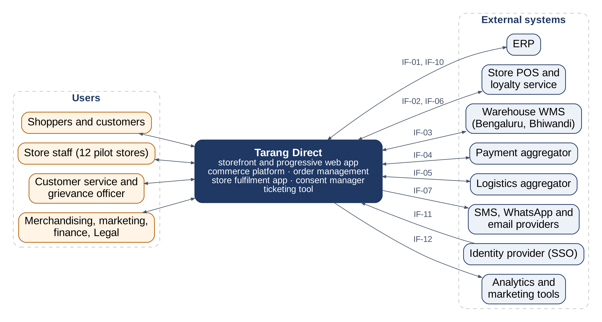
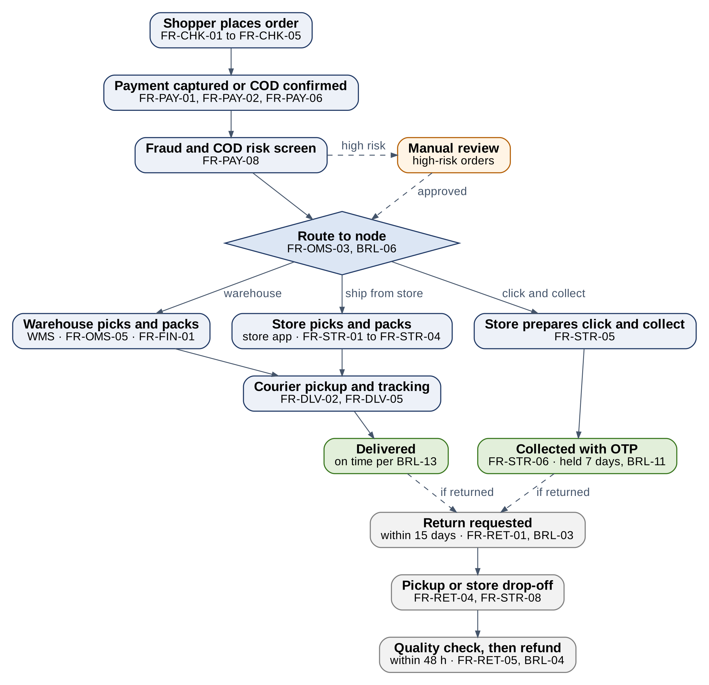
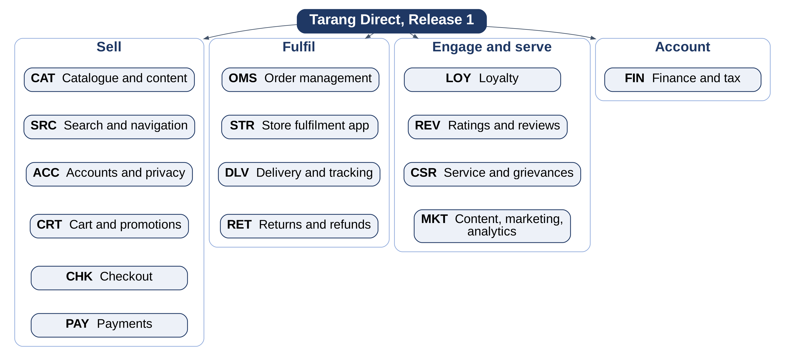
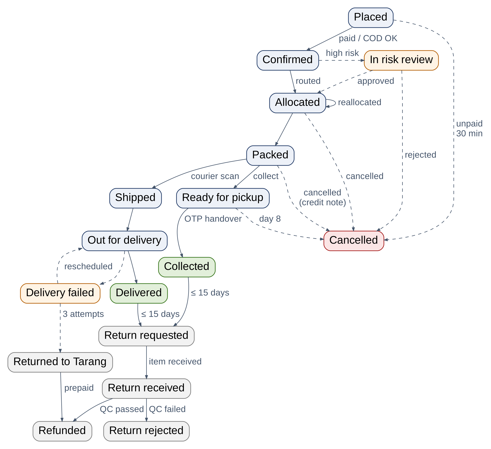

# Functional Requirements Document (FRD)

**Tarang Direct: direct-to-consumer e-commerce portal · Release 1**

Based only on the BABOK® Guide v3 (IIBA) · FRD-DIG-014-B · Version 1.0 · Approved 11 December 2026 · Derived from BRD-DIG-014 v1.0

**Contents**

- [About this example](#about-this-example)
- [Document control](#document-control)
- [1. Introduction](#1-introduction)
- [2. Stakeholders](#2-stakeholders)
- [3. Requirements architecture](#3-requirements-architecture)
- [4. Requirements models](#4-requirements-models)
- [5. Functional requirements](#5-functional-requirements)
- [6. Non-functional requirements](#6-non-functional-requirements)
- [7. Interface requirements](#7-interface-requirements)
- [8. Transition requirements](#8-transition-requirements)
- [9. Assumptions and constraints](#9-assumptions-and-constraints)
- [10. Verification](#10-verification)
- [11. Validation](#11-validation)
- [12. Traceability](#12-traceability)
- [13. Prioritization](#13-prioritization)
- [14. Change control](#14-change-control)
- [15. Open items](#15-open-items)
- [16. Glossary](#16-glossary)
- [17. Approval](#17-approval)

# About this example

> *Note: This FRD is derived from the example BRD "Tarang Direct: direct-to-consumer e-commerce portal" (BRD-DIG-014, version 1.0) and follows the FRD template based only on the BABOK Guide v3. Tarang Home & Kitchen Pvt. Ltd., its people, figures, systems and dates are fictional. Regulatory requirements reflect Indian law as of November 2026 and must be confirmed with legal counsel before use on a real project. IDs without a capability or category code (BR-nn, SR-nn, FR-nn, NFR-nn, TR-nn, BRL-01 to BRL-14, A-nn, C-nn, D-nn, RSK-nn) refer to the BRD; requirements specified in this FRD carry a code, such as FR-CHK-04, NFR-SEC-02 or TR-DAT-01 (section 3.1).*

# Document control

| **Field** | **Value** |
|----|----|
| **Document title** | Functional Requirements Document for Tarang Direct, Release 1 |
| **Document ID** | FRD-DIG-014-B |
| **Initiative** | Tarang Direct: direct-to-consumer e-commerce portal |
| **Release** | Release 1 (soft launch 2027-03-22; public launch 2027-04-15) |
| **Related BRD** | BRD-DIG-014, version 1.0, approved 2026-11-10 |
| **Business analyst** | Kavya Nair, Lead Business Analyst |
| **Sponsor** | Meera Iyer, Chief Executive Officer |
| **Product owner** | Rohan Mehta, Head of Digital Commerce |
| **Current version** | 1.0 |
| **Status** | Approved and baselined |
| **Last updated** | 2026-12-11 |

## Version history

| **Version** | **Date** | **Author** | **Summary of changes** |
|----|----|----|----|
| 0.1 | 2026-11-20 | Kavya Nair | Initial draft: requirements architecture and models derived from BRD v1.0 |
| 0.2 | 2026-11-27 | Kavya Nair | Functional requirements specified in four capability workshops with store, supply chain, service and finance teams |
| 0.3 | 2026-12-04 | Kavya Nair, Imran Qureshi | Interfaces, data model, non-functional and transition requirements added with the solution architect |
| 0.9 | 2026-12-08 | Kavya Nair | Review draft, verified against the nine quality characteristics (section 10) |
| 1.0 | 2026-12-11 | Kavya Nair | Review findings fixed; validated with business owners (section 11); approved and baselined (section 17) |

# 1. Introduction

## 1.1 Purpose

This FRD specifies the solution requirements for Release 1 of Tarang Direct: the customer storefront, order management, the store fulfilment app, customer service and marketing tools, and their integrations. It turns the business and stakeholder requirements in BRD-DIG-014 into functional, non-functional and transition requirements that the delivery team can design and build and testers can verify. Business owners use it to confirm that the solution will meet their needs before build starts.

## 1.2 Business need and objectives

Tarang sells home and kitchen products through 38 stores and through online marketplaces. In FY2025-26 the marketplaces cost it ₹18.3 crore (31% of online revenue) and gave it no data on its online customers, while 23% of SKUs shown out of stock online were held in a store (BRD section 2). Tarang Direct gives Tarang its own online channel with one view of stock across warehouses and stores. This FRD addresses all seven business requirements in the BRD:

| **Business requirement (BRD)** | **Summary** | **Measure** |
|----|----|----|
| BR-01 | Earn net revenue through Tarang's own portal | ₹0 → ₹45 crore in the first 12 months |
| BR-02 | Reduce the cost of selling online | Channel cost 31% → 18% or less of net revenue by month 6 |
| BR-03 | Build a base of customers Tarang can contact directly | 0 → 4 lakh registered customers with marketing consent in 12 months |
| BR-04 | Reduce aged stock by selling store stock online | Stock over 180 days old 17% → 12% of stock value by 2028-03-31 |
| BR-05 | Use stores to fulfil online orders | 0% → 20% of portal orders fulfilled by a store by month 12 |
| BR-06 | Give online customers an experience they recommend | Online Net Promoter Score 45 or higher by month 6 |
| BR-07 | Comply with Indian law from launch | No open compliance gaps at go-live; no high-severity audit findings |

## 1.3 Solution scope

The change strategy in the BRD (section 4.4) delivers the solution in four steps: an invite-only soft launch on 2027-03-22, Release 1 on 2027-04-15, Release 1.1 (ship-from-store in 10 more stores) in July 2027 and Release 2 (native apps, Hindi storefront) in October 2027. This FRD covers Release 1.

- **In scope:** the 15 capabilities in section 3.1. These cover the storefront and progressive web app in English; catalogue of about 6,500 SKUs; search with country-of-origin filters; accounts, guest checkout and the privacy centre; cart, pricing and promotions; checkout with UPI, cards, net banking, wallets and cash on delivery; order management across 2 warehouses and 12 pilot stores; delivery, express delivery and click and collect; returns, exchanges and refunds; Tarang Circle loyalty; reviews; customer service and grievances; content, consent-based marketing and analytics; and GST invoicing, reconciliation and ERP posting.

- **Out of scope:** native apps and the Hindi storefront (Release 2; FR-SRC-09 is deferred); third-party sellers and international shipping (not planned); corporate and bulk orders; changes to marketplace channels; ship-from-store in the other 26 stores (Release 1.1 onward); and the augmented-reality room visualiser (backlog). Payment execution to suppliers and accounting remain in the ERP.

Figure 1 is the scope model: it shows the solution boundary, the people who use the solution and the external systems it exchanges data with. Section 7.1 specifies each interface.

*Figure 1: System context: the Release 1 solution boundary*

## 1.4 Audience

| **Reader** | **Sections to read** |
|----|----|
| Developers and solution architect | 3 to 9 |
| Testers | 4, 5, 6, 7, 8, 11, 12 |
| Business owners and approvers | 1, 2, the requirement statements in 5 and 6, 11, 13, 17 |
| Legal, security and audit | 4.1, 4.2, 6.10, 6.13, 12 |
| Store and service managers | 4.1, 4.3, 5.8, 5.13, 6.15, 8 |

## 1.5 References

| **Document** | **Version** | **Location** |
|----|----|----|
| Business Requirements Document, BRD-DIG-014 | 1.0 | SharePoint › Tarang Direct › Requirements |
| Business case BC-2026-07 | 1.0 | SharePoint › Tarang Direct › Business case |
| Designs listed in section 3.3 | As listed | As listed |
| Returns policy RP-2026-01; pricing policy PRC-2026-03; loyalty terms LT-2026 | Current | Policy library |
| Retail operations procedure RO-14; service levels SL-2026; marketing policy MKT-05; data policy DP-03 | Current | Policy library |
| Tarang security standard TSS-11 (authentication) | 3.0 | Information security library |
| Test strategy TS-DIG-014 | 0.4 | SharePoint › Tarang Direct › Test |

# 2. Stakeholders

The stakeholders are those in the BRD stakeholder register (BRD section 5.1), with Imran Qureshi added as solution architect. Accountability for these requirements rests with the product owner; the sponsor approved the business requirements in the BRD.

| **Stakeholder** | **BABOK role** | **Interest in these requirements** | **Involvement (RACI)** |
|----|----|----|----|
| Rohan Mehta, Head of Digital Commerce | Domain subject matter expert; product owner | Complete, prioritized requirements that deliver BR-01 and BR-06 | A |
| Kavya Nair, Lead Business Analyst | Business analyst | Elicits, specifies, verifies and maintains the requirements | R |
| Meera Iyer, CEO | Sponsor | Outcomes against the business case | I |
| Neha Kapoor, Programme Manager | Project manager | Scope, schedule and change control | C |
| Imran Qureshi, Solution Architect | Implementation subject matter expert | Feasibility, design and integration | C |
| Vikram Desai, CIO | Implementation subject matter expert | Architecture, hosting and the ERP, POS and WMS | C |
| Deepak Joshi, CISO | Implementation subject matter expert | Security and privacy controls (section 6.10) | C |
| Sanjay Kulkarni, CFO | Sponsor (finance); domain subject matter expert | Payments, reconciliation and GST (sections 5.6, 5.15) | C |
| Farhan Sheikh, Head of Retail Operations | Domain subject matter expert | Store fulfilment workload and rules (sections 5.7, 5.8) | C |
| Lakshmi Prasad, Head of Supply Chain | Domain subject matter expert | Routing, delivery and returns (sections 5.7, 5.9, 5.10) | C |
| Ananya Bose, Head of Marketing | Domain subject matter expert | Loyalty, consent and campaigns (sections 5.11, 5.14) | C |
| Priya D'Souza, Head of Customer Service | Operational support | Agent tools and grievance timelines (section 5.13) | C |
| Arjun Menon, Head of Legal and Compliance | Regulator (internal) | Compliance requirements (section 6.13); acts as grievance officer | C |
| Sneha Pillai, QA Lead | Tester | Testable acceptance criteria; test suites (section 12) | C |
| Store managers and staff, 12 pilot stores | End user | A store app that fits around floor sales | C |
| Customer service agents (18) | End user | One view of the customer | C |
| Merchandisers and marketing users | End user | Publishing and promotions without IT help | C |
| Online shoppers (represented by 12 target customers in usability tests) | Customer | Easy buying, honest prices, reliable delivery | C |
| Payment and logistics aggregators | Supplier | Interface specifications and service levels | I |
| Central Consumer Protection Authority; Data Protection Board of India | Regulator (external) | Compliance with consumer and data protection law | I |

# 3. Requirements architecture

The requirements are organized so that every requirement has one place, every BRD requirement is refined somewhere, and readers can see how the parts relate. This section describes the structure; section 12 traces each requirement through it.

## 3.1 Organization of the requirements

**Requirement levels.** The FRD uses the BABOK requirements classification. Business and stakeholder requirements stay in the BRD. The BRD also states solution requirements at a high level; this FRD refines each into detailed requirements.

| **Classification** | **Where** | **ID format** | **Example** |
|----|----|----|----|
| Business requirements | BRD section 6 | BR-nn | BR-05 |
| Stakeholder requirements | BRD section 7 | SR-nn | SR-07 |
| Solution requirements: functional | BRD section 8, refined in section 5 | BRD: FR-nn; FRD: FR-capability-nn | FR-37 → FR-STR-05 to FR-STR-07 |
| Solution requirements: non-functional | BRD section 9, refined in section 6 | BRD: NFR-nn; FRD: NFR-category-nn | NFR-05 → NFR-AVL-01 |
| Transition requirements | BRD section 10, refined in section 8 | BRD: TR-nn; FRD: TR-category-nn | TR-04 → TR-ORG-01 |
| Business rules | BRD section 11.3 and section 4.2 | BRL-nn | BRL-18 |
| Interfaces and screens | Section 7 | IF-nn; SCR-nn | IF-05; SCR-15 |

**Capabilities.** Functional requirements are grouped by the 15 capabilities of the functional decomposition in section 4.4 (Figure 3). Each capability has a three-letter code used in its requirement IDs.

| **Code** | **Capability** | **Description** | **Stakeholder requirements served (BRD)** | **Requirements** |
|----|----|----|----|----|
| CAT | Catalogue and product content | Imports products from the ERP, lets merchandisers enrich and publish them, and enforces legal declarations and price limits | SR-01, SR-02, SR-12, SR-15 | FR-CAT-01 to FR-CAT-08 |
| SRC | Search and navigation | Helps shoppers find products and see whether, when and where they can get them | SR-01, SR-04, SR-07, SR-15 | FR-SRC-01 to FR-SRC-09 |
| ACC | Accounts, consent and privacy | Sign-in, guest checkout, consent collection and the customer's privacy rights | SR-03 to SR-05, SR-08, SR-13 to SR-16 | FR-ACC-01 to FR-ACC-10 |
| CRT | Cart, pricing and promotions | The cart, transparent pricing, promotions and honest urgency messages | SR-02, SR-03, SR-12, SR-13, SR-15 | FR-CRT-01 to FR-CRT-10 |
| CHK | Checkout | A short checkout with clear delivery choices and an explicit order action | SR-03, SR-04, SR-09, SR-10, SR-15 | FR-CHK-01 to FR-CHK-06 |
| PAY | Payments | Payment methods, cash on delivery, saved cards, payment recovery and risk screening | SR-03, SR-05, SR-14 to SR-16 | FR-PAY-01 to FR-PAY-09 |
| OMS | Order management | Stock available to promise, reservation, routing, warehouse orders, order status and cancellations | SR-04, SR-05, SR-09, SR-10, SR-15 | FR-OMS-01 to FR-OMS-08 |
| STR | Store fulfilment app | The app that store staff use to fulfil ship-from-store and click-and-collect orders and accept returns | SR-04, SR-07, SR-09, SR-10, SR-14, SR-15 | FR-STR-01 to FR-STR-08 |
| DLV | Delivery and tracking | Serviceability, shipments, promised dates, tracking and failed deliveries | SR-04, SR-10 | FR-DLV-01 to FR-DLV-08 |
| RET | Returns, exchanges and refunds | Self-service returns and exchanges, quality checks and refunds | SR-05, SR-07, SR-14 | FR-RET-01 to FR-RET-08 |
| LOY | Loyalty | One Tarang Circle points balance across stores and the portal | SR-06 | FR-LOY-01 to FR-LOY-05 |
| REV | Ratings and reviews | Reviews from verified buyers, moderated under a published policy | SR-01, SR-08, SR-13, SR-15 | FR-REV-01 to FR-REV-04 |
| CSR | Customer service and grievances | The agent's view of the customer, tickets, the grievance process and agent actions | SR-11, SR-15, SR-16 | FR-CSR-01 to FR-CSR-06 |
| MKT | Content, marketing and analytics | Content management, consent-based marketing, event tracking and the KPI dashboard | SR-08, SR-12, SR-13, SR-15, SR-17 | FR-MKT-01 to FR-MKT-06 |
| FIN | Finance and tax | GST invoices and credit notes, daily reconciliation and ERP posting | SR-13 to SR-15, SR-17 | FR-FIN-01 to FR-FIN-05 |

**Non-functional requirements** are grouped by the 15 BABOK non-functional categories (section 6.1), and transition requirements by type: data (DAT), organizational readiness (ORG), training (TRN), release (REL) and parallel operation and retirement (PAR).

## 3.2 Views used

| **View** | **Model category** | **Where** | **Purpose** |
|----|----|----|----|
| Context view | Rationale (scope model) | Figure 1 | What is inside and outside the solution |
| Roles and permissions view | People and roles | Section 4.1 | Who uses the solution and what each role can do |
| Business rules view | Rationale | Section 4.2 | Rules the solution enforces, with decision tables |
| Process view | Activity flow | Section 4.3, Figure 2 | How an order moves from placement to delivery or return |
| Use case and story view | Activity flow | Section 4.3 | Detailed interactions for the riskiest journeys |
| Capability view | Capability | Section 4.4, Figure 3 | What the solution does, and how requirements group |
| Data view | Data and information | Section 4.5, Figure 4 | Information held, its rules and its life cycle |
| Interface view | Capability; data and information | Section 7 | Exchanges with people and other systems |

## 3.3 Related designs

Designs are kept outside this FRD. Each satisfies the requirements listed; section 12.2 traces them by capability.

| **Design** | **Version** | **Location** | **Requirements it satisfies** |
|----|----|----|----|
| Solution architecture SA-DIG-014 | 0.6 | SharePoint › Tarang Direct › Design | All; NFR-CMP-02, NFR-EXT-01 to NFR-EXT-03 in particular |
| Wireframes, Release 1 (screens SCR-01 to SCR-21) | 0.8 | Figma › Tarang Direct › R1 | Section 7.2 lists the requirements for each screen |
| Tarang UI style guide | 2.1 | Figma › Tarang Design System | NFR-USB-02, NFR-USB-03, NFR-LOC-01 |
| Store app clickable prototype | 0.4 | Figma › Tarang Direct › Store app | FR-STR-01 to FR-STR-08, NFR-USB-04 |
| Logical data model ERD_R1_v2 | 2.0 | SharePoint › Tarang Direct › Design | Section 4.5 |
| Integration specifications ISD-01 to ISD-12 | 0.3 | SharePoint › Tarang Direct › Design › Integration | IF-01 to IF-12 |
| Routing and stock design DD-OMS-01 | 0.3 | SharePoint › Tarang Direct › Design | FR-OMS-01 to FR-OMS-04, BRL-05, BRL-06 |
| Promised-date calculation design DD-DLV-01 | 0.2 | SharePoint › Tarang Direct › Design | FR-DLV-01, FR-DLV-04, FR-DLV-07 |
| Tax and invoice configuration DD-FIN-01 | 0.2 | SharePoint › Tarang Direct › Design | FR-FIN-01, FR-FIN-02, NFR-FUN-01 |

# 4. Requirements models

Models are grouped by the five BABOK model categories. Each subsection names the techniques used.

## 4.1 People and roles

*Techniques: Roles and Permissions Matrix (10.39); Organizational Modelling (10.32); Stakeholder List, Map, or Personas (10.43).*

### User roles

| **Role** | **Description** | **Users (year 1)** | **Frequency of use** | **Characteristics** |
|----|----|----|----|----|
| Guest shopper | Browses and buys without an account | About 60% of visitors | Occasional | Mostly on phones (BRD A-01); varied digital skills |
| Registered customer | Has an account; may be a Tarang Circle member | 4 lakh with marketing consent (BR-03) | Monthly | Expects saved details and order history |
| Store associate | Picks, packs and hands over orders in a pilot store | About 70 (12 stores) | Daily, alongside floor sales | Trained on POS; new to online fulfilment |
| Store manager | Oversees store fulfilment and safety stock | 12 | Daily | Accountable for fulfilment times |
| Customer service agent | Handles contacts and tickets | 18 | Daily, full time | Uses the ticketing tool all day |
| Customer service supervisor | Approves exceptions; handles grievances for the grievance officer | 3 | Daily | Senior; accountable for legal timelines |
| Merchandiser | Manages products, prices and promotions | 8 | Daily | Expert in product data; not technical |
| Marketing user | Manages content, campaigns and segments | 6 | Daily | Uses the CMS and marketing tool |
| Finance user | Reconciliation, invoices and reports | 4 | Daily | Expert in the ERP and GST |
| Legal reviewer | Approves policy pages and compliance content | 2 | Weekly | Approves; does not edit |
| System administrator | Users, roles and configuration | 3 | As needed | IT staff |

The four customer segments in BRD section 5.2 (home refreshers, first-home setters, gift buyers and loyalty regulars) are used as personas in usability tests (NFR-USB-01).

### Roles and permissions matrix

> *Note: "Own" means the user's own records only; "Store" means records for the user's own store. Permissions are enforced on the server, not only hidden in the interface (NFR-SEC-02).*

**Customer, store and service roles**

| **Function** | **Customer** | **Store associate** | **Store manager** | **CS agent** | **CS supervisor** |
|----|----|----|----|----|----|
| Browse, search, buy | Yes | — | — | — | — |
| View orders | Own | Store | Store | All | All |
| Cancel order or line before dispatch | Own | — | Store | Yes | Yes |
| Pick, pack, hand over | — | Store | Store | — | — |
| Change store safety stock (BRL-05) | — | — | Store | — | — |
| Start a return | Own | Store | Store | Yes | Yes |
| Goodwill credit up to ₹500 (BRL-21) | — | — | — | Yes | Yes |
| Goodwill credit above ₹500 | — | — | — | — | Yes |
| Manage grievances | — | — | — | View | Yes |
| View full contact and payment details | Own | — | — | Masked | Yes |

**Head office roles**

| **Function** | **Merchandiser** | **Marketing user** | **Finance user** | **Legal reviewer** | **Administrator** |
|----|----|----|----|----|----|
| View orders | — | — | All | — | All |
| Edit products and content | Yes | Content only | — | — | — |
| Change prices and promotions | Yes | Promotions only | — | — | — |
| Approve policy pages | — | — | — | Yes | — |
| Export consented segments | — | Yes | — | — | — |
| View full contact and payment details | — | — | Yes | — | — |
| Reconciliation and invoices | — | — | Yes | — | — |
| Manage users and roles | — | — | — | — | Yes |

## 4.2 Rationale

*Techniques: Business Rules Analysis (10.9); Decision Modelling (10.17); Scope Modelling (10.41).*

The scope model is Figure 1 (section 1.3).

### Business rules

Rules BRL-01 to BRL-14 come from the BRD (section 11.3) and keep their numbers. BRL-15 to BRL-21 were identified while specifying this FRD. Definitional rules define a term or calculation; behavioural rules say what must or must not happen.

| **ID** | **Rule** | **Type** | **Source** | **Enforced by** |
|----|----|----|----|----|
| BRL-01 | Standard delivery is free for orders of ₹999 or more after discounts; otherwise it costs ₹79. | Behavioural | Pricing policy PRC-2026-03 | FR-CHK-02, FR-CRT-04 |
| BRL-02 | COD is available for orders of ₹299 to ₹10,000 to eligible pincodes, for a ₹49 fee; it is withdrawn after 2 refused COD deliveries in 90 days. | Behavioural | DEC-02 | FR-PAY-02 |
| BRL-03 | Items can be returned within 15 days of delivery, except personalised items, "final sale" items, and opened candles and fragrances. | Behavioural | Returns policy RP-2026-01 | FR-RET-01, FR-RET-02 |
| BRL-04 | Refunds start within 48 hours of a passed quality check, to the original payment method; COD refunds go by UPI, bank transfer or store credit. | Behavioural | Returns policy RP-2026-01 | FR-RET-05, FR-RET-07, FR-OMS-07, FR-PAY-09 |
| BRL-05 | A store's last 2 units of a SKU are not offered online; store managers may lower this to 0 for stock over 180 days old. | Behavioural | Procedure RO-14 | FR-OMS-01, FR-SRC-07 |
| BRL-06 | Orders go to one node that can meet the promised date for the whole order, then the lowest delivery cost, then the oldest stock. | Behavioural | DEC-03 | FR-OMS-03 |
| BRL-07 | 1 point per ₹100 of net spend, credited when the return window closes; 1 point = ₹1; points pay for up to 20% of an order and expire 12 months after the last activity. | Behavioural | Loyalty terms LT-2026 | FR-LOY-03, FR-LOY-04 |
| BRL-08 | One coupon per order; none on bundle prices or on items already discounted by more than 40%. | Behavioural | Pricing policy PRC-2026-03 | FR-CRT-06 |
| BRL-09 | The selling price is never higher than the MRP. | Behavioural | Legal Metrology Act, 2009 and Rules | FR-CAT-08 |
| BRL-10 | A verified buyer of a product has a delivered portal order that contains it. | Definitional | Reviews policy RV-2026 | FR-REV-01 |
| BRL-11 | Click-and-collect orders are held for 7 days, then cancelled and refunded on day 8. | Behavioural | Procedure RO-14 | FR-STR-07 |
| BRL-12 | Net revenue is order value after discounts and returns, excluding GST and delivery charges. | Definitional | Finance policy FP-09 | FR-MKT-06 |
| BRL-13 | An order is on time if delivered, or ready for pickup, by the date promised at checkout. | Definitional | Service levels SL-2026 | FR-DLV-04, NFR-SLA-01 |
| BRL-14 | Express delivery (₹149) is offered in Bengaluru, Pune and Hyderabad for orders placed by 14:00 that one node in the same city can fulfil completely. | Behavioural | DEC-03 | FR-DLV-07, FR-CHK-02 |
| BRL-15 | An order number is "TD" followed by 10 digits, unique and never reused (for example TD2704150123). | Definitional | This FRD | FR-CHK-05 |
| BRL-16 | An OTP has 6 digits and is valid for 5 minutes and 3 attempts; a new one can be sent after 30 seconds, up to 5 an hour for each mobile number. | Behavioural | Security standard TSS-11 | FR-ACC-02, FR-PAY-02, FR-STR-06 |
| BRL-17 | Stock reserved when an order is placed is released if payment is not confirmed within 30 minutes. | Behavioural | This FRD | FR-OMS-02, FR-PAY-06 |
| BRL-18 | A store must accept an allocated order within 30 minutes (the manager is then alerted), and the order is reallocated at 60 minutes; accepted orders must be packed within 4 business hours. | Behavioural | Procedure RO-14 | FR-STR-02, FR-OMS-04, NFR-SLA-02 |
| BRL-19 | Each GSTIN has its own consecutive invoice number series for each financial year, of no more than 16 characters. | Definitional | GST rules; Finance | FR-FIN-01 |
| BRL-20 | A customer receives no more than 3 marketing messages a week across all channels. | Behavioural | Marketing policy MKT-05 | FR-MKT-03 |
| BRL-21 | An agent may give goodwill credit of up to ₹500 an order; more needs a supervisor's approval. | Behavioural | BRD FR-55 | FR-CSR-05 |

### Decision tables

**DT-01: Is cash on delivery offered, and is an OTP needed?** (BRL-02, FR-PAY-02)

| **Order value** | **Pincode allows COD** | **Refused COD deliveries in last 90 days** | **COD offered** | **OTP confirmation** |
|----|----|----|----|----|
| Under ₹299 | Any | Any | No | — |
| ₹299 to ₹5,000 | Yes | 0 or 1 | Yes, ₹49 fee | No |
| Over ₹5,000 to ₹10,000 | Yes | 0 or 1 | Yes, ₹49 fee | Yes |
| Over ₹10,000 | Any | Any | No | — |
| Any | No | Any | No | — |
| Any | Any | 2 or more | No | — |

**DT-02: Which delivery options are offered?** (BRL-01, BRL-14, FR-CHK-02)

| **Option** | **Offered when** | **Charge** |
|----|----|----|
| Standard | The pincode is serviceable (FR-DLV-01) | Free from ₹999 after discounts; otherwise ₹79 |
| Express, next day | The pincode is in Bengaluru, Pune or Hyderabad, the order is placed by 14:00, and one node in the same city can fulfil the whole order | ₹149 |
| Click and collect | A pilot store chosen by the shopper has every item available to promise | Free |

**DT-03: Can this item be returned?** (BRL-03, FR-RET-01, FR-RET-02)

| **Days since delivery** | **Item type** | **Returnable** | **Reason shown if not** |
|----|----|----|----|
| 15 or fewer | Standard item | Yes | — |
| 15 or fewer | Personalised item | No | "Personalised items can't be returned" |
| 15 or fewer | Marked "final sale" | No | "Final sale items can't be returned" |
| 15 or fewer | Candle or fragrance, opened | No | "Opened candles and fragrances can't be returned" |
| More than 15 | Any | No | "The return window closed on DD-MM-YYYY" |

Damage in transit is reported separately within 48 hours of delivery (FR-RET-08) and is not limited by this table.

## 4.3 Activity flow

*Techniques: Process Modelling (10.35); Use Cases and Scenarios (10.47); User Stories (10.48).*

### Process model

Figure 2 shows the future-state order process from the BRD (section 11.1), annotated with the FRD requirements that support each activity.

*Figure 2: Process model: order to delivery, collection or refund*

### Use cases

| **ID** | **Use case** | **Primary actor** | **Related requirements** |
|----|----|----|----|
| UC-01 | Place an order | Shopper | FR-CRT-04, FR-CHK-01 to FR-CHK-06, FR-PAY-01 to FR-PAY-07, FR-OMS-02 |
| UC-02 | Track an order | Shopper | FR-DLV-05, FR-DLV-06, FR-DLV-08 |
| UC-03 | Fulfil a ship-from-store order | Store associate | FR-OMS-03, FR-OMS-04, FR-STR-01 to FR-STR-04, FR-FIN-01 |
| UC-04 | Collect a click-and-collect order | Shopper, store associate | FR-STR-05 to FR-STR-07 |
| UC-05 | Return an item and get a refund | Shopper | FR-RET-01 to FR-RET-07, FR-PAY-09, FR-FIN-02, FR-LOY-04 |
| UC-06 | Withdraw a marketing consent | Customer | FR-ACC-06, FR-ACC-07 |
| UC-07 | Resolve a grievance | CS agent, grievance officer | FR-CSR-02 to FR-CSR-04 |
| UC-08 | Publish a new product | Merchandiser | FR-CAT-01 to FR-CAT-05 |
| UC-09 | Reconcile daily settlements | Finance user | FR-FIN-03, FR-FIN-04 |

UC-01, UC-03 and UC-05 cover the journeys with the most risk and are specified below; the others are in the use case catalogue (SharePoint › Tarang Direct › Requirements › Use cases).

### UC-01 Place an order

| **Element** | **Description** |
|----|----|
| Goal | The shopper buys the items in the cart and knows when they will arrive |
| Actors | Shopper, guest or registered (primary); payment aggregator, OMS, logistics aggregator, messaging providers |
| Trigger | The shopper selects "Checkout" on the cart page |
| Preconditions | The cart has at least one item deliverable to the shopper's pincode or available for collection |
| Post-conditions | The order is confirmed, stock is reserved, the shopper has a confirmation, and the order is released for routing |
| Frequency | About 520 orders a day in year 1 (₹45 crore ÷ ₹2,400 average order ÷ 365) |
| Related requirements | FR-CRT-02, FR-CRT-04, FR-CHK-01 to FR-CHK-06, FR-PAY-01 to FR-PAY-07, FR-OMS-02 |

**Basic flow**

1.  The solution rechecks the price, stock and deliverability of every cart line (FR-CRT-02).

2.  The shopper signs in, or continues as a guest with a mobile number and email (FR-ACC-01, FR-ACC-03).

3.  The shopper selects or enters a delivery address; the solution validates the pincode (FR-ACC-09).

4.  The solution shows the delivery options in DT-02 with charges and promised dates; the shopper chooses one (FR-CHK-02).

5.  The solution shows payment methods; the shopper chooses one and pays in the payment aggregator's hosted page or SDK (FR-PAY-01).

6.  The solution shows the review step with the itemised total; the shopper selects "Place order" (FR-CRT-04, FR-CHK-04).

7.  The payment aggregator confirms success; the solution confirms the order and reserves stock (FR-OMS-02).

8.  The solution shows the confirmation page and sends email and SMS within 2 minutes (FR-CHK-05).

**Alternative flows**

- **4a. Click and collect:** the shopper chooses a pilot store; the solution shows the "ready by" time. The flow continues at step 5.

- **5a. Cash on delivery:** if DT-01 allows COD, the shopper chooses it and the ₹49 fee is added; for orders over ₹5,000 the shopper enters an OTP sent by SMS (FR-PAY-02). The flow continues at step 6, with no payment at step 7.

- **5b. Saved card:** a registered customer pays with a saved card token and enters only the CVV in the aggregator's field (FR-PAY-03).

- **6a. Split shipment:** the review step shows each shipment's items and promised date (FR-CHK-03).

**Exception flows**

- **1a. Price or stock changed:** the solution shows what changed and asks the shopper to confirm (FR-CRT-02).

- **6b. Stock lost before payment:** the solution stops, shows the affected lines and offers to remove them or change the delivery option (FR-CHK-06).

- **7a. Payment failed:** the solution keeps the cart, explains the failure and lets the shopper retry with any method (FR-PAY-07).

- **7b. Payment status unknown:** the solution shows "Confirming your payment", checks with the aggregator for up to 30 minutes, then confirms the order or cancels it with an automatic refund (FR-PAY-06).

### UC-03 Fulfil a ship-from-store order

| **Element** | **Description** |
|----|----|
| Goal | The store packs and dispatches an online order without disrupting floor sales |
| Actors | Store associate (primary); OMS, logistics aggregator, store manager |
| Trigger | The OMS allocates an order line to the associate's store (FR-OMS-03) |
| Preconditions | The store is live for ship-from-store (TR-ORG-01); the associate is signed in to the store app |
| Post-conditions | The parcel is packed, labelled, invoiced and handed to the courier, and the line shows "Shipped" |
| Frequency | Up to 60 orders a day for each store at peak |
| Related requirements | FR-OMS-03, FR-OMS-04, FR-STR-01 to FR-STR-04, FR-FIN-01, FR-DLV-02 |

**Basic flow**

1.  The store app alerts the store within 1 minute; an associate accepts the order within 30 minutes (FR-STR-02).

2.  The app lists the items with shelf location and image; the associate scans each unit (FR-STR-03).

3.  The associate packs the items and confirms the package size and weight.

4.  The app prints the shipping label and GST invoice and books courier pickup (FR-STR-04, FR-FIN-01).

5.  The courier collects and scans the parcel; the line status changes to "Shipped" (FR-DLV-05).

**Alternative flows**

- **1a. No one accepts in 30 minutes:** the app alerts the store manager; at 60 minutes the OMS reallocates the order (FR-OMS-04, BRL-18).

**Exception flows**

- **2a. Wrong item scanned:** the app blocks packing and shows the expected item (FR-STR-03).

- **2b. Item missing or damaged:** the associate marks the line "Cannot fulfil"; the OMS reallocates it and, if the promised date changes, tells the customer (FR-OMS-04).

- **4a. Courier booking fails:** the solution retries 3 times, then alerts the fulfilment support queue (FR-DLV-03).

### UC-05 Return an item and get a refund

| **Element** | **Description** |
|----|----|
| Goal | The customer returns an unwanted item and gets their money back quickly |
| Actors | Shopper (primary); logistics aggregator, warehouse or store staff, payment aggregator, ERP |
| Trigger | The shopper selects "Return or exchange" on a delivered order |
| Preconditions | The order line is delivered and DT-03 allows the return |
| Post-conditions | The item is back with Tarang, the refund is sent, a credit note is issued, and loyalty points are adjusted |
| Frequency | About 47 returns a day (9% of orders, BRD A-05) |
| Related requirements | FR-RET-01 to FR-RET-07, FR-PAY-09, FR-FIN-02, FR-LOY-04 |

**Basic flow**

1.  The shopper selects the item, quantity and reason, and can add up to 5 photos (FR-RET-01).

2.  The solution confirms the item is returnable under DT-03 (FR-RET-02).

3.  The shopper chooses pickup; the solution books a reverse pickup within 2 business days and confirms the date (FR-RET-04).

4.  The courier collects the item and delivers it to the warehouse.

5.  Warehouse staff inspect the item and record "Passed" (FR-RET-05).

6.  The solution starts the refund to the original payment method within 48 hours, issues a credit note and reverses any points (FR-PAY-09, FR-FIN-02, FR-LOY-04).

7.  The solution tells the shopper the refund amount and method (NTF-12).

**Alternative flows**

- **1a. Exchange:** the shopper chooses another variant; the solution reserves it if in stock, and otherwise offers a return (FR-RET-03).

- **3a. Store drop-off:** the shopper takes the item to a pilot store, where staff record it and print a receipt (FR-STR-08).

- **6a. COD order:** before pickup, the shopper chooses a refund to a UPI ID, a bank account or store credit (FR-RET-07).

**Exception flows**

- **2a. Not returnable:** the solution shows the reason from DT-03 and offers no return (FR-RET-02).

- **5a. Quality check failed:** the solution tells the shopper why, with photos, and offers to send the item back at no charge (FR-RET-06).

### User stories

**US-01: As a** shopper, **I want** to see when an item will reach my pincode before I add it to my cart, **so that** I only buy what arrives in time. Traces to: FR-SRC-06, FR-DLV-04.

> Scenario: Deliverable pincode
>
> Given I have entered pincode 560034
>
> And the product is in stock at the Bengaluru warehouse
>
> When I open the product page before 14:00
>
> Then I see "Delivery by" with a date from the promised-date calculation
>
> Scenario: Unserviceable pincode
>
> Given I have entered a pincode the logistics aggregator does not serve
>
> When I open any product page
>
> Then I see "Not deliverable to this pincode"
>
> And the "Add to cart" button is replaced by "Check another pincode"

**US-02: As a** finance controller, **I want** COD orders over ₹5,000 confirmed by OTP, **so that** fewer high-value COD orders are refused at the door. Traces to: FR-PAY-02, BRD RSK-03.

> Scenario: High-value COD order
>
> Given my cart total is ₹6,200 and my pincode allows COD
>
> When I choose "Cash on delivery" and select "Place order"
>
> Then I receive a 6-digit OTP by SMS
>
> And the order is placed only after I enter the correct OTP
>
> Scenario: OTP not entered
>
> Given I have chosen COD for an order over ₹5,000
>
> When 5 minutes pass without a correct OTP
>
> Then the OTP expires and I can request a new one or choose another payment method

**US-03: As a** customer, **I want** to stop WhatsApp offers in one step, **so that** I only get messages I want. Traces to: FR-ACC-07, FR-MKT-03.

> Scenario: Withdraw WhatsApp marketing consent
>
> Given I have consented to WhatsApp marketing
>
> When I turn off "Offers on WhatsApp" in my privacy centre
>
> Then I see "You will stop receiving WhatsApp offers within 24 hours"
>
> And no WhatsApp marketing message is sent to me after 24 hours
>
> And order updates I have opted in to continue

## 4.4 Capability

*Techniques: Functional Decomposition (10.22); Business Capability Analysis (10.6); Prototyping (10.36).*

Figure 3 decomposes the solution into four areas and 15 capabilities. The table below continues the decomposition to the functions within each capability; each function is specified by the functional requirements listed. Screens are prototyped in the wireframes and the store app prototype (section 3.3).

*Figure 3: Functional decomposition of the solution*

| **Capability** | **Functions (requirements)** |
|----|----|
| CAT | Import product master (FR-CAT-01, FR-CAT-02); enrich and publish (FR-CAT-03, FR-CAT-04); show legal declarations (FR-CAT-05); variants and bundles (FR-CAT-06, FR-CAT-07); protect MRP (FR-CAT-08) |
| SRC | Search (FR-SRC-01 to FR-SRC-03); filter and sort (FR-SRC-04, FR-SRC-05); delivery dates and store stock (FR-SRC-06, FR-SRC-07); recommend (FR-SRC-08); Hindi storefront (FR-SRC-09, deferred) |
| ACC | Sign in and guest checkout (FR-ACC-01 to FR-ACC-03); collect consent (FR-ACC-04, FR-ACC-05); privacy rights (FR-ACC-06 to FR-ACC-08); addresses and account page (FR-ACC-09, FR-ACC-10) |
| CRT | Keep and recheck the cart (FR-CRT-01, FR-CRT-02); show prices and totals (FR-CRT-03, FR-CRT-04); promotions and coupons (FR-CRT-05, FR-CRT-06); honest urgency and add-ons (FR-CRT-07, FR-CRT-08; FR-CRT-10 rejected); gift options (FR-CRT-09) |
| CHK | Checkout steps and delivery options (FR-CHK-01 to FR-CHK-03); place and confirm the order (FR-CHK-04 to FR-CHK-06) |
| PAY | Take payment (FR-PAY-01, FR-PAY-02, FR-PAY-05); saved cards (FR-PAY-03, FR-PAY-04); recover payments (FR-PAY-06, FR-PAY-07); screen risk (FR-PAY-08); refund (FR-PAY-09) |
| OMS | Stock available to promise (FR-OMS-01, FR-OMS-02); route and reallocate (FR-OMS-03, FR-OMS-04); warehouse orders (FR-OMS-05); order status (FR-OMS-06); cancel (FR-OMS-07, FR-OMS-08) |
| STR | Receive and accept orders (FR-STR-01, FR-STR-02); pick and pack (FR-STR-03, FR-STR-04); click and collect (FR-STR-05 to FR-STR-07); store returns (FR-STR-08) |
| DLV | Serviceability and shipments (FR-DLV-01 to FR-DLV-03); promised dates and express (FR-DLV-04, FR-DLV-07); tracking and delivery exceptions (FR-DLV-05, FR-DLV-06, FR-DLV-08) |
| RET | Request a return or exchange (FR-RET-01 to FR-RET-04); inspect and refund (FR-RET-05 to FR-RET-07); damage claims (FR-RET-08) |
| LOY | Link membership (FR-LOY-01); share one balance (FR-LOY-02, FR-LOY-05); earn and redeem points (FR-LOY-03, FR-LOY-04) |
| REV | Collect reviews (FR-REV-01, FR-REV-02); moderate and display (FR-REV-03, FR-REV-04) |
| CSR | Single customer view (FR-CSR-01, FR-CSR-06); tickets (FR-CSR-02); grievances (FR-CSR-03, FR-CSR-04); agent actions (FR-CSR-05) |
| MKT | Content and policy pages (FR-MKT-01, FR-MKT-02); consent-based messages and segments (FR-MKT-03, FR-MKT-04); events and KPI dashboard (FR-MKT-05, FR-MKT-06) |
| FIN | Invoices and credit notes (FR-FIN-01, FR-FIN-02); reconcile and post to the ERP (FR-FIN-03, FR-FIN-04); channel cost (FR-FIN-05) |

## 4.5 Data and information

*Techniques: Data Modelling (10.15); Data Dictionary (10.12); State Modelling (10.44); Glossary (10.23).*

### Logical data model

The entity-relationship diagram is in ERD_R1_v2 (section 3.3). The main entities are:

| **Entity** | **Description** | **Key attributes** | **System of record** | **Volume (year 1)** |
|----|----|----|----|----|
| Customer | A registered customer | Customer ID, mobile, email, name, loyalty ID | Commerce platform | 4 to 6 lakh |
| Address | A delivery address | Address ID, customer ID, pincode, city, state | Commerce platform | 1.5 per customer |
| Consent record | One consent given or withdrawn | Purpose, status, notice version, language, time, channel | Consent manager | About 15 lakh |
| Product and SKU | A product and its variants | SKU, HSN code, GST rate, MRP, country of origin, declarations | ERP (master); commerce platform (content) | 6,500 SKUs |
| Node stock | Stock available to promise by SKU and node | SKU, node, on hand, reserved, safety stock, ATP | OMS (from POS and WMS) | 6,500 × 14 nodes |
| Order and order line | A customer order and its lines | Order number, lines, prices, discounts, delivery option, status | OMS | About 1.9 lakh orders |
| Shipment | A parcel sent to a customer | Shipment ID, AWB number, node, courier, promised date, status | OMS | About 2.1 lakh |
| Payment and refund | Money in and out | Aggregator IDs, method, amount, status, token reference | Commerce platform (aggregator holds card data) | About 2.3 lakh |
| Return | A return or exchange request | Return ID, line, reason, photos, quality-check result | OMS | About 17,000 |
| Invoice and credit note | GST documents | Number, GSTIN, HSN code, taxable value, taxes, place of supply | Commerce platform; posted to the ERP | About 2.3 lakh |
| Loyalty link | Link to a Tarang Circle member | Customer ID, member ID, time linked | POS loyalty service | About 2 lakh |
| Review | A rating and review | Review ID, SKU, customer, rating, text, status | Commerce platform | About 20,000 |
| Ticket | A customer contact | Ticket ID, channel, type, order, timers, outcome | Ticketing tool | About 60,000 |
| Promotion and coupon | A price rule | Type, dates, limits, eligibility, stacking | Commerce platform | About 300 a year |

### Data dictionary

| **Element** | **Entity** | **Type and format** | **Required** | **Allowed values or rule** | **Example** |
|----|----|----|----|----|----|
| Order number | Order | Text, 12 characters | Yes | BRL-15; unique | TD2704150123 |
| Line status | Order line | List (Figure 4) | Yes | Only the changes shown in Figure 4 | Packed |
| Mobile number | Customer | 10 digits | Yes | Starts with 6, 7, 8 or 9 | 9845012345 |
| Email | Customer | Text, up to 254 characters | Yes for guests | Valid email format; verified by link for accounts | asha@example.com |
| Pincode | Address | 6 digits | Yes | In the serviceable pincode list for delivery | 560034 |
| Consent purpose | Consent record | List: Email marketing, SMS marketing, WhatsApp marketing, Personalisation | Yes | One record for each purpose | WhatsApp marketing |
| Notice version | Consent record | Text | Yes | Matches a published notice | PN-2027-01-EN |
| SKU | Product | Text, 10 characters | Yes | Unique; from the ERP | TK10045821 |
| HSN code | Product | 4 to 8 digits | Yes | In the ERP tax master | 6302 |
| GST rate | Product | Percentage | Yes | One of the rates in the ERP tax master | 18% |
| MRP | Product | Decimal (10,2), ₹ | Yes | Greater than 0 | 1,999.00 |
| Selling price | Product | Decimal (10,2), ₹ | Yes | Greater than 0 and not above MRP (BRL-09) | 1,499.00 |
| Country of origin | Product | Country name | Yes | From the ISO country list | India |
| Promised date | Shipment | Date, DD-MM-YYYY on screen | Yes | Not before the order date | 18-04-2027 |
| AWB number | Shipment | Text, up to 20 characters | When shipped | From the logistics aggregator | 1490812345678 |
| Payment method | Payment | List: UPI, Card, Net banking, Wallet, EMI, COD | Yes | Enabled for the order (DT-01) | UPI |
| Token reference | Saved card | Text | When a card is saved | From the payment aggregator; never a card number | tok_8Fz21 |
| Card last 4 digits and issuer | Saved card | 4 digits; text | When a card is saved | The only card details stored (NFR-CPL-10) | 4821, HDFC Bank |
| Return reason | Return | List of 8 reasons | Yes | "Other" needs at least 10 characters of text | Damaged in transit |
| Refund method | Refund | List: Original method, UPI, Bank transfer, Store credit | Yes | UPI and bank transfer only for COD orders | Original method |
| Invoice number | Invoice | Text, up to 16 characters | Yes | BRL-19 | KA27-0004512 |
| Rating | Review | Whole number, 1 to 5 | Yes | — | 4 |
| Ticket type | Ticket | List: Query, Complaint, Grievance, Feedback | Yes | "Grievance" starts the timers in FR-CSR-04 | Grievance |

### State model

Statuses apply to each order line, so one order can have lines in different statuses; the status shown to the customer is the least advanced status of its lines. Figure 4 shows the allowed changes; the BRD (section 11.2) gives the meaning of each status and the message the customer receives.

*Figure 4: State model: order line statuses*

### Reports

| **ID** | **Report** | **Purpose** | **Users** | **Frequency** | **Traces to** |
|----|----|----|----|----|----|
| RPT-01 | KPI dashboard | Track BR-01 to BR-06 and supporting measures | Leadership, product owner | Daily | FR-MKT-06 |
| RPT-02 | Product import errors | Fix rejected ERP records | Merchandisers | Daily | FR-CAT-02 |
| RPT-03 | Zero-result searches | Add synonyms and products | Merchandisers | Weekly | FR-SRC-03 |
| RPT-04 | Store fulfilment times | Acceptance and packing times by store | Store managers, retail operations | Daily | FR-STR-02, NFR-SLA-02 |
| RPT-05 | Orders at risk | Orders likely to miss the promised date | Fulfilment support | Hourly | FR-DLV-04 |
| RPT-06 | Settlement exceptions | Unmatched payments, refunds and COD remittances | Finance | Daily | FR-FIN-03 |
| RPT-07 | Grievance register | Evidence of grievance timelines | Grievance officer, Legal | Monthly | FR-CSR-04 |
| RPT-08 | Consent and withdrawals | Evidence that withdrawals reach every tool within 24 hours | Legal, marketing | Weekly | FR-ACC-07 |
| RPT-09 | Channel comparison | Marketplace against portal sales | Head of Digital Commerce | Weekly | TR-PAR-01 |
| RPT-10 | Returns by reason | Product and packaging problems | Merchandisers, supply chain | Weekly | FR-RET-01 |

# 5. Functional requirements

Functional requirements are grouped by the capabilities in section 3.1. Each states one capability of the solution, as "The solution shall …", or as "When … " or "If … then …" where the solution responds to an event or an error, and has acceptance criteria (Acceptance and Evaluation Criteria, technique 10.1). "Traces to" records the source attribute: the BRD requirement the row is derived from. Section 12 traces each capability up to stakeholder and business requirements.

The tables show the attributes used most: ID, source, priority (section 13) and status. The other BABOK attributes (author, ownership, complexity, stability, urgency and risks) are held for every requirement in the requirements repository (Jira project TDREQ). The full record for one requirement looks like this:

| **Attribute** | **FR-PAY-02** |
|----|----|
| Absolute reference | FR-PAY-02 (never reused) |
| Author | Kavya Nair |
| Complexity | Medium: COD rules (DT-01), OTP service and risk score combined |
| Ownership | Sanjay Kulkarni, CFO |
| Priority | High |
| Risks | RSK-03 (COD orders refused at the door); OTP threshold may be wrong (ITM-04) |
| Source | BRD FR-27; DEC-02; BRL-02 |
| Stability | Medium: the ₹5,000 OTP threshold will be reviewed with soft-launch data |
| Status | Approved |
| Urgency | Needed for the soft launch on 2027-03-22 |

## 5.1 CAT: Catalogue and product content

**Description:** Imports products from the ERP, lets merchandisers enrich and publish them, and enforces legal declarations and price limits. **Priority:** High. **Traces to:** BR-01, BR-04, BR-06, BR-07; SR-01, SR-02, SR-12, SR-15.

| **ID** | **Requirement** | **Acceptance criteria** | **Traces to** | **Priority** | **Status** |
|----|----|----|----|----|----|
| FR-CAT-01 | When the ERP publishes a new or changed product, the solution shall import its master data (SKU, title, category, attributes, HSN code, GST rate, MRP, dimensions, weight, country of origin, and manufacturer, packer or importer details) within 15 minutes. | Given a SKU changed in the ERP, when the next import runs, then portal admin shows the change within 15 minutes. | FR-01 | High | Approved |
| FR-CAT-02 | If an imported record fails validation (for example, a missing HSN code, MRP of zero, or no country of origin), then the solution shall keep the last valid version live and add the record to the daily import error report. | Given a record with no HSN code, when it is imported, then the live product is unchanged and the error report (RPT-02) lists the SKU and reason. | FR-01, FR-03 | High | Approved |
| FR-CAT-03 | The solution shall let merchandisers add a description of up to 2,000 characters, 3 to 12 images, up to 2 videos, care instructions, room tags and search-engine title and description to each product, and schedule its publication. | A merchandiser publishes a scheduled product with no IT help; it goes live within 5 minutes of the scheduled time. | FR-02 | High | Approved |
| FR-CAT-04 | If any Legal Metrology declaration field is empty, then the solution shall block publication and list the missing fields. | The Publish action is disabled and the message names each missing field. | FR-03 | High | Approved |
| FR-CAT-05 | The solution shall show on every product page the Legal Metrology declarations, the return, exchange and refund terms for its category, the warranty, and Tarang's legal name and address as seller. | Inspection of 50 sampled product pages across all categories finds every item present. | FR-03, FR-04 | High | Approved |
| FR-CAT-06 | The solution shall support variants by size, colour and finish, each with its own SKU, images, price, stock and delivery date. | Selecting a variant updates image, price, stock and delivery date without reloading the page. | FR-05 | High | Approved |
| FR-CAT-07 | The solution shall support room-set bundles of 2 to 8 SKUs at a bundle price, with bundle stock equal to the lowest available stock of its components and a refund value for each item stored at purchase. | Returning one item from a bundle refunds exactly the stored value for that item. | FR-06 | Medium | Approved |
| FR-CAT-08 | If a price change would make a selling price higher than the MRP, then the solution shall reject the change, keep the current price, and log the attempt with user and source. | Imports and manual edits above MRP both fail; the log shows each attempt (BRL-09). | FR-07 | High | Approved |

## 5.2 SRC: Search and navigation

**Description:** Helps shoppers find products and see whether, when and where they can get them. **Priority:** High. **Traces to:** BR-01, BR-05 to BR-07; SR-01, SR-04, SR-07, SR-15.

| **ID** | **Requirement** | **Acceptance criteria** | **Traces to** | **Priority** | **Status** |
|----|----|----|----|----|----|
| FR-SRC-01 | The solution shall rank search results by relevance, tolerate up to 2 wrong characters in words of 5 or more characters, and apply synonyms maintained by merchandisers (for example "bedsheet", "bed sheet" and "chaddar"). | For the agreed 200 top search terms, a relevant product is in the top 5 results for at least 90% of terms. | FR-08 | High | Approved |
| FR-SRC-02 | When a shopper has typed 3 or more characters, the solution shall show up to 8 product and category suggestions. | Suggestions appear within 300 ms for 95% of keystrokes at peak load. | FR-08 | High | Approved |
| FR-SRC-03 | If a search returns no results, then the solution shall show spelling suggestions and popular categories, and log the term for merchandiser review. | Zero-result terms appear in the weekly report RPT-03 with their search counts. | FR-08 | Medium | Approved |
| FR-SRC-04 | The solution shall let shoppers filter listings by category, room, price range, colour, material, rating, discount band, delivery to their pincode and country of origin, and sort by relevance, price (both directions), newest and rating. | Filter counts update without a page reload; combining filters returns only products matching all of them. | FR-09 | High | Approved |
| FR-SRC-05 | Where a listing contains imported products, the solution shall let shoppers search, filter and sort by country of origin. | On every listing with an imported product, the country-of-origin filter and sort are present and return correct results (NFR-CPL-07). | FR-09 | High | Approved |
| FR-SRC-06 | When a shopper enters a pincode, the solution shall show "Delivery by \<date\>" or "Not deliverable to this pincode" on every listing tile and product page, and remember the pincode for the session and, for signed-in customers, as their default. | See US-01. | FR-10 | High | Approved |
| FR-SRC-07 | The solution shall show stock at pilot stores within 10 km of the shopper's pincode as "In stock", "Few left" (3 or fewer) or "Out of stock", based on store stock available to promise. | Store status matches the OMS (FR-OMS-01) and is no more than 5 minutes old. | FR-11 | Medium | Approved |
| FR-SRC-08 | The solution shall show up to 8 "Complete the look" recommendations on product and cart pages. | Recommendations never include items that are out of stock or not deliverable to the shopper's pincode. | FR-12 | Low | Approved |
| FR-SRC-09 | The solution shall display the storefront in Hindi. | Not applicable to Release 1; NFR-LOC-02 keeps the option open. | FR-13 | Low | Deferred |

## 5.3 ACC: Accounts, consent and privacy

**Description:** Sign-in, guest checkout, consent collection and the customer's privacy rights. **Priority:** High. **Traces to:** BR-01 to BR-03, BR-06, BR-07; SR-03 to SR-05, SR-08, SR-13 to SR-16.

| **ID** | **Requirement** | **Acceptance criteria** | **Traces to** | **Priority** | **Status** |
|----|----|----|----|----|----|
| FR-ACC-01 | The solution shall let shoppers register and sign in with a mobile number and OTP, or with an email address and a password of at least 8 characters including a letter and a number. | Both methods create an account; a weaker password is rejected with the rule shown. | FR-14 | High | Approved |
| FR-ACC-02 | If an OTP is entered wrongly 3 times, or is not used within 5 minutes, then the solution shall invalidate it and allow a new OTP after 30 seconds, up to 5 OTPs an hour for each mobile number (BRL-16). | A sixth OTP request within an hour is refused with the time when the next is allowed. | FR-14, NFR-11 | High | Approved |
| FR-ACC-03 | The solution shall let shoppers check out as guests with a mobile number and email, and offer one-tap account creation after the order without re-entering details. | A guest completes checkout; after one tap, the order appears in the new account. | FR-14 | High | Approved |
| FR-ACC-04 | When the solution asks for consent to an optional purpose, it shall show an itemised notice (data collected, purpose, how to withdraw, how to complain to the Data Protection Board) with separate, unticked choices for email, SMS and WhatsApp marketing and for personalisation. | No choice is pre-ticked; each choice can be given or refused on its own (NFR-CPL-08). | FR-15 | High | Approved |
| FR-ACC-05 | The solution shall show the notice in English or Hindi at the customer's choice, and record for each consent the purpose, notice version, language, time, channel and device. | Every consent record has all six attributes; changing the notice creates a new version. | FR-15 | High | Validated |
| FR-ACC-06 | The solution shall provide a privacy centre where customers can download their data, correct their profile, withdraw any consent, nominate a person to act for them, and ask for their account to be erased. | Each action is available from one page and completes in 3 steps or fewer. | FR-16 | High | Approved |
| FR-ACC-07 | When a customer withdraws a consent, the solution shall stop the related processing and send the withdrawal to the messaging, marketing and analytics tools within 24 hours. | See US-03; the consent log (RPT-08) shows the withdrawal reaching every tool within 24 hours. | FR-16, FR-57 | High | Approved |
| FR-ACC-08 | When a customer asks for erasure, the solution shall confirm identity by OTP, erase or anonymise their personal data within 30 days except records the law requires Tarang to keep (NFR-CPL-11), and confirm by email. | After erasure, a search by the customer's mobile or email finds no profile; invoices remain with the name anonymised where the law allows. | FR-16, NFR-19 | High | Approved |
| FR-ACC-09 | The solution shall store up to 10 delivery addresses for each customer, validate the 6-digit pincode against the serviceable list, and fill in city and state from the pincode. | An unserviceable pincode cannot be chosen for delivery, and the shopper is told why. | FR-17 | High | Approved |
| FR-ACC-10 | The solution shall provide an account page showing orders from the last 3 years, returns, downloadable GST invoices, loyalty balance, saved cards (issuer and last 4 digits), wishlist and a link to the privacy centre. | Every order has its status and invoice; no more card detail than issuer and last 4 digits is shown. | FR-18 | High | Approved |

## 5.4 CRT: Cart, pricing and promotions

**Description:** The cart, transparent pricing, promotions and honest urgency messages. **Priority:** High. **Traces to:** BR-01 to BR-04, BR-06, BR-07; SR-02, SR-03, SR-12, SR-13, SR-15.

| **ID** | **Requirement** | **Acceptance criteria** | **Traces to** | **Priority** | **Status** |
|----|----|----|----|----|----|
| FR-CRT-01 | The solution shall keep a signed-in customer's cart for 30 days across devices, and a guest's cart for 7 days on the same device, and merge the guest cart into the account cart at sign-in. | Items added as a guest appear in the account cart after sign-in, with duplicates combined. | FR-19 | Medium | Approved |
| FR-CRT-02 | When a cart is opened, the solution shall recheck the price, stock and deliverability of every line and show what changed. | A changed price shows "Price changed from ₹X to ₹Y"; an unavailable item is moved to "Saved for later". | FR-19, FR-20 | High | Approved |
| FR-CRT-03 | The solution shall show on listings and product pages the selling price, the MRP struck through when it is higher, and the discount percentage rounded down to a whole number. | A ₹1,499 item with MRP ₹1,999 shows "25% off" (25.01% rounded down). | FR-20 | High | Approved |
| FR-CRT-04 | The solution shall show an itemised summary (items, discounts, coupon, loyalty points, delivery charge, COD fee, gift wrap, and total including GST) on the cart page and at every checkout step. | The total is identical at every step; no charge first appears at the payment step (NFR-CPL-05). | FR-20 | High | Approved |
| FR-CRT-05 | The solution shall support percentage and flat discounts, buy-X-get-Y offers, bundle prices, free-delivery thresholds, and coupons limited by dates, uses per customer, total uses, minimum cart value and eligible or excluded categories. | Merchandisers set up and schedule each type without IT help; all 25 promotion test scenarios give the expected totals. | FR-21 | High | Approved |
| FR-CRT-06 | If a shopper applies a second coupon, or a coupon to ineligible items (BRL-08), then the solution shall reject it and give the specific reason. | Each of the 6 rejection reasons in the promotion rules shows its own message. | FR-21 | High | Approved |
| FR-CRT-07 | The solution shall show "Only N left" only when stock available to the shopper's delivery node is 5 or fewer, and shall show a countdown only for an offer with a fixed end time that never resets. | Automated checks find no stock message that differs from available stock, and no countdown that restarts (NFR-CPL-05). | FR-22 | High | Approved |
| FR-CRT-08 | The solution shall never add an item, warranty, donation, insurance or charge to the cart without an explicit action by the shopper, and shall not pre-select any optional add-on. | No add-on is pre-selected anywhere in the purchase journey (NFR-CPL-03, NFR-CPL-05). | FR-23 | High | Approved |
| FR-CRT-09 | The solution shall offer gift wrap (₹99 a shipment) and a gift message of up to 200 characters, and leave prices off the packing slip of gift orders. | The gift wrap charge appears in the summary before payment; the packing slip shows no prices. | FR-24 | Low | Approved |
| FR-CRT-10 | The solution shall add a ₹10 donation to the Tarang Foundation to every cart by default, which the shopper can remove. | Not applicable: rejected through CR-02. | Marketing request MR-11 | Low | Rejected |

## 5.5 CHK: Checkout

**Description:** A short checkout with clear delivery choices and an explicit order action. **Priority:** High. **Traces to:** BR-01, BR-04 to BR-07; SR-03, SR-04, SR-09, SR-10, SR-15.

| **ID** | **Requirement** | **Acceptance criteria** | **Traces to** | **Priority** | **Status** |
|----|----|----|----|----|----|
| FR-CHK-01 | The solution shall provide a checkout of no more than 4 steps (address, delivery option, payment, review and place order); signed-in customers with a default address start at the delivery step. | A returning customer with a saved address and card completes checkout in 3 steps. | FR-25 | High | Approved |
| FR-CHK-02 | The solution shall show each available delivery option with its charge and promised date (standard under BRL-01, express under BRL-14, click and collect at eligible stores), and show unavailable options with the reason. | For a Pune pincode at 13:00 with stock in Pune, all three options appear; at 15:00, express shows "Order by 2 pm for next-day delivery". | FR-25, FR-42 | High | Approved |
| FR-CHK-03 | Where an order will ship in more than one shipment, the solution shall show each shipment's items and promised date before payment. | A two-node order shows two shipments with separate dates on the review step. | FR-34 | High | Approved |
| FR-CHK-04 | The solution shall place an order only when the shopper selects "Place order" on the review step, shown next to links to the terms of sale and the returns policy, with no pre-ticked consent. | No order is created by any other action; inspection finds no pre-ticked box in checkout (NFR-CPL-03). | FR-31, FR-23 | High | Approved |
| FR-CHK-05 | When an order is confirmed, the solution shall show a confirmation page and send email and SMS within 2 minutes with the order number, items, amount paid, payment method and promised dates. | 100 test orders all receive both messages within 2 minutes (NTF-01). | FR-31 | High | Approved |
| FR-CHK-06 | If any line becomes unavailable between the review step and payment, then the solution shall stop before payment, show the affected lines, and offer to remove them or change the delivery option. | In a concurrency test for the last unit, the losing shopper is never charged. | FR-33 | High | Approved |

## 5.6 PAY: Payments

**Description:** Payment methods, cash on delivery, saved cards, payment recovery and risk screening. **Priority:** High. **Traces to:** BR-01, BR-02, BR-06, BR-07; SR-03, SR-05, SR-14 to SR-16.

| **ID** | **Requirement** | **Acceptance criteria** | **Traces to** | **Priority** | **Status** |
|----|----|----|----|----|----|
| FR-PAY-01 | The solution shall offer UPI (app intent on phones, QR code on desktops, and UPI ID collect requests), cards, net banking and wallets through the payment aggregator's hosted payment page or SDK. | Each method completes a test payment and refund in UAT; payment options load within 2 seconds. | FR-26, NFR-10 | High | Approved |
| FR-PAY-02 | The solution shall offer cash on delivery only when BRL-02 conditions are met, show the ₹49 COD fee before the order is placed, and require OTP confirmation for COD orders over ₹5,000. | See US-02. | FR-27 | High | Approved |
| FR-PAY-03 | Where the customer consents, the solution shall save a card as a card-network or bank token through the payment aggregator, storing only the token reference, card issuer name and last 4 digits. | A database review finds only these three items for saved cards (NFR-CPL-10). | FR-28 | High | Approved |
| FR-PAY-04 | The solution shall never receive, store or log a full card number, expiry date or CVV. | A scan of databases, logs and backups finds no card data; card fields are in the aggregator's hosted fields only. | FR-28, NFR-10 | High | Approved |
| FR-PAY-05 | The solution shall offer EMI on eligible cards for orders of ₹3,000 or more, showing tenure, interest and total payable before payment. | EMI options appear only at ₹3,000 or more; no-cost EMI depends on ITM-01. | FR-29 | Low | Validated |
| FR-PAY-06 | If a payment's status is pending or unknown when the customer returns from the payment step, then the solution shall check with the aggregator every 2 minutes for up to 30 minutes, then confirm the order or cancel it and start an automatic refund. | No payment stays unresolved for more than 30 minutes; the customer is told the outcome (NTF-03). | FR-30 | High | Approved |
| FR-PAY-07 | If a payment fails, then the solution shall keep the cart and checkout details, explain the failure in plain language, and let the customer retry with any method. | A declined card shows the reason and returns the customer to the payment step with details kept. | FR-26 | High | Approved |
| FR-PAY-08 | The solution shall score every order for fraud and COD risk (order frequency, address and device signals, refused COD deliveries) and send orders above the risk threshold to a review queue. | At least 98% of orders are released for routing within 10 minutes; reviewed orders show the score and reasons. | FR-32 | Medium | Approved |
| FR-PAY-09 | When a refund is triggered, the solution shall create it through the payment aggregator to the original payment method and record the aggregator's refund ID. | Every refund has an aggregator refund ID and appears in the daily reconciliation (FR-FIN-03). | FR-30, FR-47 | High | Approved |

## 5.7 OMS: Order management

**Description:** Stock available to promise, reservation, routing, warehouse orders, order status and cancellations. **Priority:** High. **Traces to:** BR-01, BR-04 to BR-07; SR-04, SR-05, SR-09, SR-10, SR-15.

| **ID** | **Requirement** | **Acceptance criteria** | **Traces to** | **Priority** | **Status** |
|----|----|----|----|----|----|
| FR-OMS-01 | The solution shall calculate stock available to promise (ATP) for each SKU at each node as on-hand minus reserved minus safety stock (BRL-05), updated from POS and WMS events within 5 minutes. | A POS sale reduces store ATP online within 5 minutes. | FR-33 | High | Approved |
| FR-OMS-02 | When an order is placed, the solution shall reserve stock at the planned node, and release it if payment is not confirmed within 30 minutes (BRL-17). | Two shoppers buying the last unit: the first confirmed payment wins; the other is stopped before payment (FR-CHK-06). | FR-33 | High | Approved |
| FR-OMS-03 | When an order is confirmed and passes risk screening, the solution shall allocate each line to a node under BRL-06 within 2 minutes. | In 40 routing scenarios, every allocation matches BRL-06. | FR-34 | High | Approved |
| FR-OMS-04 | If a store does not accept an allocated order within 60 minutes or marks a line "Cannot fulfil" (BRL-18), then the solution shall reallocate it to the next-best node and tell the customer if the promised date changes. | Reallocation happens within 2 minutes of the trigger; a changed date sends NTF-07. | FR-34, FR-35 | High | Approved |
| FR-OMS-05 | When a line is allocated to a warehouse, the solution shall send it to the WMS with packing instructions, gift options and label data within 5 minutes, and receive pick, pack and dispatch updates within 5 minutes of each event. | WMS order and status timings meet the targets in 99% of 500 test orders. | FR-36 | High | Approved |
| FR-OMS-06 | The solution shall maintain order and line statuses as shown in Figure 4 and share every status change with the customer's account, the service tool and analytics. | A status change appears in all three places within 1 minute. | FR-31, FR-41 | High | Approved |
| FR-OMS-07 | The solution shall let customers cancel a whole order or single lines free of charge until the line is dispatched. | The cancel option disappears at dispatch; the refund follows BRL-04 (NFR-CPL-04). | FR-38 | High | Approved |
| FR-OMS-08 | If Tarang cancels a line (stock error or failed risk check), then the solution shall refund it in full, tell the customer the reason, and charge no fee. | The refund starts within 1 hour of cancellation and NTF-10 states the reason. | FR-38 | High | Approved |

## 5.8 STR: Store fulfilment app

**Description:** The app that store staff use to fulfil ship-from-store and click-and-collect orders and accept returns. **Priority:** Medium. **Traces to:** BR-01, BR-02, BR-04 to BR-07; SR-04, SR-07, SR-09, SR-10, SR-14, SR-15.

| **ID** | **Requirement** | **Acceptance criteria** | **Traces to** | **Priority** | **Status** |
|----|----|----|----|----|----|
| FR-STR-01 | The solution shall give store staff an app on store tablets and handheld scanners listing orders allocated to their store, sorted by pick-by time. | Staff see only their own store's orders (section 4.1). | FR-35 | Medium | Approved |
| FR-STR-02 | When an order is allocated to a store, the solution shall alert the store app within 1 minute and require an associate to accept it within 30 minutes during store hours. | Unaccepted orders alert the store manager at 30 minutes and are reallocated at 60 minutes (FR-OMS-04). | FR-35 | Medium | Approved |
| FR-STR-03 | The solution shall guide picking with each item's location and image and require a barcode scan for every unit; if a scanned barcode does not match, then the app shall block packing and show the expected item. | A wrong scan always blocks packing in 30 test picks. | FR-35 | Medium | Approved |
| FR-STR-04 | When packing is complete, the solution shall print the shipping label and GST invoice at the store and book courier pickup. | Label and invoice print within 30 seconds; pickup booking is confirmed (FR-DLV-02). | FR-35, FR-39, FR-60 | Medium | Approved |
| FR-STR-05 | When a click-and-collect order is packed, the solution shall mark it "Ready for pickup" and send the customer a collection OTP, the store address and opening hours. | NTF-09 is sent within 4 hours of ordering for in-stock items. | FR-37 | Medium | Approved |
| FR-STR-06 | The solution shall release a click-and-collect order only when staff enter the customer's valid OTP, and record the staff member and time. | Handover without a valid OTP is impossible in the app. | FR-37 | Medium | Approved |
| FR-STR-07 | If a click-and-collect order is not collected by the end of day 7, then the solution shall cancel it on day 8, return the stock to store ATP and refund in full (BRL-11). | Uncollected test orders cancel and refund on day 8 in a time-shifted test. | FR-37 | Medium | Approved |
| FR-STR-08 | The solution shall let store staff accept a return of a portal order found by order number or mobile number, record its condition and reason, and print a return receipt. | The return starts the same refund process as a courier return (FR-RET-05). | FR-46 | Medium | Approved |

## 5.9 DLV: Delivery and tracking

**Description:** Serviceability, shipments, promised dates, tracking and failed deliveries. **Priority:** High. **Traces to:** BR-01, BR-06; SR-04, SR-10.

| **ID** | **Requirement** | **Acceptance criteria** | **Traces to** | **Priority** | **Status** |
|----|----|----|----|----|----|
| FR-DLV-01 | The solution shall get serviceability, charges and transit times by pincode from the logistics aggregator, keeping them for up to 24 hours. | Pincode checks return within 300 ms from stored data; stored data is never more than 24 hours old. | FR-39, FR-10 | High | Approved |
| FR-DLV-02 | When a shipment is packed, the solution shall create it with the logistics aggregator, receive the air waybill (AWB) number and label, and book pickup. | Shipment creation succeeds for 99.5% of attempts in the soft launch. | FR-39 | High | Approved |
| FR-DLV-03 | If shipment creation fails, then the solution shall retry 3 times at 5-minute intervals, then alert the fulfilment support queue. | A simulated aggregator outage creates an alert after the third failure. | FR-39 | High | Approved |
| FR-DLV-04 | The solution shall calculate the promised delivery date from the node's stock, the 14:00 processing cut-off, node processing time, courier transit days to the pincode and a buffer set for each pincode zone. | In the first 3 months, at least 95% of orders are on time (BRL-13). | FR-40 | High | Approved |
| FR-DLV-05 | The solution shall provide a tracking page, reachable by a link without signing in, showing status history and expected date, and send messages at dispatch, out for delivery and delivery. | NTF-04, NTF-05 and NTF-06 are sent for every shipment. | FR-41 | High | Approved |
| FR-DLV-06 | When the courier reports a delay, or the promised date passes without delivery, the solution shall tell the customer within 2 hours and give a new expected date. | NTF-07 is sent within 2 hours in 100% of delay test cases. | FR-41 | High | Approved |
| FR-DLV-07 | The solution shall offer next-day express delivery only when BRL-14 conditions are met. | Express is never offered for an order placed after 14:00 or fulfilled from another city. | FR-42 | Medium | Approved |
| FR-DLV-08 | When the courier reports a failed delivery attempt, the solution shall send the customer a link to reschedule within 3 days or correct the address, and pass the instruction to the courier within 1 hour; after 3 failed attempts the shipment returns to Tarang and any prepaid amount is refunded. | NTF-08 is sent within 1 hour of the courier's report. | FR-43 | Medium | Approved |

## 5.10 RET: Returns, exchanges and refunds

**Description:** Self-service returns and exchanges, quality checks and refunds. **Priority:** High. **Traces to:** BR-02, BR-05 to BR-07; SR-05, SR-07, SR-14.

| **ID** | **Requirement** | **Acceptance criteria** | **Traces to** | **Priority** | **Status** |
|----|----|----|----|----|----|
| FR-RET-01 | The solution shall let customers start a return or exchange from the order page within the return window (BRL-03), choosing item, quantity and reason, with up to 5 optional photos. | An eligible return takes 3 steps or fewer. | FR-44 | High | Approved |
| FR-RET-02 | If an item is not eligible for return, then the solution shall show the reason and offer no return. | Each exclusion in BRL-03 shows its own reason. | FR-44 | High | Approved |
| FR-RET-03 | When a customer asks for an exchange, the solution shall reserve the replacement variant if in stock, and otherwise offer a return. | The replacement ships when the original is collected; out-of-stock variants are not offered. | FR-44 | Medium | Approved |
| FR-RET-04 | When a return is requested, the solution shall book a reverse pickup with the logistics aggregator within 2 business days on serviceable pincodes, or offer drop-off at a pilot store. | NTF-11 confirms the pickup date or the chosen store. | FR-45, FR-46 | High | Approved |
| FR-RET-05 | When a returned item passes quality check at a warehouse or store, the solution shall start the refund within 48 hours under BRL-04 and issue a credit note (FR-FIN-02). | The refund and credit note exist within 48 hours in 100% of test returns. | FR-47 | High | Approved |
| FR-RET-06 | If a returned item fails quality check, then the solution shall tell the customer why, with photos, and offer to send the item back at no charge. | The customer receives the reason and photos within 1 business day. | FR-47 | Medium | Approved |
| FR-RET-07 | For COD orders, the solution shall ask the customer before pickup to choose a refund to a UPI ID, to a bank account validated through the payment aggregator, or to store credit. | Invalid UPI IDs or bank details are rejected before the return is booked. | FR-47 | High | Approved |
| FR-RET-08 | The solution shall let customers report damage in transit within 48 hours of delivery with up to 5 photos, creating a ticket and offering a replacement or refund. | The ticket holds the photos and links to the order (FR-CSR-02). | FR-48 | Medium | Approved |

## 5.11 LOY: Loyalty

**Description:** One Tarang Circle points balance across stores and the portal. **Priority:** High. **Traces to:** BR-03; SR-06.

| **ID** | **Requirement** | **Acceptance criteria** | **Traces to** | **Priority** | **Status** |
|----|----|----|----|----|----|
| FR-LOY-01 | The solution shall link a portal account to a Tarang Circle membership when the mobile numbers match and the customer confirms with an OTP. | A linked account shows the member's tier and balance. | FR-49 | High | Approved |
| FR-LOY-02 | The solution shall read and update the points balance in the POS loyalty service, so the same balance shows in stores and online within 5 minutes of any change. | Points earned in a store appear online within 5 minutes, and vice versa. | FR-49 | High | Approved |
| FR-LOY-03 | When an order's return window closes, the solution shall credit 1 point for each ₹100 of net spend on unreturned items (BRL-07). | A ₹2,450 order with nothing returned earns 24 points on day 16 after delivery. | FR-50 | High | Approved |
| FR-LOY-04 | The solution shall let members redeem points at checkout at ₹1 a point, up to 20% of the order value, and reverse redeemed points in proportion when items are returned. | Redemption above 20% is blocked; a full return restores all redeemed points. | FR-50 | High | Approved |
| FR-LOY-05 | If the loyalty service is unavailable at checkout, then the solution shall hide redemption, let checkout continue, and queue point credits for later. | Checkout succeeds during a simulated loyalty outage. | FR-49 | High | Approved |

## 5.12 REV: Ratings and reviews

**Description:** Reviews from verified buyers, moderated under a published policy. **Priority:** Medium. **Traces to:** BR-01 to BR-03, BR-06, BR-07; SR-01, SR-08, SR-13, SR-15.

| **ID** | **Requirement** | **Acceptance criteria** | **Traces to** | **Priority** | **Status** |
|----|----|----|----|----|----|
| FR-REV-01 | The solution shall accept reviews only from verified buyers (BRL-10), and send review requests only to customers with marketing consent. | A customer without a delivered order containing the product cannot review it. | FR-51, FR-57 | Medium | Approved |
| FR-REV-02 | The solution shall let verified buyers give a 1 to 5 star rating with an optional title, text of up to 2,000 characters and up to 5 photos. | All fields save and display as entered. | FR-51 | Medium | Approved |
| FR-REV-03 | The solution shall moderate each review within 48 hours against the published reviews policy, and reject reviews only for policy reasons (abuse, personal data, unrelated content), never because they are negative. | Moderation logs show a policy reason for every rejection (NFR-CPL-12). | FR-51 | Medium | Approved |
| FR-REV-04 | The solution shall show the average rating of all published reviews with their count, and label each review "Verified purchase". | The displayed average matches a recalculation from published reviews. | FR-51 | Medium | Approved |

## 5.13 CSR: Customer service and grievances

**Description:** The agent's view of the customer, tickets, the grievance process and agent actions. **Priority:** High. **Traces to:** BR-06, BR-07; SR-11, SR-15, SR-16.

| **ID** | **Requirement** | **Acceptance criteria** | **Traces to** | **Priority** | **Status** |
|----|----|----|----|----|----|
| FR-CSR-01 | The solution shall give agents one view of a customer's profile, consents, orders, payments, refunds, returns, shipments, loyalty, reviews and past tickets, found by order number, mobile number or email. | An agent finds a customer in under 10 seconds. | FR-52 | High | Approved |
| FR-CSR-02 | The solution shall create a ticket for every phone, email, web chat and WhatsApp contact, link it to the customer and order, and send the customer the ticket number within 5 minutes. | Every channel creates linked tickets automatically (NTF-13). | FR-53 | High | Approved |
| FR-CSR-03 | The solution shall show the grievance officer's name, designation, phone number and email address on the Contact and Grievance pages and in the site footer. | Inspection finds the details on all three places (NFR-CPL-01). | FR-54 | High | Approved |
| FR-CSR-04 | When a contact is classed as a grievance, the solution shall acknowledge it within 48 hours, track resolution within one month, escalate at 36 hours and on day 21, and record the outcome. | The monthly grievance register (RPT-07) shows 100% acknowledged within 48 hours (NFR-CPL-02). | FR-54 | High | Approved |
| FR-CSR-05 | The solution shall let agents cancel orders or lines, start returns, resend invoices and give goodwill credit of up to ₹500 with a reason code; credit above ₹500 needs supervisor approval (BRL-21). | Every action is logged with agent, time and reason. | FR-55 | Medium | Approved |
| FR-CSR-06 | The solution shall mask customers' contact details and payment references in the agent view (partial email, last 4 digits of mobile) unless the user has the supervisor role. | Agents never see a full email address or mobile number in the view. | FR-52, NFR-08 | High | Approved |

## 5.14 MKT: Content, marketing and analytics

**Description:** Content management, consent-based marketing, event tracking and the KPI dashboard. **Priority:** High. **Traces to:** BR-01 to BR-07; SR-08, SR-12, SR-13, SR-15, SR-17.

| **ID** | **Requirement** | **Acceptance criteria** | **Traces to** | **Priority** | **Status** |
|----|----|----|----|----|----|
| FR-MKT-01 | The solution shall provide a CMS for home, category, campaign, store and policy pages, with draft, review, approval, scheduled publishing and version history. | A marketing user publishes a scheduled campaign page without IT help. | FR-56 | High | Approved |
| FR-MKT-02 | The solution shall let only the Legal role approve changes to policy pages (terms, privacy, returns, shipping, grievance), and show the version and effective date on each. | A non-Legal user cannot publish a policy change. | FR-56 | High | Approved |
| FR-MKT-03 | The solution shall send triggered marketing messages (abandoned cart after 1 hour, back in stock, review request, wishlist price drop) only on channels the customer has consented to, no more than 3 a week for each customer (BRL-20), each with a one-step opt-out. | Messages are suppressed without consent in 100% of test cases; the fourth message in a week is never sent. | FR-57 | Medium | Approved |
| FR-MKT-04 | The solution shall let marketers build segments by purchase history, category, city, loyalty tier and recency, and export only consented customers, refreshing suppression lists every 24 hours. | Exports exclude every customer who withdrew consent, including in the last 24 hours. | FR-58 | Medium | Approved |
| FR-MKT-05 | The solution shall capture shopping events (view, search, add to cart, checkout step, purchase, return), sending non-essential events to analytics only for customers who consented. | Event volumes for non-consenting visitors are zero in the analytics tool. | FR-59 | High | Approved |
| FR-MKT-06 | The solution shall provide a daily KPI dashboard for BR-01 to BR-06 (net revenue, channel cost, consented registrations, aged stock, store-fulfilled share, NPS) plus conversion, average order value, on-time delivery, return rate and payment success rate. | Dashboard revenue matches the ERP within 1% (RPT-01). | FR-59 | High | Approved |

## 5.15 FIN: Finance and tax

**Description:** GST invoices and credit notes, daily reconciliation and ERP posting. **Priority:** High. **Traces to:** BR-01 to BR-07; SR-13 to SR-15, SR-17.

| **ID** | **Requirement** | **Acceptance criteria** | **Traces to** | **Priority** | **Status** |
|----|----|----|----|----|----|
| FR-FIN-01 | When a shipment is packed, the solution shall issue a GST tax invoice from the GSTIN of the shipping node's state, numbered in that GSTIN's series (BRL-19), showing HSN codes, taxable value, CGST and SGST or IGST by place of supply, and attach it to the order. | Finance passes 30 scenarios across Karnataka, Maharashtra and Telangana, including inter-state supplies (NFR-CPL-11). | FR-60 | High | Approved |
| FR-FIN-02 | When a return passes quality check, or a line is cancelled after invoicing, the solution shall issue a credit note that references the original invoice. | Every refund after invoicing has a matching credit note. | FR-60 | High | Approved |
| FR-FIN-03 | The solution shall reconcile every day the payment aggregator's settlements against captured payments and refunds, and the logistics aggregator's COD remittances against delivered COD orders, and list every exception. | At least 99.5% of items match automatically; RPT-06 lists the rest. | FR-61 | High | Approved |
| FR-FIN-04 | The solution shall post orders, invoices, credit notes, payments, refunds, COD remittances and loyalty liability to the ERP every hour; if a post fails, then it shall retry and alert Finance IT after 3 failures. | After the last hourly post, ERP sales for a day equal portal sales for that day. | FR-62 | High | Approved |
| FR-FIN-05 | The solution shall calculate channel cost for each order (payment fee, logistics cost and allocated marketing cost) for BR-02 reporting. | Monthly channel cost on the dashboard reconciles to invoices from the aggregators within 2%. | FR-59, FR-61 | Medium | Approved |

# 6. Non-functional requirements

Non-functional requirements describe the conditions under which the solution must remain effective and the qualities it must have (Non-Functional Requirements Analysis, technique 10.30). They are grouped by the 15 BABOK categories; each has a measure and acceptance criteria, and traces to the BRD non-functional requirement, constraint or law it comes from. "Peak load" means the load in NFR-SCL-01.

## 6.1 Category coverage

Every category was considered; none is "Not applicable" for this solution.

| **Category** | **Code** | **What it covers for Tarang Direct** | **Requirements** |
|----|----|----|----|
| Availability | AVL | When the solution can be used; maintenance windows | NFR-AVL-01 to NFR-AVL-03 |
| Compatibility | CMP | Browsers, devices, store hardware, and coexistence with the ERP, POS and WMS | NFR-CMP-01 to NFR-CMP-04 |
| Functionality | FUN | Accuracy of prices and stock; findability by search engines | NFR-FUN-01 to NFR-FUN-03 |
| Maintainability | MNT | Change by configuration; monitoring and support | NFR-MNT-01 to NFR-MNT-04 |
| Performance efficiency | PRF | Response times on the storefront and in the store app | NFR-PRF-01 to NFR-PRF-05 |
| Portability | PRT | Moving the store app and the data to other devices or platforms | NFR-PRT-01, NFR-PRT-02 |
| Reliability | REL | Recovery after failure; degrading gracefully; no duplicates | NFR-REL-01 to NFR-REL-03 |
| Scalability | SCL | Peak load, automatic scaling, more stores and SKUs | NFR-SCL-01 to NFR-SCL-03 |
| Security | SEC | Access, encryption, card data, attacks and logging | NFR-SEC-01 to NFR-SEC-07 |
| Usability | USB | Ease of use for shoppers, store staff and agents; accessibility | NFR-USB-01 to NFR-USB-05 |
| Certification | CRT | Certifications and authorisations the solution's suppliers must hold | NFR-CRT-01, NFR-CRT-02 |
| Compliance | CPL | Consumer protection, legal metrology, data protection, payments, tax and messaging law | NFR-CPL-01 to NFR-CPL-15 |
| Localization | LOC | Indian formats; readiness for Hindi | NFR-LOC-01, NFR-LOC-02 |
| Service level agreements | SLA | Delivery, store, service and refund commitments; supplier SLAs | NFR-SLA-01 to NFR-SLA-05 |
| Extensibility | EXT | Native apps, a second payment aggregator, new delivery options | NFR-EXT-01 to NFR-EXT-03 |

## 6.2 Availability (AVL)

| **ID** | **Requirement** | **Acceptance criteria** | **Traces to** | **Priority** | **Status** |
|----|----|----|----|----|----|
| NFR-AVL-01 | The storefront, checkout and order tracking shall be available 99.9% of each month (about 43 minutes of downtime), excluding announced maintenance between 02:00 and 05:00 IST. | Monthly availability from synthetic checks every minute from 2 Indian cities is 99.9% or more. | NFR-05 | High | Approved |
| NFR-AVL-02 | The store fulfilment app and staff tools shall be available 99.5% of store hours (10:00 to 21:00 IST) each month. | Monthly monitoring report for store hours is 99.5% or more. | SR-09, SR-11 | Medium | Approved |
| NFR-AVL-03 | Planned maintenance shall be announced on the storefront at least 48 hours ahead and shall not be scheduled during sale events in the marketing calendar. | Change calendar for the first 3 months shows no maintenance during sale events and every notice posted 48 hours ahead. | NFR-05 | Medium | Approved |

## 6.3 Compatibility (CMP)

| **ID** | **Requirement** | **Acceptance criteria** | **Traces to** | **Priority** | **Status** |
|----|----|----|----|----|----|
| NFR-CMP-01 | The storefront shall work on the latest two versions of Chrome, Safari, Edge, Firefox and Samsung Internet, on Android 10 and later and iOS 16 and later, on screens 360 px wide and up. | All UC-01 and UC-05 scenarios pass on the device list in the test strategy. | NFR-16 | High | Approved |
| NFR-CMP-02 | The solution shall integrate with the ERP, POS and WMS only through their published APIs and events, without changing their core code. | Architecture review of SA-DIG-014 finds no core-code change; integration tests of IF-01 to IF-03 and IF-10 pass. | C-05 | High | Approved |
| NFR-CMP-03 | The store app shall work with the pilot stores' 10-inch Android tablets, handheld 1D and 2D barcode scanners, 4 × 6 inch thermal label printers and A4 printers (section 7.3). | Device test in 2 pilot stores before the soft launch passes for every device type. | SR-09, D-03 | Medium | Approved |
| NFR-CMP-04 | Sending stock changes to the OMS shall not add more than 0.5 seconds to a POS sale transaction. | POS transaction times measured in 2 pilot stores at peak hours, with and without stock events. | SR-09, A-04 | Medium | Approved |

## 6.4 Functionality (FUN)

| **ID** | **Requirement** | **Acceptance criteria** | **Traces to** | **Priority** | **Status** |
|----|----|----|----|----|----|
| NFR-FUN-01 | Prices, discounts, loyalty redemption, taxes and totals shall be calculated correctly to the paisa, and the amounts on screen, on the invoice and in the ERP shall be identical. | 150 pricing and tax scenarios give the exact expected values; no difference between screen, invoice and ERP. | FR-20, FR-60 | High | Approved |
| NFR-FUN-02 | No more than 1% of order lines in a month shall be cancelled because stock shown as available was not there. | Monthly count of lines cancelled with reason "stock error", divided by lines ordered, from the first full month. | FR-33, SR-09 | Medium | Approved |
| NFR-FUN-03 | Listing and product pages shall be rendered on the server, with unique URLs, structured product data and an XML sitemap. | Crawl test: every live product page is indexable and its structured data validates. | NFR-22 | Medium | Approved |

## 6.5 Maintainability (MNT)

| **ID** | **Requirement** | **Acceptance criteria** | **Traces to** | **Priority** | **Status** |
|----|----|----|----|----|----|
| NFR-MNT-01 | Business users shall change promotions, content, delivery charges, COD limits, safety stock and routing weights without a software release. | Demonstration of each change by a business user in staging. | NFR-21 | High | Approved |
| NFR-MNT-02 | Monitoring shall alert the on-call team within 5 minutes if payment success falls below 85% over 15 minutes, the error rate exceeds 2%, or any interface in section 7.1 fails 3 times in a row. | Each alert fires within 5 minutes in a staging test. | NFR-20 | High | Approved |
| NFR-MNT-03 | Every interface in section 7.1 shall log each message with an order or customer reference, so that support staff can follow an order across all systems from one search. | Support staff trace 10 sample orders end to end in under 5 minutes each. | NFR-20, SR-11 | Medium | Approved |
| NFR-MNT-04 | Releases shall be deployed without storefront downtime. | A release deployed during a load test causes no failed requests. | NFR-05 | Medium | Approved |

## 6.6 Performance efficiency (PRF)

| **ID** | **Requirement** | **Acceptance criteria** | **Traces to** | **Priority** | **Status** |
|----|----|----|----|----|----|
| NFR-PRF-01 | Pages shall meet "good" Core Web Vitals at the 75th percentile on mobile: Largest Contentful Paint 2.5 s or less, Interaction to Next Paint 200 ms or less, Cumulative Layout Shift 0.1 or less. | Lab tests before the soft launch; field data during the soft launch. | NFR-01 | High | Approved |
| NFR-PRF-02 | Search results shall return within 1 second for 95% of queries at peak load. | Load test. | NFR-02 | High | Approved |
| NFR-PRF-03 | Checkout and payment steps shall respond within 800 ms for 95% of requests at peak load. | Load test. | NFR-03 | High | Approved |
| NFR-PRF-04 | The home page shall be usable within 5 seconds on a throttled slow-4G connection. | Lab test with network throttling. | NFR-17 | Medium | Approved |
| NFR-PRF-05 | The store app shall show the order list within 2 seconds and confirm each barcode scan within 1 second on store Wi-Fi. | Timed test in 2 pilot stores. | SR-09 | Medium | Approved |

## 6.7 Portability (PRT)

| **ID** | **Requirement** | **Acceptance criteria** | **Traces to** | **Priority** | **Status** |
|----|----|----|----|----|----|
| NFR-PRT-01 | The store app shall run on any 10-inch Android tablet with Android 10 or later, so that stores can replace devices without software changes. | The app passes its test suite on 2 different tablet models. | SR-09 | Medium | Approved |
| NFR-PRT-02 | Product, customer, order and consent data shall be exportable in full in documented formats (CSV or JSON), so that Tarang can move to another platform at the end of a contract. | A full export from staging loads into a test database with matching record counts. | C-05 | Low | Approved |

## 6.8 Reliability (REL)

| **ID** | **Requirement** | **Acceptance criteria** | **Traces to** | **Priority** | **Status** |
|----|----|----|----|----|----|
| NFR-REL-01 | After a failure, no more than 15 minutes of data shall be lost and service shall be restored within 2 hours. | Disaster-recovery drill before public launch (TR-REL-02). | NFR-06 | High | Approved |
| NFR-REL-02 | If recommendations, reviews, loyalty or analytics fail, then browsing and checkout shall continue without them. | Failure-injection test for each dependency. | NFR-05 | High | Approved |
| NFR-REL-03 | A repeated message from the payment aggregator, logistics aggregator, WMS or POS shall never create a duplicate order, payment, refund, shipment or stock movement. | Replaying 1,000 duplicate messages across IF-02 to IF-05 creates no duplicates. | NFR-06, SR-14 | High | Approved |

## 6.9 Scalability (SCL)

| **ID** | **Requirement** | **Acceptance criteria** | **Traces to** | **Priority** | **Status** |
|----|----|----|----|----|----|
| NFR-SCL-01 | The solution shall support 8,000 concurrent sessions and 60 orders a minute for 2 hours without breaching NFR-PRF-01 to NFR-PRF-03. | Load test before public launch (TR-REL-02). | NFR-04 | High | Approved |
| NFR-SCL-02 | New stores (up to all 38) and up to 20,000 SKUs shall be added by configuration, without code changes. | Demonstration of adding a store in staging. | BR-05, SR-09 | Medium | Approved |
| NFR-SCL-03 | Capacity shall increase and decrease automatically with load, reaching the capacity in NFR-SCL-01 within 5 minutes of a traffic surge. | Load test with a step from 1,000 to 8,000 sessions. | NFR-04, RSK-02 | Medium | Approved |

## 6.10 Security (SEC)

| **ID** | **Requirement** | **Acceptance criteria** | **Traces to** | **Priority** | **Status** |
|----|----|----|----|----|----|
| NFR-SEC-01 | The solution shall meet OWASP ASVS Level 2, and an independent penetration test shall find no open critical or high issues at go-live. | Penetration test report. | NFR-07 | High | Approved |
| NFR-SEC-02 | Staff shall sign in through single sign-on with multi-factor authentication; permissions shall follow section 4.1, be enforced on the server, and be reviewed every quarter. | Security test of every role and function in section 4.1. | NFR-08 | High | Approved |
| NFR-SEC-03 | Data shall be encrypted in transit with TLS 1.2 or higher, and personal data encrypted at rest. | Configuration inspection; security scan. | NFR-09 | High | Approved |
| NFR-SEC-04 | Card details shall be entered only in the payment aggregator's PCI DSS-compliant hosted fields or SDK. | Inspection; card-data scan (FR-PAY-04). | NFR-10 | High | Approved |
| NFR-SEC-05 | The solution shall use a web application firewall, bot protection, and rate limits on sign-in, OTP, coupon and pincode-check requests. | Security test of each limit. | NFR-11 | High | Approved |
| NFR-SEC-06 | Access to personal data shall be logged and processing logs kept for at least 1 year; a breach runbook shall cover notifying the Data Protection Board and affected customers within the DPDP Rules' timelines. | Inspection of logs and runbook; tabletop exercise before launch. | NFR-12 | High | Approved |
| NFR-SEC-07 | Staff sessions shall end after 30 minutes of inactivity and customer sessions after 30 days; customers shall confirm with an OTP before changing their mobile number or email. | Security test of session timeouts and contact changes. | NFR-08, SR-16 | High | Approved |

## 6.11 Usability (USB)

| **ID** | **Requirement** | **Acceptance criteria** | **Traces to** | **Priority** | **Status** |
|----|----|----|----|----|----|
| NFR-USB-01 | In a moderated test with 12 target customers, at least 90% shall find a product and complete a purchase without help. | Usability test using the four personas in section 4.1. | NFR-15 | High | Approved |
| NFR-USB-02 | The storefront shall conform to WCAG 2.2 Level AA. | External accessibility audit before launch. | NFR-14 | High | Approved |
| NFR-USB-03 | Every validation error shall appear next to its field and say what is wrong and how to fix it. | Inspection of all forms against the UI style guide. | NFR-15 | Medium | Approved |
| NFR-USB-04 | A store associate who has completed the 1-hour app training shall pick, pack and print a 3-item ship-from-store order without help in under 10 minutes. | Observed test with 6 associates in 2 pilot stores. | SR-09, TR-04 | Medium | Approved |
| NFR-USB-05 | An agent shall resolve the 10 most common contact types from the single customer view without opening another tool. | Observed test with 5 agents. | SR-11 | Medium | Approved |

## 6.12 Certification (CRT)

| **ID** | **Requirement** | **Acceptance criteria** | **Traces to** | **Priority** | **Status** |
|----|----|----|----|----|----|
| NFR-CRT-01 | The payment aggregator shall hold a current PCI DSS Level 1 attestation of compliance, and Tarang shall complete each year the PCI DSS self-assessment questionnaire that applies to its integration. | Attestation checked before contract signature; questionnaire completed before public launch. | NFR-10, C-03 | High | Approved |
| NFR-CRT-02 | The payment aggregator shall be authorised by the Reserve Bank of India as a payment aggregator for the whole contract. | Authorisation checked before contract signature and each year. | C-03 | High | Approved |

## 6.13 Compliance (CPL)

Each requirement refines the BRD's regulatory compliance map (BRD Appendix B). Legal audits them before launch (TR-REL-03) and every 6 months (BR-07).

| **ID** | **Requirement** | **Acceptance criteria** | **Traces to** | **Priority** | **Status** |
|----|----|----|----|----|----|
| NFR-CPL-01 | The solution shall show Tarang's legal name, address, customer care contacts and grievance officer details. | Inspection of footer, Contact and Grievance pages and 50 product pages (FR-CAT-05, FR-CSR-03). | SR-15; Consumer Protection (E-Commerce) Rules, 2020 | High | Approved |
| NFR-CPL-02 | Grievances shall be acknowledged within 48 hours and resolved within one month. | Test of FR-CSR-04; monthly grievance register (RPT-07). | SR-15; E-Commerce Rules, 2020 | High | Approved |
| NFR-CPL-03 | Consent to a purchase shall be recorded only through an explicit, affirmative action, with no pre-ticked boxes. | Inspection of every checkout step (FR-CHK-04, FR-CRT-08). | SR-15; E-Commerce Rules, 2020 | High | Approved |
| NFR-CPL-04 | No cancellation fee shall be charged unless Tarang bears a similar charge when it cancels. | Test of FR-OMS-07 and FR-OMS-08. | SR-15; E-Commerce Rules, 2020 | High | Approved |
| NFR-CPL-05 | The solution shall use none of the 13 dark patterns in the CCPA Guidelines, including false urgency, basket sneaking, drip pricing and nagging. | Legal's dark-pattern self-audit before launch and every 6 months finds none (FR-CRT-04, FR-CRT-07, FR-CRT-08, FR-ACC-07, FR-MKT-03). | SR-15; Guidelines for Prevention and Regulation of Dark Patterns, 2023 | High | Approved |
| NFR-CPL-06 | Product pages shall show the mandatory declarations, and no product shall be sold above its MRP. | Inspection and test of FR-CAT-04, FR-CAT-05 and FR-CAT-08. | SR-15; Legal Metrology (Packaged Commodities) Rules, 2011, Rule 6(10) | High | Approved |
| NFR-CPL-07 | Shoppers shall be able to search, filter and sort imported products by country of origin. | Test of FR-SRC-05. | SR-15; Legal Metrology Rule 6(10A), in force from 1 July 2026 | High | Approved |
| NFR-CPL-08 | The solution shall give itemised notices, collect free and specific consent, make withdrawal as easy as giving consent, and support access, correction, erasure, nomination and grievances. | Test of FR-ACC-04 to FR-ACC-08; Legal review. | SR-08; Digital Personal Data Protection Act, 2023 and Rules, 2025 | High | Approved |
| NFR-CPL-09 | The solution shall apply reasonable security safeguards, keep processing logs for at least 1 year, and support breach reporting. | Inspection of NFR-SEC-03 and NFR-SEC-06 evidence. | SR-16; DPDP Act, 2023 and Rules, 2025 | High | Approved |
| NFR-CPL-10 | Tarang shall store no card data, and save cards only as tokens, with the customer's consent. | Inspection and card-data scan (FR-PAY-03, FR-PAY-04, NFR-SEC-04). | SR-16; RBI directions on card-on-file data and tokenisation | High | Approved |
| NFR-CPL-11 | A tax invoice shall be issued for each supply and a credit note for each return, and records kept for the period GST law requires (currently 72 months from the due date of the annual return). | Test of FR-FIN-01 and FR-FIN-02; Finance review of retention settings. | NFR-19; Central Goods and Services Tax Act, 2017 | High | Approved |
| NFR-CPL-12 | Reviews shall be collected, moderated and published fairly and transparently. | Inspection of FR-REV-01 to FR-REV-04 against the standard. | SR-15; IS 19000:2022 (voluntary) | Medium | Approved |
| NFR-CPL-13 | Accounts inactive for 3 years shall be erased after 48 hours' notice to the customer. | Time-shifted test of the erasure job (NTF-15). | NFR-19; Tarang data policy DP-03 | High | Approved |
| NFR-CPL-14 | Customer personal data shall be stored only in data centres in India. | Inspection of hosting and backup configuration. | NFR-13, C-04 | High | Approved |
| NFR-CPL-15 | SMS shall be sent only from sender IDs and templates registered on the DLT platform. | Inspection of the DLT registrations (D-06). | FR-57; TRAI commercial communication regulations | High | Approved |

## 6.14 Localization (LOC)

| **ID** | **Requirement** | **Acceptance criteria** | **Traces to** | **Priority** | **Status** |
|----|----|----|----|----|----|
| NFR-LOC-01 | Prices shall use ₹ with Indian digit grouping (₹1,23,450), dates DD-MM-YYYY, times in IST, and Indian address formats with 6-digit pincodes. | Inspection of all screens, messages and invoices. | NFR-18 | High | Approved |
| NFR-LOC-02 | Customer-facing text shall be held separately from code and support Devanagari, so that the Hindi storefront planned for Release 2 (FR-SRC-09) needs translation but no code change. | A test build renders every storefront page from a Devanagari text file with no hard-coded English. | FR-13 | Medium | Approved |

## 6.15 Service level agreements (SLA)

| **ID** | **Requirement** | **Acceptance criteria** | **Traces to** | **Priority** | **Status** |
|----|----|----|----|----|----|
| NFR-SLA-01 | At least 95% of orders each month shall be on time (BRL-13). | On-time measure in RPT-01 for each month from launch. | FR-40, SR-04 | High | Approved |
| NFR-SLA-02 | Stores shall accept at least 95% of allocated orders within 30 minutes and pack them within 4 business hours (BRL-18). | Store fulfilment times report (RPT-04). | SR-09, BR-05 | Medium | Approved |
| NFR-SLA-03 | Customer service shall answer 90% of calls within 60 seconds, and 90% of email, chat and WhatsApp contacts within 4 business hours, from 09:00 to 21:00 IST, 7 days a week. | Ticketing tool service-level report, weekly from the soft launch. | SR-11 | High | Approved |
| NFR-SLA-04 | Every refund shall be started within 48 hours of a passed quality check or a cancellation (BRL-04). | Settlement exceptions report (RPT-06) shows no refund started late. | FR-47, SR-05 | High | Approved |
| NFR-SLA-05 | The payment and logistics aggregators' contracts shall commit to 99.9% monthly availability of their APIs and a 30-minute response to severity-1 incidents. | Contract review by Legal and the CIO before signature (D-01, D-02). | SR-03, SR-04 | High | Approved |

## 6.16 Extensibility (EXT)

| **ID** | **Requirement** | **Acceptance criteria** | **Traces to** | **Priority** | **Status** |
|----|----|----|----|----|----|
| NFR-EXT-01 | All storefront functions shall be available through documented APIs, so that the native apps planned for Release 2 can use them without duplicating business logic. | Architecture review: screens SCR-01 to SCR-14 use only the documented APIs. | SR-01, SR-03; BRD section 4.4 (Release 2) | Medium | Approved |
| NFR-EXT-02 | A second payment aggregator shall be addable through a new adapter, without changes to checkout screens or order logic. | Architecture review of the payment adapter interface. | SR-03, RSK-08, C-03 | Medium | Approved |
| NFR-EXT-03 | New delivery options, such as delivery slots for bulky items in Release 2, shall be addable without changing the promised-date calculation for existing options. | Architecture review of DD-DLV-01. | SR-04; BRD section 4.4 (Release 2) | Low | Approved |

# 7. Interface requirements

Interfaces were identified through Interface Analysis (technique 10.24). For each, the requirements state what is exchanged, how often, and what happens when the other side is unavailable. Detailed message formats are designs, held in the integration specifications ISD-01 to ISD-12 (section 3.3).

## 7.1 System interfaces

| **ID** | **Interface** | **Type** | **Exchanged** | **Frequency** | **If unavailable** | **Traces to** | **Priority** |
|----|----|----|----|----|----|----|----|
| IF-01 | ERP → solution | API | Products, prices, tax master | Every 15 minutes | Last valid data stays live; alert after 2 missed runs | FR-CAT-01, FR-CAT-02 | High |
| IF-02 | POS → OMS | Events | Store stock changes | Within 5 minutes | Store ATP frozen; stores with data over 30 minutes old stop taking orders | FR-OMS-01, FR-SRC-07 | High |
| IF-03 | WMS ↔ OMS | API and events | Warehouse stock in; orders out; pick, pack and dispatch statuses in | Within 5 minutes | Orders queue and retry every 5 minutes; alert after 3 failures | FR-OMS-05 | High |
| IF-04 | Solution ↔ payment aggregator | Hosted page or SDK; API; file | Payments, tokens, EMI, refunds; daily settlement file | Real time; daily file | Checkout shows "Payments unavailable"; refunds queue | FR-PAY-01 to FR-PAY-09, FR-FIN-03 | High |
| IF-05 | OMS ↔ logistics aggregator | API; webhooks; file | Serviceability, shipments, labels, pickups, tracking events; COD remittance file | Real time; daily file | Stored serviceability used (FR-DLV-01); shipment creation retried (FR-DLV-03) | FR-DLV-01 to FR-DLV-08, FR-RET-04 | High |
| IF-06 | Solution ↔ POS loyalty service | API | Membership link, balance, earn, redeem | Real time | Redemption hidden; credits queued (FR-LOY-05) | FR-LOY-01 to FR-LOY-05 | High |
| IF-07 | Solution → messaging providers | API | SMS, WhatsApp and email messages (section 7.4) | On event | Retry for 1 hour; WhatsApp falls back to SMS | FR-CHK-05, FR-DLV-05, FR-MKT-03 | High |
| IF-08 | Solution ↔ consent manager | API | Notices, consents, withdrawals | Real time | Optional consents cannot be collected; checkout continues | FR-ACC-04 to FR-ACC-07 | High |
| IF-09 | Solution ↔ ticketing tool | API | Customer, order and return data; tickets | Real time | Agents use read-only order lookup; tickets queue | FR-CSR-01, FR-CSR-02 | High |
| IF-10 | Solution → ERP | API | Orders, invoices, credit notes, payments, refunds, COD remittances, loyalty liability | Hourly | Posts queue and retry; alert after 3 failures | FR-FIN-04 | High |
| IF-11 | Identity provider → staff tools | SAML or OpenID Connect | Staff sign-in and roles | On sign-in | Staff cannot sign in; customer site unaffected | NFR-SEC-02 | High |
| IF-12 | Solution → analytics and marketing tools | API | Consented events and segments; suppression lists | Hourly; suppression lists daily | Data queues for 72 hours | FR-MKT-04, FR-MKT-05 | Medium |

## 7.2 User interfaces

All screens follow the Tarang UI style guide and NFR-USB-01 to NFR-USB-03. Layouts are designs, in the Release 1 wireframes (section 3.3).

| **ID** | **Screen** | **Purpose** | **Users** | **Related requirements** |
|----|----|----|----|----|
| SCR-01 | Home | Inspiration, campaigns, entry to categories | Shoppers | FR-MKT-01 |
| SCR-02 | Category listing | Browse, filter and sort products | Shoppers | FR-SRC-04 to FR-SRC-06, FR-CRT-03 |
| SCR-03 | Search results | Find products by keyword | Shoppers | FR-SRC-01 to FR-SRC-03 |
| SCR-04 | Product page | Details, declarations, delivery date, store stock | Shoppers | FR-CAT-05 to FR-CAT-07, FR-SRC-06 to FR-SRC-08, FR-REV-04 |
| SCR-05 | Cart | Review items, coupons, points, summary | Shoppers | FR-CRT-01 to FR-CRT-09, FR-LOY-04 |
| SCR-06 | Checkout: address | Choose or add an address | Shoppers | FR-CHK-01, FR-ACC-03, FR-ACC-09 |
| SCR-07 | Checkout: delivery | Choose a delivery option | Shoppers | FR-CHK-02, FR-CHK-03, FR-DLV-07 |
| SCR-08 | Checkout: payment | Choose and make a payment | Shoppers | FR-PAY-01 to FR-PAY-07 |
| SCR-09 | Checkout: review | Check and place the order | Shoppers | FR-CHK-04, FR-CHK-06 |
| SCR-10 | Order confirmation | Confirm the order | Shoppers | FR-CHK-05 |
| SCR-11 | Order tracking | Track a shipment | Shoppers | FR-DLV-05, FR-DLV-06, FR-DLV-08 |
| SCR-12 | Account | Orders, invoices, loyalty, saved cards | Customers | FR-ACC-01, FR-ACC-10, FR-LOY-01, FR-OMS-07 |
| SCR-13 | Privacy centre | Consents and privacy rights | Customers | FR-ACC-04 to FR-ACC-08 |
| SCR-14 | Return or exchange | Start a return or exchange | Customers | FR-RET-01 to FR-RET-04, FR-RET-07, FR-RET-08 |
| SCR-15 | Store app: order list | See and accept store orders | Store staff | FR-STR-01, FR-STR-02 |
| SCR-16 | Store app: pick and pack | Pick, scan, pack, print | Store staff | FR-STR-03, FR-STR-04 |
| SCR-17 | Store app: handover and returns | Click-and-collect handover; store returns | Store staff | FR-STR-05 to FR-STR-08 |
| SCR-18 | Service: customer view | Single customer view and agent actions | CS agents | FR-CSR-01 to FR-CSR-06 |
| SCR-19 | Product editor | Enrich and publish products | Merchandisers | FR-CAT-01 to FR-CAT-04, FR-CAT-08 |
| SCR-20 | Promotions | Set up promotions and coupons | Merchandisers, marketing | FR-CRT-05, FR-CRT-06 |
| SCR-21 | KPI dashboard | Business measures | Leadership | FR-MKT-06, FR-FIN-05 |

## 7.3 Hardware and communications interfaces

| **ID** | **Interface** | **Type** | **Exchanged** | **Frequency** | **If unavailable** | **Traces to** | **Priority** |
|----|----|----|----|----|----|----|----|
| IF-13 | Store tablets and handheld scanners (2 of each a store) | Hardware | Order lists; barcode scans | On demand | Staff use the second device; orders not accepted are reallocated at 60 minutes (FR-OMS-04) | FR-STR-01, FR-STR-03, NFR-CMP-03 | Medium |
| IF-14 | Store thermal label printer and A4 printer | Hardware | Shipping labels; GST invoices | On packing | Labels and invoices are reprinted from the app when the printer is back (ITM-05) | FR-STR-04 | Medium |
| IF-15 | SMS through DLT-registered sender IDs | Communications | OTPs and transactional SMS | On event | Retry for 1 hour; non-OTP messages go by email instead | FR-ACC-02, FR-PAY-02, NFR-CPL-15 | High |
| IF-16 | WhatsApp Business templates | Communications | Order updates for customers who opted in; consented offers | On event | SMS sent instead | FR-DLV-05, FR-MKT-03 | Medium |
| IF-17 | Email from a domain authenticated with SPF, DKIM and DMARC | Communications | Confirmations, invoices, notices | On event | Retry for 1 hour | FR-CHK-05, FR-ACC-08 | High |

## 7.4 Customer notifications

Transactional messages are sent because the customer placed an order; marketing messages need the matching consent (FR-ACC-04). WhatsApp is used only for customers who opted in to it (ITM-06); otherwise SMS is used.

| **ID** | **Event** | **Channels** | **Basis** | **Triggered by** |
|----|----|----|----|----|
| NTF-01 | Order confirmed | Email, SMS | Transactional | FR-CHK-05 |
| NTF-02 | Sign-in or COD OTP | SMS | Transactional | FR-ACC-02, FR-PAY-02 |
| NTF-03 | Payment outcome after a delay | Email, SMS | Transactional | FR-PAY-06 |
| NTF-04 | Shipped, with tracking link | Email, SMS or WhatsApp | Transactional | FR-DLV-05 |
| NTF-05 | Out for delivery | SMS or WhatsApp | Transactional | FR-DLV-05 |
| NTF-06 | Delivered | Email, SMS or WhatsApp | Transactional | FR-DLV-05 |
| NTF-07 | Delayed, or new delivery date | Email, SMS or WhatsApp | Transactional | FR-DLV-06, FR-OMS-04 |
| NTF-08 | Delivery attempt failed, with reschedule link | SMS or WhatsApp | Transactional | FR-DLV-08 |
| NTF-09 | Ready for pickup, with collection OTP | Email, SMS or WhatsApp | Transactional | FR-STR-05 |
| NTF-10 | Order or line cancelled, with refund details | Email, SMS | Transactional | FR-OMS-07, FR-OMS-08, FR-STR-07 |
| NTF-11 | Return pickup booked or store drop-off confirmed | Email, SMS | Transactional | FR-RET-04 |
| NTF-12 | Refund sent | Email, SMS | Transactional | FR-RET-05, FR-PAY-09 |
| NTF-13 | Ticket or grievance acknowledged | Email, SMS | Transactional | FR-CSR-02, FR-CSR-04 |
| NTF-14 | Erasure completed | Email | Transactional | FR-ACC-08 |
| NTF-15 | Inactive account to be erased in 48 hours | Email, SMS | Transactional | NFR-CPL-13 |
| NTF-16 | Abandoned cart | Email, SMS or WhatsApp | Marketing consent | FR-MKT-03 |
| NTF-17 | Back in stock; wishlist price drop | Email, SMS or WhatsApp | Marketing consent | FR-MKT-03 |
| NTF-18 | Review request | Email | Marketing consent | FR-REV-01, FR-MKT-03 |

# 8. Transition requirements

Transition requirements describe what is needed only to move from today's marketplace-only operation to Tarang Direct. They refine the BRD's transition requirements and stop applying once the transition is complete, at the end of hypercare (TR-REL-04).

| **ID** | **Category** | **Requirement** | **Acceptance criteria** | **Traces to** | **Priority** |
|----|----|----|----|----|----|
| TR-DAT-01 | Data conversion | All 6,500 SKUs shall be loaded through the normal ERP import (FR-CAT-01), so that its validation applies, with declarations, HSN codes and country of origin 100% complete. | Import error report (RPT-02) empty for live SKUs 1 week before the soft launch. | TR-01 | High |
| TR-DAT-02 | Data conversion | Each of the top 2,000 SKUs shall have at least 5 images, and every other SKU at least 3, before the soft launch. | Content completeness report checked on 2027-03-15 (D-05). | TR-02 | High |
| TR-DAT-03 | Data conversion | Tarang Circle members shall not be bulk-loaded as portal customers; they shall link their own accounts (FR-LOY-01) and see the consent notice before any portal marketing. | Database check: no portal customer created without sign-up; no marketing sent before consent. | TR-03 | High |
| TR-DAT-04 | Data conversion | The 1,200 URLs of the current catalogue website shall redirect permanently (HTTP 301) to the matching portal pages. | Crawl of all 1,200 old URLs returns 301 to a live page. | TR-09 | Medium |
| TR-DAT-05 | Data conversion | The serviceable pincode list and transit times shall be loaded from the logistics aggregator and checked against the destinations of the last 12 months of marketplace orders. | At least 95% of past destinations are serviceable (BRD A-03). | SR-04, A-03 | High |
| TR-ORG-01 | Organizational readiness | Each pilot store shall reach 97% stock-count accuracy in two consecutive weekly counts, and have 2 trained staff on every shift, before ship-from-store starts there. | Store readiness checklist signed by the Head of Retail Operations for each store. | TR-04 | High |
| TR-ORG-02 | Organizational readiness | Safety stock (BRL-05) shall be set for every SKU in every pilot store before the store goes live. | No store SKU without a safety stock value at go-live. | TR-04, SR-09 | High |
| TR-ORG-03 | Organizational readiness | The grievance officer shall be appointed and their details published before the soft launch. | Details live on the Contact and Grievance pages (FR-CSR-03). | D-04 | High |
| TR-TRN-01 | Training | 18 customer service agents shall complete training, and the knowledge base shall be published, 2 weeks before the soft launch. | Training records; knowledge base live by 2027-03-08. | TR-05 | High |
| TR-TRN-02 | Training | Every pilot-store associate on the fulfilment rota shall complete the 1-hour app training and 10 practice orders in the training environment. | Training records for each store before TR-ORG-01 sign-off. | TR-04, SR-09 | High |
| TR-TRN-03 | Training | Merchandisers, marketing users and finance users shall complete training on the tools they use, with a job aid for each task in section 4.1. | Training records; job aids published. | SR-12, SR-13, SR-14 | Medium |
| TR-REL-01 | Release | A 3-week invite-only soft launch shall take at least 500 orders, and shall end only when payment success is 90% or more and no severity-1 defects are open. | Soft-launch exit report approved by the product owner. | TR-06 | High |
| TR-REL-02 | Release | The load test (NFR-SCL-01) and the disaster-recovery drill (NFR-REL-01) shall pass before public launch. | Test reports approved by the CIO. | TR-07 | High |
| TR-REL-03 | Release | Legal shall sign off the pre-launch compliance audit, including a dark-pattern self-audit, against section 6.13 before public launch. | Signed audit with no open gaps. | TR-08 | High |
| TR-REL-04 | Release | A daily war room, with vendors on call, shall run for 6 weeks after public launch. | War-room log for 6 weeks; exit approved by the product owner. | TR-10 | High |
| TR-PAR-01 | Parallel operation | Marketplace sales shall be compared with portal sales every week for 3 months after launch, to measure how much portal revenue is new rather than moved from marketplaces (RPT-09). | 13 weekly reports issued. | TR-11 | Medium |
| TR-PAR-02 | Retirement | The catalogue website and the product spreadsheets shall be retired within 30 days of public launch, after TR-DAT-04 is confirmed. | Website switched off; spreadsheets archived read-only. | SR-12 | Low |

# 9. Assumptions and constraints

The BRD's assumptions, constraints and dependencies apply and keep their numbers; this FRD adds A-06, A-07, C-07, C-08 and D-06 to D-08. Business constraints limit the options for business reasons, such as time, budget and policy; technical constraints limit the technical options.

| **ID** | **Type** | **Description** | **Owner** | **Impact if wrong, binding or unmet** |
|----|----|----|----|----|
| A-01 | Assumption | About 70% of visits and 60% of orders come from mobile devices. | Head of Digital Commerce | Mobile journeys get less design and test effort than they need |
| A-02 | Assumption | A 2.2% conversion rate and ₹2,400 average order value are achievable with a year-1 marketing budget of ₹9 crore. | Head of Marketing | BR-01 is missed |
| A-03 | Assumption | The logistics aggregator serves at least 19,000 pincodes, covering 95% of past marketplace destinations. | Head of Supply Chain | More shoppers see "Not deliverable" (TR-DAT-05) |
| A-04 | Assumption | Pilot store POS can send stock changes every 5 minutes after the v8 upgrade. | CIO | Stale store stock and more cancellations (NFR-FUN-02) |
| A-05 | Assumption | About 9% of orders are returned, as on marketplaces. | CFO | Higher reverse-logistics cost puts BR-02 at risk |
| A-06 | Assumption | The logistics aggregator returns serviceability and transit times for all serviceable pincodes through one API. | Head of Supply Chain | Promised dates (FR-DLV-04) need a second source |
| A-07 | Assumption | The payment aggregator supports card tokenisation, UPI intent, EMI and refunds through one integration. | CFO | A second integration is needed; schedule risk |
| C-01 | Business constraint | Public launch by 2027-04-15, before the DPDP Rules' core obligations apply on 2027-05-13. | Sponsor | Low-priority requirements are deferred first (section 13) |
| C-02 | Business constraint | Budget of ₹6.8 crore capital and ₹2.1 crore a year running cost. | CFO | Scope may need to be reduced |
| C-03 | Business constraint | Payments only through an RBI-authorised payment aggregator; Tarang stores no card data. | CFO; Head of Legal and Compliance | Shapes FR-PAY-01 to FR-PAY-04 and NFR-CRT-01, NFR-CRT-02 |
| C-04 | Business constraint | Customer personal data is hosted in India (data policy DP-03). | CIO; Head of Legal and Compliance | Limits hosting and tool choices (NFR-CPL-14) |
| C-06 | Business constraint | Tarang sells only its own inventory, as an inventory e-commerce entity (DEC-01). | Sponsor | No seller functions are specified |
| C-05 | Technical constraint | The ERP remains the system of record for products, prices, stock valuation and finance; its core code is not changed. | CIO | Integration only through APIs (NFR-CMP-02) |
| C-07 | Technical constraint | Store POS v8 provides stock and loyalty services; no other POS changes in Release 1. | CIO | Store stock and loyalty depend on IF-02 and IF-06 |
| C-08 | Technical constraint | Card details are entered only in the payment aggregator's hosted fields or SDK. | CISO | Card capture cannot be customised beyond the aggregator's options |
| D-01 | Dependency | Payment aggregator onboarding and KYC complete by 2027-02-15. | CFO | Checkout cannot be tested end to end; soft launch slips |
| D-02 | Dependency | Logistics aggregator contract signed by 2027-01-31. | Head of Supply Chain | Delivery integration cannot be tested |
| D-03 | Dependency | POS upgraded to v8 in the 12 pilot stores by 2027-01-31. | CIO | Ship-from-store and store stock display are delayed |
| D-04 | Dependency | Grievance officer appointed and details published before the soft launch. | Head of Legal and Compliance | The portal breaches the E-Commerce Rules (TR-ORG-03) |
| D-05 | Dependency | Product photography for all 6,500 SKUs complete by 2027-03-15. | Head of Marketing | Products cannot be published (TR-DAT-02) |
| D-06 | Dependency | SMS sender ID and templates registered on the DLT platform by 2027-02-28. | Head of Marketing | Transactional SMS and OTP sign-in fail |
| D-07 | Dependency | WhatsApp Business account and message templates approved by 2027-02-28. | Head of Marketing | WhatsApp messages fall back to SMS |
| D-08 | Dependency | Store tablets, scanners and printers installed in the 12 pilot stores by 2027-02-15. | CIO | Store fulfilment cannot be tested in stores |

# 10. Verification

Verification checked that the requirements and models are of good enough quality to design, build and test from (Verify Requirements, task 7.2). Five reviews were held (section 10.3). Every requirement now meets the nine characteristics; 21 requirements were added, split or reworded as a result.

## 10.1 Quality characteristics

| **Characteristic** | **What was checked** | **Changes made** |
|----|----|----|
| Atomic | Each requirement states one capability or quality and can be understood on its own. | Card saving and card-data handling split into FR-PAY-03 and FR-PAY-04; ready notice and OTP handover split into FR-STR-05 and FR-STR-06. |
| Complete | Each capability covers errors, invalid input and unavailable systems, not only the normal path. | "If … then" requirements added: FR-CAT-02, FR-SRC-03, FR-PAY-07, FR-DLV-03, FR-LOY-05, NFR-REL-02. Every interface in section 7 given its "If unavailable" behaviour. |
| Consistent | No requirement conflicts with another, with the BRD or with a business rule. | One OTP rule (BRL-16) adopted for FR-ACC-02, FR-PAY-02 and FR-STR-06, replacing three different limits. |
| Concise | Requirement text holds no rationale or background. | Limits moved into business rules, for example the ₹500 goodwill limit from FR-CSR-05 into BRL-21. |
| Feasible | The solution architect confirmed each requirement against SA-DIG-014, the budget (C-02) and the schedule (C-01). | No change; FR-SRC-07 confirmed only for stock data up to 5 minutes old, because POS sends changes every 5 minutes (A-04). |
| Unambiguous | Two readers would interpret each requirement the same way. | Time limits added to FR-OMS-02 (BRL-17) and FR-STR-02 (BRL-18); rounding rule added to FR-CRT-03. |
| Testable | Each requirement has acceptance criteria that QA can turn into test cases. | FR-ACC-08, FR-CSR-06, FR-FIN-04, NFR-MNT-02 and NFR-SEC-02 reworded with measurable results. |
| Prioritized | Each requirement has a priority agreed with the product owner (section 13). | No change. |
| Understandable | Terms are plain or defined in the glossary (section 16 and BRD section 16). | Terms such as ATP, node and place of supply added to the glossary. |

## 10.2 Verification activities

☑ Models use their notation correctly and are complete: the state model (Figure 4) was checked against the BRD status table, and each decision table in section 4.2 covers every combination of conditions.

☑ Related models agree: the data dictionary matches the logical data model; the roles and permissions matrix matches the security tests for NFR-SEC-02; the process model (Figure 2) matches UC-01, UC-03 and UC-05.

☑ Terms are used consistently and are in the glossary.

☑ Examples are given where they make a requirement clearer, for example in FR-CRT-03, FR-LOY-03 and BRL-15.

☑ Every FRD requirement traces to the BRD, and every BRD requirement is refined (section 12.4); the check is run by script on each version.

## 10.3 Review record

| **Review** | **Date** | **Participants** | **Findings** | **Status** |
|----|----|----|----|----|
| Peer review of the requirements models (section 4) | 2026-11-24 | Kavya Nair, Imran Qureshi, Sneha Pillai | 11 findings; all fixed | Closed |
| Walkthrough of sections 5.7 to 5.10 with store and supply chain teams | 2026-11-26 | Kavya Nair, Farhan Sheikh, Lakshmi Prasad, 3 store managers | 9 findings; all fixed | Closed |
| Architecture review of sections 6 and 7 | 2026-12-04 | Imran Qureshi, Vikram Desai, Deepak Joshi | 7 findings; all fixed | Closed |
| Testability review of all requirements | 2026-12-08 | Sneha Pillai, Kavya Nair, 4 test analysts | 14 findings; 12 fixed, 2 raised as ITM-04 and ITM-05 | Closed |
| Compliance review of section 6.13 and the journeys in section 4.3 | 2026-12-09 | Arjun Menon, Kavya Nair | 5 findings; all fixed; ITM-02 and ITM-06 raised | Closed |

# 11. Validation

Validation confirmed that the requirements deliver value toward the business requirements (Validate Requirements, task 7.3). Each group was walked through with its business owner against the BRD measures. After launch, the same measures are tracked in the KPI dashboard (RPT-01) and reviewed at months 3, 6 and 12 (Measure Solution Performance, task 8.1).

## 11.1 Benefits and evaluation criteria

| **Requirements** | **Business requirement** | **Expected benefit** | **Evaluation criteria and measure** | **Assumption** | **Validated by** |
|----|----|----|----|----|----|
| FR-SRC, FR-CRT, FR-CHK, FR-PAY; NFR-PRF, NFR-USB-01 | BR-01 | Shoppers find, trust and buy products easily | Portal net revenue ₹45 crore in 12 months; conversion 2.2%; average order ₹2,400 | A-01, A-02 | Rohan Mehta, 2026-12-10 |
| FR-PAY-02, FR-PAY-08, FR-FIN-05; IF-04, IF-05 | BR-02 | Lower payment, logistics and refused-COD costs | Channel cost 18% or less of net revenue by month 6 (FR-FIN-05) | A-05 | Sanjay Kulkarni, 2026-12-10 |
| FR-ACC-01 to FR-ACC-07, FR-LOY, FR-MKT-03, FR-MKT-04 | BR-03 | Customers Tarang can contact, with consent | 4 lakh registered customers with marketing consent in 12 months | — | Ananya Bose, 2026-12-09 |
| FR-OMS-01, FR-OMS-03, FR-SRC-07; BRL-05 | BR-04 | Store stock sold online before it ages | Stock over 180 days old: 17% → 12% of stock value by 2028-03-31 | A-04 | Farhan Sheikh, 2026-12-09 |
| FR-STR, FR-OMS-03, FR-OMS-04; NFR-SLA-02 | BR-05 | Stores fulfil online orders | 20% of portal orders fulfilled by a store by month 12 | TR-ORG-01 met in each store | Farhan Sheikh, 2026-12-09 |
| FR-DLV, FR-RET, FR-CSR; NFR-SLA-01, NFR-SLA-03, NFR-SLA-04 | BR-06 | Reliable delivery, easy returns and quick help | Online NPS 45 or higher by month 6; 95% on time; refunds started within 48 hours | A-03 | Rohan Mehta and Priya D'Souza, 2026-12-10 |
| NFR-CPL-01 to NFR-CPL-15; FR-ACC-04 to FR-ACC-08 | BR-07 | Lawful operation from launch | No open gaps at go-live; no high-severity findings in 6-monthly audits | — | Arjun Menon, 2026-12-11 |

## 11.2 Requirements not carried forward

| **Requirement** | **Outcome** | **Reason** |
|----|----|----|
| FR-CRT-10 | Rejected | A donation added to every cart by default is basket sneaking (NFR-CPL-05), and supports no business requirement (CR-02). |
| FR-SRC-09 | Deferred to Release 2 | The Hindi storefront is not needed to meet Release 1 measures; NFR-LOC-02 keeps the option open. |
| Delivery slots for bulky items (CR-05) | Deferred to Release 2 | Bulky items are under 3% of planned orders; NFR-EXT-03 keeps the option open. |
| FR-PAY-05 | Validated; approval pending ITM-01 | EMI helps first-home setters (BRD section 5.2), but who pays for no-cost EMI is still open. |
| FR-ACC-05 | Validated; approval pending ITM-02 | The value is clear, but the languages required for the consent notice are still open. |

# 12. Traceability

Traceability uses BABOK's four relationships (Trace Requirements, task 5.1): **derive** (a requirement is derived from another), **depends** (one requirement needs another, either by necessity or because building one first makes the other easier), **satisfy** (a design satisfies a requirement) and **validate** (a test validates that a requirement is met). The tables below are generated from the "Traces to" columns in sections 5, 6 and 8 and checked by script.

## 12.1 Derive: from business requirements to this FRD

| **Capability or category** | **Business requirements** | **Stakeholder requirements** | **BRD requirements and constraints** | **FRD requirements** |
|----|----|----|----|----|
| CAT: Catalogue and product content | BR-01, BR-04, BR-06, BR-07 | SR-01, SR-02, SR-12, SR-15 | FR-01 to FR-07 | FR-CAT-01 to FR-CAT-08 |
| SRC: Search and navigation | BR-01, BR-05 to BR-07 | SR-01, SR-04, SR-07, SR-15 | FR-08 to FR-13 | FR-SRC-01 to FR-SRC-09 |
| ACC: Accounts, consent and privacy | BR-01 to BR-03, BR-06, BR-07 | SR-03 to SR-05, SR-08, SR-13 to SR-16 | FR-14 to FR-18, FR-57, NFR-11, NFR-19 | FR-ACC-01 to FR-ACC-10 |
| CRT: Cart, pricing and promotions | BR-01 to BR-04, BR-06, BR-07 | SR-02, SR-03, SR-12, SR-13, SR-15 | FR-19 to FR-24 | FR-CRT-01 to FR-CRT-10 |
| CHK: Checkout | BR-01, BR-04 to BR-07 | SR-03, SR-04, SR-09, SR-10, SR-15 | FR-23, FR-25, FR-31, FR-33, FR-34, FR-42 | FR-CHK-01 to FR-CHK-06 |
| PAY: Payments | BR-01, BR-02, BR-06, BR-07 | SR-03, SR-05, SR-14 to SR-16 | FR-26 to FR-30, FR-32, FR-47, NFR-10 | FR-PAY-01 to FR-PAY-09 |
| OMS: Order management | BR-01, BR-04 to BR-07 | SR-04, SR-05, SR-09, SR-10, SR-15 | FR-31, FR-33 to FR-36, FR-38, FR-41 | FR-OMS-01 to FR-OMS-08 |
| STR: Store fulfilment app | BR-01, BR-02, BR-04 to BR-07 | SR-04, SR-07, SR-09, SR-10, SR-14, SR-15 | FR-35, FR-37, FR-39, FR-46, FR-60 | FR-STR-01 to FR-STR-08 |
| DLV: Delivery and tracking | BR-01, BR-06 | SR-04, SR-10 | FR-10, FR-39 to FR-43 | FR-DLV-01 to FR-DLV-08 |
| RET: Returns, exchanges and refunds | BR-02, BR-05 to BR-07 | SR-05, SR-07, SR-14 | FR-44 to FR-48 | FR-RET-01 to FR-RET-08 |
| LOY: Loyalty | BR-03 | SR-06 | FR-49, FR-50 | FR-LOY-01 to FR-LOY-05 |
| REV: Ratings and reviews | BR-01 to BR-03, BR-06, BR-07 | SR-01, SR-08, SR-13, SR-15 | FR-51, FR-57 | FR-REV-01 to FR-REV-04 |
| CSR: Customer service and grievances | BR-06, BR-07 | SR-11, SR-15, SR-16 | FR-52 to FR-55, NFR-08 | FR-CSR-01 to FR-CSR-06 |
| MKT: Content, marketing and analytics | BR-01 to BR-07 | SR-08, SR-12, SR-13, SR-15, SR-17 | FR-56 to FR-59 | FR-MKT-01 to FR-MKT-06 |
| FIN: Finance and tax | BR-01 to BR-07 | SR-13 to SR-15, SR-17 | FR-59 to FR-62 | FR-FIN-01 to FR-FIN-05 |
| NFR AVL: Availability | BR-01, BR-04 to BR-06 | SR-03, SR-09, SR-11 | NFR-05 | NFR-AVL-01 to NFR-AVL-03 |
| NFR CMP: Compatibility | BR-01, BR-04 to BR-06 | SR-01, SR-09 | NFR-16; A-04, C-05, D-03 | NFR-CMP-01 to NFR-CMP-04 |
| NFR FUN: Functionality | BR-01, BR-02, BR-04 to BR-07 | SR-01, SR-02, SR-09, SR-10, SR-14, SR-15 | FR-20, FR-33, FR-60, NFR-22 | NFR-FUN-01 to NFR-FUN-03 |
| NFR MNT: Maintainability | BR-01, BR-02, BR-04, BR-06, BR-07 | SR-03, SR-11, SR-12, SR-14 | NFR-05, NFR-20, NFR-21 | NFR-MNT-01 to NFR-MNT-04 |
| NFR PRF: Performance efficiency | BR-01, BR-04 to BR-06 | SR-01, SR-03, SR-09 | NFR-01 to NFR-03, NFR-17 | NFR-PRF-01 to NFR-PRF-05 |
| NFR PRT: Portability | BR-04, BR-05 | SR-09 | C-05 | NFR-PRT-01, NFR-PRT-02 |
| NFR REL: Reliability | BR-01, BR-02, BR-07 | SR-03, SR-14 | NFR-05, NFR-06 | NFR-REL-01 to NFR-REL-03 |
| NFR SCL: Scalability | BR-01, BR-04, BR-05 | SR-03, SR-09 | NFR-04; RSK-02 | NFR-SCL-01 to NFR-SCL-03 |
| NFR SEC: Security | BR-03, BR-07 | SR-08, SR-16 | NFR-07 to NFR-12 | NFR-SEC-01 to NFR-SEC-07 |
| NFR USB: Usability | BR-01, BR-04 to BR-06 | SR-01, SR-03, SR-09, SR-11 | NFR-14, NFR-15, TR-04 | NFR-USB-01 to NFR-USB-05 |
| NFR CRT: Certification | BR-07 | SR-16 | NFR-10; C-03 | NFR-CRT-01, NFR-CRT-02 |
| NFR CPL: Compliance | BR-02, BR-03, BR-07 | SR-08, SR-13 to SR-16 | FR-57, NFR-13, NFR-19; C-04 | NFR-CPL-01 to NFR-CPL-15 |
| NFR LOC: Localization | BR-01, BR-06, BR-07 | SR-01, SR-02 | FR-13, NFR-18 | NFR-LOC-01, NFR-LOC-02 |
| NFR SLA: Service level agreements | BR-01, BR-02, BR-04 to BR-07 | SR-03 to SR-05, SR-09, SR-11, SR-14 | FR-40, FR-47 | NFR-SLA-01 to NFR-SLA-05 |
| NFR EXT: Extensibility | BR-01, BR-06 | SR-01, SR-03, SR-04 | C-03, RSK-08 | NFR-EXT-01 to NFR-EXT-03 |
| TR DAT: Data conversion | BR-01, BR-03, BR-04, BR-06, BR-07 | SR-01, SR-04, SR-06, SR-08, SR-12, SR-15 | TR-01 to TR-03, TR-09; A-03 | TR-DAT-01 to TR-DAT-05 |
| TR ORG: Organizational readiness | BR-04, BR-05 | SR-09 | TR-04; D-04 | TR-ORG-01 to TR-ORG-03 |
| TR TRN: Training | BR-01 to BR-07 | SR-09, SR-11 to SR-14 | TR-04, TR-05 | TR-TRN-01 to TR-TRN-03 |
| TR REL: Release | BR-01, BR-06, BR-07 | SR-03, SR-04, SR-11, SR-15 | TR-06 to TR-08, TR-10 | TR-REL-01 to TR-REL-04 |
| TR PAR: Parallel operation and retirement | BR-01, BR-04 | SR-12 | TR-11 | TR-PAR-01, TR-PAR-02 |

## 12.2 Depends, satisfy and validate, by capability

Test suites are those defined in BRD section 14; test cases within each suite are in the test management tool, linked to requirement IDs.

| **Capability** | **Depends on** | **Designs (satisfy)** | **Test suites (validate)** |
|----|----|----|----|
| CAT: Catalogue and product content | IF-01 | SCR-04, SCR-19; ISD-01 | TS-01 |
| SRC: Search and navigation | CAT, OMS, DLV | SCR-02 to SCR-04; DD-DLV-01 | TS-01 |
| ACC: Accounts, consent and privacy | IF-07, IF-08 | SCR-06, SCR-12, SCR-13; ISD-08 | TS-02 |
| CRT: Cart, pricing and promotions | CAT, LOY | SCR-02, SCR-05, SCR-20 | TS-03 |
| CHK: Checkout | CRT, PAY, OMS, DLV | SCR-06, SCR-07, SCR-09, SCR-10; DD-DLV-01 | TS-03 |
| PAY: Payments | IF-04 | SCR-08; ISD-04 | TS-03 |
| OMS: Order management | PAY; IF-02, IF-03 | SCR-12; DD-OMS-01; ISD-02, ISD-03 | TS-04 |
| STR: Store fulfilment app | OMS, DLV, FIN; IF-13, IF-14 | SCR-15 to SCR-17; Store app prototype; DD-OMS-01 | TS-04 |
| DLV: Delivery and tracking | OMS; IF-05 | SCR-07, SCR-11; DD-DLV-01; ISD-05 | TS-04 |
| RET: Returns, exchanges and refunds | DLV, PAY, FIN, LOY | SCR-14; ISD-05 | TS-05 |
| LOY: Loyalty | IF-06 | SCR-05, SCR-12; ISD-06 | TS-06 |
| REV: Ratings and reviews | OMS, ACC | SCR-04 | TS-06 |
| CSR: Customer service and grievances | ACC, OMS, PAY, RET; IF-09 | SCR-18; ISD-09 | TS-07 |
| MKT: Content, marketing and analytics | ACC; IF-07, IF-12 | SCR-01, SCR-21; ISD-07, ISD-12 | TS-08 |
| FIN: Finance and tax | OMS, PAY, RET; IF-10 | SCR-21; DD-FIN-01; ISD-10 | TS-09 |
| NFR AVL, PRF, REL, SCL, MNT | All capabilities | SA-DIG-014 | TS-10 |
| NFR SEC; NFR-CPL-08 to NFR-CPL-10, NFR-CPL-14 | All capabilities; IF-11 | SA-DIG-014 | TS-11 |
| NFR USB, CMP, FUN, LOC, PRT, EXT | All capabilities | UI style guide; wireframes; SA-DIG-014 | TS-12 |
| NFR CPL, CRT | All capabilities | — | TS-13 |
| NFR SLA | DLV, STR, CSR, RET | Supplier contracts; operating procedures | Measured after launch (RPT-01, RPT-04, RPT-06) |
| Transition requirements | — | Cutover plan | TS-14 |

## 12.3 Key dependencies between requirements

| **Requirement** | **Depends on** | **Type** | **Why** |
|----|----|----|----|
| FR-SRC-06 | FR-DLV-01, FR-DLV-04 | Necessity | Delivery dates need serviceability and the promised-date calculation |
| FR-SRC-07 | FR-OMS-01, IF-02 | Necessity | Store stock shown online comes from available-to-promise stock fed by POS events |
| FR-CHK-06 | FR-OMS-02 | Necessity | Stopping before payment needs stock reservation |
| FR-OMS-03 | FR-PAY-08 | Necessity | Orders are routed only after risk screening |
| FR-PAY-03 | IF-04 | Necessity | Card tokens are issued through the payment aggregator |
| FR-STR-04 | FR-FIN-01, FR-DLV-02 | Necessity | Packing prints the invoice and books the courier |
| FR-RET-05 | FR-PAY-09, FR-FIN-02 | Necessity | A passed return triggers the refund and the credit note |
| FR-LOY-03 | FR-LOY-01, FR-LOY-02 | Necessity | Points can be credited only to a linked membership with a shared balance |
| FR-MKT-03 | FR-ACC-04, FR-ACC-07 | Necessity | Messages depend on recorded consents and withdrawals |
| FR-REV-01 | FR-OMS-06 | Necessity | A verified buyer needs a "Delivered" status (BRL-10) |
| FR-FIN-03 | FR-PAY-09, IF-04, IF-05 | Necessity | Reconciliation needs refund IDs and both settlement files |
| FR-CAT-07 | FR-CAT-06 | Effort | Bundles reuse the variant data structure and are cheaper to build after it |
| FR-SRC-08 | FR-MKT-05 | Effort | Recommendations are trained on the captured shopping events |
| FR-CSR-01 | FR-OMS-06 | Effort | The customer view reuses the order status feed |

## 12.4 BRD coverage

Every functional, non-functional and transition requirement in the BRD is refined by at least one requirement in this FRD.

| **BRD** | **Refined by** | **BRD** | **Refined by** | **BRD** | **Refined by** |
|----|----|----|----|----|----|
| FR-01 | FR-CAT-01, FR-CAT-02 | FR-33 | FR-CHK-06, FR-OMS-01, FR-OMS-02, NFR-FUN-02 | NFR-03 | NFR-PRF-03 |
| FR-02 | FR-CAT-03 | FR-34 | FR-CHK-03, FR-OMS-03, FR-OMS-04 | NFR-04 | NFR-SCL-01, NFR-SCL-03 |
| FR-03 | FR-CAT-02, FR-CAT-04, FR-CAT-05 | FR-35 | FR-OMS-04, FR-STR-01 to FR-STR-04 | NFR-05 | NFR-AVL-01, NFR-AVL-03, NFR-MNT-04, NFR-REL-02 |
| FR-04 | FR-CAT-05 | FR-36 | FR-OMS-05 | NFR-06 | NFR-REL-01, NFR-REL-03 |
| FR-05 | FR-CAT-06 | FR-37 | FR-STR-05 to FR-STR-07 | NFR-07 | NFR-SEC-01 |
| FR-06 | FR-CAT-07 | FR-38 | FR-OMS-07, FR-OMS-08 | NFR-08 | FR-CSR-06, NFR-SEC-02, NFR-SEC-07 |
| FR-07 | FR-CAT-08 | FR-39 | FR-DLV-01 to FR-DLV-03, FR-STR-04 | NFR-09 | NFR-SEC-03 |
| FR-08 | FR-SRC-01 to FR-SRC-03 | FR-40 | FR-DLV-04, NFR-SLA-01 | NFR-10 | FR-PAY-01, FR-PAY-04, NFR-CRT-01, NFR-SEC-04 |
| FR-09 | FR-SRC-04, FR-SRC-05 | FR-41 | FR-DLV-05, FR-DLV-06, FR-OMS-06 | NFR-11 | FR-ACC-02, NFR-SEC-05 |
| FR-10 | FR-DLV-01, FR-SRC-06 | FR-42 | FR-CHK-02, FR-DLV-07 | NFR-12 | NFR-SEC-06 |
| FR-11 | FR-SRC-07 | FR-43 | FR-DLV-08 | NFR-13 | NFR-CPL-14 |
| FR-12 | FR-SRC-08 | FR-44 | FR-RET-01 to FR-RET-03 | NFR-14 | NFR-USB-02 |
| FR-13 | FR-SRC-09, NFR-LOC-02 | FR-45 | FR-RET-04 | NFR-15 | NFR-USB-01, NFR-USB-03 |
| FR-14 | FR-ACC-01 to FR-ACC-03 | FR-46 | FR-RET-04, FR-STR-08 | NFR-16 | NFR-CMP-01 |
| FR-15 | FR-ACC-04, FR-ACC-05 | FR-47 | FR-PAY-09, FR-RET-05 to FR-RET-07, NFR-SLA-04 | NFR-17 | NFR-PRF-04 |
| FR-16 | FR-ACC-06 to FR-ACC-08 | FR-48 | FR-RET-08 | NFR-18 | NFR-LOC-01 |
| FR-17 | FR-ACC-09 | FR-49 | FR-LOY-01, FR-LOY-02, FR-LOY-05 | NFR-19 | FR-ACC-08, NFR-CPL-11, NFR-CPL-13 |
| FR-18 | FR-ACC-10 | FR-50 | FR-LOY-03, FR-LOY-04 | NFR-20 | NFR-MNT-02, NFR-MNT-03 |
| FR-19 | FR-CRT-01, FR-CRT-02 | FR-51 | FR-REV-01 to FR-REV-04 | NFR-21 | NFR-MNT-01 |
| FR-20 | FR-CRT-02 to FR-CRT-04, NFR-FUN-01 | FR-52 | FR-CSR-01, FR-CSR-06 | NFR-22 | NFR-FUN-03 |
| FR-21 | FR-CRT-05, FR-CRT-06 | FR-53 | FR-CSR-02 | TR-01 | TR-DAT-01 |
| FR-22 | FR-CRT-07 | FR-54 | FR-CSR-03, FR-CSR-04 | TR-02 | TR-DAT-02 |
| FR-23 | FR-CHK-04, FR-CRT-08 | FR-55 | FR-CSR-05 | TR-03 | TR-DAT-03 |
| FR-24 | FR-CRT-09 | FR-56 | FR-MKT-01, FR-MKT-02 | TR-04 | NFR-USB-04, TR-ORG-01, TR-ORG-02, TR-TRN-02 |
| FR-25 | FR-CHK-01, FR-CHK-02 | FR-57 | FR-ACC-07, FR-MKT-03, FR-REV-01, NFR-CPL-15 | TR-05 | TR-TRN-01 |
| FR-26 | FR-PAY-01, FR-PAY-07 | FR-58 | FR-MKT-04 | TR-06 | TR-REL-01 |
| FR-27 | FR-PAY-02 | FR-59 | FR-FIN-05, FR-MKT-05, FR-MKT-06 | TR-07 | TR-REL-02 |
| FR-28 | FR-PAY-03, FR-PAY-04 | FR-60 | FR-FIN-01, FR-FIN-02, FR-STR-04, NFR-FUN-01 | TR-08 | TR-REL-03 |
| FR-29 | FR-PAY-05 | FR-61 | FR-FIN-03, FR-FIN-05 | TR-09 | TR-DAT-04 |
| FR-30 | FR-PAY-06, FR-PAY-09 | FR-62 | FR-FIN-04 | TR-10 | TR-REL-04 |
| FR-31 | FR-CHK-04, FR-CHK-05, FR-OMS-06 | NFR-01 | NFR-PRF-01 | TR-11 | TR-PAR-01 |
| FR-32 | FR-PAY-08 | NFR-02 | NFR-PRF-02 |  |  |

# 13. Prioritization

Priorities were set by grouping (Prioritization, technique 10.33) and agreed by the product owner with the programme manager and the steering committee on 2026-12-07.

- **High:** the solution cannot go live without it.

- **Medium:** needed in Release 1; with the product owner's agreement it may follow within 4 weeks of public launch, with a workaround.

- **Low:** desirable; the first to be deferred if the launch date (C-01) is at risk.

Each requirement starts from the priority of its BRD source (Must becomes High, Should becomes Medium, Could becomes Low, and Won't becomes Deferred) and is adjusted only where the factors below justify it.

| **Factor** | **How it was applied** | **Example** |
|----|----|----|
| Benefit | Contribution to the BRD measures | FR-SRC-06 is High: knowing the delivery date drives conversion (BR-01) |
| Penalty | Consequence of not having it | All compliance requirements (section 6.13) are High, except the voluntary standard in NFR-CPL-12 |
| Cost | Effort against benefit | FR-SRC-08 is Low: recommendations cost a lot to tune and add little at launch |
| Risk | Chance of the requirement failing in delivery | The store app (FR-STR) is Medium: it depends on store stock accuracy (RSK-01), so stores go live one at a time |
| Dependencies | Other requirements need it | FR-OMS-01 is High: FR-SRC-07 and FR-CHK-06 depend on it |
| Time sensitivity | Fixed dates | NFR-CPL-08 is High: the DPDP Rules' core obligations apply from 2027-05-13 |
| Stability | Likelihood of change | FR-PAY-02 stays High, but its OTP threshold is flagged for review (ITM-04) |
| Regulatory or policy compliance | Required by law or policy | NFR-CPL-07 is High: Legal Metrology Rule 6(10A) is in force |

## 13.1 Priority summary

| **Type** | **High** | **Medium** | **Low** | **Deferred** | **Rejected** | **Total** |
|----|----|----|----|----|----|----|
| Functional (section 5) | 79 | 26 | 3 | 1 | 1 | 110 |
| Non-functional (section 6) | 43 | 21 | 2 | 0 | 0 | 66 |
| Transition (section 8) | 13 | 3 | 1 | 0 | 0 | 17 |
| **Total** | **135** | **50** | **6** | **1** | **1** | **193** |
| Share of active requirements | 71% | 26% | 3% | — | — | — |

## 13.2 First to be deferred

If the launch date is at risk, these Low requirements are deferred first, in this order: FR-SRC-08 (recommendations); FR-CRT-09 (gift options); NFR-EXT-03 (new delivery options); NFR-PRT-02 (full data export); TR-PAR-02 (retiring the old website); FR-PAY-05 (EMI, if ITM-01 is not closed in time).

# 14. Change control

The requirements were baselined at version 1.0. Every change request is assessed for its benefit, cost, effect on the schedule and risk before a decision (Maintain Requirements and Assess Requirements Changes, tasks 5.2 and 5.4). The product owner decides changes of up to 5 days' effort; the steering committee decides larger ones. Approved changes raise the FRD version and are traced to the requirements they affect. Changes assessed while the FRD was drafted are recorded below.

| **Change ID** | **Date** | **Requirements affected** | **Change requested** | **Impact (benefit, cost, time, risk)** | **Decision** | **Decided by** |
|----|----|----|----|----|----|----|
| CR-01 | 2026-11-25 | IF-07, IF-16, section 7.4 | Send order updates by WhatsApp as well as SMS | Higher open rates; 3 days' effort; needs a consent decision (ITM-06) | Approved | Rohan Mehta |
| CR-02 | 2026-12-02 | FR-CRT-10 | Add a ₹10 donation to the Tarang Foundation to every cart by default | Breaches NFR-CPL-05 (basket sneaking); legal risk | Rejected | Rohan Mehta, on Legal's advice |
| CR-03 | 2026-12-03 | FR-OMS-04, BRL-18 | Reallocate unaccepted store orders at 60 minutes instead of 120 | Fewer late orders; no extra cost; more reallocations to warehouses | Approved | Rohan Mehta |
| CR-04 | 2026-12-05 | FR-FIN-01, FR-STR-04 | Issue the GST invoice when a shipment is packed, instead of at delivery | Meets the GST rule that a goods invoice is issued at or before removal; lines cancelled after packing need credit notes (FR-FIN-02); 2 days' effort | Approved | Sanjay Kulkarni |
| CR-05 | 2026-12-07 | NFR-EXT-03 | Add delivery slots for bulky items to Release 1 | Small benefit (under 3% of orders); 15 days' effort; puts C-01 at risk | Deferred to Release 2 | Steering committee |

# 15. Open items

| **ID** | **Type** | **Description** | **Owner** | **Due** | **Status** |
|----|----|----|----|----|----|
| ITM-01 | Question | Should Tarang offer no-cost EMI and absorb the interest (FR-PAY-05; BRD Q-01)? | CFO | 2026-12-15 | Open |
| ITM-02 | Question | Beyond English and Hindi, which languages must the consent notice offer at launch (FR-ACC-05; BRD Q-02)? | Head of Legal and Compliance | 2026-12-18 | Open |
| ITM-03 | Question | Should express delivery be free for the top Tarang Circle tier (BRL-14; BRD Q-03)? | Head of Marketing | 2027-01-15 | Open |
| ITM-04 | Question | Is ₹5,000 the right threshold for COD OTP confirmation (FR-PAY-02)? Review with soft-launch data. | CFO | 2027-04-08 | Open |
| ITM-05 | Issue | Can the pilot stores' A4 printers print GST invoices from the store app, or are new printers needed (IF-14)? | CIO | 2027-01-10 | Open |
| ITM-06 | Question | Do WhatsApp order updates need a separate opt-in at checkout, or can it be taken at sign-up (IF-16)? | Head of Legal and Compliance | 2026-12-18 | Open |
| ITM-07 | Risk | Store stock accuracy below 97% would breach NFR-FUN-02 and delay ship-from-store (RSK-01; TR-ORG-01). | Head of Retail Operations | 2027-03-01 | Open |
| ITM-08 | Decision | Agents see masked contact details; supervisors see them in full (FR-CSR-06). | Head of Customer Service | 2026-12-01 | Closed |
| ITM-09 | Decision | Loyalty members link their own accounts rather than being bulk-loaded (TR-DAT-03). | Head of Marketing | 2026-11-27 | Closed |

# 16. Glossary

Terms defined in the BRD glossary (BRD section 16) are not repeated here.

| **Term** | **Definition** |
|----|----|
| **Acceptance criteria** | Conditions a requirement must meet to be accepted, sometimes written as Given / When / Then |
| **ATP (available to promise)** | Stock that can be sold online at a node: on hand minus reserved minus safety stock |
| **AWB (air waybill)** | The courier's shipment number, used for tracking |
| **Business requirement** | A goal, objective or outcome of the organization; the reason for the change |
| **CGST, SGST, IGST** | Central and State GST, charged on supplies within a state; Integrated GST, charged on supplies between states |
| **Credit note** | A GST document that reduces the value of an earlier invoice, for example after a return |
| **Decision table** | A table showing the outcome for each combination of conditions (section 4.2) |
| **Design** | A usable representation of a solution, such as a wireframe, data structure or interface specification |
| **DLT** | The Distributed Ledger Technology platform on which businesses in India register SMS sender IDs and templates |
| **Exchange** | Returning an item and receiving a different variant of the same product instead of a refund |
| **Functional requirement** | A capability the solution must have |
| **Gherkin** | The Given / When / Then format used for the user story scenarios in section 4.3 |
| **Node** | A location that fulfils orders: one of the 2 warehouses or 12 pilot stores |
| **Non-functional requirement** | A condition or quality under which the solution must remain effective |
| **Pick-by time** | The time by which a store must pick an order to meet its promised date |
| **Place of supply** | The location that decides whether CGST and SGST or IGST applies |
| **Reverse pickup** | A courier collection of a returned item from the customer |
| **Solution requirement** | A capability or quality of the solution; either functional or non-functional |
| **Stakeholder requirement** | A need of a stakeholder or group of stakeholders |
| **Transition requirement** | A capability or condition needed only to move from the current state to the future state |
| **UPI intent, UPI collect** | Paying by opening a UPI app on the phone (intent), or approving a request sent to a UPI ID (collect) |
| **Validation** | Confirming that requirements deliver value toward the business objectives (section 11) |
| **Verification** | Confirming that requirements and models are of good enough quality to use (section 10) |
| **Webhook** | A message one system sends another automatically when an event happens |

# 17. Approval

By approving, the stakeholders below agree that version 1.0 of this FRD states the solution requirements for Release 1 of Tarang Direct correctly and completely enough for design, build and test to start (Approve Requirements, task 5.5). Requirements with the status "Approved" are approved; FR-PAY-05 and FR-ACC-05 stay "Validated" until ITM-01 and ITM-02 are closed. Changes after approval follow section 14.

| **Name** | **Role** | **Decision** | **Signature** | **Date** |
|----|----|----|----|----|
| Rohan Mehta | Product owner (domain subject matter expert) | Approved | Signed electronically | 2026-12-10 |
| Imran Qureshi | Solution Architect (implementation subject matter expert) | Approved | Signed electronically | 2026-12-09 |
| Vikram Desai | CIO (implementation subject matter expert) | Approved | Signed electronically | 2026-12-10 |
| Farhan Sheikh | Head of Retail Operations (domain subject matter expert) | Approved with conditions: BRL-18 times reviewed after 4 weeks of soft launch and Release 1 | Signed electronically | 2026-12-09 |
| Lakshmi Prasad | Head of Supply Chain (domain subject matter expert) | Approved | Signed electronically | 2026-12-09 |
| Priya D'Souza | Head of Customer Service (operational support) | Approved | Signed electronically | 2026-12-09 |
| Sanjay Kulkarni | CFO (sponsor, finance) | Approved | Signed electronically | 2026-12-10 |
| Arjun Menon | Head of Legal and Compliance (regulator, internal) | Approved with conditions: ITM-02 and ITM-06 closed before UAT | Signed electronically | 2026-12-11 |
| Sneha Pillai | QA Lead (tester) | Approved | Signed electronically | 2026-12-08 |

References: BRD-DIG-014, Tarang Direct Business Requirements Document, version 1.0 (fictional example) · [A Guide to the Business Analysis Body of Knowledge (BABOK Guide) v3, IIBA](https://www.iiba.org/career-resources/a-business-analysis-professionals-foundation-for-success/babok/) · [IIBA task cards: Requirements Analysis and Design Definition](https://www.iiba.org/contentassets/134acd0f148b4c51a7225c72bd17db0a/all-task-cards-req-analysis-and-design-def.pdf) · [Consumer Protection (E-Commerce) Rules, 2020: summary](https://www.lkslaw.com/insights/news/e-commerce-consumer-protection-e-commerce-rules-2020-notified) · [CCPA's Guidelines on Dark Patterns: an overview](https://www.mondaq.com/article/1844140/ccpas-guidelines-on-dark-patterns-an-overview) · [Legal Metrology (Packaged Commodities) Amendment Rules, 2026 explained](https://www.scconline.com/blog/post/2026/02/21/legal-metrology-packaged-commodities-amendment-rules-2026-explained/) · [India's DPDP framework comes into effect](https://www.azbpartners.com/bank/update-indias-digital-personal-data-protection-framework-comes-into-effect/) · [RBI: Restriction on storage of actual card data](https://www.rbi.org.in/Scripts/BS_ViewMasDirections.aspx?id=12211)
